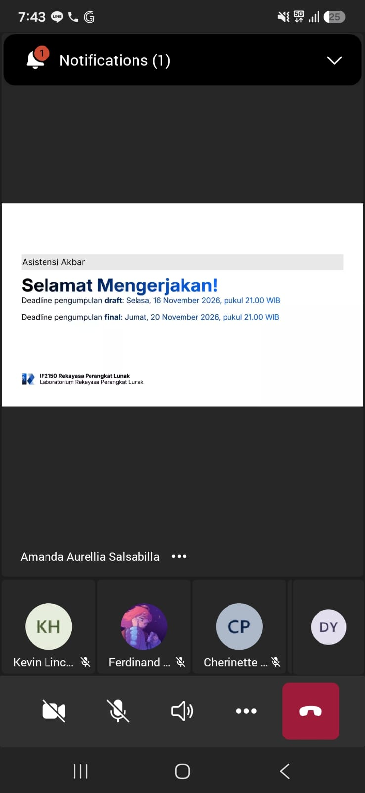

# Form Asistensi

## Tugas Besar IF2150 - Rekayasa Perangkat Lunak

| Informasi | Keterangan |
| --- | --- |
| **Hari** | Senin |
| **Tanggal** | 16/11/2026 |
| **Kelas** | 02 |
| **Nomor Kelompok** | 04 |
| **Nama Kelompok** | 0sks |
| **Nama Perangkat Lunak** | Ngaksara |
| **Dokumen** | HIUPL |

### Anggota Kelompok

| NIM | Nama |
| --- | --- |
| 13525026 | Ryuza Nadif Aldebaran |
| 13525029 | Muhammad Naufal Hilmi |
| 13525077 | Muhammad Abduh |
| 13525107 | Nathaniel Marvelo |
| 13525113 | Diandra Aria Yufana |
| 13525143 | Natan Danuarta Ariel Wicaksana |

### Catatan

| Catatan |
| --- |
| 1. Uji semua skenario use case (normal & alternatif) dan ukur tiap KNF pakai tools dengan target angka jelas, lalu lampirkan bukti screenshot atau log yang terbaca untuk setiap TC.  |
| 2. Petakan semua KF/KNF sampai ke TC di Bab 5 (KF dianggap lulus kalau semua TC-nya Pass)  |
| 3. deadline draft 16 Nov 2026 dan final 20 Nov 2026 jam 21.00 WIB  |

**Notes for this section:**  
*Catatan dapat dituliskan dalam bentuk paragraf atau poin-poin, disesuaikan saja.* 

## Dokumentasi

<!--  -->

  

  <i>Gambar 1. Dokumentasi kegiatan asistensi.</i>

