<h1>
IF2150 REKAYASA PERANGKAT LUNAK
 
TUGAS 5
 
DESKRIPSI PERANCANGAN PERANGKAT LUNAK (DPPL)
</h1>
 

## Ngaksara
### *[Logo Perangkat Lunak]*

### Untuk: Amanda Aurellia Salsabilla

Dipersiapkan oleh:
| Informasi | Keterangan |
| --- | --- |
| Kelas | K2 |
| Kelompok | 4 |

| NIM      | Nama                           |
| -------- | ------------------------------ |
| 13525026 | Ryuza Nadif Aldebaran          |
| 13525029 | Muhammad Naufal Hilmi          |
| 13525077 | Muhammad Abduh                 |
| 13525107 | Nathaniel Marvelo              |
| 13525113 | Diandra Aria Yufana            |
| 13525143 | Natan Danuarta Ariel Wicaksana |

---

## Daftar Perubahan

| Revisi | Deskripsi |
| :--- | :--- |
| *A* | *Deskripsikan perubahan yang dilakukan dari dokumen sebelumnya pada dokumen ini. Jika tidak terdapat perubahan, harap kosongkan tabel.* |
| *B* |  |
| *C* |  |
| ... |  |

---

 

> **Petunjuk pengerjaan:** *[Silahkan hapus bagian ini setelah selesai mengerjakan]*
>
> Dokumen ini melanjutkan **Spesifikasi Kebutuhan Perangkat Lunak (SKPL)** dan **Arsitektur Perangkat Lunak (APL)**. Gunakan nama, ID, kebutuhan, dan use case yang konsisten dengan kedua dokumen tersebut. Contoh pola ID baru di bawah dapat disesuaikan dengan kesepakatan kelompok, ID yang sudah ada tetap dipertahankan.

 

---

# BAB 1: Pendahuluan

## 1.1 Tujuan Penulisan Dokumen
Tuliskan dengan ringkas tujuan dokumen DPPL ini dibuat dan siapa saja yang akan menggunakan dokumen ini.

## 1.2 Lingkup Masalah
Ngaksara adalah perangkat lunak berbasis web untuk membantu pengguna mengenal kembali aksara Jawa dan aksara Sunda. Pelajar dapat mempelajari materi, mengerjakan latihan menggambar, mencocokkan bunyi, merangkai aksara, dan transliterasi, serta meninjau progres dan motivasi belajar. Pengajar dapat membuat kelas, menerbitkan tugas, dan memantau progres anggota kelas. Tim Materi mengelola materi pembelajaran. Pelajar dan Pengajar juga dapat menyampaikan feedback kepada sistem.

## 1.3 Definisi, Istilah, dan Singkatan
Semua definisi dan singkatan yang digunakan dalam dokumen ini beserta penjelasannya.

Tabel 1.3. Definisi Istilah dan Singkatan

| Singkatan, Akronim, atau Istilah | Penjelasan |
| :--- | :--- |
| *P/L* | *Singkatan dari Perangkat Lunak, yaitu aplikasi yang memberikan perintah kepada komputer untuk menjalankan tugas tertentu.* |
| *DPPL* | *Singkatan dari Spesifikasi Kebutuhan Perangkat Lunak, yaitu dokumen yang merangkum kriteria-kriteria yang diperlukan untuk membangun aplikasi menjalankan tugasnya.* |
| *UC* | *Singkatan dari Use Case.* |
| *...* | *...* |

## 1.4 Aturan Penomoran
Tabel 1.4. Aturan Penomoran

| Hal/Bagian | Penomoran | Keterangan |
| :--- | :--- | :--- |
| Kebutuhan (hasil *Requirement Gathering*) | RXX | Contoh: R01. |
| Kebutuhan Fungsional | KFXX | Contoh: KF01. Nomor dua digit berurutan mulai dari 01. |
| Kebutuhan Non-Fungsional | KNFXX | Contoh: KNF01. Nomor dua digit berurutan mulai dari 01. |
| Aktor | Nama aktor | Dirujuk dengan nama (Pelajar, Pengajar, Tim Materi), sama seperti dokumen sebelumnya. |
| Use Case | UC-XX | Contoh: UC-01. Menggunakan tanda hubung, sama seperti SKPL. |
| Skenario | Skenario Normal, Skenario Alternatif N | Nomor alternatif mengikuti urutan pada subbab 4.4 dokumen SKPL. |
| Kelas | CXX | Contoh: C01. C01 sampai C26 sama dengan kelas analisis pada SKPL. Kelas baru pada perancangan diberi nomor lanjutan, yaitu C27 sampai C30. |
| Operasi | + atau - di depan nama | Tanda `+` berarti publik dan tanda `-` berarti privat, yaitu hanya dipanggil oleh kelas itu sendiri. |
| Tabel | Tabel X.Y | X adalah nomor bab dan Y adalah nomor urut tabel dalam bab tersebut. |
| Gambar | Gambar N | Nomor urut gambar di seluruh dokumen. |

## 1.5 Referensi
Cantumkan dokumentasi P/L yang dirujuk oleh dokumen ini, **minimal dokumen SKPL dan APL**. Tambahkan buku, panduan, atau dokumentasi lain apabila digunakan.

## 1.6 Deskripsi Umum Dokumen (Ikhtisar)
Tuliskan sistematika pembahasan dokumen ini secara ringkas dan runut, dengan maksimal 1 paragraf.

 

---

# BAB 2: Perancangan Arsitektur

## 2.1 Rancangan Lingkungan Implementasi

Lingkungan implementasi pada Tabel 2.1 kami turunkan dari lingkungan operasi yang sudah ditetapkan pada dokumen APL. Bedanya, tabel ini tidak hanya menyebut tempat web Ngaksara akan berjalan, tetapi juga perangkat, bahasa, dan pustaka yang kami gunakan untuk membangunnya.

Tabel 2.1. Rancangan Lingkungan Implementasi

| Aspek | Rancangan |
| :--- | :--- |
| *Operating system* | Windows 11 64-bit dan Linux untuk pengembangan dan demonstrasi. Rencana jika dipublikasikan: Ubuntu Server 24.04 LTS dengan Nginx dan PHP-FPM 8.4. |
| DBMS | MySQL 8.4 dengan `utf8mb4`. Model mengakses basis data melalui Eloquent ORM bawaan Laravel. |
| Bahasa pemrograman | PHP 8.4 pada sisi server, JavaScript pada sisi browser (Canvas API dan Pointer Events), HTML dan CSS, serta SQL. |
| *Framework* dan pustaka | Laravel 13 untuk Model, Controller, dan routing. Blade dan Bootstrap 5.3 untuk View. |
| *Filing system* | Laravel Filesystem pada disk lokal server untuk materi, audio, gambar, dan template aksara. Dikelola oleh komponen `PenyimpananBerkas`. |
| Pencatatan log | Fasilitas log Laravel yang menulis log aktivitas dan error ke berkas log di server. Dikelola oleh komponen `LogAplikasi`. |
| *Development tools* | Composer untuk pustaka PHP, Git dan GitHub untuk pengelolaan kode, draw.io atau StarUML serta Mermaid untuk diagram, dan editor kode sesuai pilihan anggota kelompok. |
| *Client* | Chrome, Edge, atau Firefox versi stabil dengan JavaScript aktif. |

## 2.2 Style/Pattern Arsitektur Acuan

Ngaksara dibangun dengan arsitektur *client-server* yang dipadukan dengan pola *Model-View-Controller* (MVC). Pengguna mengakses Ngaksara sebagai web melalui browser, sementara pengolahan data berlangsung di server yang menjalankan satu proyek web berbasis Laravel. Di dalam proyek tersebut, pekerjaan dibagi ke tiga bagian. Model mengurus data dan aturan bisnis, misalnya akun, materi, hasil latihan, dan kelas. View adalah halaman yang dilihat Pelajar, Pengajar, dan Tim Materi. Controller berada di antara keduanya: komponen ini menerima permintaan pengguna, mengambil data yang diperlukan dari Model, lalu menyerahkan hasilnya ke View. Di luar ketiga lapisan tersebut, data Ngaksara tersimpan di `Database` (MySQL 8.4), berkas materi dan audio di `PenyimpananBerkas`, sedangkan log aktivitas dan error dicatat oleh `LogAplikasi`.

Pertimbangan utama kami memilih *client-server* adalah keterkaitan data antarperan. Hasil latihan seorang Pelajar tidak hanya ditampilkan kepada dirinya di halaman progres, tetapi juga perlu dapat dipantau oleh Pengajar kelasnya. Kebutuhan seperti ini lebih mudah dipenuhi jika data disimpan dan dikendalikan di satu tempat, termasuk pembatasan akses pada KF02 dan pencatatan riwayat pada KF14. MVC kami pilih karena alasan yang lebih praktis. Setiap lapisan memiliki tugas yang jelas sehingga pekerjaan mudah dibagi di antara anggota kelompok. Tampilan halaman latihan, misalnya, dapat diubah tanpa menyentuh cara riwayat belajar disimpan.

Ada satu bagian yang sengaja tidak menunggu server, yaitu goresan saat Pelajar menggambar aksara. Goresan langsung digambar oleh Canvas di browser agar tidak terasa tertunda, sesuai batas 50 milidetik pada KNF04. Server baru terlibat ketika jawaban dikirim, yaitu untuk menilai hasil akhir, menyimpannya ke riwayat, dan memperbarui streak serta poin. Hal yang menyangkut keamanan dan pemeliharaan, seperti pemeriksaan hak akses, *hashing* kata sandi (KF05 dan KNF02), serta pencatatan log (KF17 dan KNF01), juga tetap ditangani server.

<i>Gambar 1. Penerapan Arsitektur Client-Server dan MVC pada Ngaksara</i>

Pada Gambar 1, komponen dikelompokkan ke sisi *Client* dan sisi *Server*. View memang dirender oleh Blade di server, tetapi hasilnya dikirim ke browser sebagai *HTTP response*, sehingga pada diagram View ditempatkan di sisi *Client*. Setiap kali pengguna menekan tombol atau mengirim form, browser mengirim *HTTP request* ke Controller yang bersangkutan. Controller lalu meminta Model membaca atau mengubah data dan mencatat aktivitasnya ke `LogAplikasi`. Model sendiri yang berhubungan dengan `Database` dan `PenyimpananBerkas`. Arah hubungan ini tidak pernah dibalik: View tidak langsung mengakses Model, dan Model tidak memanggil Controller.

## 2.3 Identifikasi Komponen / Modul / Subsistem

Identifikasi komponen, modul, atau subsistem penyusun aplikasi berdasarkan *pattern* yang telah ditetapkan. Jelaskan tanggung jawab masing-masing komponen. Pengelompokan dapat mengikuti lapisan arsitektur atau fungsi/peran komponen dalam sistem.

Ambil dari **Tabel 2.1 dokumen APL**, lalu kelompokkan berdasarkan lapisan (Model/View/Controller). Kolom **Jenis** diisi sesuai pattern, misalnya View, Controller, Model, Service, Repository. Satu komponen merepresentasikan saatu tanggung jawab utama yang jelas,

Tabel 2.3. Identifikasi Komponen/Modul/Subsistem

| Nama Komponen/Modul/Subsistem | Jenis | Penjelasan |
| :--- | :--- | :--- |
| *[Nama komponen/modul/subsistem]* | *[Jenis]* | *[Tanggung jawab komponen]* |
| *[Nama komponen/modul/subsistem]* | *[Jenis]* | *[Tanggung jawab komponen]* |
| *...* | *...* | *...* |

## 2.4 Model Arsitektur Perangkat Lunak

Buat model arsitektur dalam bentuk satu atau lebih *view* yang memperlihatkan interaksi dan kolaborasi komponen, modul, serta subsistem dalam menjalankan fungsi sistem. Pilih notasi yang sesuai. Contoh *view*: *Logical View*, *Process View*, *Development View*, dan *Physical View*.

Gunakan hasil **BAB 3 Model Arsitektur Perangkat Lunak pada dokumen APL**. 

### 2.4.1 View [Nama View]

Tuliskan secara singkat model arsitektur yang dipilih dan alasan model tersebut cocok untuk aplikasi.

<i>Gambar 2. Contoh Logical View pada P/L E-Commerce</i>

### 2.4.X View [Nama View]
*[Lakukan hal yang sama dengan bagian sebelumnya]*

 

---

# BAB 3: Realisasi Use Case

## 3.1 Use Case Melakukan Pendaftaran Akun
 
**ID Use Case:** UC-01
**Nama Use Case:** Melakukan Pendaftaran Akun
 
### 3.1.1 Identifikasi Kelas
 
Tabel 3.1.1 Identifikasi Kelas Use Case UC-01
 
| No | Nama Kelas Perancangan | Nama Kelas Analisis Terkait |
| :--- | :--- | :--- |
| 1 | C05 - HalamanPendaftaran | C05 - HalamanPendaftaran |
| 2 | C06 - HalamanLogin | C06 - HalamanLogin |
| 3 | C15 - OtentikasiController | C15 - OtentikasiController |
| 4 | C01 - AkunPengguna | C01 - AkunPengguna |
 
### 3.1.2 Sequence Diagram
 
**Skenario Normal**
 

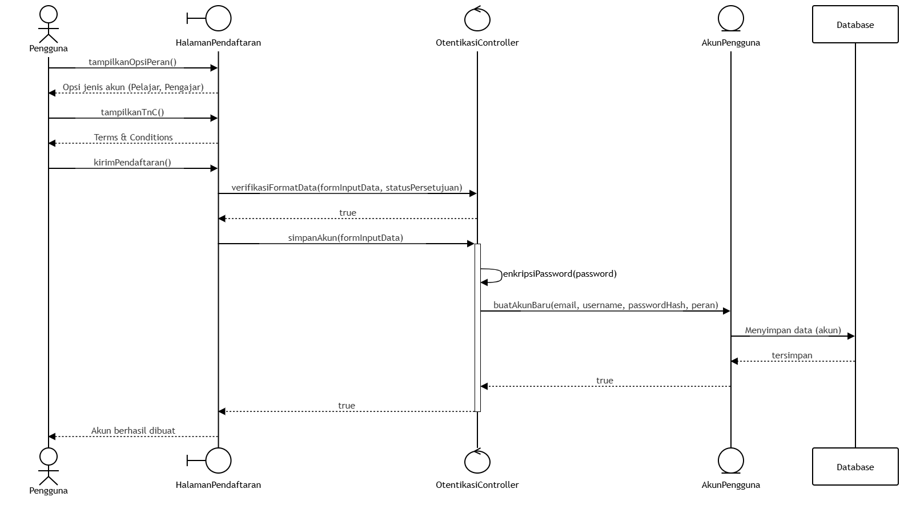

<i>Diagram sekuens UC-01 - Skenario Normal</i>

**Skenario Alternatif 1: Validasi Pendaftaran Gagal**
 

<i>Diagram sekuens UC-01 - Alternatif 1: Validasi Pendaftaran Gagal</i>

### 3.1.3 Diagram Kelas
 

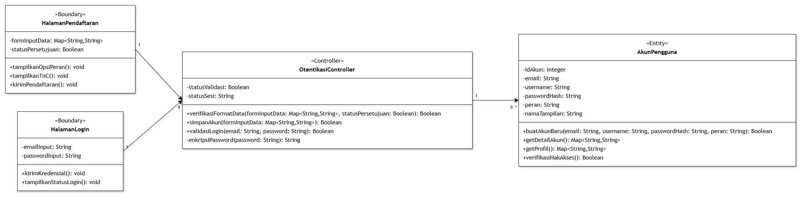

<i>Gambar X. Diagram Kelas Melakukan Pendaftaran Akun</i>

## 3.3 Use Case Mengerjakan Latihan Aksara
 
**ID Use Case:** UC-03  
**Nama Use Case:** Mengerjakan Latihan Aksara
 
### 3.3.1 Identifikasi Kelas
 
Realisasi UC-03 melibatkan delapan kelas. Seluruhnya berasal dari kelas analisis pada SKPL, sehingga tidak ada kelas baru yang kami tambahkan untuk use case ini.
 
Tabel 3.3. Identifikasi Kelas Use Case UC-03
 
| No | Nama Kelas Perancangan | Nama Kelas Analisis Terkait |
| :--- | :--- | :--- |
| 1 | `HalamanLatihan` | C08 - `HalamanLatihan` |
| 2 | `LatihanController` | C16 - `LatihanController` |
| 3 | `MateriController` | C17 - `MateriController` |
| 4 | `AkunPengguna` | C01 - `AkunPengguna` |
| 5 | `MateriAksara` | C02 - `MateriAksara` |
| 6 | `KontenMateri` | C21 - `KontenMateri` |
| 7 | `RiwayatLatihan` | C03 - `RiwayatLatihan` |
| 8 | `MotivasiBelajar` | C22 - `MotivasiBelajar` |
 
Perubahan dari tahap analisis terletak pada atribut dan operasinya. Beberapa operasi kami tambahkan karena dibutuhkan oleh alur pada sequence diagram, di antaranya `cekPernahSelesai()` pada `RiwayatLatihan` untuk mencegah pemberian poin ulang, `ambilTemplateAksara()` pada `KontenMateri` untuk menampilkan outline, serta beberapa operasi penilaian privat pada `LatihanController`.
 
### 3.3.2 Sequence Diagram
 
Seluruh skenario UC-03 diawali dengan alur penyiapan soal yang sama. `LatihanController` terlebih dahulu memastikan bahwa pengguna yang masuk berperan sebagai Pelajar melalui `AkunPengguna` (KF02). Setelah itu, `LatihanController` meminta `MateriController` mengambil target latihan dari `MateriAksara` dan isi materi dari `KontenMateri`. Perbedaan antarskenario baru muncul pada jenis konten yang diambil, cara Pelajar menjawab, dan cara jawaban dinilai.
 
- **Skenario Normal**
Skenario normal kami realisasikan dengan mode menulis karena mode ini melibatkan seluruh kelas UC-03 dan menjadi dasar Skenario Alternatif 3. Selain konten materi, `MateriController` juga mengambil template aksara dari `KontenMateri` sehingga `HalamanLatihan` dapat menampilkan outline sesuai opsi yang dipilih Pelajar (KF10). Selama Pelajar menggores, `HalamanLatihan` merekam goresan langsung di browser melalui Canvas tanpa menghubungi server (KF11, KNF04). Setelah jawaban dikirim, `LatihanController` menghitung akurasi goresan terhadap template (KF12). Karena akurasinya memenuhi ambang, latihan berstatus lulus. Ketika Pelajar menyelesaikan latihan, `LatihanController` memeriksa apakah soal yang sama pernah diselesaikan, menyimpan hasil ke `RiwayatLatihan` (KF14), dan memperbarui streak pada `MotivasiBelajar`. Poin hanya ditambahkan jika soal tersebut belum pernah diselesaikan sebelumnya, sesuai fragmen `opt` pada diagram. Ringkasan streak, poin, dan badge kemudian ditampilkan kepada Pelajar.
 

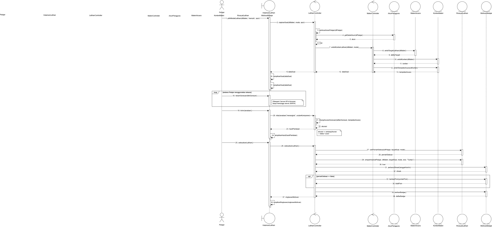

<i>Gambar X. Sequence Diagram UC-03 - Skenario Normal</i>

- **Skenario Alternatif 1: Latihan Mencocokkan Bunyi**
Pada mode ini, `MateriController` juga mengambil audio pengucapan dari `KontenMateri`. `HalamanLatihan` kemudian memutar audio tersebut dan menampilkan beberapa pilihan aksara. Pilihan Pelajar langsung dikirim ke `LatihanController` dan dinilai melalui operasi privat `cocokkanBunyi()` (KF21). Hasilnya ditampilkan sebagai status benar atau salah beserta penjelasan. Penyimpanan hasil dan pembaruan motivasi mengikuti aturan yang sama dengan skenario normal.
 

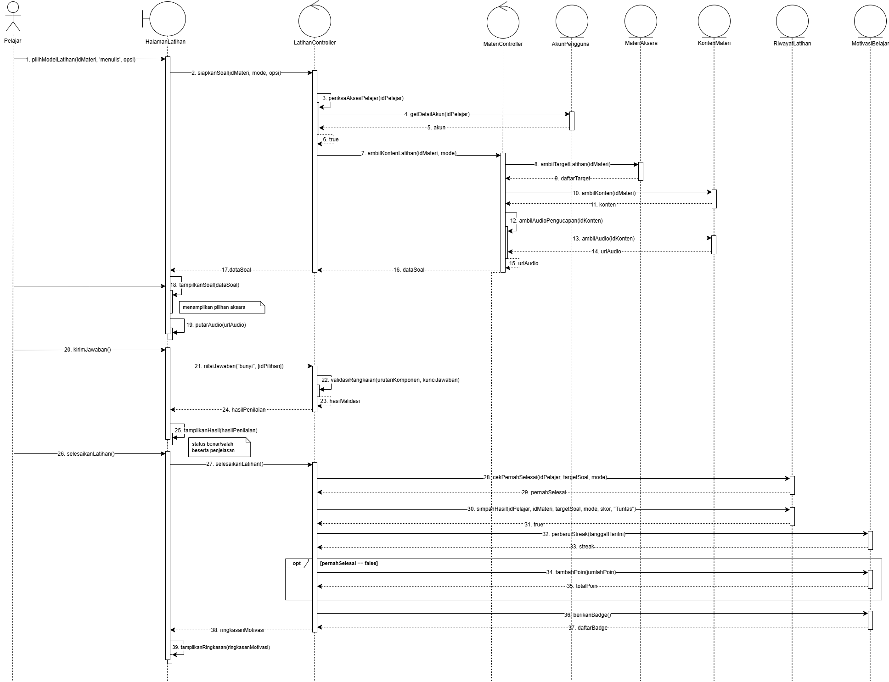

<i>Gambar X. Sequence Diagram UC-03 - Latihan Mencocokkan Bunyi</i>

- **Skenario Alternatif 2: Latihan Merangkai Aksara**
`HalamanLatihan` menampilkan komponen aksara dan tanda baca yang dapat disusun. Pelajar menyusun komponen tersebut menjadi suku kata atau kata, lalu mengirimkannya. `LatihanController` memvalidasi urutan susunan terhadap kunci jawaban melalui `validasiRangkaian()` berdasarkan aturan penulisan aksara (KF22). Setelah hasil ditampilkan, alur penyelesaian latihan sama dengan skenario normal.
 

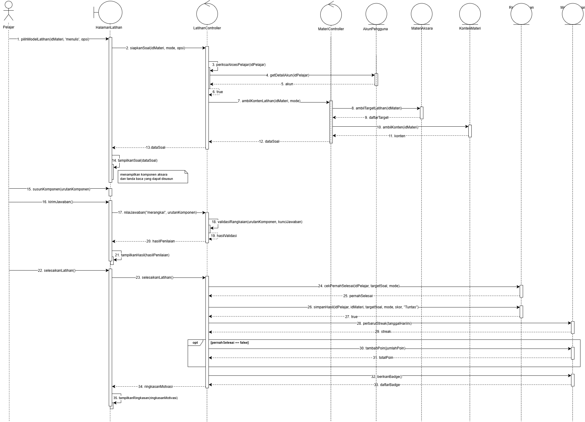

<i>Gambar X. Sequence Diagram UC-03 - Latihan Merangkai Aksara</i>

- **Skenario Alternatif 3: Gambar Aksara Kurang Akurat (Mode Menulis)**
Alur hingga penilaian sama dengan skenario normal. Perbedaannya, akurasi goresan berada di bawah ambang sehingga latihan berstatus belum tuntas. Percobaan ini tetap kami simpan ke `RiwayatLatihan` agar riwayat aktivitas Pelajar lengkap (KF14) dan pola kesalahannya dapat dipantau Pengajar. Namun, `LatihanController` tidak memanggil `MotivasiBelajar` sama sekali, sehingga streak dan poin tidak bertambah. Ketika Pelajar memilih mengulang, `HalamanLatihan` membersihkan kanvas dan menampilkan kembali outline aksara yang sama tanpa meminta soal baru ke server.
 

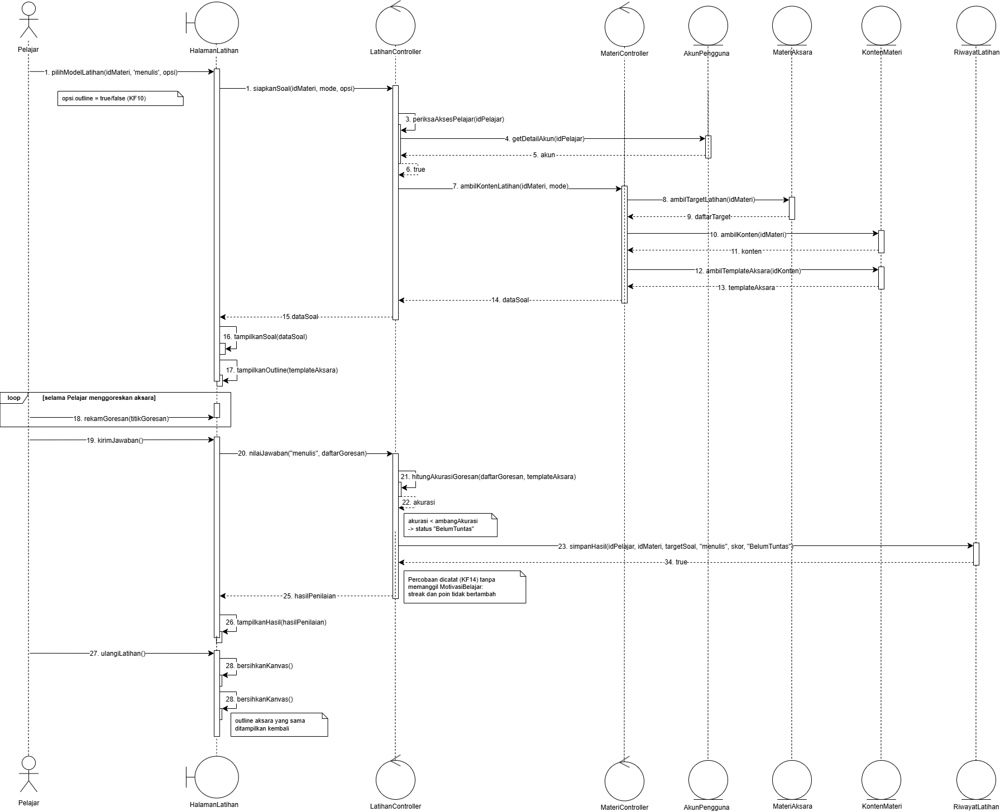

<i>Gambar X. Sequence Diagram UC-03 - Gambar Aksara Kurang Akurat</i>

### 3.3.3 Diagram Kelas
 
Diagram kelas UC-03 terdiri atas satu kelas boundary, dua kelas control, dan lima kelas entity. Setiap kelas hanya memuat atribut dan operasi yang digunakan dalam realisasi use case ini.
 

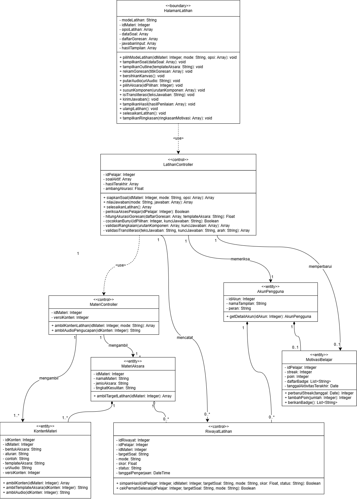

<i>Gambar X. Diagram Kelas Use Case UC-03</i>

`HalamanLatihan` bergantung pada `LatihanController` untuk semua proses yang memerlukan server, seperti menyiapkan soal, menilai jawaban, dan menyelesaikan latihan. Operasi tampilan dan perekaman goresan tetap berada di `HalamanLatihan` karena dijalankan di browser. `LatihanController` bergantung pada `MateriController` untuk memperoleh konten latihan, serta berasosiasi dengan `AkunPengguna`, `RiwayatLatihan`, dan `MotivasiBelajar`. `MateriController` berasosiasi dengan `MateriAksara` dan `KontenMateri`.
 
Relasi antarkelas entity mengikuti model arsitektur pada dokumen APL. `KontenMateri` merupakan komposisi dari `MateriAksara` karena isi materi tidak dapat berdiri tanpa metadatanya. `RiwayatLatihan` dan `MotivasiBelajar` merupakan komposisi dari `AkunPengguna` karena keduanya selalu dimiliki oleh satu akun Pelajar. Hubungan `RiwayatLatihan` dengan `MateriAksara` berupa agregasi karena satu materi dapat dirujuk oleh banyak riwayat, tetapi keduanya tetap dapat berdiri sendiri.
 
Ada beberapa keputusan perancangan yang perlu dicatat:
 
1. Penilaian jawaban ditangani oleh operasi privat pada `LatihanController`, yaitu `hitungAkurasiGoresan()`, `cocokkanBunyi()`, `validasiRangkaian()`, dan `validasiTransliterasi()`. Dengan cara ini, use case ini tidak memerlukan kelas baru.
2. Batas akurasi disimpan sebagai atribut `ambangAkurasi` pada `LatihanController`. Nilainya menjadi dasar pembeda antara skenario normal dan Skenario Alternatif 3.
3. Aturan poin ulang dijaga oleh `RiwayatLatihan.cekPernahSelesai()`, yang dipanggil sebelum `MotivasiBelajar.tambahPoin()`. Aturan ini sejalan dengan batasan SKPL bahwa pengulangan soal yang sama tidak memberikan poin baru.
4. Opsi outline (KF10) dan arah transliterasi dikirim melalui satu parameter `opsi` pada `pilihModeLatihan()` dan `siapkanSoal()`, sehingga signature kedua operasi tersebut sama untuk semua mode latihan.
   

## 3.4 Use Case UC-04: Meninjau Progres dan Motivasi

**ID Use Case:** UC-04  
**Nama Use Case:** Meninjau Progres dan Motivasi

### 3.4.1 Identifikasi Kelas

Tabel 3.4. Identifikasi Kelas Use Case UC-04

| No | Nama Kelas Perancangan | Nama Kelas Analisis Terkait |
| :--- | :--- | :--- |
| 1 | `HalamanMateri` (C13) | HalamanMateri (C13) |
| 2 | `HalamanProgres` (C14) | HalamanProgres (C14) |
| 3 | `ProgresController` (C19) | ProgresController (C19) |
| 4 | `AkunPengguna` (C01) | AkunPengguna (C01) |
| 5 | `KeanggotaanKelas` (C24) | KeanggotaanKelas (C24) |
| 6 | `KelasBelajar` (C23) | KelasBelajar (C23) |
| 7 | `MateriAksara` (C02) | MateriAksara (C02) |
| 8 | `MotivasiBelajar` (C22) | MotivasiBelajar (C22) |
| 9 | `RiwayatLatihan` (C03) | RiwayatLatihan (C03) |

### 3.4.2 Sequence Diagram

- **Skenario Normal**

<i>Gambar 15. Sequence Diagram UC-04 - Skenario Normal</i>

- **Skenario Alternatif 1: Belum ada riwayat pembelajaran**

<i>Gambar 16. Sequence Diagram UC-04 - Skenario Alternatif 1: Belum ada riwayat pembelajaran</i>

- **Skenario Alternatif 2: Melihat papan peringkat kelas**

<i>Gambar 17. Sequence Diagram UC-04 - Skenario Alternatif 2: Melihat papan peringkat kelas</i>

### 3.4.3 Diagram Kelas

`ProgresController` mengolah data dari `RiwayatLatihan`, `MateriAksara`, dan `MotivasiBelajar`. Untuk papan peringkat, `ProgresController` memeriksa pengaturan kelas pada `KelasBelajar` dan mengambil anggota aktif dari `KeanggotaanKelas`.

<i>Gambar 18. Diagram Kelas Meninjau Progres dan Motivasi (UC-04)</i>

## 3.5 Use Case Mengikuti Pembelajaran Kelas

**ID Use Case:** *UC05*  
**Nama Use Case:** *Mengikuti Pembelajaran Kelas*

### 3.5.1 Identifikasi Kelas

Tabel 3.5.1 Identifikasi Kelas Use Case UC05

| No | Nama Kelas Perancangan | Nama Kelas Analisis Terkait |
| :--- | :--- | :--- |
| 1 | C11 — HalamanKelasPelajar | C11 — HalamanKelasPelajar |
| 2 | C20 — KelasController | C20 — KelasController |
| 3 | C01 — AkunPengguna | C01 — AkunPengguna |
| 4 | C23 — KelasBelajar | C23 — KelasBelajar |
| 5 | C24 — KeanggotaanKelas | C24 — KeanggotaanKelas |
| 6 | C25 — TugasKelas | C25 — TugasKelas |
| 7 | C03 — RiwayatLatihan | C03 — RiwayatLatihan |
| 8 | C26 — PenyelesaianTugas | C26 — PenyelesaianTugas |

### 3.5.2 Sequence Diagram

**Skenario Normal**

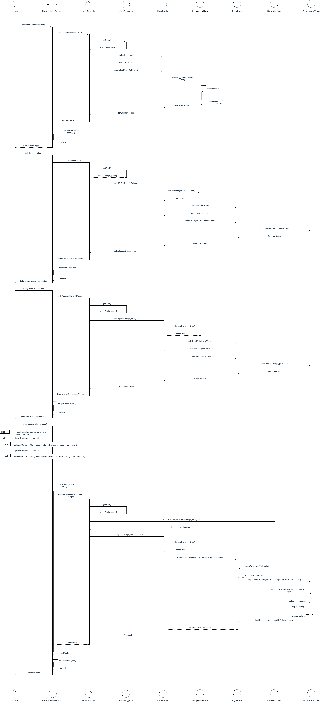

<i>Diagram sekuens UC-05 — Skenario Normal</i>

**Skenario Alternatif 1: Pelajar Sudah Menjadi Anggota Kelas**

<i>Diagram sekuens UC-05 — Alternatif 1: Pelajar Sudah Menjadi Anggota Kelas</i>

**Skenario Alternatif 2: Tugas Diselesaikan Terlambat**

<i>Diagram sekuens UC-05 — Alternatif 2: Tugas Diselesaikan Terlambat</i>

**Skenario Alternatif 3: Kode Kelas Tidak Valid**

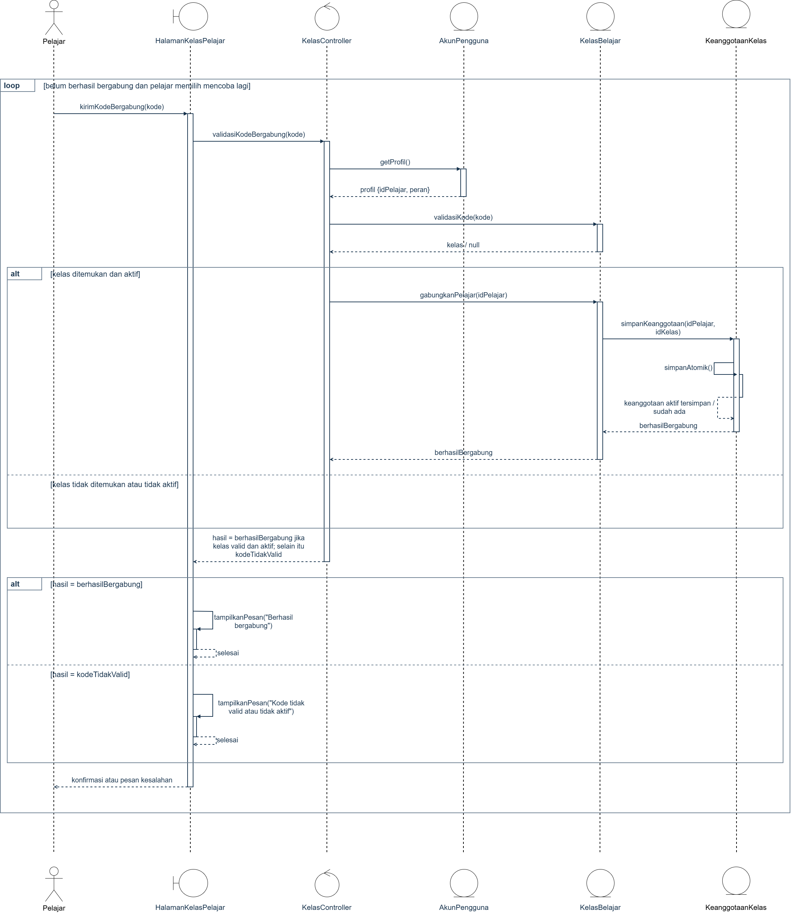

<i>Diagram sekuens UC-05 — Alternatif 3: Kode Kelas Tidak Valid</i>

**Eksepsi: Penyimpanan Hasil Gagal**

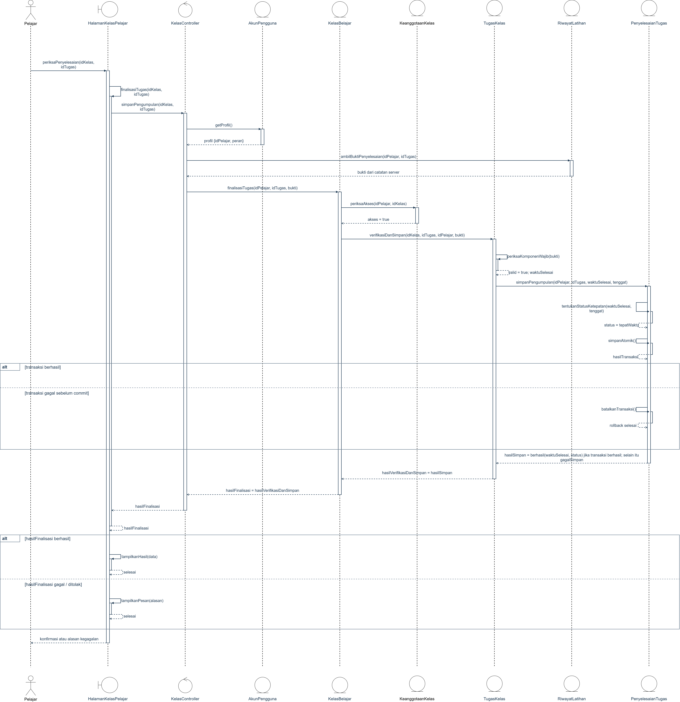

<i>Diagram sekuens UC-05 — Eksepsi Penyimpanan Hasil Gagal</i>

**Eksepsi: Akses atau Bukti Penyelesaian Tidak Memenuhi Syarat**

<i>Diagram sekuens UC-05 — Eksepsi Akses dan Bukti Penyelesaian</i>

`ref UC-02/UC-03` merujuk realisasi pengerjaan materi/latihan. Finalisasi menggunakan bukti penyelesaian di server; kriteria selesai materi masih perlu ditetapkan pada UC-02.

### 3.5.3 Diagram Kelas

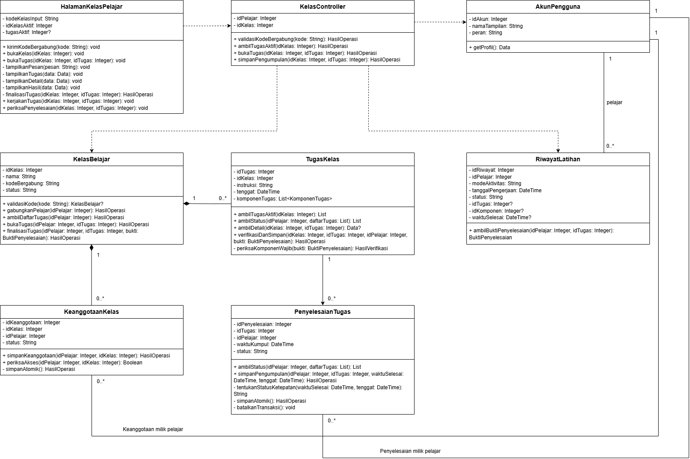

<i>Gambar X. Diagram Kelas Mengikuti Pembelajaran Kelas </i>

 

## 3.9 Use Case Menyampaikan Feedback
 
**ID Use Case:** UC-09
**Nama Use Case:** Menyampaikan Feedback
 
### 3.9.1 Identifikasi Kelas
 
Tabel 3.9.1 Identifikasi Kelas Use Case UC-09
 
| No | Nama Kelas Perancangan | Nama Kelas Analisis Terkait |
| :--- | :--- | :--- |
| 1 | C10 - HalamanFeedback | C10 - HalamanFeedback |
| 2 | C18 - FeedbackController | C18 - FeedbackController |
| 3 | C04 - DataFeedback | C04 - DataFeedback |
| 4 | C01 - AkunPengguna | C01 - AkunPengguna |
 
### 3.9.2 Sequence Diagram

**Skenario Normal**
 

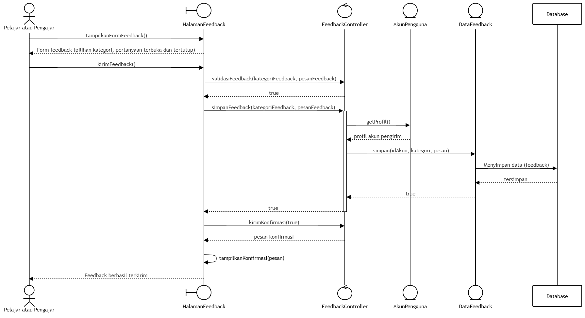

<i>Diagram sekuens UC-09 — Skenario Normal</i>

**Skenario Alternatif 1: Feedback Gagal Terkirim**
 

<i>Diagram sekuens UC-09 — Alternatif 1: Feedback Gagal Terkirim</i>

### 3.9.3 Diagram Kelas
 

<i>Gambar X. Diagram Kelas Menyampaikan Feedback</i>

---

# BAB 4: Diagram Kelas Keseluruhan

## 4.1 Diagram Kelas

**Bagian ini diisi dengan diagram kelas keseluruhan.**

<i>Gambar 4.1. Diagram Kelas Perancangan Keseluruhan [Nama P/L]</i>

Tabel 4.1. Daftar Kelas Perancangan Keseluruhan

| ID Kelas | Nama Kelas | Atribut | Metode/Operasi |
| :--- | :--- | :--- | :--- |
| *[C01]* | *[Nama kelas]* | *[Daftar atribut]* | *[Daftar metode/operasi]* |
| *[C02]* | *[Nama kelas]* | *[Daftar atribut]* | *[Daftar metode/operasi]* |
| *[C03]* | *[Nama kelas]* | *[Daftar atribut]* | *[Daftar metode/operasi]* |
| *...* | *...* | *...* | *...* |

 

---

# BAB 5: Matriks Kerunutan

Petakan kelas perancangan dengan use case yang terkait. Gunakan **BAB 6 Traceability pada dokumen SKPL** sebagai acuan keterkaitan kelas analisis dan use case, lalu sesuaikan dengan realisasi use case dan kelas perancangan pada BAB 3–BAB 5 DPPL.

Tabel 7.1. Matriks Kerunutan Kelas terhadap Use Case

| Kelas | Use Case Terkait |
| :--- | :--- |
| *[ID kelas - Nama kelas]* | *[ID UC - Nama use case]* |
| *[ID kelas - Nama kelas]* | *[ID UC - Nama use case]* |
| *...* | *...* |
