<h1>
IF2150 REKAYASA PERANGKAT LUNAK
<br>
TUGAS 5
<br>
DESKRIPSI PERANCANGAN PERANGKAT LUNAK (DPPL)
</h1>
<br>

## Ngaksara
<p align="center">
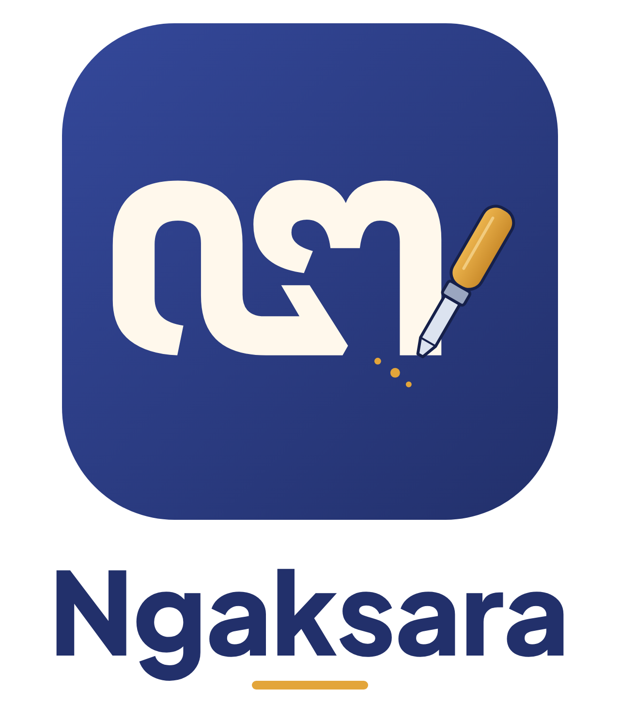
</p>

### Untuk: Amanda Aurellia Salsabilla

Dipersiapkan oleh:
| Informasi | Keterangan |
| --- | --- |
| Kelas | K2 |
| Kelompok | 4 |

| NIM      | Nama                           |
| -------- | ------------------------------ |
| 13525026 | Ryuza Nadif Aldebaran          |
| 13525029 | Muhammad Naufal Hilmi          |
| 13525077 | Muhammad Abduh                 |
| 13525107 | Nathaniel Marvelo              |
| 13525113 | Diandra Aria Yufana            |
| 13525143 | Natan Danuarta Ariel Wicaksana |

---

## Daftar Perubahan

| Revisi | Deskripsi |
| :--- | :--- |
| *A* | *Menambahkan 2 eksepsi baru di UC5 yang belum ada di SKPL* |
| *B* |  |
| *C* |  |
| ... |  |

<br>

---

# BAB 1: Pendahuluan

## 1.1 Tujuan Penulisan Dokumen
Dokumen Deskripsi Perancangan Perangkat Lunak (DPPL) ini menjelaskan rancangan perangkat lunak Ngaksara sebagai kelanjutan dari dokumen SKPL dan APL. Dokumen ini mencakup lingkungan implementasi, komponen dan modul dalam arsitektur, realisasi setiap use case melalui sequence diagram dan diagram kelas, diagram kelas keseluruhan, serta kerunutan antara kelas dan use case.

Pengguna dokumen ini meliputi:
1. Kelompok Pengembang (Kelompok 4 Kelas K2): sebagai acuan dalam mengimplementasikan kode dan menyusun pengujian, sehingga perangkat lunak dibangun sesuai rancangan.
2. Pemelihara sistem di masa depan: sebagai sarana memahami struktur kelas dan alur interaksi antarkomponen dalam perangkat lunak
3. Asisten penilai (Amanda Aurellia Salsabilla) selaku pemangku kepentingan: sebagai dokumen evaluasi dan validasi kesesuaian rancangan dengan SKPL dan APL.

## 1.2 Lingkup Masalah
Ngaksara adalah perangkat lunak berbasis web untuk membantu pengguna mengenal kembali aksara Jawa dan aksara Sunda. Pelajar dapat mempelajari materi, mengerjakan latihan menggambar, mencocokkan bunyi, merangkai aksara, dan transliterasi, serta meninjau progres dan motivasi belajar. Pengajar dapat membuat kelas, menerbitkan tugas, dan memantau progres anggota kelas. Tim Materi mengelola materi pembelajaran. Pelajar dan Pengajar juga dapat menyampaikan feedback kepada sistem.

## 1.3 Definisi, Istilah, dan Singkatan

Tabel 1.3. Definisi Istilah dan Singkatan

| Singkatan, Akronim, atau Istilah | Penjelasan |
| :--- | :--- |
| P/L | Perangkat Lunak, yaitu aplikasi yang memberikan perintah kepada komputer untuk menjalankan tugas tertentu. |
| SKPL | Spesifikasi Kebutuhan Perangkat Lunak, yaitu dokumen yang merangkum kebutuhan yang harus dipenuhi P/L. |
| APL | Arsitektur Perangkat Lunak, yaitu dokumen yang menetapkan pola arsitektur, komponen, dan model arsitektur P/L. |
| DPPL | Deskripsi Perancangan Perangkat Lunak, yaitu dokumen ini, yang menjelaskan rancangan P/L berdasarkan SKPL dan APL. |
| R | Kebutuhan hasil tahap *Requirement Gathering* yang menjadi sumber KF dan KNF. |
| KF | Kebutuhan Fungsional, yaitu perilaku sistem yang dapat diamati oleh pengguna. |
| KNF | Kebutuhan Non-Fungsional, yaitu batasan terhadap perilaku sistem atau cara sistem memberikannya, seperti waktu tanggap dan keamanan. |
| UC | Use Case, yaitu rangkaian interaksi antara aktor dan sistem untuk mencapai suatu tujuan. |
| Skenario | Urutan aksi aktor dan reaksi sistem pada suatu use case. Skenario normal adalah alur utama, sedangkan skenario alternatif adalah alur yang menyimpang dari alur utama. |
| Client-server | Arsitektur ketika pengguna mengakses P/L melalui browser (*client*), sedangkan pengolahan dan penyimpanan data dilakukan oleh server. |
| MVC | *Model-View-Controller*, yaitu pola arsitektur yang membagi aplikasi menjadi Model (data dan aturan aplikasi), View (tampilan), dan Controller (pengatur permintaan dan alur). |
| Logical View | Model arsitektur yang menunjukkan pembagian tanggung jawab dan hubungan antarkomponen. |
| Boundary, Controller, Entity | Tiga jenis kelas analisis, yaitu kelas antarmuka dengan aktor, kelas pengatur alur logika, dan kelas penyimpan data. |
| Kelas analisis | Kelas hasil tahap analisis pada SKPL (C01 sampai C26). |
| Kelas perancangan | Kelas pada tahap perancangan, ditulis lengkap dengan atribut, operasi, tipe data, dan visibilitas. |
| Sequence diagram | Diagram yang menggambarkan urutan pesan antarobjek pada satu skenario. |
| Diagram kelas | Diagram yang menggambarkan kelas beserta atribut, operasi, dan hubungan antarkelas. |
| Visibilitas | Tanda akses atribut atau operasi. Tanda `+` berarti publik, tanda `-` berarti privat. |
| Multiplisitas | Jumlah objek yang dapat terhubung dalam suatu relasi, misalnya `1` atau `0..*`. |
| Matriks kerunutan | Tabel yang memetakan kelas ke use case yang merealisasikannya. |
| Laravel | *Framework* PHP yang digunakan untuk membangun Model, Controller, dan *routing* Ngaksara. |
| Blade | Mesin templat Laravel yang digunakan untuk merender View. |
| Eloquent ORM | Fitur Laravel yang digunakan Model untuk mengakses basis data. |
| Canvas API | Antarmuka browser untuk menggambar di layar, digunakan pada latihan menggambar aksara. |
| Aksara | Sistem tulisan dengan bentuk karakter tersendiri. Pada dokumen ini merujuk pada aksara Jawa dan aksara Sunda. |
| Pelajar | Aktor yang menggunakan Ngaksara untuk mempelajari materi dan mengerjakan latihan aksara. |
| Pengajar | Aktor yang membuat kelas, memberikan tugas, dan memantau progres Pelajar. |
| Tim Materi | Aktor yang mengelola konten materi dan latihan. |
| Kelas belajar | Kelompok belajar milik seorang Pengajar yang beranggotakan sejumlah Pelajar. |
| Kode bergabung | Kode unik dan aktif yang digunakan Pelajar untuk bergabung ke kelas belajar. |
| Tenggat | Batas waktu penyelesaian tugas. Tugas yang diselesaikan setelah tenggat berstatus "terlambat". |
| Streak | Jumlah hari berturut-turut Pelajar menyelesaikan aktivitas belajar. |
| Poin | Nilai yang diperoleh Pelajar setelah menyelesaikan latihan atau tugas. |
| Badge | Penanda pencapaian yang diberikan kepada Pelajar ketika memenuhi syarat tertentu. |
| Papan peringkat | Urutan poin anggota dalam satu kelas belajar. |
| Transliterasi | Pengalihan tulisan dari aksara ke huruf Latin atau sebaliknya. |
| Feedback | Masukan dari Pelajar atau Pengajar mengenai performa, tampilan, fitur, atau materi aplikasi. |
| T&C | *Terms & Conditions*, yaitu syarat dan ketentuan yang harus disetujui pengguna saat membuat akun. |
| Hash | Hasil fungsi satu arah yang digunakan untuk menyimpan kata sandi tanpa menyimpan teks aslinya. |

## 1.4 Aturan Penomoran

 Hal/Bagian | Penomoran | Keterangan |
| :--- | :--- | :--- |
| Kebutuhan (hasil *Requirement Gathering*) | RXX | Contoh: R01. |
| Kebutuhan Fungsional | KFXX | Contoh: KF01. Nomor dua digit berurutan mulai dari 01. |
| Kebutuhan Non-Fungsional | KNFXX | Contoh: KNF01. Nomor dua digit berurutan mulai dari 01. |
| Aktor | Nama aktor | Dirujuk dengan nama (Pelajar, Pengajar, Tim Materi). |
| Use Case | UC-XX | Contoh: UC-01. Menggunakan tanda hubung. |
| Skenario | Skenario Normal, Skenario Alternatif N | Nomor alternatif mengikuti urutan pada subbab 4.4 dokumen SKPL. |
| Kelas | CXX | Contoh: C01. C01 sampai C26 sama dengan kelas analisis pada SKPL. |
| Operasi | + atau - di depan nama | Tanda `+` berarti publik dan tanda `-` berarti privat, yaitu hanya dipanggil oleh kelas itu sendiri. |
| Tabel | Tabel X.Y | X adalah nomor bab dan Y adalah nomor urut tabel dalam bab tersebut. |
| Gambar | Gambar N | Nomor urut gambar di seluruh dokumen. |

## 1.5 Referensi
1. Kelompok 4 K2, *Spesifikasi Kebutuhan Perangkat Lunak (SKPL) – Ngaksara*, Tugas 5 IF2150 Rekayasa Perangkat Lunak.
2. Kelompok 4 K2, *Arsitektur Perangkat Lunak (APL) – Ngaksara*, Tugas 6 IF2150 Rekayasa Perangkat Lunak.
3. Sommerville, I. (2016). *Software Engineering* (10th ed.). Pearson. Chapter 6: *Architectural Design*. https://software-engineering-book.com/slides/
4. Perangkat pembuat diagram: draw.io (https://www.drawio.com/), StarUML (https://staruml.io/), dan Mermaid (https://mermaid.js.org/).

## 1.6 Deskripsi Umum Dokumen (Ikhtisar)
Dokumen ini terdiri atas lima bab. Bab 1 menguraikan tujuan, lingkup masalah, istilah, aturan penomoran, dan referensi. Bab 2 memaparkan perancangan arsitektur, yaitu lingkungan implementasi, pola arsitektur acuan, identifikasi komponen, dan model arsitektur yang diturunkan dari APL. Bab 3 berisi realisasi use case UC-01 sampai UC-09 berupa identifikasi kelas, sequence diagram untuk setiap skenario, dan diagram kelas per use case. Bab 4 menyajikan diagram kelas perancangan keseluruhan beserta daftar atribut dan operasinya. Bab 5 memuat matriks kerunutan yang memetakan setiap kelas ke use case yang merealisasikannya.

<br>

---

# BAB 2: Perancangan Arsitektur

## 2.1 Rancangan Lingkungan Implementasi

Lingkungan implementasi pada Tabel 2.1 kami turunkan dari lingkungan operasi yang sudah ditetapkan pada dokumen APL. Bedanya, tabel ini tidak hanya menyebut tempat web Ngaksara akan berjalan, tetapi juga perangkat, bahasa, dan pustaka yang kami gunakan untuk membangunnya.

Tabel 2.1. Rancangan Lingkungan Implementasi

| Aspek | Rancangan |
| :--- | :--- |
| *Operating system* | Windows 11 64-bit dan Linux untuk pengembangan dan demonstrasi. Rencana jika dipublikasikan: Ubuntu Server 24.04 LTS dengan Nginx dan PHP-FPM 8.4. |
| DBMS | MySQL 8.4 dengan `utf8mb4`. Model mengakses basis data melalui Eloquent ORM bawaan Laravel. |
| Bahasa pemrograman | PHP 8.4 pada sisi server, JavaScript pada sisi browser (Canvas API dan Pointer Events), HTML dan CSS, serta SQL. |
| *Framework* dan pustaka | Laravel 13 untuk Model, Controller, dan routing. Blade dan Bootstrap 5.3 untuk View. |
| *Filing system* | Laravel Filesystem pada disk lokal server untuk materi, audio, gambar, dan template aksara. Dikelola oleh komponen `PenyimpananBerkas`. |
| Pencatatan log | Fasilitas log Laravel yang menulis log aktivitas dan error ke berkas log di server. Dikelola oleh komponen `LogAplikasi`. |
| *Development tools* | Composer untuk pustaka PHP, Git dan GitHub untuk pengelolaan kode, draw.io atau StarUML serta Mermaid untuk diagram, dan editor kode sesuai pilihan anggota kelompok. |
| *Client* | Chrome, Edge, atau Firefox versi stabil dengan JavaScript aktif. |

## 2.2 Style/Pattern Arsitektur Acuan

Ngaksara dibangun dengan arsitektur *client-server* yang dipadukan dengan pola *Model-View-Controller* (MVC). Pengguna mengakses Ngaksara sebagai web melalui browser, sementara pengolahan data berlangsung di server yang menjalankan satu proyek web berbasis Laravel. Di dalam proyek tersebut, pekerjaan dibagi ke tiga bagian. Model mengurus data dan aturan bisnis, misalnya akun, materi, hasil latihan, dan kelas. View adalah halaman yang dilihat Pelajar, Pengajar, dan Tim Materi. Controller berada di antara keduanya: komponen ini menerima permintaan pengguna, mengambil data yang diperlukan dari Model, lalu menyerahkan hasilnya ke View. Di luar ketiga lapisan tersebut, data Ngaksara tersimpan di `Database` (MySQL 8.4), berkas materi dan audio di `PenyimpananBerkas`, sedangkan log aktivitas dan error dicatat oleh `LogAplikasi`.

Pertimbangan utama kami memilih *client-server* adalah keterkaitan data antarperan. Hasil latihan seorang Pelajar tidak hanya ditampilkan kepada dirinya di halaman progres, tetapi juga perlu dapat dipantau oleh Pengajar kelasnya. Kebutuhan seperti ini lebih mudah dipenuhi jika data disimpan dan dikendalikan di satu tempat, termasuk pembatasan akses pada KF02 dan pencatatan riwayat pada KF14. MVC kami pilih karena alasan yang lebih praktis. Setiap lapisan memiliki tugas yang jelas sehingga pekerjaan mudah dibagi di antara anggota kelompok. Tampilan halaman latihan, misalnya, dapat diubah tanpa menyentuh cara riwayat belajar disimpan.

Ada satu bagian yang sengaja tidak menunggu server, yaitu goresan saat Pelajar menggambar aksara. Goresan langsung digambar oleh Canvas di browser agar tidak terasa tertunda, sesuai batas 50 milidetik pada KNF04. Server baru terlibat ketika jawaban dikirim, yaitu untuk menilai hasil akhir, menyimpannya ke riwayat, dan memperbarui streak serta poin. Hal yang menyangkut keamanan dan pemeliharaan, seperti pemeriksaan hak akses, *hashing* kata sandi (KF05 dan KNF02), serta pencatatan log (KF17 dan KNF01), juga tetap ditangani server.

<p align="center">
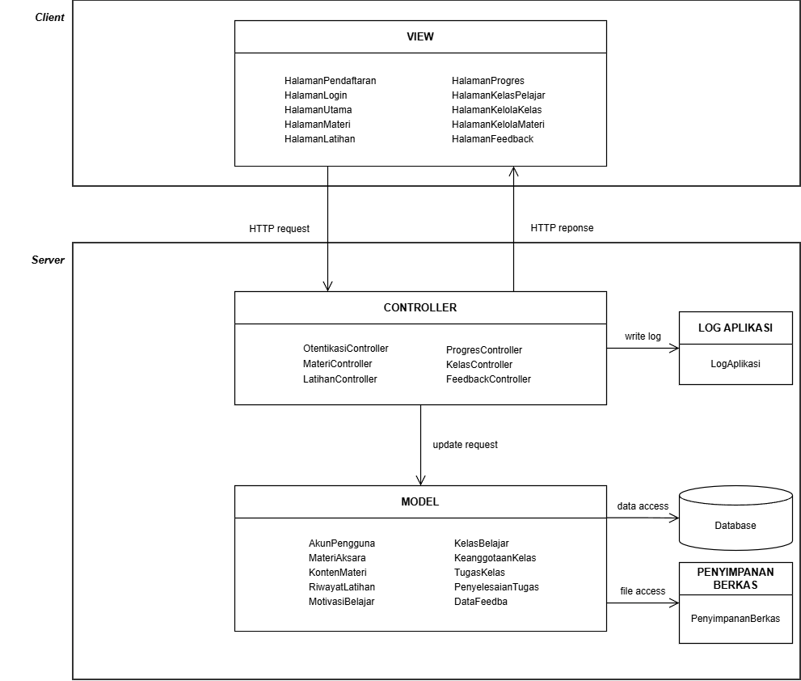
</p>
<p align="center">
<i>Gambar 1. Penerapan Arsitektur Client-Server dan MVC pada Ngaksara</i>
</p>

Pada Gambar 1, komponen dikelompokkan ke sisi *Client* dan sisi *Server*. View memang dirender oleh Blade di server, tetapi hasilnya dikirim ke browser sebagai *HTTP response*, sehingga pada diagram View ditempatkan di sisi *Client*. Setiap kali pengguna menekan tombol atau mengirim form, browser mengirim *HTTP request* ke Controller yang bersangkutan. Controller lalu meminta Model membaca atau mengubah data dan mencatat aktivitasnya ke `LogAplikasi`. Model sendiri yang berhubungan dengan `Database` dan `PenyimpananBerkas`. Arah hubungan ini tidak pernah dibalik: View tidak langsung mengakses Model, dan Model tidak memanggil Controller.

## 2.3 Identifikasi Komponen / Modul / Subsistem

Identifikasi komponen, modul, atau subsistem penyusun aplikasi berdasarkan *pattern* yang telah ditetapkan. Jelaskan tanggung jawab masing-masing komponen. Pengelompokan dapat mengikuti lapisan arsitektur atau fungsi/peran komponen dalam sistem.

Ambil dari **Tabel 2.1 dokumen APL**, lalu kelompokkan berdasarkan lapisan (Model/View/Controller). Kolom **Jenis** diisi sesuai pattern, misalnya View, Controller, Model, Service, Repository. Satu komponen merepresentasikan saatu tanggung jawab utama yang jelas,

Tabel 2.3. Identifikasi Komponen/Modul/Subsistem

**View**

| Nama Komponen/Modul/Subsistem | Jenis | Penjelasan |
| :--- | :--- | :--- |
| `HalamanPendaftaran` | View | Menampilkan form pendaftaran, pemilihan peran pengguna, dan persetujuan Terms & Conditions. |
| `HalamanLogin` | View | Menampilkan form untuk memasukkan kredensial login. |
| `HalamanUtama` | View | Menampilkan navigasi utama setelah pengguna berhasil masuk ke sistem. |
| `HalamanMateri` | View | Menampilkan antarmuka bagi Pelajar untuk memilih dan mempelajari materi, termasuk memutar audio pengucapan. |
| `HalamanLatihan` | View | Menampilkan antarmuka latihan menulis, mencocokkan bunyi, merangkai aksara, dan transliterasi. |
| `HalamanProgres` | View | Menampilkan riwayat, progres, rekomendasi materi, dan indikator motivasi belajar Pelajar. |
| `HalamanKelasPelajar` | View | Menampilkan antarmuka bagi Pelajar untuk bergabung ke kelas, melihat tugas, dan mengumpulkan tugas. |
| `HalamanKelolaKelas` | View | Menampilkan antarmuka bagi Pengajar untuk mengelola kelas dan memantau anggotanya. |
| `HalamanKelolaMateri` | View | Menampilkan antarmuka bagi Tim Materi untuk mengunggah dan menyunting materi. |
| `HalamanFeedback` | View | Menampilkan form untuk mengirim feedback aplikasi, materi, atau pengalaman penggunaan. |

**Controller**

| Nama Komponen/Modul/Subsistem | Jenis | Penjelasan |
| :--- | :--- | :--- |
| `OtentikasiController` | Controller | Memvalidasi pendaftaran dan login, serta memproses autentikasi pengguna. |
| `MateriController` | Controller | Mengambil, mengurutkan, memuat, dan memperbarui data materi. |
| `LatihanController` | Controller | Menyiapkan soal latihan, menilai jawaban, serta memperbarui riwayat dan motivasi belajar. |
| `ProgresController` | Controller | Mengolah riwayat dan progres belajar, menyiapkan rekomendasi materi serta papan peringkat. |
| `KelasController` | Controller | Memproses keanggotaan kelas, data kelas, tugas, dan pengambilan data kelas. |
| `FeedbackController` | Controller | Memvalidasi dan menyimpan feedback, serta menyiapkan konfirmasi pengiriman. |

**Model**

| Nama Komponen/Modul/Subsistem | Jenis | Penjelasan |
| :--- | :--- | :--- |
| `AkunPengguna` | Model | Menyimpan kredensial, profil, dan peran Pelajar, Pengajar, atau Tim Materi. |
| `MateriAksara` | Model | Menyimpan metadata materi, jenis aksara, dan tingkat kesulitan. |
| `KontenMateri` | Model | Menyimpan isi materi, contoh, aturan, template aksara, referensi audio, dan versi konten. |
| `RiwayatLatihan` | Model | Menyimpan hasil latihan, status, dan waktu pengerjaan Pelajar. |
| `MotivasiBelajar` | Model | Menyimpan streak, poin, dan badge Pelajar untuk motivasi dan papan peringkat. |
| `KelasBelajar` | Model | Menyimpan data kelas, pemilik kelas, kode bergabung, dan pengaturan kelas. |
| `KeanggotaanKelas` | Model | Menyimpan hubungan Pelajar dengan kelas dan status keanggotaannya. |
| `TugasKelas` | Model | Menyimpan instruksi, komponen, dan tenggat tugas. |
| `PenyelesaianTugas` | Model | Menyimpan status dan waktu pengumpulan tugas oleh Pelajar. |
| `DataFeedback` | Model | Menyimpan feedback, pengirim, waktu kirim, dan status tindak lanjut. |

**Penyimpanan Data dan Komponen Pendukung**

| Nama Komponen/Modul/Subsistem | Jenis | Penjelasan |
| :--- | :--- | :--- |
| `Database` | Penyimpanan Data | Menyimpan seluruh data Model secara persisten pada MySQL 8.4 yang digunakan aplikasi. |
| `PenyimpananBerkas` | Penyimpanan Data | Menyimpan berkas materi, gambar, audio pengucapan, dan template aksara pada disk lokal server melalui Laravel Filesystem. |
| `LogAplikasi` | Komponen Pendukung | Mencatat log aktivitas dan error aplikasi untuk keperluan pemeliharaan oleh pengembang. |

## 2.4 Model Arsitektur Perangkat Lunak
### 2.4.1 Logical View

Logical View dipilih untuk menggambarkan Ngaksara karena view ini menunjukkan pembagian tanggung jawab antarkomponen secara langsung yang merupakan inti dari pola MVC. Selain itu, Logical View juga cocok dengan Ngaksara karena Ngaksara dipakai oleh peran Pelajar, Pengajar, juga Tim Materi dengan halaman dan akses yang berbeda. Logical View dapat memperlihatkan perbedaan halaman yang melayani tiap peran.

<p align="center">
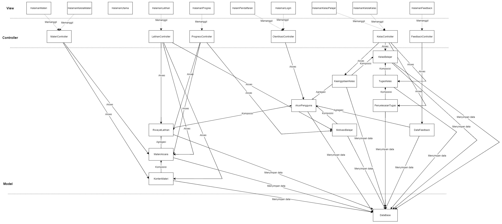
</p>
<p align="center">
<i>Gambar 2. Contoh Logical View pada P/L E-Commerce</i>
</p>

Hubungan Antarkomponen pada diagram tersebut adalah sebagai berikut.

| Label | Arah | Makna |
| :--- | :--- | :--- |
| Memanggil | *View* → *Controller* | Halaman meneruskan permintaan pengguna ke Controller yang menangani fiturnya |
| Akses | *Controller* → *Model* | Controller membaca atau mengubah data melalui Model |
| Menyimpan data | *Model* → `Database` | Model menyimpan datanya pada MySQL |
| Komposisi | antar-*Model* | Satu Model menjadi bagian yang tidak berdiri sendiri dari Model lain |
| Agregasi | antar-*Model* | Satu Model terhubung ke Model lain, tetapi keduanya tetap dapat berdiri sendiri |

Hubungan mengalir dari lapisan atas ke bawah: *View*, *Controller*, *Model*, lalu `Database`. *View* tidak mengakses *Model* secara langsung, dan *Model* tidak memanggil *Controller*. Dengan begitu, perubahan tampilan tidak memengaruhi cara data disimpan, sesuai alasan pemilihan MVC pada Bab 1.

Hubungan antar-*Model* pada diagram adalah sebagai berikut.
- **Komposisi:** `AkunPengguna` dengan `RiwayatLatihan` dan `MotivasiBelajar`, karena riwayat dan motivasi selalu milik satu akun. `MateriAksara` dengan `KontenMateri`, karena isi materi tidak berdiri tanpa metadatanya. `KelasBelajar` dengan `KeanggotaanKelas` dan `TugasKelas`, serta `TugasKelas` dengan `PenyelesaianTugas`.
- **Agregasi:** `RiwayatLatihan` dengan `MateriAksara`, serta `AkunPengguna` dengan `KeanggotaanKelas` dan `DataFeedback`.

Alur Interaksi 

1. `HalamanPendaftaran` dan `HalamanLogin` memanggil `OtentikasiController`. Controller memvalidasi kredensial dan mengakses `AkunPengguna`. Akun yang tersimpan menjadi dasar hak akses ketiga peran pada alur berikutnya.
2. `HalamanMateri` memanggil `MateriController`, yang mengakses `MateriAksara` untuk daftar dan metadata materi serta `KontenMateri` untuk isi dan audio pengucapan. `HalamanUtama` berperan sebagai navigasi menuju halaman-halaman tersebut.
3. `HalamanLatihan` memanggil `LatihanController`. Controller mengakses `MateriAksara` dan `KontenMateri` untuk menyiapkan soal, menilai jawaban, lalu mengakses `RiwayatLatihan` untuk menyimpan hasilnya dan `MotivasiBelajar` untuk memperbarui streak dan poin.
4. `HalamanProgres` memanggil `ProgressController`, yang mengakses `RiwayatLatihan` untuk menghitung penguasaan, `MateriAksara` untuk rekomendasi materi, dan `MotivasiBelajar` untuk streak, poin, badge, dan papan peringkat.
5. `HalamanKelolaKelas` (Pengajar) dan `HalamanKelasPelajar` (Pelajar) sama-sama memanggil `KelasController`. Controller ini mengakses `KelasBelajar`, `KeanggotaanKelas`, `TugasKelas`, dan `PenyelesaianTugas` untuk membuat kelas, memproses kode bergabung, menerbitkan tugas, dan mencatat status pengumpulan.
6. `HalamanKelolaMateri` memanggil `MateriController`, yang mengakses `MateriAksara` dan `KontenMateri` untuk menambah atau memperbarui materi.
7. `HalamanFeedback` memanggil `FeedbackController`, yang mengakses `DataFeedback` untuk menyimpan masukan.

Pada semua alur tersebut, data pada setiap Model akhirnya disimpan ke `Database` melalui hubungan "Menyimpan data".

---


# BAB 3: Realisasi Use Case

## 3.1 Use Case Melakukan Pendaftaran Akun
 
**ID Use Case:** UC-01
**Nama Use Case:** Melakukan Pendaftaran Akun
 
### 3.1.1 Identifikasi Kelas
 
Tabel 3.1.1 Identifikasi Kelas Use Case UC-01
 
| No | Nama Kelas Perancangan | Nama Kelas Analisis Terkait |
| :--- | :--- | :--- |
| 1 | C05 - HalamanPendaftaran | C05 - HalamanPendaftaran |
| 2 | C06 - HalamanLogin | C06 - HalamanLogin |
| 3 | C15 - OtentikasiController | C15 - OtentikasiController |
| 4 | C01 - AkunPengguna | C01 - AkunPengguna |
 
### 3.1.2 Sequence Diagram
 
- **Skenario Normal**
 
<p align="center">
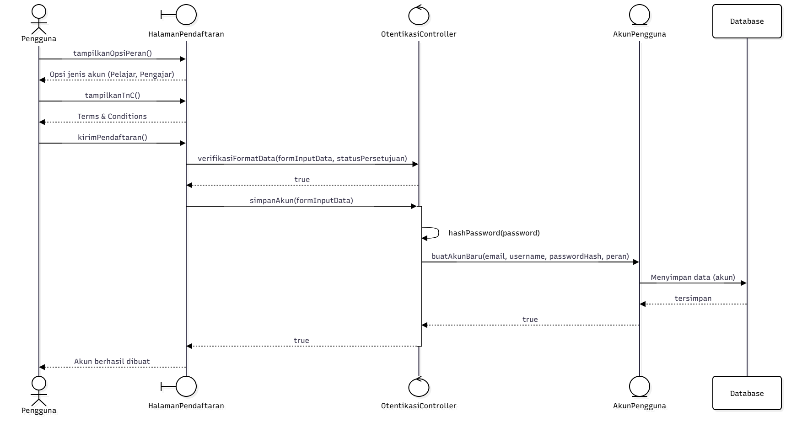
</p>
<p align="center"><i>Gambar 3. Diagram sekuens UC-01 - Skenario Normal</i></p>

- **Skenario Alternatif 1: Validasi Pendaftaran Gagal**
 
<p align="center">
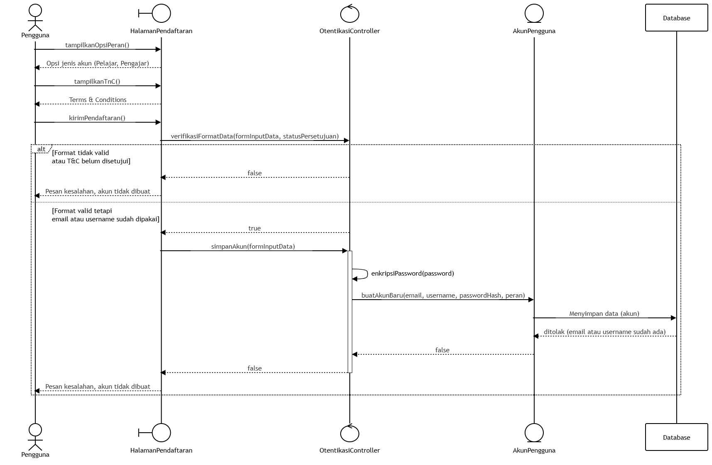
</p>
<p align="center"><i>Gambar 4. Diagram sekuens UC-01 - Alternatif 1: Validasi Pendaftaran Gagal</i></p>

### 3.1.3 Diagram Kelas
 
<p align="center">
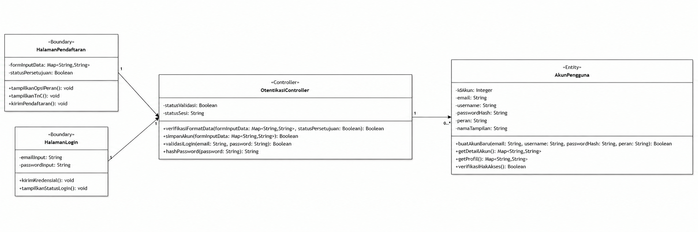
</p>
<p align="center">
<i>Gambar 5. Diagram Kelas Melakukan Pendaftaran Akun</i>
</p>

## 3.2 Use Case Mempelajari Materi

**ID Use Case:** UC-02
**Nama Use Case:** Mempelajari Materi

### 3.2.1 Identifikasi Kelas

Tabel 3.2.1 Identifikasi Kelas Use Case UC-02

| No | Nama Kelas Perancangan | Nama Kelas Analisis Terkait |
| :--- | :--- | :--- |
| 1 | C13 — HalamanMateri | C13 — HalamanMateri |
| 2 | C17 — MateriController | C17 — MateriController |
| 3 | C02 — MateriAksara | C02 — MateriAksara |
| 4 | C21 — KontenMateri | C21 — KontenMateri |
| 5 | C03 — RiwayatLatihan | C03 — RiwayatLatihan |
| 6 | C01 — AkunPengguna | C01 — AkunPengguna |

### 3.2.2 Sequence Diagram

- **Skenario Normal**

<p align="center">
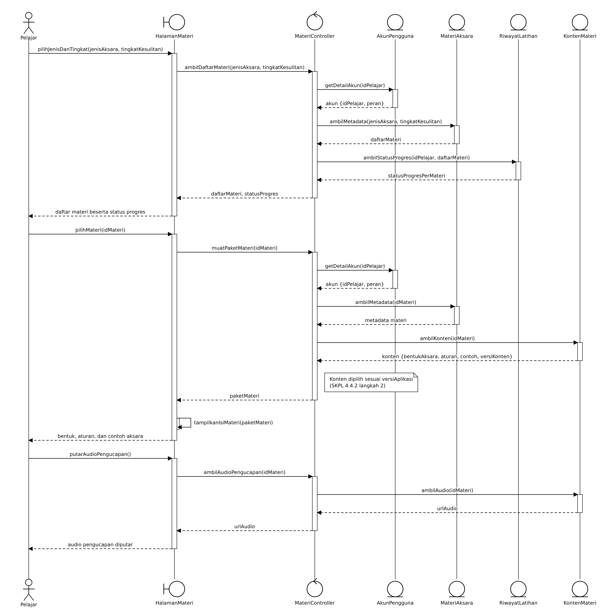
</p>
<p align="center"><i>Gambar 6. Diagram sekuens UC-02 — Skenario Normal</i></p>

- **Skenario Alternatif 1: Materi Belum Tersedia untuk Kombinasi yang Dipilih**

<p align="center">
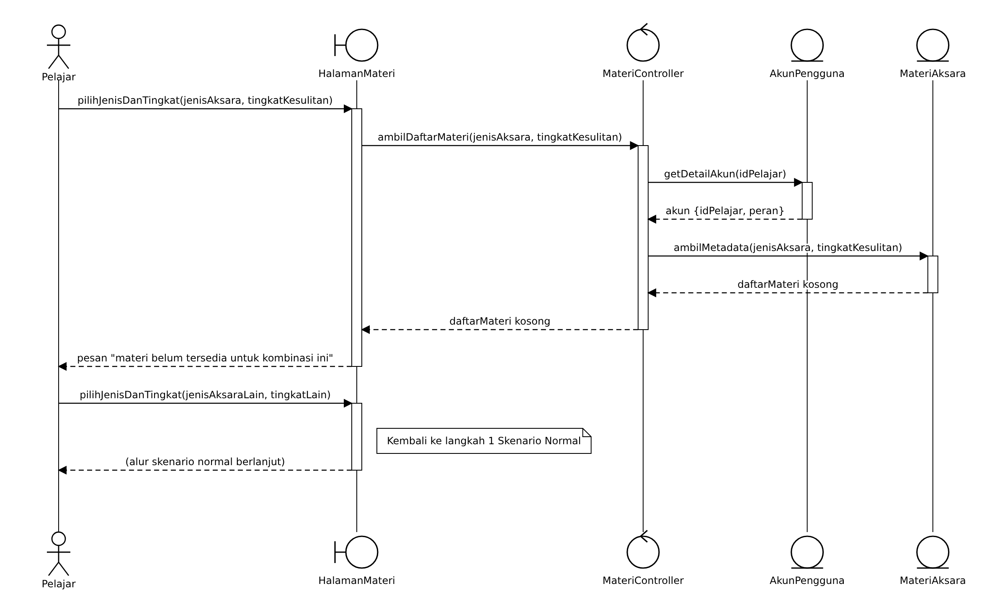
</p>
<p align="center"><i>Gambar 7. Diagram sekuens UC-02 — Alternatif 1: Materi Belum Tersedia</i></p>

- **Skenario Alternatif 2: Audio Pengucapan Gagal Diputar**

<p align="center">
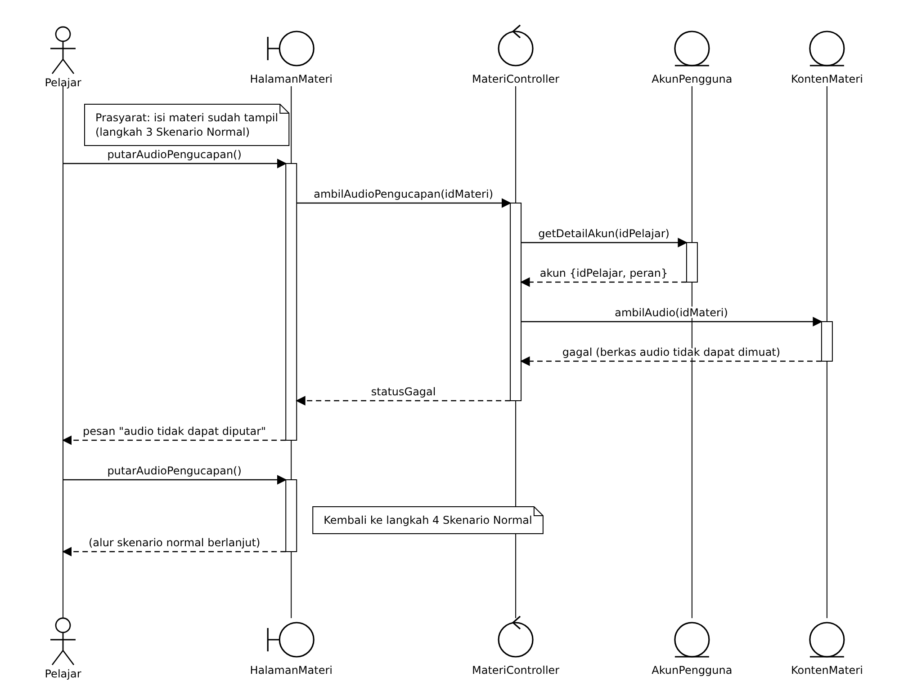
</p>
<p align="center"><i>Gambar 8. Diagram sekuens UC-02 — Alternatif 2: Audio Pengucapan Gagal Diputar</i></p>

### 3.2.3 Diagram Kelas

<p align="center">
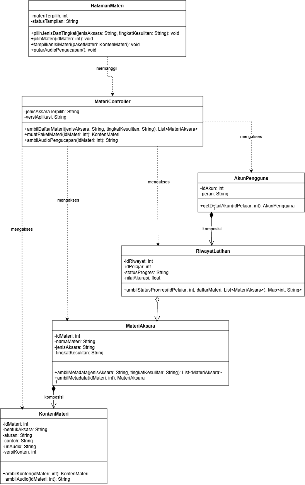
</p>
<p align="center"><i>Gambar 9. Diagram kelas UC-02 — Mempelajari Materi</i></p>

## 3.3 Use Case Mengerjakan Latihan Aksara
 
**ID Use Case:** UC-03  
**Nama Use Case:** Mengerjakan Latihan Aksara
 
### 3.3.1 Identifikasi Kelas
 
Tabel 3.3. Identifikasi Kelas Use Case UC-03
 
| No | Nama Kelas Perancangan | Nama Kelas Analisis Terkait |
| :--- | :--- | :--- |
| 1 | `HalamanLatihan` | C08 - `HalamanLatihan` |
| 2 | `LatihanController` | C16 - `LatihanController` |
| 3 | `MateriController` | C17 - `MateriController` |
| 4 | `AkunPengguna` | C01 - `AkunPengguna` |
| 5 | `MateriAksara` | C02 - `MateriAksara` |
| 6 | `KontenMateri` | C21 - `KontenMateri` |
| 7 | `RiwayatLatihan` | C03 - `RiwayatLatihan` |
| 8 | `MotivasiBelajar` | C22 - `MotivasiBelajar` |
 
### 3.3.2 Sequence Diagram
 
- **Skenario Normal**
 
<p align="center">
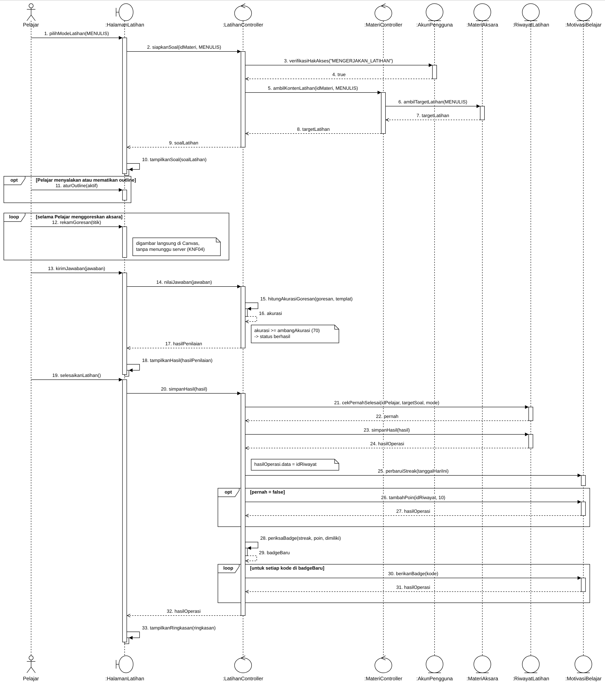
</p>
<p align="center">
<i>Gambar 10. Diagram sekuens UC-03 - Skenario Normal</i>
</p>

- **Skenario Alternatif 1: Latihan Mencocokkan Bunyi**
 
<p align="center">
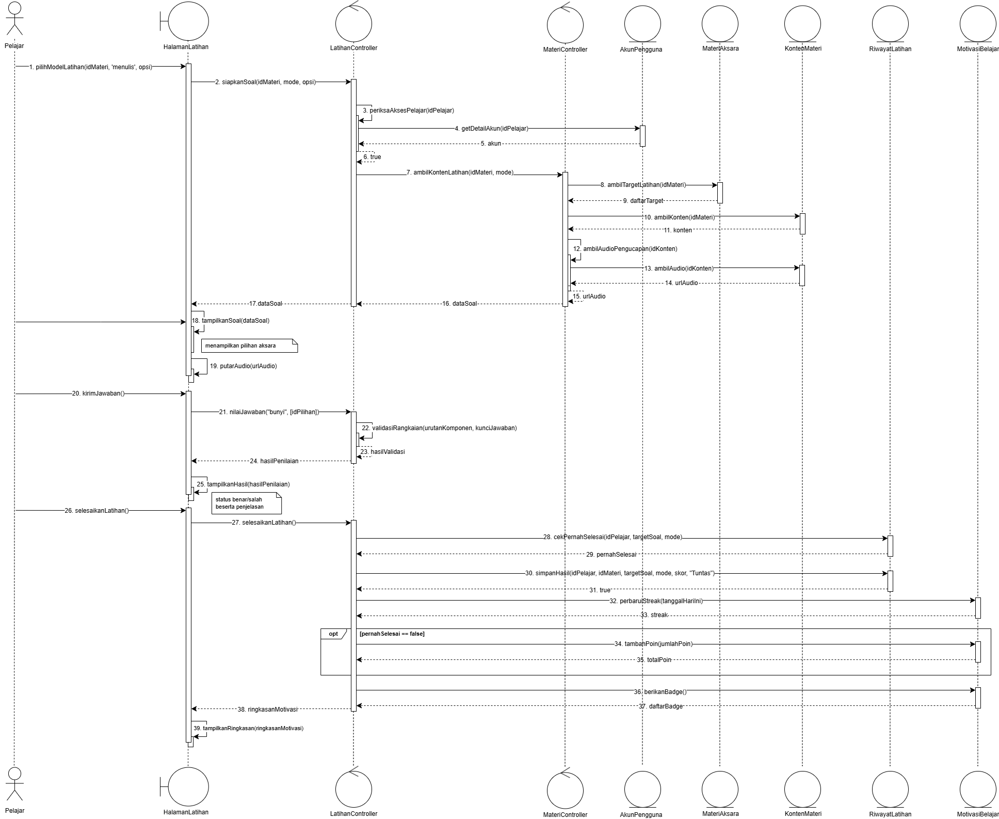
</p>
<p align="center">
<i>Gambar 11. Diagram sekuens UC-03 - Latihan Mencocokkan Bunyi</i>
</p>

- **Skenario Alternatif 2: Latihan Merangkai Aksara**
 
<p align="center">
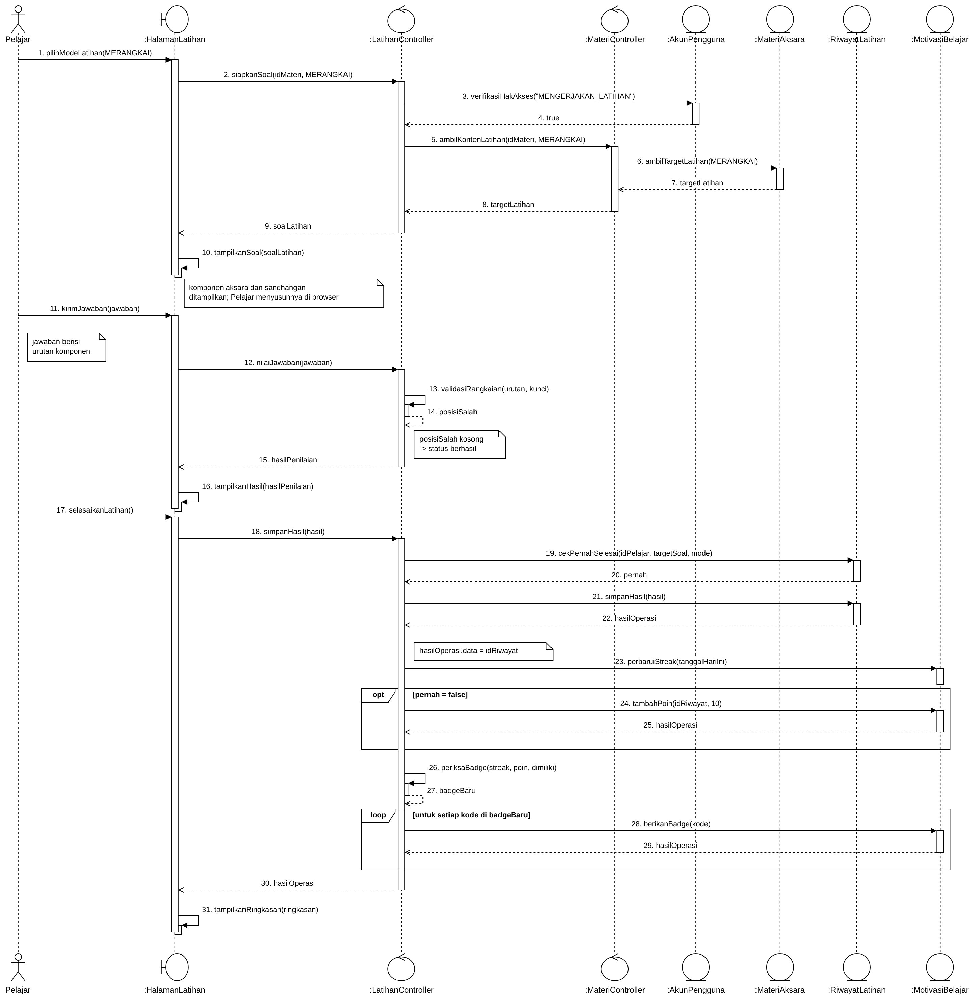
</p>
<p align="center">
<i>Gambar 12. Diagram sekuens UC-03 - Latihan Merangkai Aksara</i>
</p>

- **Skenario Alternatif 3: Gambar Aksara Kurang Akurat (Mode Menulis)**
 
<p align="center">

</p>
<p align="center">
<i>Gambar 13. Diagram sekuens UC-03 - Gambar Aksara Kurang Akurat</i>
</p>

### 3.3.3 Diagram Kelas
 
<p align="center">
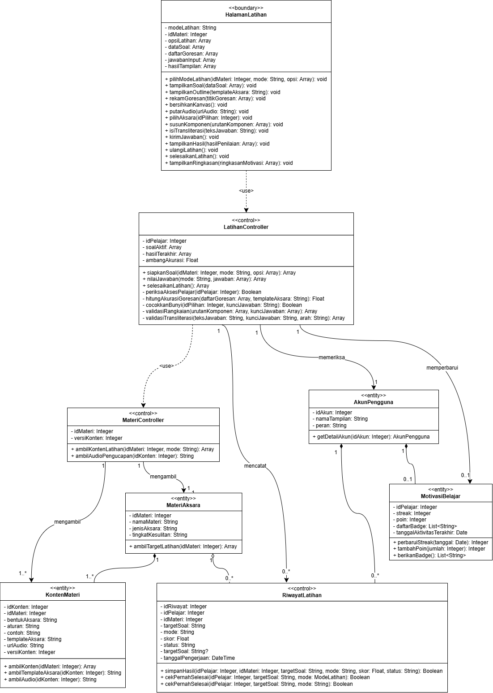
</p>
<p align="center">
<i>Gambar 14. Diagram Kelas Use Case UC-03</i>
</p>

## 3.4 Use Case UC-04: Meninjau Progres dan Motivasi

**ID Use Case:** UC-04  
**Nama Use Case:** Meninjau Progres dan Motivasi

### 3.4.1 Identifikasi Kelas

Tabel 3.4. Identifikasi Kelas Use Case UC-04

| No | Nama Kelas Perancangan | Nama Kelas Analisis Terkait |
| :--- | :--- | :--- |
| 1 | `HalamanMateri` (C13) | HalamanMateri (C13) |
| 2 | `HalamanProgres` (C14) | HalamanProgres (C14) |
| 3 | `ProgresController` (C19) | ProgresController (C19) |
| 4 | `AkunPengguna` (C01) | AkunPengguna (C01) |
| 5 | `KeanggotaanKelas` (C24) | KeanggotaanKelas (C24) |
| 6 | `KelasBelajar` (C23) | KelasBelajar (C23) |
| 7 | `MateriAksara` (C02) | MateriAksara (C02) |
| 8 | `MotivasiBelajar` (C22) | MotivasiBelajar (C22) |
| 9 | `RiwayatLatihan` (C03) | RiwayatLatihan (C03) |

### 3.4.2 Sequence Diagram

- **Skenario Normal**

<p align="center">

</p>
<p align="center"><i>Gambar 15. Diagram sekuens UC-04 - Skenario Normal</i></p>


- **Skenario Alternatif 1: Belum ada riwayat pembelajaran**

<p align="center">

</p>
<p align="center"><i>Gambar 16. Diagram sekuens UC-04 - Skenario Alternatif 1: Belum ada riwayat pembelajaran</i></p>


- **Skenario Alternatif 2: Melihat papan peringkat kelas**

<p align="center">

</p>
<p align="center"><i>Gambar 17. Diagram sekuens UC-04 - Skenario Alternatif 2: Melihat papan peringkat kelas</i></p>


### 3.4.3 Diagram Kelas

<p align="center">

</p>
<p align="center"><i>Gambar 18. Diagram Kelas Meninjau Progres dan Motivasi (UC-04)</i></p>

## 3.5 Use Case Mengikuti Pembelajaran Kelas

**ID Use Case:** *UC05*  
**Nama Use Case:** *Mengikuti Pembelajaran Kelas*

### 3.5.1 Identifikasi Kelas

Tabel 3.5.1 Identifikasi Kelas Use Case UC05

| No | Nama Kelas Perancangan | Nama Kelas Analisis Terkait |
| :--- | :--- | :--- |
| 1 | C11 — HalamanKelasPelajar | C11 — HalamanKelasPelajar |
| 2 | C20 — KelasController | C20 — KelasController |
| 3 | C01 — AkunPengguna | C01 — AkunPengguna |
| 4 | C23 — KelasBelajar | C23 — KelasBelajar |
| 5 | C24 — KeanggotaanKelas | C24 — KeanggotaanKelas |
| 6 | C25 — TugasKelas | C25 — TugasKelas |
| 7 | C03 — RiwayatLatihan | C03 — RiwayatLatihan |
| 8 | C26 — PenyelesaianTugas | C26 — PenyelesaianTugas |

### 3.5.2 Sequence Diagram

- **Skenario Normal**

<p align="center">

</p>
<p align="center"><i>Gambar 19. Diagram sekuens UC-05 — Skenario Normal</i></p>

- **Skenario Alternatif 1: Pelajar Sudah Menjadi Anggota Kelas**

<p align="center">
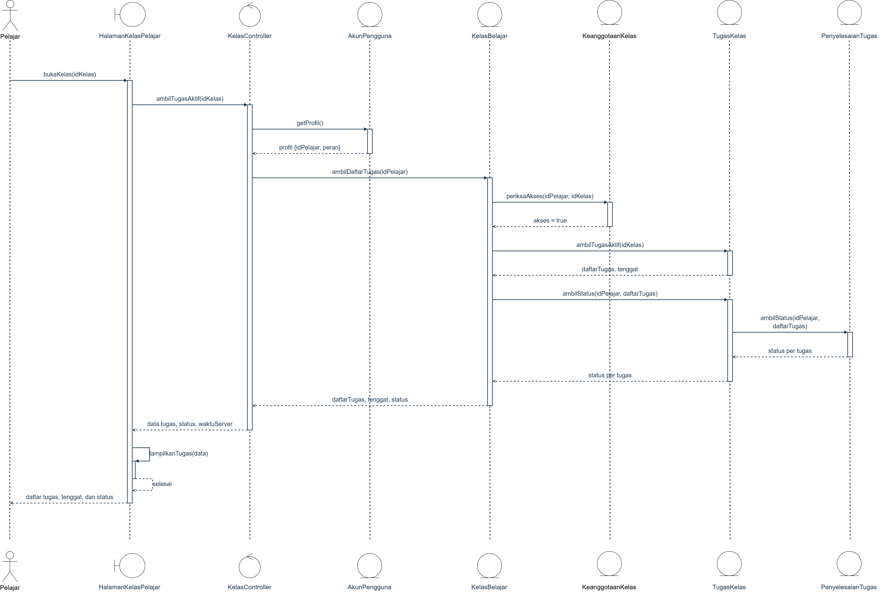
</p>
<p align="center"><i>Gambar 20. Diagram sekuens UC-05 — Alternatif 1: Pelajar Sudah Menjadi Anggota Kelas</i></p>

- **Skenario Alternatif 2: Tugas Diselesaikan Terlambat**

<p align="center">
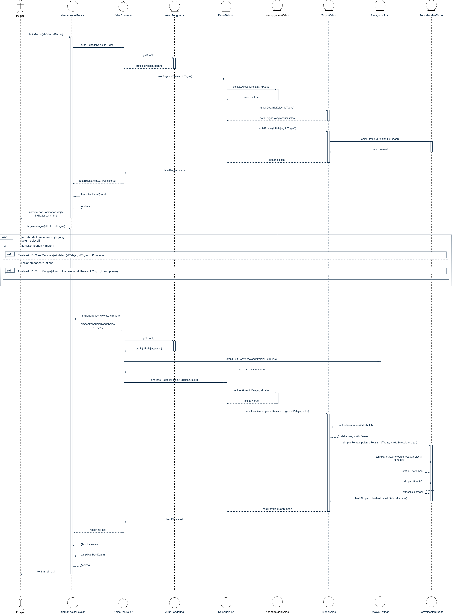
</p>
<p align="center"><i>Gambar 21. Diagram sekuens UC-05 — Alternatif 2: Tugas Diselesaikan Terlambat</i></p>

- **Skenario Alternatif 3: Kode Kelas Tidak Valid**

<p align="center">

</p>
<p align="center"><i>Gambar 22. Diagram sekuens UC-05 — Alternatif 3: Kode Kelas Tidak Valid</i></p>

- **Eksepsi: Penyimpanan Hasil Gagal**

<p align="center">

</p>
<p align="center"><i>Gambar 23. Diagram sekuens UC-05 — Eksepsi Penyimpanan Hasil Gagal</i></p>

- **Eksepsi: Akses atau Bukti Penyelesaian Tidak Memenuhi Syarat**

<p align="center">
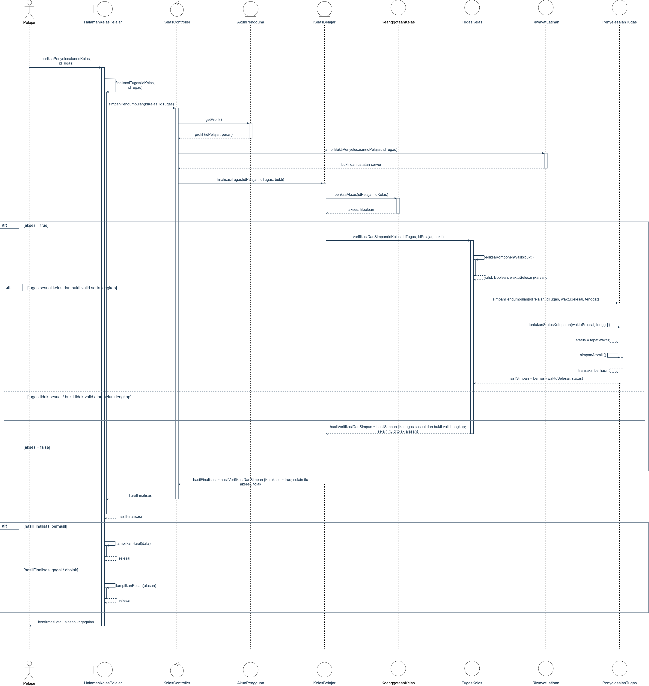
</p>
<p align="center"><i>Gambar 24. Diagram sekuens UC-05 — Eksepsi Akses dan Bukti Penyelesaian</i></p>

### 3.5.3 Diagram Kelas

<p align="center">

</p>
<p align="center">
<i>Gambar 25. Diagram Kelas Mengikuti Pembelajaran Kelas </i>
</p>

<br>

## 3.6 Use Case Memperbaharui Materi

**ID Use Case:** UC-06
**Nama Use Case:** Memperbaharui Materi

### 3.6.1 Identifikasi Kelas

Tabel 3.6.1 Identifikasi Kelas Use Case UC-06

| No | Nama Kelas Perancangan | Nama Kelas Analisis Terkait |
| :--- | :--- | :--- |
| 1 | C09 — HalamanKelolaMateri | C09 — HalamanKelolaMateri |
| 2 | C17 — MateriController | C17 — MateriController |
| 3 | C02 — MateriAksara | C02 — MateriAksara |
| 4 | C21 — KontenMateri | C21 — KontenMateri |
| 5 | C01 — AkunPengguna | C01 — AkunPengguna |


### 3.6.2 Sequence Diagram

- **Skenario Normal**

<p align="center">
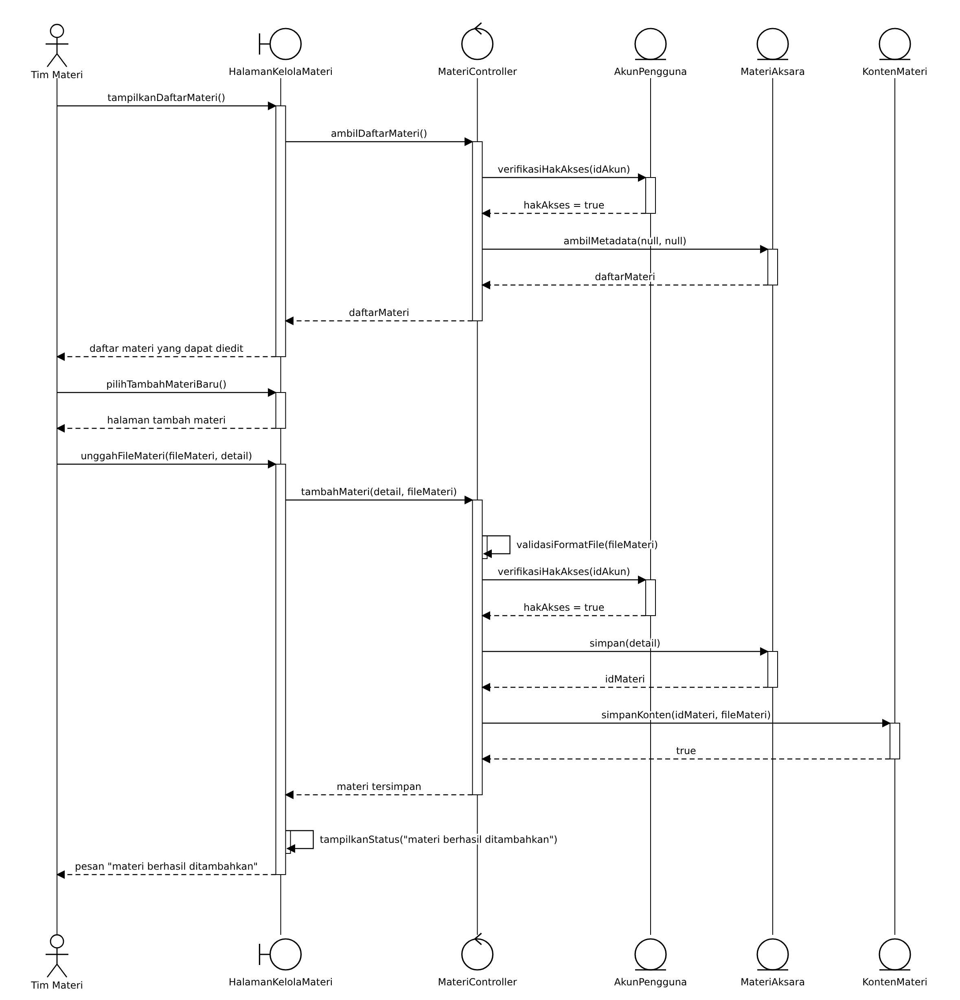
</p>
<p align="center"><i>Gambar 26. Diagram sekuens UC-06 — Skenario Normal</i></p>

- **Skenario Alternatif 1: Penambahan Materi Gagal**

<p align="center">
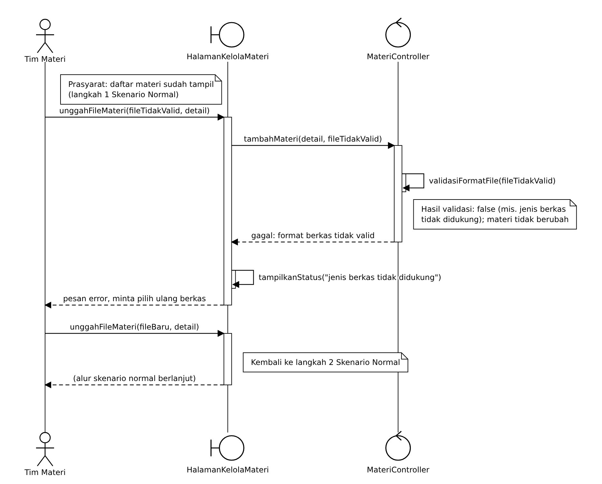
</p>
<p align="center"><i>Gambar 27. Diagram sekuens UC-06 — Alternatif 1: Penambahan Materi Gagal</i></p>


### 3.6.3 Diagram Kelas

<p align="center">
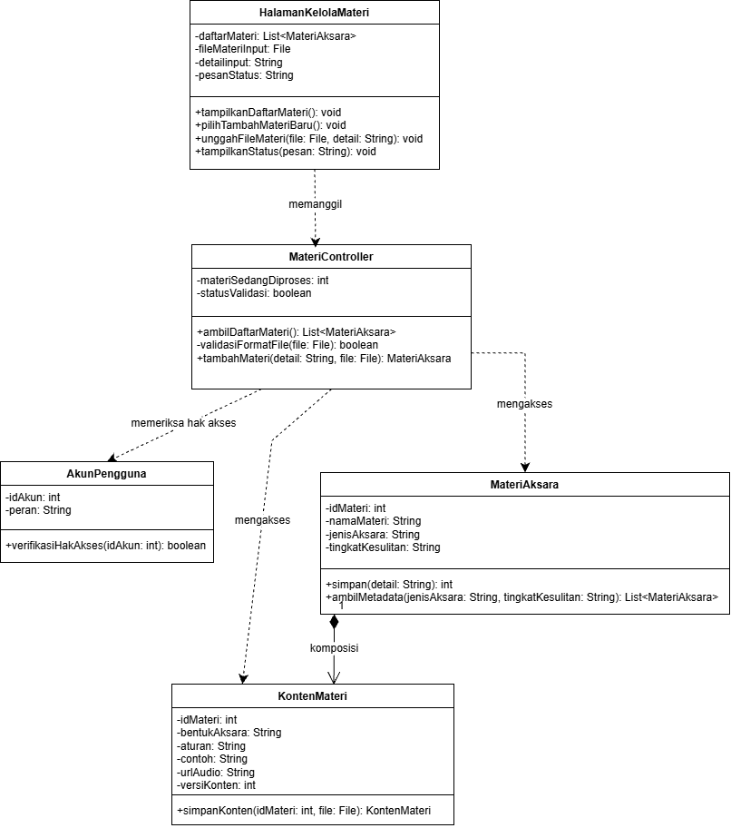
</p>
<p align="center"><i>Gambar 28. Diagram kelas UC-06 — Memperbaharui Materi</i></p>


## 3.7 Use Case UC-07: Menyiapkan Pembelajaran Kelas

**ID Use Case:** UC-07
**Nama Use Case:** Menyiapkan Pembelajaran Kelas

### 3.7.1 Identifikasi Kelas

Tabel 3.7. Identifikasi Kelas Use Case UC-7

| No | Nama Kelas Perancangan | Nama Kelas Analisis Terkait |
| :--- | :--- | :--- |
| 1 | `HalamanKelolaKelas` | HalamanKelolaKelas (C12) |
| 2 | `KelasController` | KelasController (C20) |
| 3 | `TugasKelas` | ProgresController (C25) |
| 4 | `AkunPengguna` | AkunPengguna (C01) |
| 5 | `KeanggotaanKelas` | KeanggotaanKelas (C24) |
| 6 | `KelasBelajar` | KelasBelajar (C23) |
| 7 | `MotivasiBelajar` | RiwayatLatihan (C22) |

### 3.7.2 Sequence Diagram

- **Skenario Normal**

<p align="center">

</p>
<p align="center"><i>Gambar 29. Diagram sekuens UC-07 - Skenario Normal</i></p>


- **Skenario Alternatif 1: Mengganti Kode Kelas**

<p align="center">

</p>
<p align="center"><i>Gambar 30. Diagram sekuens UC-07 - Skenario Alternatif 1: Mengganti Kode Kelas</i></p>


- **Skenario Alternatif 2: Mengeluarkan Anggota Kelas**

<p align="center">

</p>
<p align="center"><i>Gambar 31. Diagram sekuens UC-07 - Skenario Alternatif 2: Mengeluarkan Anggota Kelas</i></p>

- **Skenario Alternatif 3: Mengaktifkan Papan Peringkat Kelas**

<p align="center">

</p>
<p align="center"><i>Gambar 32. Diagram sekuens UC-07 - Skenario Alternatif 3: Mengaktifkan Papan Peringkat Kelas</i></p>

### 3.7.3 Diagram Kelas

<p align="center">

</p>
<p align="center"><i>Gambar 33. Diagram Kelas Menyiapkan Pembelajaran Kelas (UC-07)</i></p>

## 3.8 Use Case UC-08: Memantau dan Menindaklanjuti Progres

**ID Use Case:** UC-08  
**Nama Use Case:** Memantau dan Menindaklanjuti Progres

### 3.8.1 Identifikasi Kelas

Tabel 3.8. Identifikasi Kelas Use Case UC-08

| No | Nama Kelas Perancangan | Nama Kelas Analisis Terkait |
| :--- | :--- | :--- |
| 1 | `HalamanKelolaKelas` (C12) | HalamanKelolaKelas (C12) |
| 2 | `KelasController` (C20) | KelasController (C20) |
| 3 | `ProgresController` (C19) | ProgresController (C19) |
| 4 | `AkunPengguna` (C01) | AkunPengguna (C01) |
| 5 | `KeanggotaanKelas` (C24) | KeanggotaanKelas (C24) |
| 6 | `KelasBelajar` (C23) | KelasBelajar (C23) |
| 7 | `RiwayatLatihan` (C03) | RiwayatLatihan (C03) |

### 3.8.2 Sequence Diagram

- **Skenario Normal**

<p align="center">

</p>
<p align="center"><i>Gambar 34. Diagram sekuens UC-08 - Skenario Normal</i></p>


- **Skenario Alternatif 1: Belum ada hasil belajar anggota**

<p align="center">

</p>
<p align="center"><i>Gambar 35. Diagram sekuens UC-08 - Skenario Alternatif 1: Belum ada hasil belajar anggota</i></p>


- **Skenario Alternatif 2: Anggota yang dipilih bukan anggota aktif kelas**

<p align="center">

</p>
<p align="center"><i>Gambar 36.Diagram sekuens UC-08 - Skenario Alternatif 2: Anggota yang dipilih bukan anggota aktif kelas</i></p>


### 3.8.3 Diagram Kelas

<p align="center">

</p>
<p align="center"><i>Gambar 37. Diagram Kelas Memantau dan Menindaklanjuti Progres (UC-08)</i></p>


## 3.9 Use Case Menyampaikan Feedback
 
**ID Use Case:** UC-09
**Nama Use Case:** Menyampaikan Feedback
 
### 3.9.1 Identifikasi Kelas
 
Tabel 3.9.1 Identifikasi Kelas Use Case UC-09
 
| No | Nama Kelas Perancangan | Nama Kelas Analisis Terkait |
| :--- | :--- | :--- |
| 1 | C10 - HalamanFeedback | C10 - HalamanFeedback |
| 2 | C18 - FeedbackController | C18 - FeedbackController |
| 3 | C04 - DataFeedback | C04 - DataFeedback |
| 4 | C01 - AkunPengguna | C01 - AkunPengguna |
 
### 3.9.2 Sequence Diagram

- **Skenario Normal**
 
<p align="center">

</p>
<p align="center"><i>Gambar 38. Diagram sekuens UC-09 — Skenario Normal</i></p>

- **Skenario Alternatif 1: Feedback Gagal Terkirim**
 
<p align="center">
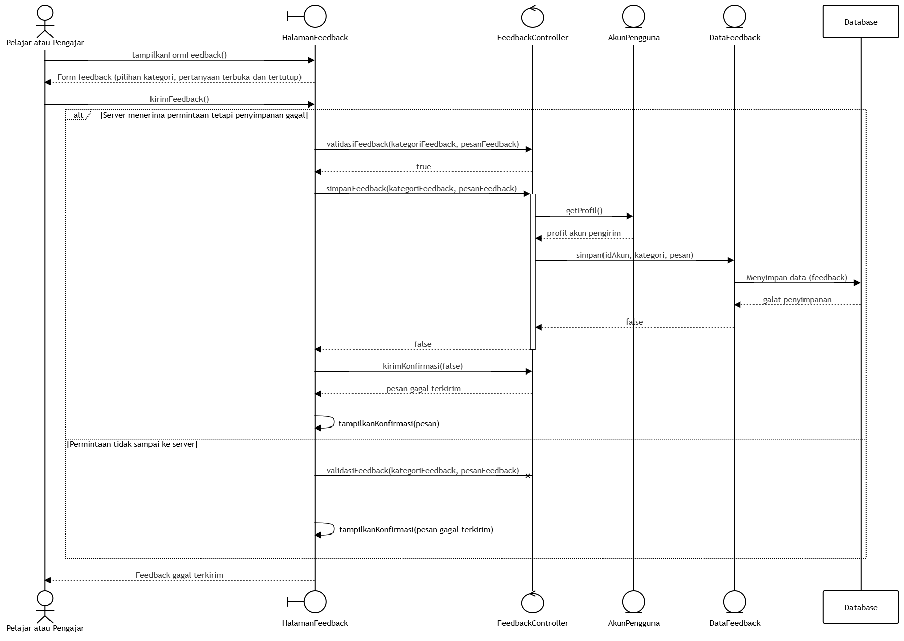
</p>
<p align="center"><i>Gambar 39. Diagram sekuens UC-09 — Alternatif 1: Feedback Gagal Terkirim</i></p>

### 3.9.3 Diagram Kelas
 
<p align="center">
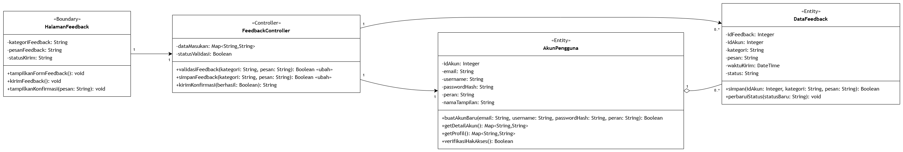
</p>
<p align="center">
<i>Gambar 40. Diagram Kelas Menyampaikan Feedback</i>
</p>

--- 

# BAB 4: Diagram Kelas Keseluruhan

## 4.1 Diagram Kelas

<p align="center">
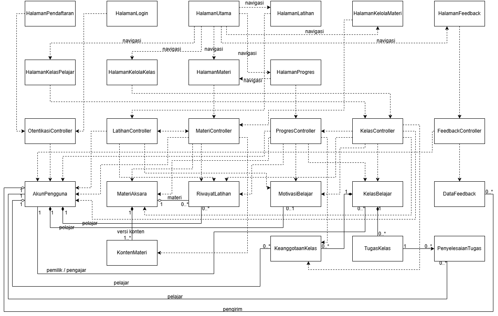
</p>
<p align="center">
<i>Gambar 41. Diagram Kelas Perancangan Keseluruhan Ngaksara</i>
</p>

Tabel 4.1. Daftar Kelas Perancangan Keseluruhan

| ID Kelas | Nama Kelas | Atribut | Metode/Operasi |
| :--- | :--- | :--- | :--- |
| C01 | AkunPengguna | `- idAkun: Integer`<br>`- email: String`<br>`- username: String`<br>`- passwordHash: String`<br>`- peran: String`<br>`- namaTampilan: String` | `+ buatAkunBaru(data: DataPendaftaran): HasilOperasi`<br>`+ getProfil(): Data`<br>`+ verifikasiHakAkses(aksi: String): Boolean`<br>`+ getDetailAkun(): Data` |
| C02 | MateriAksara | `- idMateri: Integer`<br>`- namaMateri: String`<br>`- jenisAksara: JenisAksara`<br>`- tingkatKesulitan: Integer`<br>`- statusPublikasi: StatusPublikasi` | `+ ambilMetadata(): MetadataMateri`<br>`+ ambilTargetLatihan(mode: ModeLatihan): TargetLatihan`<br>`+ perbaruiData(data: MetadataMateri): HasilOperasi`<br>`+ simpan(data: MetadataMateri): HasilOperasi`<br>`+ ambilDaftarMateri(filter: FilterMateri): List<MateriAksara>`<br>`+ ambilMateriRekomendasi(penguasaan: Data): List<MateriAksara>` |
| C03 | RiwayatLatihan | `- idRiwayat: Integer`<br>`- idPelajar: Integer`<br>`- idMateri: Integer`<br>`- mode: ModeLatihan?`<br>`- skor: Decimal?`<br>`- tanggalPengerjaan: DateTime`<br>`- status: String`<br>`- idTugas: Integer?`<br>`- idKomponen: Integer?`<br>`- modeAktivitas: String`<br>`- waktuSelesai: DateTime?` | `+ simpanHasil(hasil: HasilLatihan): HasilOperasi`<br>`+ catatAktivitas(aktivitas: AktivitasBelajar): HasilOperasi`<br>`+ ambilRiwayat(idPelajar: Integer, periode: Periode): List<RiwayatLatihan>`<br>`+ ambilBuktiPenyelesaian(idPelajar: Integer, idTugas: Integer): BuktiPenyelesaian`<br>`+ ambilStatusProgres(idPelajar: Integer): Data`<br>`+ hitungPenguasaan(idPelajar: Integer): Data`<br>`+ ambilRiwayatPelajar(idPelajar: Integer): List<RiwayatLatihan>`<br>`+ hitungPolaKesalahan(idPelajar: Integer): Data` |
| C04 | DataFeedback | `- idFeedback: Integer`<br>`- idAkun: Integer`<br>`- kategori: KategoriFeedback`<br>`- pesan: String`<br>`- waktuKirim: DateTime`<br>`- status: StatusFeedback` | `+ simpan(data: MasukanFeedback): HasilOperasi`<br>`+ perbaruiStatus(status: StatusFeedback): HasilOperasi` |
| C05 | HalamanPendaftaran | `- formInputData: DataPendaftaran`<br>`- statusPersetujuan: Boolean` | `+ tampilkanTnC(): void`<br>`+ kirimPendaftaran(data: DataPendaftaran): void`<br>`+ tampilkanOpsiPeran(): void` |
| C06 | HalamanLogin | `- emailInput: String`<br>`- statusTampilan: String` | `+ kirimKredensial(email: String, password: String): void`<br>`+ tampilkanStatusLogin(hasil: HasilOperasi): void` |
| C07 | HalamanUtama | `- profil: Profil`<br>`- menuTersedia: List<String>` | `+ tampilkanMenu(peran: Peran): void`<br>`+ pilihMenu(kode: String): void` |
| C08 | HalamanLatihan | `- modeLatihan: ModeLatihan`<br>`- jawabanInput: JawabanLatihan`<br>`- goresan: List<Goresan>`<br>`- hasilTampilan: HasilPenilaian?` | `+ pilihModeLatihan(mode: ModeLatihan): void`<br>`+ rekamGoresan(titik: Titik): void`<br>`+ kirimJawaban(jawaban: JawabanLatihan): void`<br>`+ tampilkanHasil(hasil: HasilPenilaian): void` |
| C09 | HalamanKelolaMateri | `- daftarMateri: List<MetadataMateri>`<br>`- detailInput: DataKonten`<br>`- fileMateriInput: Berkas?` | `+ unggahFileMateri(berkas: Berkas, detail: DataKonten): void`<br>`+ suntingMateri(idMateri: Integer): void`<br>`+ tampilkanStatus(hasil: HasilOperasi): void`<br>`+ tampilkanDaftarMateri(data: List<MateriAksara>): void` |
| C10 | HalamanFeedback | `- kategoriFeedback: KategoriFeedback`<br>`- pesanFeedback: String`<br>`- statusKirim: StatusKirim` | `+ kirimFeedback(data: MasukanFeedback): void`<br>`+ tampilkanKonfirmasi(hasil: HasilOperasi): void`<br>`+ tampilkanFormFeedback(): void` |
| C11 | HalamanKelasPelajar | `- kodeKelasInput: String`<br>`- tugasAktif: Integer?`<br>`- detailTugas: DetailTugas?`<br>`- idKelasAktif: Integer` | `+ kirimKodeBergabung(kode: String): void`<br>`+ bukaTugas(idKelas: Integer, idTugas: Integer): void`<br>`+ kerjakanTugas(idKelas: Integer, idTugas: Integer): void`<br>`- finalisasiTugas(idKelas: Integer, idTugas: Integer): HasilOperasi`<br>`+ bukaKelas(idKelas: Integer): void`<br>`- tampilkanPesan(pesan: String): void`<br>`- tampilkanTugas(data: Data): void`<br>`- tampilkanDetail(data: Data): void`<br>`- tampilkanHasil(data: Data): void`<br>`+ periksaPenyelesaian(idKelas: Integer, idTugas: Integer): void` |
| C12 | HalamanKelolaKelas | `- idKelasTerpilih: Integer?`<br>`- daftarAnggota: List<Profil>`<br>`- ringkasanProgres: RingkasanProgres?`<br>`- pesanInput: String` | `+ buatKelas(data: DataKelas): void`<br>`+ buatTugas(data: DataTugas): void`<br>`+ pilihAnggota(idPelajar: Integer): void`<br>`+ kirimUmpanBalik(data: DataUmpanBalik): void`<br>`+ kelolaAnggota(idKelas: Integer): void`<br>`+ aturScoreboard(idKelas: Integer, aktif: Boolean): void`<br>`+ tampilkanAnggota(data: List<Profil>): void`<br>`+ tampilkanProgres(data: RingkasanProgres): void` |
| C13 | HalamanMateri | `- materiTerpilih: Integer?`<br>`- statusTampilan: String`<br>`- statusAudio: String` | `+ pilihMateri(idMateri: Integer): void`<br>`+ tampilkanIsiMateri(paket: PaketMateri): void`<br>`+ putarAudioPengucapan(sumber: ReferensiBerkas): void` |
| C14 | HalamanProgres | `- filterPeriode: Periode`<br>`- dataTampilan: RingkasanProgres?`<br>`- idKelasTerpilih: Integer?` | `+ tampilkanProgres(data: RingkasanProgres): void`<br>`+ pilihPeriode(periode: Periode): void`<br>`+ tampilkanScoreboard(data: List<Peringkat>): void` |
| C15 | OtentikasiController | `- konteks: KonteksPermintaan` | `+ verifikasiFormatData(data: DataPendaftaran): HasilValidasi`<br>`- hashPassword(password: String): String`<br>`+ simpanAkun(data: DataPendaftaran): HasilOperasi`<br>`+ validasiLogin(email: String, password: String): HasilOperasi` |
| C16 | LatihanController | `- konteks: KonteksPermintaan` | `+ siapkanSoal(idMateri: Integer, mode: ModeLatihan): SoalLatihan`<br>`+ nilaiJawaban(jawaban: JawabanLatihan): HasilPenilaian`<br>`+ simpanHasil(hasil: HasilLatihan): HasilOperasi` |
| C17 | MateriController | `- konteks: KonteksPermintaan` | `+ ambilDaftarMateri(filter: FilterMateri): List<MetadataMateri>`<br>`+ muatPaketMateri(idMateri: Integer, versiAplikasi: String): PaketMateri`<br>`+ ambilAudioPengucapan(idMateri: Integer): HasilBerkas`<br>`+ ambilKontenLatihan(idMateri: Integer, mode: ModeLatihan): TargetLatihan`<br>`+ tambahMateri(data: DataKonten, berkas: Berkas): HasilOperasi`<br>`+ perbaruiMateri(idMateri: Integer, data: DataKonten): HasilOperasi`<br>`+ validasiFormatFile(berkas: Berkas): HasilValidasi`<br>`+ hapusMateri(idMateri: Integer): HasilOperasi` |
| C18 | FeedbackController | `- konteks: KonteksPermintaan` | `+ validasiFeedback(data: MasukanFeedback): HasilValidasi`<br>`+ simpanFeedback(data: MasukanFeedback): HasilOperasi`<br>`+ kirimKonfirmasi(hasil: HasilOperasi): Konfirmasi` |
| C19 | ProgresController | `- konteks: KonteksPermintaan` | `+ ambilRiwayat(idPelajar: Integer, periode: Periode): List<RiwayatLatihan>`<br>`+ hitungProgres(idPelajar: Integer): RingkasanProgres`<br>`+ siapkanRekomendasi(idPelajar: Integer): List<MetadataMateri>`<br>`+ ambilScoreboard(idKelas: Integer): HasilScoreboard`<br>`+ agregasiProgres(anggotaAktif: List<Integer>, periode: Periode): RingkasanProgres`<br>`+ hitungPolaKesalahan(idPelajar: Integer): Data` |
| C20 | KelasController | `- konteks: KonteksPermintaan`<br>`- idPelajar: Integer`<br>`- idKelas: Integer` | `+ validasiKodeBergabung(kode: String): HasilOperasi`<br>`+ ambilTugasAktif(idKelas: Integer): HasilOperasi`<br>`+ simpanPengumpulan(idKelas: Integer, idTugas: Integer): HasilOperasi`<br>`+ buatKelas(data: DataKelas): HasilOperasi`<br>`+ terbitkanTugas(idKelas: Integer, data: DataTugas): HasilOperasi`<br>`+ ambilDaftarAnggota(idKelas: Integer): List<Profil>`<br>`+ kirimUmpanBalik(idKelas: Integer, data: DataUmpanBalik): HasilOperasi`<br>`+ bukaTugas(idKelas: Integer, idTugas: Integer): HasilOperasi`<br>`+ hasilkanKodeUnik(): String`<br>`+ gabungkanPelajar(idKelas: Integer): HasilOperasi`<br>`+ kelolaAnggota(idKelas: Integer, idPelajar: Integer, status: String): HasilOperasi`<br>`+ ambilKelasPengajar(): List<KelasBelajar>`<br>`+ gantiKodeKelas(idKelas: Integer): HasilOperasi`<br>`+ aturScoreboard(idKelas: Integer, aktif: Boolean): HasilOperasi`<br>`+ ambilProgresAnggota(idKelas: Integer, idPelajar: Integer): Data` |
| C21 | KontenMateri | `- idKonten: Integer`<br>`- idMateri: Integer`<br>`- bentukAksara: String`<br>`- aturan: String`<br>`- contoh: String`<br>`- pathAudio: String?`<br>`- versiKonten: String`<br>`- versiAplikasiMinimum: String` | `+ ambilKonten(versiAplikasi: String): PaketMateri`<br>`+ ambilAudio(): HasilBerkas`<br>`+ perbaruiKonten(data: DataKonten): HasilOperasi`<br>`+ arsipkanVersi(): HasilOperasi`<br>`+ simpanKonten(data: DataKonten): HasilOperasi` |
| C22 | MotivasiBelajar | `- idPelajar: Integer`<br>`- streak: Integer`<br>`- poin: Integer`<br>`- tanggalAktifTerakhir: Date?`<br>`- daftarBadge: List<String>` | `+ perbaruiStreak(tanggal: Date): void`<br>`+ tambahPoin(idAktivitas: Integer, nilai: Integer): HasilOperasi`<br>`+ berikanBadge(kode: String): HasilOperasi`<br>`+ susunScoreboard(anggotaAktif: List<Profil>): List<Peringkat>`<br>`+ ambilMotivasi(idPelajar: Integer): Data`<br>`+ ambilPoinKelas(anggotaAktif: List<Integer>): List<Peringkat>` |
| C23 | KelasBelajar | `- idKelas: Integer`<br>`- nama: String`<br>`- pemilikId: Integer`<br>`- kodeBergabung: String`<br>`- status: String`<br>`- statusScoreboard: Boolean` | `+ validasiKode(kode: String): KelasBelajar?`<br>`+ gabungkanPelajar(idPelajar: Integer): HasilOperasi`<br>`+ gantiKodeBergabung(idPengajar: Integer): HasilOperasi`<br>`+ finalisasiTugas(idPelajar: Integer, idTugas: Integer, bukti: BuktiPenyelesaian): HasilOperasi`<br>`+ periksaPemilik(idPengajar: Integer): Boolean`<br>`+ ambilDaftarTugas(idPelajar: Integer): HasilOperasi`<br>`+ bukaTugas(idPelajar: Integer, idTugas: Integer): HasilOperasi`<br>`+ simpan(data: DataKelas): HasilOperasi`<br>`+ buatKodeBergabung(): String`<br>`+ daftarKelasPengajar(idPengajar: Integer): List<KelasBelajar>`<br>`+ aturScoreboard(aktif: Boolean): HasilOperasi` |
| C24 | KeanggotaanKelas | `- idKeanggotaan: Integer`<br>`- idKelas: Integer`<br>`- idPelajar: Integer`<br>`- status: String` | `+ simpanKeanggotaan(idPelajar: Integer, idKelas: Integer): HasilOperasi`<br>`+ periksaAkses(idPelajar: Integer, idKelas: Integer): Boolean`<br>`+ daftarAnggotaAktif(idKelas: Integer): List<KeanggotaanKelas>`<br>`+ ubahStatus(status: String): HasilOperasi`<br>`- simpanAtomik(): HasilOperasi`<br>`+ daftarAnggota(idKelas: Integer): List<KeanggotaanKelas>` |
| C25 | TugasKelas | `- idTugas: Integer`<br>`- idKelas: Integer`<br>`- instruksi: String`<br>`- tenggat: DateTime`<br>`- status: StatusTugas`<br>`- komponenTugas: List<KomponenTugas>` | `+ ambilTugasAktif(idKelas: Integer): List`<br>`+ terbitkan(): HasilOperasi`<br>`+ verifikasiDanSimpan(idKelas: Integer, idTugas: Integer, idPelajar: Integer, bukti: BuktiPenyelesaian): HasilOperasi`<br>`+ ambilStatus(idPelajar: Integer, daftarTugas: List): List`<br>`+ ambilDetail(idKelas: Integer, idTugas: Integer): Data?`<br>`- periksaKomponenWajib(bukti: BuktiPenyelesaian): HasilVerifikasi`<br>`+ simpan(data: DataTugas): HasilOperasi` |
| C26 | PenyelesaianTugas | `- idPenyelesaian: Integer`<br>`- idTugas: Integer`<br>`- idPelajar: Integer`<br>`- waktuKumpul: DateTime`<br>`- status: String` | `+ simpanPengumpulan(idPelajar: Integer, idTugas: Integer, waktuSelesai: DateTime, tenggat: DateTime): HasilOperasi`<br>`- tentukanStatusKetepatan(waktuSelesai: DateTime, tenggat: DateTime): String`<br>`+ ambilStatus(idPelajar: Integer, daftarTugas: List): List`<br>`- simpanAtomik(): HasilOperasi`<br>`- batalkanTransaksi(): void` |

<br>

---

# BAB 5: Perancangan Rinci Kelas

Bagian ini diisi dengan daftar seluruh kelas dalam tabel berikut:

Tabel 5.1. Daftar Kelas Perancangan dan Kelas Analisis Terkait

| No | Nama Kelas Perancangan | Nama Kelas Analisis Terkait |
| :--- | :--- | :--- |
| 1 | *[Nama kelas perancangan]* | *[Nama kelas analisis pada SKPL atau -]* |
| 2 | *[Nama kelas perancangan]* | *[Nama kelas analisis pada SKPL atau -]* |
| ... | *...* | *...* |

Untuk **setiap kelas**, identifikasi operasi berdasarkan tanggung jawab kelas beserta *visibility*-nya, serta atribut beserta *visibility* dan tipenya. Buat subbab tersendiri untuk setiap kelas.

## 5.1 Kelas [Nama Kelas 1]

**Nama Kelas:** *[Nama kelas]*  
**ID Kelas:** *[ID kelas]*

Tabel 5.1.1. Operasi Kelas [Nama Kelas 1]

| Nama Operasi | Visibility (private, public) | Keterangan |
| :--- | :--- | :--- |
| *[Signature operasi, termasuk parameter dan tipe kembalian]* | *[Visibility]* | *[Tanggung jawab operasi]* |
| *...* | *...* | *...* |

Tabel 5.1.2. Atribut Kelas [Nama Kelas 1]

| Nama Atribut | Visibility (private, public) | Tipe |
| :--- | :--- | :--- |
| *[Nama atribut]* | *[Visibility]* | *[Tipe sesuai bahasa pemrograman yang digunakan]* |
| *...* | *...* | *...* |

### 5.1.1 Algoritma/Query

Bagian ini diisi untuk kerangka algoritma proses yang dianggap cukup penting. Algoritma dapat dituliskan sebagai *pseudocode*. Implementasi *skeleton code* juga dapat digunakan untuk kelas yang sudah terdefinisi pada bahasa pemrograman tertentu.

**Nama Kelas:** *[Nama kelas]*  
**Nama Operasi:** *[Signature operasi]*  
**ID Algoritma:** *[Algo-001]*

```text
[Tuliskan pseudocode algoritma operasi di sini.]
```

Jika operasi mengacu pada query tertentu, lengkapi tabel berikut. 

Tabel 5.1.1. Query Operasi [Nama Operasi]

| No Query | Query | Keterangan |
| :--- | :--- | :--- |
| *[Q-001]* | *[Tuliskan query]* | *[Fungsi query]* |
| *...* | *...* | *...* |


### 5.1.2 Algoritma/Query

*[Ulangi pola 5.1.1 untuk operasi penting berikutnya pada kelas yang sama, jika ada.]*

## 5.2 Kelas [Nama Kelas Berikutnya]

*[Ulangi pola 5.1: nama dan ID kelas, tabel operasi, tabel atribut, serta subbab algoritma/query untuk operasi penting jika diperlukan.]*

<br>

---

# BAB 6: Perancangan Antarmuka

## 6.1 Rancangan Antarmuka [ID Layar 1]

Masukkan versi awal prototipe antarmuka, dimana untuk setiap antarmuka/layar, tuliskan spesifikasi rinci objek yang ditampilkan dan reaksi sistem terhadap interaksi pengguna.

**Antarmuka:** *[ID layar]*  
**Nama Layar:** *[Nama layar]*

<p align="center">
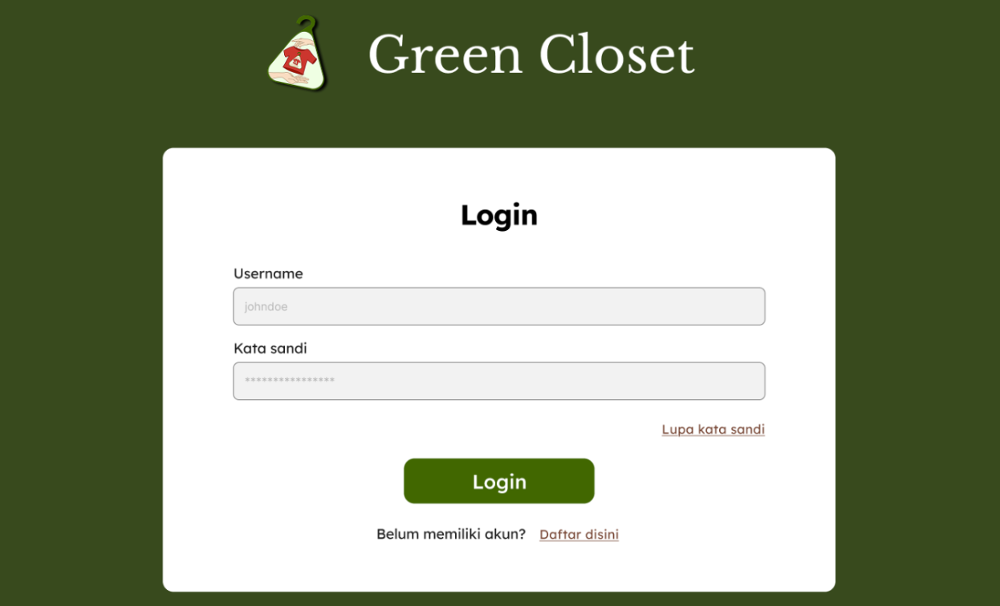
</p>
<p align="center">
<i>Gambar 6.1. Rancangan Antarmuka [ID Layar] - [Nama Layar]</i>
</p>

Tabel 6.1. Spesifikasi Objek Antarmuka [ID Layar]

| Id_Objek | Jenis | Konten | Keterangan |
| :--- | :--- | :--- | :--- |
| *[ID objek]* | *[Jenis objek, misalnya Button, RTF Box, dll]* | *[String yang tampil pada layar]* | *[Reaksi sistem, layar tujuan, tautan, atau ID algoritma yang dijalankan]* |
| *[ID objek]* | *[Jenis objek]* | *[Konten yang ditampilkan]* | *[Reaksi sistem atau nama file terkait beserta deskripsi ringkasnya]* |
| *...* | *...* | *...* | *...* |


## 6.X Rancangan Antarmuka [ID Layar X]

*[Ulangi pola 6.1 untuk layar berikutnya sampai semua layar teridentifikasi]*

## 6.Y Rancangan Antarmuka Keseluruhan

Tuliskan daftar gambar seluruh antarmuka. Berikan ID unik untuk setiap tampilan dan gunakan ID yang sama pada subbab perancangan antarmuka masing-masing.

Tabel 6.Y. Rancangan Antarmuka Keseluruhan

| No | Tampilan Antarmuka |
| :--- | :--- |
| *[I-01]* |  |
| *[I-02]* | *[Sisipkan gambar antarmuka I-02]* |
| *[I-XX]* | *[Sisipkan gambar antarmuka berikutnya]* |

<br>

---

# BAB 7: Matriks Kerunutan

Petakan kelas perancangan dengan use case yang terkait. Gunakan **BAB 6 Traceability pada dokumen SKPL** sebagai acuan keterkaitan kelas analisis dan use case, lalu sesuaikan dengan realisasi use case dan kelas perancangan pada BAB 3–BAB 5 DPPL.

Tabel 7.1. Matriks Kerunutan Kelas terhadap Use Case

| Kelas | Use Case Terkait |
| :--- | :--- |
| C01 - AkunPengguna | UC-01 - Melakukan Pendaftaran Akun<br>UC-02 - Mempelajari Materi<br>UC-03 - Mengerjakan Latihan Aksara<br>UC-04 - Meninjau Progres dan Motivasi<br>UC-05 - Mengikuti Pembelajaran Kelas<br>UC-06 - Memperbaharui Materi<br>UC-07 - Menyiapkan Pembelajaran Kelas<br>UC-08 - Memantau dan Menindaklanjuti Progres<br>UC-09 - Menyampaikan Feedback |
| C02 - MateriAksara | UC-02 - Mempelajari Materi<br>UC-03 - Mengerjakan Latihan Aksara<br>UC-04 - Meninjau Progres dan Motivasi<br>UC-06 - Memperbaharui Materi |
| C03 - RiwayatLatihan | UC-02 - Mempelajari Materi<br>UC-03 - Mengerjakan Latihan Aksara<br>UC-04 - Meninjau Progres dan Motivasi<br>UC-05 - Mengikuti Pembelajaran Kelas<br>UC-08 - Memantau dan Menindaklanjuti Progres |
| C04 - DataFeedback | UC-09 - Menyampaikan Feedback |
| C05 - HalamanPendaftaran | UC-01 - Melakukan Pendaftaran Akun |
| C06 - HalamanLogin | UC-01 - Melakukan Pendaftaran Akun |
| C07 - HalamanUtama | UC-02 - Mempelajari Materi<br>UC-03 - Mengerjakan Latihan Aksara<br>UC-04 - Meninjau Progres dan Motivasi<br>UC-05 - Mengikuti Pembelajaran Kelas<br>UC-06 - Memperbaharui Materi<br>UC-07 - Menyiapkan Pembelajaran Kelas<br>UC-08 - Memantau dan Menindaklanjuti Progres<br>UC-09 - Menyampaikan Feedback |
| C08 - HalamanLatihan | UC-03 - Mengerjakan Latihan Aksara |
| C09 - HalamanKelolaMateri | UC-06 - Memperbaharui Materi |
| C10 - HalamanFeedback | UC-09 - Menyampaikan Feedback |
| C11 - HalamanKelasPelajar | UC-05 - Mengikuti Pembelajaran Kelas |
| C12 - HalamanKelolaKelas | UC-07 - Menyiapkan Pembelajaran Kelas<br>UC-08 - Memantau dan Menindaklanjuti Progres |
| C13 - HalamanMateri | UC-02 - Mempelajari Materi |
| C14 - HalamanProgres | UC-04 - Meninjau Progres dan Motivasi |
| C15 - OtentikasiController | UC-01 - Melakukan Pendaftaran Akun |
| C16 - LatihanController | UC-03 - Mengerjakan Latihan Aksara |
| C17 - MateriController | UC-02 - Mempelajari Materi<br>UC-03 - Mengerjakan Latihan Aksara<br>UC-06 - Memperbaharui Materi |
| C18 - FeedbackController | UC-09 - Menyampaikan Feedback |
| C19 - ProgresController | UC-04 - Meninjau Progres dan Motivasi<br>UC-08 - Memantau dan Menindaklanjuti Progres |
| C20 - KelasController | UC-05 - Mengikuti Pembelajaran Kelas<br>UC-07 - Menyiapkan Pembelajaran Kelas<br>UC-08 - Memantau dan Menindaklanjuti Progres |
| C21 - KontenMateri | UC-02 - Mempelajari Materi<br>UC-03 - Mengerjakan Latihan Aksara<br>UC-06 - Memperbaharui Materi |
| C22 - MotivasiBelajar | UC-03 - Mengerjakan Latihan Aksara<br>UC-04 - Meninjau Progres dan Motivasi<br>UC-07 - Menyiapkan Pembelajaran Kelas |
| C23 - KelasBelajar | UC-05 - Mengikuti Pembelajaran Kelas<br>UC-07 - Menyiapkan Pembelajaran Kelas<br>UC-08 - Memantau dan Menindaklanjuti Progres |
| C24 - KeanggotaanKelas | UC-05 - Mengikuti Pembelajaran Kelas<br>UC-07 - Menyiapkan Pembelajaran Kelas<br>UC-08 - Memantau dan Menindaklanjuti Progres |
| C25 - TugasKelas | UC-05 - Mengikuti Pembelajaran Kelas<br>UC-07 - Menyiapkan Pembelajaran Kelas |
| C26 - PenyelesaianTugas | UC-05 - Mengikuti Pembelajaran Kelas |