<h1>
IF2150 REKAYASA PERANGKAT LUNAK
<br>
TUGAS 8
<br>
DESKRIPSI PERANCANGAN PERANGKAT LUNAK (DPPL)
</h1>
<br>

## Ngaksara

<p align="center">

</p>

### Untuk: Amanda Aurellia Salsabilla

Dipersiapkan oleh:
| Informasi | Keterangan |
| --- | --- |
| Kelas | K2 |
| Kelompok | 4 |

| NIM      | Nama                           |
| -------- | ------------------------------ |
| 13525026 | Ryuza Nadif Aldebaran          |
| 13525029 | Muhammad Naufal Hilmi          |
| 13525077 | Muhammad Abduh                 |
| 13525107 | Nathaniel Marvelo              |
| 13525113 | Diandra Aria Yufana            |
| 13525143 | Natan Danuarta Ariel Wicaksana |

---

## Daftar Perubahan

| Revisi | Deskripsi                                                                              |
| :----- | :------------------------------------------------------------------------------------- |
| _A_    | Revisi diagram sekuens dan kelas menyesuaikan dengan operasi dan atribut yang tersedia |
| _B_    |                                                                                        |
| _C_    |                                                                                        |
| ...    |                                                                                        |

<br>

---

# BAB 1: Pendahuluan

## 1.1 Tujuan Penulisan Dokumen

Dokumen Deskripsi Perancangan Perangkat Lunak (DPPL) ini menjelaskan rancangan perangkat lunak Ngaksara sebagai kelanjutan dari dokumen SKPL dan APL. Dokumen ini mencakup lingkungan implementasi, komponen dan modul dalam arsitektur, realisasi setiap use case melalui sequence diagram dan diagram kelas, diagram kelas keseluruhan, serta kerunutan antara kelas dan use case.

Pengguna dokumen ini meliputi:

1. Kelompok Pengembang (Kelompok 4 Kelas K2): sebagai acuan dalam mengimplementasikan kode dan menyusun pengujian, sehingga perangkat lunak dibangun sesuai rancangan.
2. Pemelihara sistem di masa depan: sebagai sarana memahami struktur kelas dan alur interaksi antarkomponen dalam perangkat lunak
3. Asisten penilai (Amanda Aurellia Salsabilla) selaku pemangku kepentingan: sebagai dokumen evaluasi dan validasi kesesuaian rancangan dengan SKPL dan APL.

## 1.2 Lingkup Masalah

Ngaksara adalah perangkat lunak berbasis web untuk membantu pengguna mengenal kembali aksara Jawa dan aksara Sunda. Pelajar dapat mempelajari materi, mengerjakan latihan menggambar, mencocokkan bunyi, merangkai aksara, dan transliterasi, serta meninjau progres dan motivasi belajar. Pengajar dapat membuat kelas, menerbitkan tugas, dan memantau progres anggota kelas. Tim Materi mengelola materi pembelajaran. Pelajar dan Pengajar juga dapat menyampaikan feedback kepada sistem.

## 1.3 Definisi, Istilah, dan Singkatan

Tabel 1.3. Definisi Istilah dan Singkatan

| Singkatan, Akronim, atau Istilah | Penjelasan                                                                                                                                                                     |
| :------------------------------- | :----------------------------------------------------------------------------------------------------------------------------------------------------------------------------- |
| P/L                              | Perangkat Lunak, yaitu aplikasi yang memberikan perintah kepada komputer untuk menjalankan tugas tertentu.                                                                     |
| SKPL                             | Spesifikasi Kebutuhan Perangkat Lunak, yaitu dokumen yang merangkum kebutuhan yang harus dipenuhi P/L.                                                                         |
| APL                              | Arsitektur Perangkat Lunak, yaitu dokumen yang menetapkan pola arsitektur, komponen, dan model arsitektur P/L.                                                                 |
| DPPL                             | Deskripsi Perancangan Perangkat Lunak, yaitu dokumen ini, yang menjelaskan rancangan P/L berdasarkan SKPL dan APL.                                                             |
| R                                | Kebutuhan hasil tahap _Requirement Gathering_ yang menjadi sumber KF dan KNF.                                                                                                  |
| KF                               | Kebutuhan Fungsional, yaitu perilaku sistem yang dapat diamati oleh pengguna.                                                                                                  |
| KNF                              | Kebutuhan Non-Fungsional, yaitu batasan terhadap perilaku sistem atau cara sistem memberikannya, seperti waktu tanggap dan keamanan.                                           |
| UC                               | Use Case, yaitu rangkaian interaksi antara aktor dan sistem untuk mencapai suatu tujuan.                                                                                       |
| Skenario                         | Urutan aksi aktor dan reaksi sistem pada suatu use case. Skenario normal adalah alur utama, sedangkan skenario alternatif adalah alur yang menyimpang dari alur utama.         |
| Client-server                    | Arsitektur ketika pengguna mengakses P/L melalui browser (_client_), sedangkan pengolahan dan penyimpanan data dilakukan oleh server.                                          |
| MVC                              | _Model-View-Controller_, yaitu pola arsitektur yang membagi aplikasi menjadi Model (data dan aturan aplikasi), View (tampilan), dan Controller (pengatur permintaan dan alur). |
| Logical View                     | Model arsitektur yang menunjukkan pembagian tanggung jawab dan hubungan antarkomponen.                                                                                         |
| Boundary, Controller, Entity     | Tiga jenis kelas analisis, yaitu kelas antarmuka dengan aktor, kelas pengatur alur logika, dan kelas penyimpan data.                                                           |
| Kelas analisis                   | Kelas hasil tahap analisis pada SKPL (C01 sampai C26).                                                                                                                         |
| Kelas perancangan                | Kelas pada tahap perancangan, ditulis lengkap dengan atribut, operasi, tipe data, dan visibilitas.                                                                             |
| Sequence diagram                 | Diagram yang menggambarkan urutan pesan antarobjek pada satu skenario.                                                                                                         |
| Diagram kelas                    | Diagram yang menggambarkan kelas beserta atribut, operasi, dan hubungan antarkelas.                                                                                            |
| Visibilitas                      | Tanda akses atribut atau operasi. Tanda `+` berarti publik, tanda `-` berarti privat.                                                                                          |
| Multiplisitas                    | Jumlah objek yang dapat terhubung dalam suatu relasi, misalnya `1` atau `0..*`.                                                                                                |
| Matriks kerunutan                | Tabel yang memetakan kelas ke use case yang merealisasikannya.                                                                                                                 |
| Laravel                          | _Framework_ PHP yang digunakan untuk membangun Model, Controller, dan _routing_ Ngaksara.                                                                                      |
| Blade                            | Mesin templat Laravel yang digunakan untuk merender View.                                                                                                                      |
| Eloquent ORM                     | Fitur Laravel yang digunakan Model untuk mengakses basis data.                                                                                                                 |
| Canvas API                       | Antarmuka browser untuk menggambar di layar, digunakan pada latihan menggambar aksara.                                                                                         |
| Aksara                           | Sistem tulisan dengan bentuk karakter tersendiri. Pada dokumen ini merujuk pada aksara Jawa dan aksara Sunda.                                                                  |
| Pelajar                          | Aktor yang menggunakan Ngaksara untuk mempelajari materi dan mengerjakan latihan aksara.                                                                                       |
| Pengajar                         | Aktor yang membuat kelas, memberikan tugas, dan memantau progres Pelajar.                                                                                                      |
| Tim Materi                       | Aktor yang mengelola konten materi dan latihan.                                                                                                                                |
| Kelas belajar                    | Kelompok belajar milik seorang Pengajar yang beranggotakan sejumlah Pelajar.                                                                                                   |
| Kode bergabung                   | Kode unik dan aktif yang digunakan Pelajar untuk bergabung ke kelas belajar.                                                                                                   |
| Tenggat                          | Batas waktu penyelesaian tugas. Tugas yang diselesaikan setelah tenggat berstatus "terlambat".                                                                                 |
| Streak                           | Jumlah hari berturut-turut Pelajar menyelesaikan aktivitas belajar.                                                                                                            |
| Poin                             | Nilai yang diperoleh Pelajar setelah menyelesaikan latihan atau tugas.                                                                                                         |
| Badge                            | Penanda pencapaian yang diberikan kepada Pelajar ketika memenuhi syarat tertentu.                                                                                              |
| Papan peringkat                  | Urutan poin anggota dalam satu kelas belajar.                                                                                                                                  |
| Transliterasi                    | Pengalihan tulisan dari aksara ke huruf Latin atau sebaliknya.                                                                                                                 |
| Feedback                         | Masukan dari Pelajar atau Pengajar mengenai performa, tampilan, fitur, atau materi aplikasi.                                                                                   |
| T&C                              | _Terms & Conditions_, yaitu syarat dan ketentuan yang harus disetujui pengguna saat membuat akun.                                                                              |
| Hash                             | Hasil fungsi satu arah yang digunakan untuk menyimpan kata sandi tanpa menyimpan teks aslinya.                                                                                 |

## 1.4 Aturan Penomoran

| Hal/Bagian                                | Penomoran                              | Keterangan                                                                                           |
| :---------------------------------------- | :------------------------------------- | :--------------------------------------------------------------------------------------------------- |
| Kebutuhan (hasil _Requirement Gathering_) | RXX                                    | Contoh: R01.                                                                                         |
| Kebutuhan Fungsional                      | KFXX                                   | Contoh: KF01. Nomor dua digit berurutan mulai dari 01.                                               |
| Kebutuhan Non-Fungsional                  | KNFXX                                  | Contoh: KNF01. Nomor dua digit berurutan mulai dari 01.                                              |
| Aktor                                     | Nama aktor                             | Dirujuk dengan nama (Pelajar, Pengajar, Tim Materi).                                                 |
| Use Case                                  | UC-XX                                  | Contoh: UC-01. Menggunakan tanda hubung.                                                             |
| Skenario                                  | Skenario Normal, Skenario Alternatif N | Nomor alternatif mengikuti urutan pada subbab 4.4 dokumen SKPL.                                      |
| Kelas                                     | CXX                                    | Contoh: C01. C01 sampai C26 sama dengan kelas analisis pada SKPL.                                    |
| Operasi                                   | + atau - di depan nama                 | Tanda `+` berarti publik dan tanda `-` berarti privat, yaitu hanya dipanggil oleh kelas itu sendiri. |
| Tabel                                     | Tabel X.Y                              | X adalah nomor bab dan Y adalah nomor urut tabel dalam bab tersebut.                                 |
| Gambar                                    | Gambar N                               | Nomor urut gambar di seluruh dokumen.                                                                |

## 1.5 Referensi

1. Kelompok 4 K2, _Spesifikasi Kebutuhan Perangkat Lunak (SKPL) – Ngaksara_, Tugas 5 IF2150 Rekayasa Perangkat Lunak.
2. Kelompok 4 K2, _Arsitektur Perangkat Lunak (APL) – Ngaksara_, Tugas 6 IF2150 Rekayasa Perangkat Lunak.
3. Sommerville, I. (2016). _Software Engineering_ (10th ed.). Pearson. Chapter 6: _Architectural Design_. https://software-engineering-book.com/slides/
4. Perangkat pembuat diagram: draw.io (https://www.drawio.com/), StarUML (https://staruml.io/), dan Mermaid (https://mermaid.js.org/).

## 1.6 Deskripsi Umum Dokumen (Ikhtisar)

Dokumen ini terdiri atas lima bab. Bab 1 menguraikan tujuan, lingkup masalah, istilah, aturan penomoran, dan referensi. Bab 2 memaparkan perancangan arsitektur, yaitu lingkungan implementasi, pola arsitektur acuan, identifikasi komponen, dan model arsitektur yang diturunkan dari APL. Bab 3 berisi realisasi use case UC-01 sampai UC-09 berupa identifikasi kelas, sequence diagram untuk setiap skenario, dan diagram kelas per use case. Bab 4 menyajikan diagram kelas perancangan keseluruhan beserta daftar atribut dan operasinya. Bab 5 memuat matriks kerunutan yang memetakan setiap kelas ke use case yang merealisasikannya.

<br>

---

# BAB 2: Perancangan Arsitektur

## 2.1 Rancangan Lingkungan Implementasi

Lingkungan implementasi pada Tabel 2.1 kami turunkan dari lingkungan operasi yang sudah ditetapkan pada dokumen APL. Bedanya, tabel ini tidak hanya menyebut tempat web Ngaksara akan berjalan, tetapi juga perangkat, bahasa, dan pustaka yang kami gunakan untuk membangunnya.

Tabel 2.1. Rancangan Lingkungan Implementasi

| Aspek                   | Rancangan                                                                                                                                                             |
| :---------------------- | :-------------------------------------------------------------------------------------------------------------------------------------------------------------------- |
| _Operating system_      | Windows 11 64-bit dan Linux untuk pengembangan dan demonstrasi. Rencana jika dipublikasikan: Ubuntu Server 24.04 LTS dengan Nginx dan PHP-FPM 8.4.                    |
| DBMS                    | MySQL 8.4 dengan `utf8mb4`. Model mengakses basis data melalui Eloquent ORM bawaan Laravel.                                                                           |
| Bahasa pemrograman      | PHP 8.4 pada sisi server, JavaScript pada sisi browser (Canvas API dan Pointer Events), HTML dan CSS, serta SQL.                                                      |
| _Framework_ dan pustaka | Laravel 13 untuk Model, Controller, dan routing. Blade dan Bootstrap 5.3 untuk View.                                                                                  |
| _Filing system_         | Laravel Filesystem pada disk lokal server untuk materi, audio, gambar, dan template aksara. Dikelola oleh komponen `PenyimpananBerkas`.                               |
| Pencatatan log          | Fasilitas log Laravel yang menulis log aktivitas dan error ke berkas log di server. Dikelola oleh komponen `LogAplikasi`.                                             |
| _Development tools_     | Composer untuk pustaka PHP, Git dan GitHub untuk pengelolaan kode, draw.io atau StarUML serta Mermaid untuk diagram, dan editor kode sesuai pilihan anggota kelompok. |
| _Client_                | Chrome, Edge, atau Firefox versi stabil dengan JavaScript aktif.                                                                                                      |

## 2.2 Style/Pattern Arsitektur Acuan

Ngaksara dibangun dengan arsitektur _client-server_ yang dipadukan dengan pola _Model-View-Controller_ (MVC). Pengguna mengakses Ngaksara sebagai web melalui browser, sementara pengolahan data berlangsung di server yang menjalankan satu proyek web berbasis Laravel. Di dalam proyek tersebut, pekerjaan dibagi ke tiga bagian. Model mengurus data dan aturan bisnis, misalnya akun, materi, hasil latihan, dan kelas. View adalah halaman yang dilihat Pelajar, Pengajar, dan Tim Materi. Controller berada di antara keduanya: komponen ini menerima permintaan pengguna, mengambil data yang diperlukan dari Model, lalu menyerahkan hasilnya ke View. Di luar ketiga lapisan tersebut, data Ngaksara tersimpan di `Database` (MySQL 8.4), berkas materi dan audio di `PenyimpananBerkas`, sedangkan log aktivitas dan error dicatat oleh `LogAplikasi`.

Pertimbangan utama kami memilih _client-server_ adalah keterkaitan data antarperan. Hasil latihan seorang Pelajar tidak hanya ditampilkan kepada dirinya di halaman progres, tetapi juga perlu dapat dipantau oleh Pengajar kelasnya. Kebutuhan seperti ini lebih mudah dipenuhi jika data disimpan dan dikendalikan di satu tempat, termasuk pembatasan akses pada KF02 dan pencatatan riwayat pada KF14. MVC kami pilih karena alasan yang lebih praktis. Setiap lapisan memiliki tugas yang jelas sehingga pekerjaan mudah dibagi di antara anggota kelompok. Tampilan halaman latihan, misalnya, dapat diubah tanpa menyentuh cara riwayat belajar disimpan.

Ada satu bagian yang sengaja tidak menunggu server, yaitu goresan saat Pelajar menggambar aksara. Goresan langsung digambar oleh Canvas di browser agar tidak terasa tertunda, sesuai batas 50 milidetik pada KNF04. Server baru terlibat ketika jawaban dikirim, yaitu untuk menilai hasil akhir, menyimpannya ke riwayat, dan memperbarui streak serta poin. Hal yang menyangkut keamanan dan pemeliharaan, seperti pemeriksaan hak akses, _hashing_ kata sandi (KF05 dan KNF02), serta pencatatan log (KF17 dan KNF01), juga tetap ditangani server.

<p align="center">

</p>
<p align="center">
<i>Gambar 1. Penerapan Arsitektur Client-Server dan MVC pada Ngaksara</i>
</p>

Pada Gambar 1, komponen dikelompokkan ke sisi _Client_ dan sisi _Server_. View memang dirender oleh Blade di server, tetapi hasilnya dikirim ke browser sebagai _HTTP response_, sehingga pada diagram View ditempatkan di sisi _Client_. Setiap kali pengguna menekan tombol atau mengirim form, browser mengirim _HTTP request_ ke Controller yang bersangkutan. Controller lalu meminta Model membaca atau mengubah data dan mencatat aktivitasnya ke `LogAplikasi`. Model sendiri yang berhubungan dengan `Database` dan `PenyimpananBerkas`. Arah hubungan ini tidak pernah dibalik: View tidak langsung mengakses Model, dan Model tidak memanggil Controller.

## 2.3 Identifikasi Komponen / Modul / Subsistem

Identifikasi komponen, modul, atau subsistem penyusun aplikasi berdasarkan _pattern_ yang telah ditetapkan. Jelaskan tanggung jawab masing-masing komponen. Pengelompokan dapat mengikuti lapisan arsitektur atau fungsi/peran komponen dalam sistem.

Ambil dari **Tabel 2.1 dokumen APL**, lalu kelompokkan berdasarkan lapisan (Model/View/Controller). Kolom **Jenis** diisi sesuai pattern, misalnya View, Controller, Model, Service, Repository. Satu komponen merepresentasikan saatu tanggung jawab utama yang jelas,

Tabel 2.3. Identifikasi Komponen/Modul/Subsistem

**View**

| Nama Komponen/Modul/Subsistem | Jenis | Penjelasan                                                                                                  |
| :---------------------------- | :---- | :---------------------------------------------------------------------------------------------------------- |
| `HalamanPendaftaran`          | View  | Menampilkan form pendaftaran, pemilihan peran pengguna, dan persetujuan Terms & Conditions.                 |
| `HalamanLogin`                | View  | Menampilkan form untuk memasukkan kredensial login.                                                         |
| `HalamanUtama`                | View  | Menampilkan navigasi utama setelah pengguna berhasil masuk ke sistem.                                       |
| `HalamanMateri`               | View  | Menampilkan antarmuka bagi Pelajar untuk memilih dan mempelajari materi, termasuk memutar audio pengucapan. |
| `HalamanLatihan`              | View  | Menampilkan antarmuka latihan menulis, mencocokkan bunyi, merangkai aksara, dan transliterasi.              |
| `HalamanProgres`              | View  | Menampilkan riwayat, progres, rekomendasi materi, dan indikator motivasi belajar Pelajar.                   |
| `HalamanKelasPelajar`         | View  | Menampilkan antarmuka bagi Pelajar untuk bergabung ke kelas, melihat tugas, dan mengumpulkan tugas.         |
| `HalamanKelolaKelas`          | View  | Menampilkan antarmuka bagi Pengajar untuk mengelola kelas dan memantau anggotanya.                          |
| `HalamanKelolaMateri`         | View  | Menampilkan antarmuka bagi Tim Materi untuk mengunggah dan menyunting materi.                               |
| `HalamanFeedback`             | View  | Menampilkan form untuk mengirim feedback aplikasi, materi, atau pengalaman penggunaan.                      |

**Controller**

| Nama Komponen/Modul/Subsistem | Jenis      | Penjelasan                                                                                 |
| :---------------------------- | :--------- | :----------------------------------------------------------------------------------------- |
| `OtentikasiController`        | Controller | Memvalidasi pendaftaran dan login, serta memproses autentikasi pengguna.                   |
| `MateriController`            | Controller | Mengambil, mengurutkan, memuat, dan memperbarui data materi.                               |
| `LatihanController`           | Controller | Menyiapkan soal latihan, menilai jawaban, serta memperbarui riwayat dan motivasi belajar.  |
| `ProgresController`           | Controller | Mengolah riwayat dan progres belajar, menyiapkan rekomendasi materi serta papan peringkat. |
| `KelasController`             | Controller | Memproses keanggotaan kelas, data kelas, tugas, dan pengambilan data kelas.                |
| `FeedbackController`          | Controller | Memvalidasi dan menyimpan feedback, serta menyiapkan konfirmasi pengiriman.                |

**Model**

| Nama Komponen/Modul/Subsistem | Jenis | Penjelasan                                                                                |
| :---------------------------- | :---- | :---------------------------------------------------------------------------------------- |
| `AkunPengguna`                | Model | Menyimpan kredensial, profil, dan peran Pelajar, Pengajar, atau Tim Materi.               |
| `MateriAksara`                | Model | Menyimpan metadata materi, jenis aksara, dan tingkat kesulitan.                           |
| `KontenMateri`                | Model | Menyimpan isi materi, contoh, aturan, template aksara, referensi audio, dan versi konten. |
| `RiwayatLatihan`              | Model | Menyimpan hasil latihan, status, dan waktu pengerjaan Pelajar.                            |
| `MotivasiBelajar`             | Model | Menyimpan streak, poin, dan badge Pelajar untuk motivasi dan papan peringkat.             |
| `KelasBelajar`                | Model | Menyimpan data kelas, pemilik kelas, kode bergabung, dan pengaturan kelas.                |
| `KeanggotaanKelas`            | Model | Menyimpan hubungan Pelajar dengan kelas dan status keanggotaannya.                        |
| `TugasKelas`                  | Model | Menyimpan instruksi, komponen, dan tenggat tugas.                                         |
| `PenyelesaianTugas`           | Model | Menyimpan status dan waktu pengumpulan tugas oleh Pelajar.                                |
| `DataFeedback`                | Model | Menyimpan feedback, pengirim, waktu kirim, dan status tindak lanjut.                      |

**Penyimpanan Data dan Komponen Pendukung**

| Nama Komponen/Modul/Subsistem | Jenis              | Penjelasan                                                                                                                |
| :---------------------------- | :----------------- | :------------------------------------------------------------------------------------------------------------------------ |
| `Database`                    | Penyimpanan Data   | Menyimpan seluruh data Model secara persisten pada MySQL 8.4 yang digunakan aplikasi.                                     |
| `PenyimpananBerkas`           | Penyimpanan Data   | Menyimpan berkas materi, gambar, audio pengucapan, dan template aksara pada disk lokal server melalui Laravel Filesystem. |
| `LogAplikasi`                 | Komponen Pendukung | Mencatat log aktivitas dan error aplikasi untuk keperluan pemeliharaan oleh pengembang.                                   |

## 2.4 Model Arsitektur Perangkat Lunak

### 2.4.1 Logical View

Logical View dipilih untuk menggambarkan Ngaksara karena view ini menunjukkan pembagian tanggung jawab antarkomponen secara langsung yang merupakan inti dari pola MVC. Selain itu, Logical View juga cocok dengan Ngaksara karena Ngaksara dipakai oleh peran Pelajar, Pengajar, juga Tim Materi dengan halaman dan akses yang berbeda. Logical View dapat memperlihatkan perbedaan halaman yang melayani tiap peran.

<p align="center">

</p>
<p align="center">
<i>Gambar 2. Contoh Logical View pada P/L E-Commerce</i>
</p>

Hubungan Antarkomponen pada diagram tersebut adalah sebagai berikut.

| Label          | Arah                   | Makna                                                                           |
| :------------- | :--------------------- | :------------------------------------------------------------------------------ |
| Memanggil      | _View_ → _Controller_  | Halaman meneruskan permintaan pengguna ke Controller yang menangani fiturnya    |
| Akses          | _Controller_ → _Model_ | Controller membaca atau mengubah data melalui Model                             |
| Menyimpan data | _Model_ → `Database`   | Model menyimpan datanya pada MySQL                                              |
| Komposisi      | antar-_Model_          | Satu Model menjadi bagian yang tidak berdiri sendiri dari Model lain            |
| Agregasi       | antar-_Model_          | Satu Model terhubung ke Model lain, tetapi keduanya tetap dapat berdiri sendiri |

Hubungan mengalir dari lapisan atas ke bawah: _View_, _Controller_, _Model_, lalu `Database`. _View_ tidak mengakses _Model_ secara langsung, dan _Model_ tidak memanggil _Controller_. Dengan begitu, perubahan tampilan tidak memengaruhi cara data disimpan, sesuai alasan pemilihan MVC pada Bab 1.

Hubungan antar-_Model_ pada diagram adalah sebagai berikut.

- **Komposisi:** `AkunPengguna` dengan `RiwayatLatihan` dan `MotivasiBelajar`, karena riwayat dan motivasi selalu milik satu akun. `MateriAksara` dengan `KontenMateri`, karena isi materi tidak berdiri tanpa metadatanya. `KelasBelajar` dengan `KeanggotaanKelas` dan `TugasKelas`, serta `TugasKelas` dengan `PenyelesaianTugas`.
- **Agregasi:** `RiwayatLatihan` dengan `MateriAksara`, serta `AkunPengguna` dengan `KeanggotaanKelas` dan `DataFeedback`.

Alur Interaksi

1. `HalamanPendaftaran` dan `HalamanLogin` memanggil `OtentikasiController`. Controller memvalidasi kredensial dan mengakses `AkunPengguna`. Akun yang tersimpan menjadi dasar hak akses ketiga peran pada alur berikutnya.
2. `HalamanMateri` memanggil `MateriController`, yang mengakses `MateriAksara` untuk daftar dan metadata materi serta `KontenMateri` untuk isi dan audio pengucapan. `HalamanUtama` berperan sebagai navigasi menuju halaman-halaman tersebut.
3. `HalamanLatihan` memanggil `LatihanController`. Controller mengakses `MateriAksara` dan `KontenMateri` untuk menyiapkan soal, menilai jawaban, lalu mengakses `RiwayatLatihan` untuk menyimpan hasilnya dan `MotivasiBelajar` untuk memperbarui streak dan poin.
4. `HalamanProgres` memanggil `ProgressController`, yang mengakses `RiwayatLatihan` untuk menghitung penguasaan, `MateriAksara` untuk rekomendasi materi, dan `MotivasiBelajar` untuk streak, poin, badge, dan papan peringkat.
5. `HalamanKelolaKelas` (Pengajar) dan `HalamanKelasPelajar` (Pelajar) sama-sama memanggil `KelasController`. Controller ini mengakses `KelasBelajar`, `KeanggotaanKelas`, `TugasKelas`, dan `PenyelesaianTugas` untuk membuat kelas, memproses kode bergabung, menerbitkan tugas, dan mencatat status pengumpulan.
6. `HalamanKelolaMateri` memanggil `MateriController`, yang mengakses `MateriAksara` dan `KontenMateri` untuk menambah atau memperbarui materi.
7. `HalamanFeedback` memanggil `FeedbackController`, yang mengakses `DataFeedback` untuk menyimpan masukan.

Pada semua alur tersebut, data pada setiap Model akhirnya disimpan ke `Database` melalui hubungan "Menyimpan data".

---

# BAB 3: Realisasi Use Case

## 3.1 Use Case Melakukan Pendaftaran Akun

**ID Use Case:** UC-01
**Nama Use Case:** Melakukan Pendaftaran Akun

### 3.1.1 Identifikasi Kelas

Tabel 3.1.1 Identifikasi Kelas Use Case UC-01

| No  | Nama Kelas Perancangan     | Nama Kelas Analisis Terkait |
| :-- | :------------------------- | :-------------------------- |
| 1   | C05 - HalamanPendaftaran   | C05 - HalamanPendaftaran    |
| 2   | C06 - HalamanLogin         | C06 - HalamanLogin          |
| 3   | C15 - OtentikasiController | C15 - OtentikasiController  |
| 4   | C01 - AkunPengguna         | C01 - AkunPengguna          |

### 3.1.2 Sequence Diagram

- **Skenario Normal**

<p align="center">

</p>
<p align="center"><i>Gambar 3. Diagram sekuens UC-01 - Skenario Normal</i></p>

- **Skenario Alternatif 1: Validasi Pendaftaran Gagal**

<p align="center">

</p>
<p align="center"><i>Gambar 4. Diagram sekuens UC-01 - Alternatif 1: Validasi Pendaftaran Gagal</i></p>

### 3.1.3 Diagram Kelas

<p align="center">

</p>
<p align="center">
<i>Gambar 5. Diagram Kelas Melakukan Pendaftaran Akun</i>
</p>

## 3.2 Use Case Mempelajari Materi

**ID Use Case:** UC-02
**Nama Use Case:** Mempelajari Materi

### 3.2.1 Identifikasi Kelas

Tabel 3.2.1 Identifikasi Kelas Use Case UC-02

| No  | Nama Kelas Perancangan | Nama Kelas Analisis Terkait |
| :-- | :--------------------- | :-------------------------- |
| 1   | C13 — HalamanMateri    | C13 — HalamanMateri         |
| 2   | C17 — MateriController | C17 — MateriController      |
| 3   | C02 — MateriAksara     | C02 — MateriAksara          |
| 4   | C21 — KontenMateri     | C21 — KontenMateri          |
| 5   | C03 — RiwayatLatihan   | C03 — RiwayatLatihan        |
| 6   | C01 — AkunPengguna     | C01 — AkunPengguna          |

### 3.2.2 Sequence Diagram

- **Skenario Normal**

<p align="center">

</p>
<p align="center"><i>Gambar 6. Diagram sekuens UC-02 — Skenario Normal</i></p>

- **Skenario Alternatif 1: Materi Belum Tersedia untuk Kombinasi yang Dipilih**

<p align="center">

</p>
<p align="center"><i>Gambar 7. Diagram sekuens UC-02 — Alternatif 1: Materi Belum Tersedia</i></p>

- **Skenario Alternatif 2: Audio Pengucapan Gagal Diputar**

<p align="center">

</p>
<p align="center"><i>Gambar 8. Diagram sekuens UC-02 — Alternatif 2: Audio Pengucapan Gagal Diputar</i></p>

### 3.2.3 Diagram Kelas

<p align="center">

</p>
<p align="center"><i>Gambar 9. Diagram kelas UC-02 — Mempelajari Materi</i></p>

## 3.3 Use Case Mengerjakan Latihan Aksara

**ID Use Case:** UC-03  
**Nama Use Case:** Mengerjakan Latihan Aksara

### 3.3.1 Identifikasi Kelas

Tabel 3.3. Identifikasi Kelas Use Case UC-03

| No  | Nama Kelas Perancangan | Nama Kelas Analisis Terkait |
| :-- | :--------------------- | :-------------------------- |
| 1   | `HalamanLatihan`       | C08 - `HalamanLatihan`      |
| 2   | `LatihanController`    | C16 - `LatihanController`   |
| 3   | `MateriController`     | C17 - `MateriController`    |
| 4   | `AkunPengguna`         | C01 - `AkunPengguna`        |
| 5   | `MateriAksara`         | C02 - `MateriAksara`        |
| 6   | `KontenMateri`         | C21 - `KontenMateri`        |
| 7   | `RiwayatLatihan`       | C03 - `RiwayatLatihan`      |
| 8   | `MotivasiBelajar`      | C22 - `MotivasiBelajar`     |

### 3.3.2 Sequence Diagram

- **Skenario Normal**

<p align="center">

</p>
<p align="center">
<i>Gambar 10. Diagram sekuens UC-03 - Skenario Normal</i>
</p>

- **Skenario Alternatif 1: Latihan Mencocokkan Bunyi**

<p align="center">

</p>
<p align="center">
<i>Gambar 11. Diagram sekuens UC-03 - Latihan Mencocokkan Bunyi</i>
</p>

- **Skenario Alternatif 2: Latihan Merangkai Aksara**

<p align="center">

</p>
<p align="center">
<i>Gambar 12. Diagram sekuens UC-03 - Latihan Merangkai Aksara</i>
</p>

- **Skenario Alternatif 3: Gambar Aksara Kurang Akurat (Mode Menulis)**

<p align="center">

</p>
<p align="center">
<i>Gambar 13. Diagram sekuens UC-03 - Gambar Aksara Kurang Akurat</i>
</p>

### 3.3.3 Diagram Kelas

<p align="center">

</p>
<p align="center">
<i>Gambar 14. Diagram Kelas Use Case UC-03</i>
</p>

## 3.4 Use Case UC-04: Meninjau Progres dan Motivasi

**ID Use Case:** UC-04  
**Nama Use Case:** Meninjau Progres dan Motivasi

### 3.4.1 Identifikasi Kelas

Tabel 3.4. Identifikasi Kelas Use Case UC-04

| No  | Nama Kelas Perancangan    | Nama Kelas Analisis Terkait |
| :-- | :------------------------ | :-------------------------- |
| 1   | `HalamanMateri` (C13)     | HalamanMateri (C13)         |
| 2   | `HalamanProgres` (C14)    | HalamanProgres (C14)        |
| 3   | `ProgresController` (C19) | ProgresController (C19)     |
| 4   | `AkunPengguna` (C01)      | AkunPengguna (C01)          |
| 5   | `KeanggotaanKelas` (C24)  | KeanggotaanKelas (C24)      |
| 6   | `KelasBelajar` (C23)      | KelasBelajar (C23)          |
| 7   | `MateriAksara` (C02)      | MateriAksara (C02)          |
| 8   | `MotivasiBelajar` (C22)   | MotivasiBelajar (C22)       |
| 9   | `RiwayatLatihan` (C03)    | RiwayatLatihan (C03)        |

### 3.4.2 Sequence Diagram

- **Skenario Normal**

<p align="center">

</p>
<p align="center"><i>Gambar 15. Diagram sekuens UC-04 - Skenario Normal</i></p>

- **Skenario Alternatif 1: Belum ada riwayat pembelajaran**

<p align="center">

</p>
<p align="center"><i>Gambar 16. Diagram sekuens UC-04 - Skenario Alternatif 1: Belum ada riwayat pembelajaran</i></p>

- **Skenario Alternatif 2: Melihat papan peringkat kelas**

<p align="center">

</p>
<p align="center"><i>Gambar 17. Diagram sekuens UC-04 - Skenario Alternatif 2: Melihat papan peringkat kelas</i></p>

### 3.4.3 Diagram Kelas

<p align="center">

</p>
<p align="center"><i>Gambar 18. Diagram Kelas Meninjau Progres dan Motivasi (UC-04)</i></p>

## 3.5 Use Case Mengikuti Pembelajaran Kelas

**ID Use Case:** _UC05_  
**Nama Use Case:** _Mengikuti Pembelajaran Kelas_

### 3.5.1 Identifikasi Kelas

Tabel 3.5.1 Identifikasi Kelas Use Case UC05

| No  | Nama Kelas Perancangan    | Nama Kelas Analisis Terkait |
| :-- | :------------------------ | :-------------------------- |
| 1   | C11 — HalamanKelasPelajar | C11 — HalamanKelasPelajar   |
| 2   | C20 — KelasController     | C20 — KelasController       |
| 3   | C01 — AkunPengguna        | C01 — AkunPengguna          |
| 4   | C23 — KelasBelajar        | C23 — KelasBelajar          |
| 5   | C24 — KeanggotaanKelas    | C24 — KeanggotaanKelas      |
| 6   | C25 — TugasKelas          | C25 — TugasKelas            |
| 7   | C03 — RiwayatLatihan      | C03 — RiwayatLatihan        |
| 8   | C26 — PenyelesaianTugas   | C26 — PenyelesaianTugas     |

### 3.5.2 Sequence Diagram

- **Skenario Normal**

<p align="center">

</p>
<p align="center"><i>Gambar 19. Diagram sekuens UC-05 — Skenario Normal</i></p>

- **Skenario Alternatif 1: Pelajar Sudah Menjadi Anggota Kelas**

<p align="center">

</p>
<p align="center"><i>Gambar 20. Diagram sekuens UC-05 — Alternatif 1: Pelajar Sudah Menjadi Anggota Kelas</i></p>

- **Skenario Alternatif 2: Tugas Diselesaikan Terlambat**

<p align="center">

</p>
<p align="center"><i>Gambar 21. Diagram sekuens UC-05 — Alternatif 2: Tugas Diselesaikan Terlambat</i></p>

- **Skenario Alternatif 3: Kode Kelas Tidak Valid**

<p align="center">

</p>
<p align="center"><i>Gambar 22. Diagram sekuens UC-05 — Alternatif 3: Kode Kelas Tidak Valid</i></p>

- **Eksepsi: Penyimpanan Hasil Gagal**

<p align="center">

</p>
<p align="center"><i>Gambar 23. Diagram sekuens UC-05 — Eksepsi Penyimpanan Hasil Gagal</i></p>

- **Eksepsi: Akses atau Bukti Penyelesaian Tidak Memenuhi Syarat**

<p align="center">

</p>
<p align="center"><i>Gambar 24. Diagram sekuens UC-05 — Eksepsi Akses dan Bukti Penyelesaian</i></p>

### 3.5.3 Diagram Kelas

<p align="center">

</p>
<p align="center">
<i>Gambar 25. Diagram Kelas Mengikuti Pembelajaran Kelas </i>
</p>

<br>

## 3.6 Use Case Memperbaharui Materi

**ID Use Case:** UC-06
**Nama Use Case:** Memperbaharui Materi

### 3.6.1 Identifikasi Kelas

Tabel 3.6.1 Identifikasi Kelas Use Case UC-06

| No  | Nama Kelas Perancangan    | Nama Kelas Analisis Terkait |
| :-- | :------------------------ | :-------------------------- |
| 1   | C09 — HalamanKelolaMateri | C09 — HalamanKelolaMateri   |
| 2   | C17 — MateriController    | C17 — MateriController      |
| 3   | C02 — MateriAksara        | C02 — MateriAksara          |
| 4   | C21 — KontenMateri        | C21 — KontenMateri          |
| 5   | C01 — AkunPengguna        | C01 — AkunPengguna          |

### 3.6.2 Sequence Diagram

- **Skenario Normal**

<p align="center">

</p>
<p align="center"><i>Gambar 26. Diagram sekuens UC-06 — Skenario Normal</i></p>

- **Skenario Alternatif 1: Penambahan Materi Gagal**

<p align="center">

</p>
<p align="center"><i>Gambar 27. Diagram sekuens UC-06 — Alternatif 1: Penambahan Materi Gagal</i></p>

### 3.6.3 Diagram Kelas

<p align="center">

</p>
<p align="center"><i>Gambar 28. Diagram kelas UC-06 — Memperbaharui Materi</i></p>

## 3.7 Use Case UC-07: Menyiapkan Pembelajaran Kelas

**ID Use Case:** UC-07
**Nama Use Case:** Menyiapkan Pembelajaran Kelas

### 3.7.1 Identifikasi Kelas

Tabel 3.7. Identifikasi Kelas Use Case UC-7

| No  | Nama Kelas Perancangan | Nama Kelas Analisis Terkait |
| :-- | :--------------------- | :-------------------------- |
| 1   | `HalamanKelolaKelas`   | HalamanKelolaKelas (C12)    |
| 2   | `KelasController`      | KelasController (C20)       |
| 3   | `TugasKelas`           | ProgresController (C25)     |
| 4   | `AkunPengguna`         | AkunPengguna (C01)          |
| 5   | `KeanggotaanKelas`     | KeanggotaanKelas (C24)      |
| 6   | `KelasBelajar`         | KelasBelajar (C23)          |
| 7   | `MotivasiBelajar`      | RiwayatLatihan (C22)        |

### 3.7.2 Sequence Diagram

- **Skenario Normal**

<p align="center">
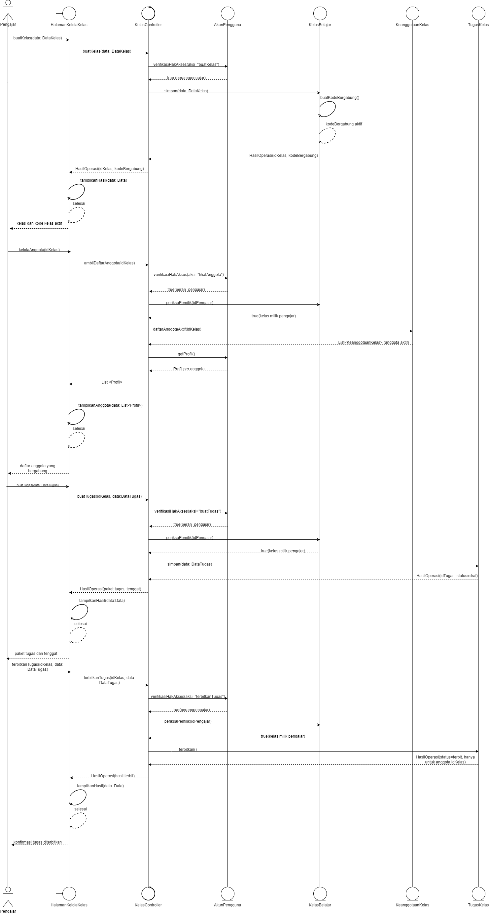
</p>
<p align="center"><i>Gambar 29. Diagram sekuens UC-07 - Skenario Normal</i></p>

- **Skenario Alternatif 1: Mengganti Kode Kelas**

<p align="center">
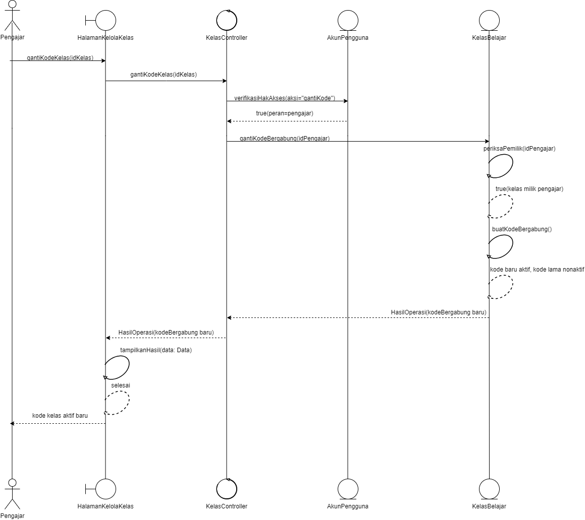
</p>
<p align="center"><i>Gambar 30. Diagram sekuens UC-07 - Skenario Alternatif 1: Mengganti Kode Kelas</i></p>

- **Skenario Alternatif 2: Mengeluarkan Anggota Kelas**

<p align="center">
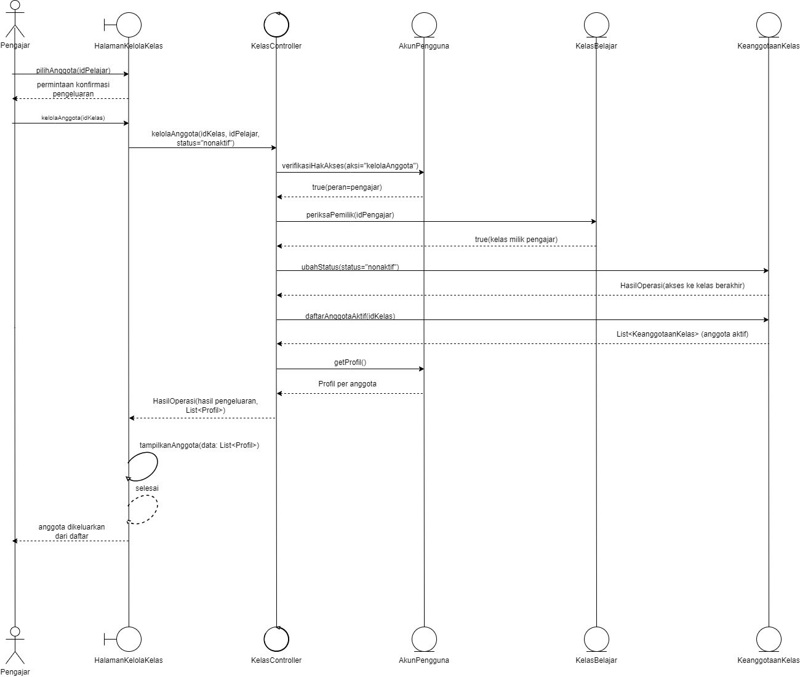
</p>
<p align="center"><i>Gambar 31. Diagram sekuens UC-07 - Skenario Alternatif 2: Mengeluarkan Anggota Kelas</i></p>

- **Skenario Alternatif 3: Mengaktifkan Papan Peringkat Kelas**

<p align="center">
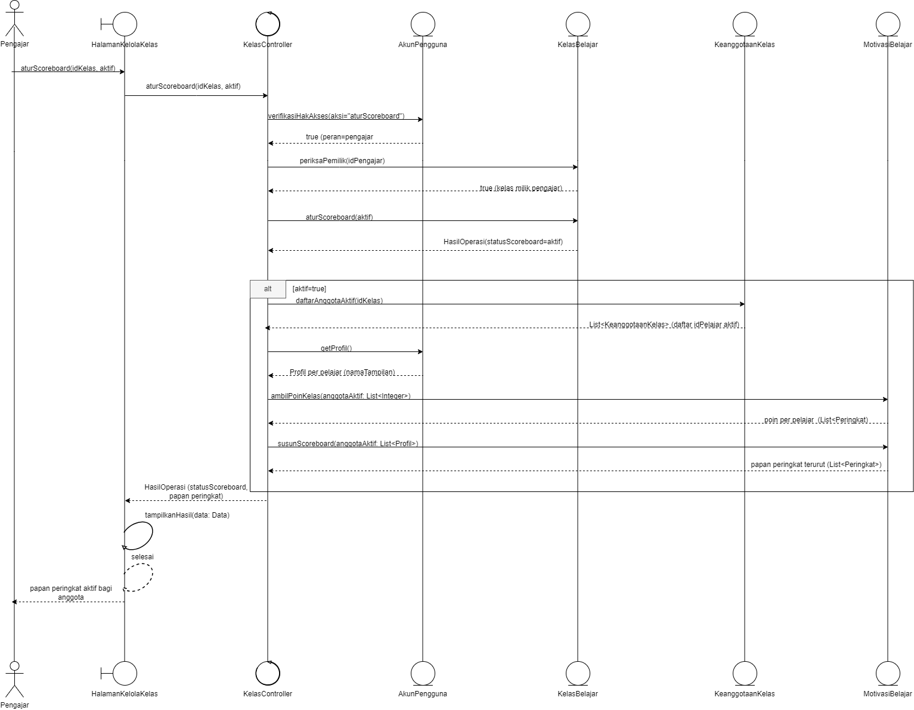
</p>
<p align="center"><i>Gambar 32. Diagram sekuens UC-07 - Skenario Alternatif 3: Mengaktifkan Papan Peringkat Kelas</i></p>

### 3.7.3 Diagram Kelas

<p align="center">
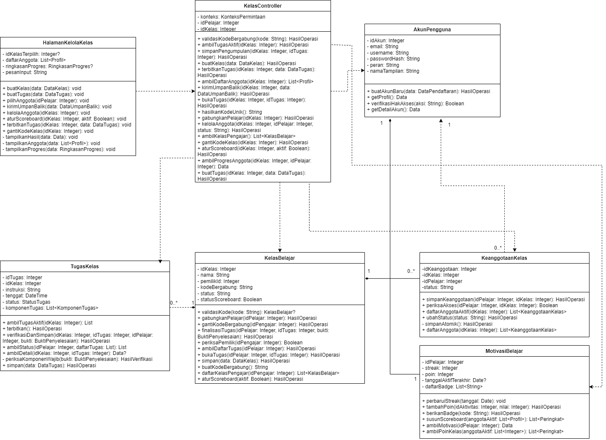
</p>
<p align="center"><i>Gambar 33. Diagram Kelas Menyiapkan Pembelajaran Kelas (UC-07)</i></p>

## 3.8 Use Case UC-08: Memantau dan Menindaklanjuti Progres

**ID Use Case:** UC-08  
**Nama Use Case:** Memantau dan Menindaklanjuti Progres

### 3.8.1 Identifikasi Kelas

Tabel 3.8. Identifikasi Kelas Use Case UC-08

| No  | Nama Kelas Perancangan     | Nama Kelas Analisis Terkait |
| :-- | :------------------------- | :-------------------------- |
| 1   | `HalamanKelolaKelas` (C12) | HalamanKelolaKelas (C12)    |
| 2   | `KelasController` (C20)    | KelasController (C20)       |
| 3   | `ProgresController` (C19)  | ProgresController (C19)     |
| 4   | `AkunPengguna` (C01)       | AkunPengguna (C01)          |
| 5   | `KeanggotaanKelas` (C24)   | KeanggotaanKelas (C24)      |
| 6   | `KelasBelajar` (C23)       | KelasBelajar (C23)          |
| 7   | `RiwayatLatihan` (C03)     | RiwayatLatihan (C03)        |

### 3.8.2 Sequence Diagram

- **Skenario Normal**

<p align="center">

</p>
<p align="center"><i>Gambar 34. Diagram sekuens UC-08 - Skenario Normal</i></p>

- **Skenario Alternatif 1: Belum ada hasil belajar anggota**

<p align="center">

</p>
<p align="center"><i>Gambar 35. Diagram sekuens UC-08 - Skenario Alternatif 1: Belum ada hasil belajar anggota</i></p>

- **Skenario Alternatif 2: Anggota yang dipilih bukan anggota aktif kelas**

<p align="center">

</p>
<p align="center"><i>Gambar 36.Diagram sekuens UC-08 - Skenario Alternatif 2: Anggota yang dipilih bukan anggota aktif kelas</i></p>

### 3.8.3 Diagram Kelas

<p align="center">

</p>
<p align="center"><i>Gambar 37. Diagram Kelas Memantau dan Menindaklanjuti Progres (UC-08)</i></p>

## 3.9 Use Case Menyampaikan Feedback

**ID Use Case:** UC-09
**Nama Use Case:** Menyampaikan Feedback

### 3.9.1 Identifikasi Kelas

Tabel 3.9.1 Identifikasi Kelas Use Case UC-09

| No  | Nama Kelas Perancangan   | Nama Kelas Analisis Terkait |
| :-- | :----------------------- | :-------------------------- |
| 1   | C10 - HalamanFeedback    | C10 - HalamanFeedback       |
| 2   | C18 - FeedbackController | C18 - FeedbackController    |
| 3   | C04 - DataFeedback       | C04 - DataFeedback          |
| 4   | C01 - AkunPengguna       | C01 - AkunPengguna          |

### 3.9.2 Sequence Diagram

- **Skenario Normal**

<p align="center">

</p>
<p align="center"><i>Gambar 38. Diagram sekuens UC-09 — Skenario Normal</i></p>

- **Skenario Alternatif 1: Feedback Gagal Terkirim**

<p align="center">

</p>
<p align="center"><i>Gambar 39. Diagram sekuens UC-09 — Alternatif 1: Feedback Gagal Terkirim</i></p>

### 3.9.3 Diagram Kelas

<p align="center">

</p>
<p align="center">
<i>Gambar 40. Diagram Kelas Menyampaikan Feedback</i>
</p>

---

# BAB 4: Diagram Kelas Keseluruhan

## 4.1 Diagram Kelas

<p align="center">

</p>
<p align="center">
<i>Gambar 41. Diagram Kelas Perancangan Keseluruhan Ngaksara</i>
</p>

Tabel 4.1. Daftar Kelas Perancangan Keseluruhan

| ID Kelas | Nama Kelas | Atribut | Metode/Operasi |
| :--- | :--- | :--- | :--- |
| C01 | AkunPengguna | `- idAkun: Integer`<br>`- email: String`<br>`- username: String`<br>`- passwordHash: String`<br>`- peran: String`<br>`- namaTampilan: String` | `+ buatAkunBaru(data: DataPendaftaran): HasilOperasi`<br>`+ getProfil(): Data`<br>`+ verifikasiHakAkses(aksi: String): Boolean`<br>`+ getDetailAkun(): Data` |
| C02 | MateriAksara | `- idMateri: Integer`<br>`- namaMateri: String`<br>`- jenisAksara: JenisAksara`<br>`- tingkatKesulitan: Integer`<br>`- statusPublikasi: StatusPublikasi` | `+ ambilMetadata(): MetadataMateri`<br>`+ ambilTargetLatihan(mode: ModeLatihan): TargetLatihan`<br>`+ perbaruiData(data: MetadataMateri): HasilOperasi`<br>`+ simpan(data: MetadataMateri): HasilOperasi`<br>`+ ambilDaftarMateri(filter: FilterMateri): List<MateriAksara>`<br>`+ ambilMateriRekomendasi(penguasaan: Data): List<MateriAksara>` |
| C03 | RiwayatLatihan | `- idRiwayat: Integer`<br>`- idPelajar: Integer`<br>`- idMateri: Integer`<br>`- mode: ModeLatihan?`<br>`- skor: Decimal?`<br>`- tanggalPengerjaan: DateTime`<br>`- status: String`<br>`- idTugas: Integer?`<br>`- idKomponen: Integer?`<br>`- modeAktivitas: String`<br>`- waktuSelesai: DateTime?` | `+ simpanHasil(hasil: HasilLatihan): HasilOperasi`<br>`+ catatAktivitas(aktivitas: AktivitasBelajar): HasilOperasi`<br>`+ ambilRiwayat(idPelajar: Integer, periode: Periode): List<RiwayatLatihan>`<br>`+ ambilBuktiPenyelesaian(idPelajar: Integer, idTugas: Integer): BuktiPenyelesaian`<br>`+ ambilStatusProgres(idPelajar: Integer): Data`<br>`+ hitungPenguasaan(idPelajar: Integer): Data`<br>`+ ambilRiwayatPelajar(idPelajar: Integer): List<RiwayatLatihan>`<br>`+ hitungPolaKesalahan(idPelajar: Integer): Data` |
| C04 | DataFeedback | `- idFeedback: Integer`<br>`- idAkun: Integer`<br>`- kategori: KategoriFeedback`<br>`- pesan: String`<br>`- waktuKirim: DateTime`<br>`- status: StatusFeedback` | `+ simpan(data: MasukanFeedback): HasilOperasi`<br>`+ perbaruiStatus(status: StatusFeedback): HasilOperasi` |
| C05 | HalamanPendaftaran | `- formInputData: DataPendaftaran`<br>`- statusPersetujuan: Boolean` | `+ tampilkanTnC(): void`<br>`+ kirimPendaftaran(data: DataPendaftaran): void`<br>`+ tampilkanOpsiPeran(): void` |
| C06 | HalamanLogin | `- emailInput: String`<br>`- statusTampilan: String` | `+ kirimKredensial(email: String, password: String): void`<br>`+ tampilkanStatusLogin(hasil: HasilOperasi): void` |
| C07 | HalamanUtama | `- profil: Profil`<br>`- menuTersedia: List<String>` | `+ tampilkanMenu(peran: Peran): void`<br>`+ pilihMenu(kode: String): void` |
| C08 | HalamanLatihan | `- modeLatihan: ModeLatihan`<br>`- jawabanInput: JawabanLatihan`<br>`- goresan: List<Goresan>`<br>`- hasilTampilan: HasilPenilaian?` | `+ pilihModeLatihan(mode: ModeLatihan): void`<br>`+ rekamGoresan(titik: Titik): void`<br>`+ kirimJawaban(jawaban: JawabanLatihan): void`<br>`+ tampilkanHasil(hasil: HasilPenilaian): void` |
| C09 | HalamanKelolaMateri | `- daftarMateri: List<MetadataMateri>`<br>`- detailInput: DataKonten`<br>`- fileMateriInput: Berkas?` | `+ unggahFileMateri(berkas: Berkas, detail: DataKonten): void`<br>`+ suntingMateri(idMateri: Integer): void`<br>`+ tampilkanStatus(hasil: HasilOperasi): void`<br>`+ tampilkanDaftarMateri(data: List<MateriAksara>): void` |
| C10 | HalamanFeedback | `- kategoriFeedback: KategoriFeedback`<br>`- pesanFeedback: String`<br>`- statusKirim: StatusKirim` | `+ kirimFeedback(data: MasukanFeedback): void`<br>`+ tampilkanKonfirmasi(hasil: HasilOperasi): void`<br>`+ tampilkanFormFeedback(): void` |
| C11 | HalamanKelasPelajar | `- kodeKelasInput: String`<br>`- tugasAktif: Integer?`<br>`- detailTugas: DetailTugas?`<br>`- idKelasAktif: Integer` | `+ kirimKodeBergabung(kode: String): void`<br>`+ bukaTugas(idKelas: Integer, idTugas: Integer): void`<br>`+ kerjakanTugas(idKelas: Integer, idTugas: Integer): void`<br>`- finalisasiTugas(idKelas: Integer, idTugas: Integer): HasilOperasi`<br>`+ bukaKelas(idKelas: Integer): void`<br>`- tampilkanPesan(pesan: String): void`<br>`- tampilkanTugas(data: Data): void`<br>`- tampilkanDetail(data: Data): void`<br>`- tampilkanHasil(data: Data): void`<br>`+ periksaPenyelesaian(idKelas: Integer, idTugas: Integer): void` |
| C12 | HalamanKelolaKelas | `- idKelasTerpilih: Integer?`<br>`- daftarAnggota: List<Profil>`<br>`- ringkasanProgres: RingkasanProgres?`<br>`- pesanInput: String` | `+ buatKelas(data: DataKelas): void`<br>`+ buatTugas(data: DataTugas): void`<br>`+ pilihAnggota(idPelajar: Integer): void`<br>`+ kirimUmpanBalik(data: DataUmpanBalik): void`<br>`+ kelolaAnggota(idKelas: Integer): void`<br>`+ aturScoreboard(idKelas: Integer, aktif: Boolean): void`<br>`+ terbitkanTugas(idKelas: Integer, data: DataTugas): void`<br>`+ gantiKodeKelas(idKelas: Integer): void`<br>`- tampilkanHasil(data: Data): void`<br>`- tampilkanAnggota(data: List<Profil>): void`<br>`- tampilkanProgres(data: RingkasanProgres): void` |
| C13 | HalamanMateri | `- materiTerpilih: Integer?`<br>`- statusTampilan: String`<br>`- statusAudio: String` | `+ pilihMateri(idMateri: Integer): void`<br>`+ tampilkanIsiMateri(paket: PaketMateri): void`<br>`+ putarAudioPengucapan(sumber: ReferensiBerkas): void` |
| C14 | HalamanProgres | `- filterPeriode: Periode`<br>`- dataTampilan: RingkasanProgres?`<br>`- idKelasTerpilih: Integer?` | `+ tampilkanProgres(data: RingkasanProgres): void`<br>`+ pilihPeriode(periode: Periode): void`<br>`+ tampilkanScoreboard(data: List<Peringkat>): void` |
| C15 | OtentikasiController | `- konteks: KonteksPermintaan` | `+ verifikasiFormatData(data: DataPendaftaran): HasilValidasi`<br>`- hashPassword(password: String): String`<br>`+ simpanAkun(data: DataPendaftaran): HasilOperasi`<br>`+ validasiLogin(email: String, password: String): HasilOperasi` |
| C16 | LatihanController | `- konteks: KonteksPermintaan` | `+ siapkanSoal(idMateri: Integer, mode: ModeLatihan): SoalLatihan`<br>`+ nilaiJawaban(jawaban: JawabanLatihan): HasilPenilaian`<br>`+ simpanHasil(hasil: HasilLatihan): HasilOperasi` |
| C17 | MateriController | `- konteks: KonteksPermintaan` | `+ ambilDaftarMateri(filter: FilterMateri): List<MetadataMateri>`<br>`+ muatPaketMateri(idMateri: Integer, versiAplikasi: String): PaketMateri`<br>`+ ambilAudioPengucapan(idMateri: Integer): HasilBerkas`<br>`+ ambilKontenLatihan(idMateri: Integer, mode: ModeLatihan): TargetLatihan`<br>`+ tambahMateri(data: DataKonten, berkas: Berkas): HasilOperasi`<br>`+ perbaruiMateri(idMateri: Integer, data: DataKonten): HasilOperasi`<br>`+ validasiFormatFile(berkas: Berkas): HasilValidasi`<br>`+ hapusMateri(idMateri: Integer): HasilOperasi` |
| C18 | FeedbackController | `- konteks: KonteksPermintaan` | `+ validasiFeedback(data: MasukanFeedback): HasilValidasi`<br>`+ simpanFeedback(data: MasukanFeedback): HasilOperasi`<br>`+ kirimKonfirmasi(hasil: HasilOperasi): Konfirmasi` |
| C19 | ProgresController | `- konteks: KonteksPermintaan` | `+ ambilRiwayat(idPelajar: Integer, periode: Periode): List<RiwayatLatihan>`<br>`+ hitungProgres(idPelajar: Integer): RingkasanProgres`<br>`+ siapkanRekomendasi(idPelajar: Integer): List<MetadataMateri>`<br>`+ ambilScoreboard(idKelas: Integer): HasilScoreboard`<br>`+ agregasiProgres(anggotaAktif: List<Integer>, periode: Periode): RingkasanProgres`<br>`+ hitungPolaKesalahan(idPelajar: Integer): Data` |
| C20 | KelasController | `- konteks: KonteksPermintaan`<br>`- idPelajar: Integer`<br>`- idKelas: Integer` | `+ validasiKodeBergabung(kode: String): HasilOperasi`<br>`+ ambilTugasAktif(idKelas: Integer): HasilOperasi`<br>`+ simpanPengumpulan(idKelas: Integer, idTugas: Integer): HasilOperasi`<br>`+ buatKelas(data: DataKelas): HasilOperasi`<br>`+ terbitkanTugas(idKelas: Integer, data: DataTugas): HasilOperasi`<br>`+ ambilDaftarAnggota(idKelas: Integer): List<Profil>`<br>`+ kirimUmpanBalik(idKelas: Integer, data: DataUmpanBalik): HasilOperasi`<br>`+ bukaTugas(idKelas: Integer, idTugas: Integer): HasilOperasi`<br>`+ hasilkanKodeUnik(): String`<br>`+ gabungkanPelajar(idKelas: Integer): HasilOperasi`<br>`+ kelolaAnggota(idKelas: Integer, idPelajar: Integer, status: String): HasilOperasi`<br>`+ ambilKelasPengajar(): List<KelasBelajar>`<br>`+ gantiKodeKelas(idKelas: Integer): HasilOperasi`<br>`+ aturScoreboard(idKelas: Integer, aktif: Boolean): HasilOperasi`<br>`+ ambilProgresAnggota(idKelas: Integer, idPelajar: Integer): Data`<br>`+ buatTugas(idKelas: Integer, data: DataTugas): HasilOperasi` |
| C21 | KontenMateri | `- idKonten: Integer`<br>`- idMateri: Integer`<br>`- bentukAksara: String`<br>`- aturan: String`<br>`- contoh: String`<br>`- pathAudio: String?`<br>`- versiKonten: String`<br>`- versiAplikasiMinimum: String` | `+ ambilKonten(versiAplikasi: String): PaketMateri`<br>`+ ambilAudio(): HasilBerkas`<br>`+ perbaruiKonten(data: DataKonten): HasilOperasi`<br>`+ arsipkanVersi(): HasilOperasi`<br>`+ simpanKonten(data: DataKonten): HasilOperasi` |
| C22 | MotivasiBelajar | `- idPelajar: Integer`<br>`- streak: Integer`<br>`- poin: Integer`<br>`- tanggalAktifTerakhir: Date?`<br>`- daftarBadge: List<String>` | `+ perbaruiStreak(tanggal: Date): void`<br>`+ tambahPoin(idAktivitas: Integer, nilai: Integer): HasilOperasi`<br>`+ berikanBadge(kode: String): HasilOperasi`<br>`+ susunScoreboard(anggotaAktif: List<Profil>): List<Peringkat>`<br>`+ ambilMotivasi(idPelajar: Integer): Data`<br>`+ ambilPoinKelas(anggotaAktif: List<Integer>): List<Peringkat>` |
| C23 | KelasBelajar | `- idKelas: Integer`<br>`- nama: String`<br>`- pemilikId: Integer`<br>`- kodeBergabung: String`<br>`- status: String`<br>`- statusScoreboard: Boolean` | `+ validasiKode(kode: String): KelasBelajar?`<br>`+ gabungkanPelajar(idPelajar: Integer): HasilOperasi`<br>`+ gantiKodeBergabung(idPengajar: Integer): HasilOperasi`<br>`+ finalisasiTugas(idPelajar: Integer, idTugas: Integer, bukti: BuktiPenyelesaian): HasilOperasi`<br>`+ periksaPemilik(idPengajar: Integer): Boolean`<br>`+ ambilDaftarTugas(idPelajar: Integer): HasilOperasi`<br>`+ bukaTugas(idPelajar: Integer, idTugas: Integer): HasilOperasi`<br>`+ simpan(data: DataKelas): HasilOperasi`<br>`+ buatKodeBergabung(): String`<br>`+ daftarKelasPengajar(idPengajar: Integer): List<KelasBelajar>`<br>`+ aturScoreboard(aktif: Boolean): HasilOperasi` |
| C24 | KeanggotaanKelas | `- idKeanggotaan: Integer`<br>`- idKelas: Integer`<br>`- idPelajar: Integer`<br>`- status: String` | `+ simpanKeanggotaan(idPelajar: Integer, idKelas: Integer): HasilOperasi`<br>`+ periksaAkses(idPelajar: Integer, idKelas: Integer): Boolean`<br>`+ daftarAnggotaAktif(idKelas: Integer): List<KeanggotaanKelas>`<br>`+ ubahStatus(status: String): HasilOperasi`<br>`- simpanAtomik(): HasilOperasi`<br>`+ daftarAnggota(idKelas: Integer): List<KeanggotaanKelas>` |
| C25 | TugasKelas | `- idTugas: Integer`<br>`- idKelas: Integer`<br>`- instruksi: String`<br>`- tenggat: DateTime`<br>`- status: StatusTugas`<br>`- komponenTugas: List<KomponenTugas>` | `+ ambilTugasAktif(idKelas: Integer): List`<br>`+ terbitkan(): HasilOperasi`<br>`+ verifikasiDanSimpan(idKelas: Integer, idTugas: Integer, idPelajar: Integer, bukti: BuktiPenyelesaian): HasilOperasi`<br>`+ ambilStatus(idPelajar: Integer, daftarTugas: List): List`<br>`+ ambilDetail(idKelas: Integer, idTugas: Integer): Data?`<br>`- periksaKomponenWajib(bukti: BuktiPenyelesaian): HasilVerifikasi`<br>`+ simpan(data: DataTugas): HasilOperasi` |
| C26 | PenyelesaianTugas | `- idPenyelesaian: Integer`<br>`- idTugas: Integer`<br>`- idPelajar: Integer`<br>`- waktuKumpul: DateTime`<br>`- status: String` | `+ simpanPengumpulan(idPelajar: Integer, idTugas: Integer, waktuSelesai: DateTime, tenggat: DateTime): HasilOperasi`<br>`- tentukanStatusKetepatan(waktuSelesai: DateTime, tenggat: DateTime): String`<br>`+ ambilStatus(idPelajar: Integer, daftarTugas: List): List`<br>`- simpanAtomik(): HasilOperasi`<br>`- batalkanTransaksi(): void` |

<br>

---

# BAB 5: Perancangan Rinci Kelas

Tabel 5.1 memuat daftar seluruh kelas perancangan beserta kelas analisis terkait. Subbab berikutnya menjabarkan operasi, atribut, serta algoritma dan query yang penting untuk setiap kelas.

Tabel 5.1. Daftar Kelas Perancangan dan Kelas Analisis Terkait

| No  | Nama Kelas Perancangan       | Nama Kelas Analisis Terkait |
| :-- | :--------------------------- | :-------------------------- |
| 1   | `AkunPengguna` (C01)         | AkunPengguna (C01)          |
| 2   | `MateriAksara` (C02)         | MateriAksara (C02)          |
| 3   | `RiwayatLatihan` (C03)       | RiwayatLatihan (C03)        |
| 4   | `DataFeedback` (C04)         | DataFeedback (C04)          |
| 5   | `HalamanPendaftaran` (C05)   | HalamanPendaftaran (C05)    |
| 6   | `HalamanLogin` (C06)         | HalamanLogin (C06)          |
| 7   | `HalamanUtama` (C07)         | HalamanUtama (C07)          |
| 8   | `HalamanLatihan` (C08)       | HalamanLatihan (C08)        |
| 9   | `HalamanKelolaMateri` (C09)  | HalamanKelolaMateri (C09)   |
| 10  | `HalamanFeedback` (C10)      | HalamanFeedback (C10)       |
| 11  | `HalamanKelasPelajar` (C11)  | HalamanKelasPelajar (C11)   |
| 12  | `HalamanKelolaKelas` (C12)   | HalamanKelolaKelas (C12)    |
| 13  | `HalamanMateri` (C13)        | HalamanMateri (C13)         |
| 14  | `HalamanProgres` (C14)       | HalamanProgres (C14)        |
| 15  | `OtentikasiController` (C15) | OtentikasiController (C15)  |
| 16  | `LatihanController` (C16)    | LatihanController (C16)     |
| 17  | `MateriController` (C17)     | MateriController (C17)      |
| 18  | `FeedbackController` (C18)   | FeedbackController (C18)    |
| 19  | `ProgresController` (C19)    | ProgresController (C19)     |
| 20  | `KelasController` (C20)      | KelasController (C20)       |
| 21  | `KontenMateri` (C21)         | KontenMateri (C21)          |
| 22  | `MotivasiBelajar` (C22)      | MotivasiBelajar (C22)       |
| 23  | `KelasBelajar` (C23)         | KelasBelajar (C23)          |
| 24  | `KeanggotaanKelas` (C24)     | KeanggotaanKelas (C24)      |
| 25  | `TugasKelas` (C25)           | TugasKelas (C25)            |
| 26  | `PenyelesaianTugas` (C26)    | PenyelesaianTugas (C26)     |

## 5.1 Kelas AkunPengguna

**Nama Kelas:** AkunPengguna  
**ID Kelas:** C01  
**Jenis:** Model

Menyimpan kredensial, profil, dan peran Pelajar, Pengajar, atau Tim Materi, serta menjadi acuan hak akses seluruh fitur.

Tabel 5.1.1. Operasi Kelas AkunPengguna

| Nama Operasi | Visibility (private, public) | Keterangan |
| :--- | :--- | :--- |
| `buatAkunBaru(data: DataPendaftaran): HasilOperasi` | public | Menyimpan akun baru dari email, username, `passwordHash`, peran, dan nama tampilan. Menolak email atau username yang sudah dipakai (UC-01 Skenario Alternatif 1). Lihat Algo-001. |
| `cariBerdasarkanEmail(email: String): AkunPengguna?` | public | Mengambil akun berdasarkan email untuk proses login. Mengembalikan `null` jika tidak ada. |
| `cocokkanPassword(password: String): Boolean` | public | Memeriksa kata sandi terhadap `passwordHash` tanpa mengeluarkan nilai hash dari objek. |
| `getProfil(): Data` | public | Mengembalikan `idAkun`, `username`, `namaTampilan`, dan `peran`. Dipakai `HalamanUtama` dan `FeedbackController`. Tidak memuat email dan `passwordHash`. |
| `getDetailAkun(): Data` | public | Mengembalikan profil beserta email untuk halaman akun milik pengguna sendiri. Tidak memuat `passwordHash`. |
| `verifikasiHakAkses(aksi: String): Boolean` | public | Memeriksa apakah peran akun boleh menjalankan aksi tertentu (KF02). Lihat Algo-002. |

Tabel 5.1.2. Atribut Kelas AkunPengguna

| Nama Atribut | Visibility (private, public) | Tipe |
| :--- | :--- | :--- |
| `idAkun` | private | Integer |
| `email` | private | String |
| `username` | private | String |
| `passwordHash` | private | String |
| `peran` | private | String (`PELAJAR`, `PENGAJAR`, atau `TIM_MATERI`) |
| `namaTampilan` | private | String |

### 5.1.1 Algoritma/Query

**Nama Kelas:** AkunPengguna  
**Nama Operasi:** `buatAkunBaru(data: DataPendaftaran): HasilOperasi`  
**ID Algoritma:** Algo-001

```text
FUNCTION buatAkunBaru(data: DataPendaftaran): HasilOperasi
  // data.passwordHash sudah di-hash oleh OtentikasiController.hashPassword()
  email ← huruf kecil(trim(data.email))
  cek ← jalankan Q-001.1
  IF cek.email_dipakai > 0 THEN
    RETURN HasilOperasi.gagal("EMAIL_TERDAFTAR", "Email sudah terdaftar")
  IF cek.username_dipakai > 0 THEN
    RETURN HasilOperasi.gagal("USERNAME_TERPAKAI", "Username sudah digunakan")

  TRY
    idBaru ← jalankan Q-001.2
  CATCH pelanggaran indeks unik          // dua pendaftaran bersamaan dengan data sama
    RETURN HasilOperasi.gagal("AKUN_SUDAH_ADA", "Email atau username sudah digunakan")

  this.idAkun ← idBaru
  this.email ← email;  this.username ← data.username
  this.passwordHash ← data.passwordHash;  this.peran ← data.peran
  this.namaTampilan ← data.namaTampilan ?? data.username
  RETURN HasilOperasi.sukses(idAkun = idBaru)
```

Tabel 5.1.3. Query Operasi buatAkunBaru

| No Query | Query | Keterangan |
| :--- | :--- | :--- |
| Q-001.1 | `SELECT COALESCE(SUM(email = :email), 0) AS email_dipakai, COALESCE(SUM(username = :username), 0) AS username_dipakai FROM akun_pengguna WHERE email = :email OR username = :username;` | Memeriksa apakah email atau username sudah dipakai, agar pesan galat dapat menyebut isian yang bermasalah. |
| Q-001.2 | `INSERT INTO akun_pengguna (email, username, password_hash, peran, nama_tampilan, created_at) VALUES (:email, :username, :password_hash, :peran, :nama_tampilan, NOW());` | Menyimpan akun baru. Kolom `email` dan `username` diberi indeks `UNIQUE` sebagai pengaman terakhir. |

### 5.1.2 Algoritma/Query

**Nama Kelas:** AkunPengguna  
**Nama Operasi:** `verifikasiHakAkses(aksi: String): Boolean`  
**ID Algoritma:** Algo-002

Hak akses diturunkan dari aktor setiap use case pada SKPL. Satu tabel ini juga dipakai `HalamanUtama` untuk menentukan menu yang tampil.

```text
FUNCTION verifikasiHakAkses(aksi: String): Boolean
  HAK ← {
    PELAJAR:    {MEMPELAJARI_MATERI, MENGERJAKAN_LATIHAN, MELIHAT_PROGRES,
                 MENGIKUTI_KELAS, KIRIM_FEEDBACK},                        // UC-02–UC-05, UC-09
    PENGAJAR:   {KELOLA_KELAS, BUAT_KELAS, BUAT_TUGAS, TERBITKAN_TUGAS,
                 GANTI_KODE, KELOLA_ANGGOTA, LIHAT_ANGGOTA, ATUR_SCOREBOARD,
                 PANTAU_PROGRES, KIRIM_FEEDBACK},                         // UC-07–UC-09
    TIM_MATERI: {KELOLA_MATERI}                                           // UC-06
  }
  IF this.idAkun = null OR this.peran NOT IN HAK THEN
    RETURN false
  kode ← normalisasi(aksi)      // "kelola_materi", "kelolaMateri", "KELOLA_MATERI" → "KELOLA_MATERI"
  RETURN kode IN HAK[this.peran]

FUNCTION normalisasi(aksi: String): String
  sisipkan "_" sebelum setiap huruf besar yang didahului huruf kecil   // camelCase → snake_case
  RETURN huruf besar(hasil)
```

### 5.1.3 Algoritma/Query

**Nama Kelas:** AkunPengguna  
**Nama Operasi:** `cariBerdasarkanEmail(email: String): AkunPengguna?`

Tabel 5.1.4. Query Operasi cariBerdasarkanEmail

| No Query | Query | Keterangan |
| :--- | :--- | :--- |
| Q-002 | `SELECT id_akun, email, username, password_hash, peran, nama_tampilan FROM akun_pengguna WHERE email = :email LIMIT 1;` | Mengambil akun untuk proses login. Email dibandingkan dalam huruf kecil. |

## 5.2 Kelas MateriAksara

**Nama Kelas:** MateriAksara  
**ID Kelas:** C02

Tabel 5.2.1. Operasi Kelas MateriAksara

| Nama Operasi                                                   | Visibility (private, public) | Keterangan                                                                                                                                                |
| :------------------------------------------------------------- | :--------------------------- | :-------------------------------------------------------------------------------------------------------------------------------------------------------- |
| `ambilMetadata(): MetadataMateri`                              | public                       | Mengemas `idMateri`, `namaMateri`, `jenisAksara`, `tingkatKesulitan`, dan `statusPublikasi` milik objek ini menjadi `MetadataMateri` untuk daftar materi. |
| `ambilTargetLatihan(mode: ModeLatihan): TargetLatihan`         | public                       | Menyusun daftar aksara/kata target latihan dari konten materi sesuai mode (menulis, bunyi, merangkai).                                                    |
| `perbaruiData(data: MetadataMateri): HasilOperasi`             | public                       | Memperbarui nama, jenis aksara, tingkat kesulitan, dan status publikasi materi.                                                                           |
| `simpan(data: MetadataMateri): HasilOperasi`                   | public                       | Menyimpan metadata materi baru dan mengembalikan `idMateri` yang terbentuk.                                                                               |
| `ambilDaftarMateri(filter: FilterMateri): List<MateriAksara>`  | public                       | Mengambil materi yang belum dihapus sesuai filter jenis aksara, tingkat, dan cakupan status publikasi.                                                    |
| `ambilMateriRekomendasi(penguasaan: Data): List<MateriAksara>` | public                       | Memilih materi terbit yang belum dikuasai pelajar berdasarkan data penguasaan.                                                                            |

Tabel 5.2.2. Atribut Kelas MateriAksara

| Nama Atribut       | Visibility (private, public) | Tipe            |
| :----------------- | :--------------------------- | :-------------- |
| `idMateri`         | private                      | Integer         |
| `namaMateri`       | private                      | String          |
| `jenisAksara`      | private                      | JenisAksara     |
| `tingkatKesulitan` | private                      | Integer         |
| `statusPublikasi`  | private                      | StatusPublikasi |

### 5.2.1 Algoritma/Query

**Nama Kelas:** MateriAksara  
**Nama Operasi:** `ambilDaftarMateri(filter: FilterMateri): List<MateriAksara>`  
**ID Algoritma:** Algo-040

```text
FUNCTION ambilDaftarMateri(filter: FilterMateri): List<MateriAksara>
  // filter.jenisAksara (nullable), filter.tingkatKesulitan (nullable),
  // filter.termasukDraf (Boolean; true hanya untuk Tim Materi)
  baris ← jalankan Q-040.1 dengan parameter filter
  daftar ← list kosong
  FOR EACH b IN baris DO
    daftar.tambah( bentuk MateriAksara dari b )
  RETURN daftar            // daftar kosong BUKAN galat; tampilan menampilkan pesan "belum tersedia"
```

Tabel 5.2.3. Query Operasi ambilDaftarMateri

| No Query | Query                                                                                                                                                                                                                                                                                                                                              | Keterangan                                                                                       |
| :------- | :------------------------------------------------------------------------------------------------------------------------------------------------------------------------------------------------------------------------------------------------------------------------------------------------------------------------------------------------- | :----------------------------------------------------------------------------------------------- |
| Q-040.1  | `SELECT id_materi, nama_materi, jenis_aksara, tingkat_kesulitan, status_publikasi FROM materi_aksara WHERE deleted_at IS NULL AND (:jenis IS NULL OR jenis_aksara = :jenis) AND (:tingkat IS NULL OR tingkat_kesulitan = :tingkat) AND (:termasuk_draf = 1 OR status_publikasi = 'TERBIT') ORDER BY jenis_aksara, tingkat_kesulitan, nama_materi;` | Mengambil materi sesuai filter; pelajar hanya melihat `TERBIT`, Tim Materi dapat melihat `DRAF`. |

### 5.2.2 Algoritma/Query

**Nama Kelas:** MateriAksara  
**Nama Operasi:** `ambilMateriRekomendasi(penguasaan: Data): List<MateriAksara>`  
**ID Algoritma:** Algo-041

```text
FUNCTION ambilMateriRekomendasi(penguasaan: Data): List<MateriAksara>
  // penguasaan: pemetaan idMateri → skor 0..100 (hasil RiwayatLatihan.hitungPenguasaan)
  AMBANG ← 70
  semua ← jalankan Q-041        // materi TERBIT, urut jenis, tingkat
  kandidat ← list kosong

  FOR EACH m IN semua DO
    skor ← penguasaan[m.idMateri]            // null bila belum pernah dilatih
    IF skor = null OR skor < AMBANG THEN
      // tingkat terbuka bila seluruh materi tingkat di bawahnya (jenis sama) sudah ≥ AMBANG
      IF semuaTingkatDiBawahTuntas(m, semua, penguasaan, AMBANG) THEN
        kandidat.tambah(m)

  urutkan kandidat berdasarkan (tingkatKesulitan ASC, skor ASC; skor null dianggap 0)
  RETURN kandidat.ambil(3 teratas)
```

Tabel 5.2.4. Query Operasi ambilMateriRekomendasi

| No Query | Query                                                                                                                                                                                                               | Keterangan                                                                              |
| :------- | :------------------------------------------------------------------------------------------------------------------------------------------------------------------------------------------------------------------ | :-------------------------------------------------------------------------------------- |
| Q-041    | `SELECT id_materi, nama_materi, jenis_aksara, tingkat_kesulitan, status_publikasi FROM materi_aksara WHERE deleted_at IS NULL AND status_publikasi = 'TERBIT' ORDER BY jenis_aksara, tingkat_kesulitan, id_materi;` | Mengambil seluruh materi terbit sebagai kandidat; penyaringan skor dilakukan pada kode. |

### 5.2.3 Algoritma/Query

**Nama Kelas:** MateriAksara  
**Nama Operasi:** `ambilTargetLatihan(mode: ModeLatihan): TargetLatihan`  
**ID Algoritma:** Algo-042

```text
FUNCTION ambilTargetLatihan(mode: ModeLatihan): TargetLatihan
  baris ← jalankan Q-042 dengan idMateri = this.idMateri
  IF baris = null THEN
    RETURN TargetLatihan.kosong()            // materi belum punya konten

  SWITCH mode
    CASE MENULIS, BUNYI:
      butir ← pecah(baris.bentuk_aksara)      // satu aksara per elemen
    CASE MERANGKAI:
      butir ← pecah(baris.contoh)             // kata/rangkaian contoh

  RETURN TargetLatihan(idMateri = this.idMateri, mode = mode, butir = butir)
```

Tabel 5.2.5. Query Operasi ambilTargetLatihan

| No Query | Query                                                                           | Keterangan                                                                                      |
| :------- | :------------------------------------------------------------------------------ | :---------------------------------------------------------------------------------------------- |
| Q-042    | `SELECT bentuk_aksara, contoh FROM konten_materi WHERE id_materi = :id_materi;` | Mengambil bahan target latihan dari konten materi (relasi komposisi MateriAksara–KontenMateri). |

### 5.2.4 Algoritma/Query

**Nama Kelas:** MateriAksara  
**Nama Operasi:** `simpan(data: MetadataMateri): HasilOperasi`  
**ID Algoritma:** Algo-043

```text
FUNCTION simpan(data: MetadataMateri): HasilOperasi
  IF kosong(trim(data.namaMateri)) OR panjang(data.namaMateri) > 100 THEN
    RETURN HasilOperasi.gagal("NAMA_TIDAK_VALID", "Nama materi wajib diisi (maks. 100 karakter)")
  IF data.jenisAksara NOT IN {JAWA, SUNDA} OR data.tingkatKesulitan NOT IN {1,2,3} THEN
    RETURN HasilOperasi.gagal("DATA_TIDAK_VALID", "Jenis aksara atau tingkat tidak valid")

  jumlah ← jalankan Q-043.1
  IF jumlah > 0 THEN
    RETURN HasilOperasi.gagal("DUPLIKAT", "Materi dengan nama, jenis, dan tingkat sama sudah ada")

  status ← IF data.terbitkan THEN TERBIT ELSE DRAF
  idBaru ← jalankan Q-043.2
  RETURN HasilOperasi.sukses(idMateri = idBaru)
```

Tabel 5.2.6. Query Operasi simpan

| No Query | Query                                                                                                                                             | Keterangan                      |
| :------- | :------------------------------------------------------------------------------------------------------------------------------------------------ | :------------------------------ |
| Q-043.1  | `SELECT COUNT(*) FROM materi_aksara WHERE nama_materi = :nama AND jenis_aksara = :jenis AND tingkat_kesulitan = :tingkat AND deleted_at IS NULL;` | Mencegah materi ganda.          |
| Q-043.2  | `INSERT INTO materi_aksara (nama_materi, jenis_aksara, tingkat_kesulitan, status_publikasi) VALUES (:nama, :jenis, :tingkat, :status);`           | Menyimpan metadata materi baru. |

### 5.2.5 Algoritma/Query

**Nama Kelas:** MateriAksara  
**Nama Operasi:** `perbaruiData(data: MetadataMateri): HasilOperasi`  
**ID Algoritma:** Algo-044

```text
FUNCTION perbaruiData(data: MetadataMateri): HasilOperasi
  jumlah ← jalankan Q-044.1 (kecuali baris milik this.idMateri)
  IF jumlah > 0 THEN
    RETURN HasilOperasi.gagal("DUPLIKAT", "Materi dengan nama, jenis, dan tingkat sama sudah ada")

  baris ← jalankan Q-044.2
  IF baris = 0 THEN
    RETURN HasilOperasi.gagal("TIDAK_DITEMUKAN", "Materi tidak ditemukan")

  this.namaMateri ← data.namaMateri
  this.jenisAksara ← data.jenisAksara
  this.tingkatKesulitan ← data.tingkatKesulitan
  this.statusPublikasi ← data.statusPublikasi
  RETURN HasilOperasi.sukses(idMateri = this.idMateri)
```

Tabel 5.2.7. Query Operasi perbaruiData

| No Query | Query                                                                                                                                                                         | Keterangan                      |
| :------- | :---------------------------------------------------------------------------------------------------------------------------------------------------------------------------- | :------------------------------ |
| Q-044.1  | `SELECT COUNT(*) FROM materi_aksara WHERE nama_materi = :nama AND jenis_aksara = :jenis AND tingkat_kesulitan = :tingkat AND id_materi <> :id AND deleted_at IS NULL;`        | Cek duplikat selain materi ini. |
| Q-044.2  | `UPDATE materi_aksara SET nama_materi = :nama, jenis_aksara = :jenis, tingkat_kesulitan = :tingkat, status_publikasi = :status WHERE id_materi = :id AND deleted_at IS NULL;` | Memperbarui metadata.           |

## 5.3 Kelas RiwayatLatihan

**Nama Kelas:** RiwayatLatihan  
**ID Kelas:** C03  
**Jenis:** Model

Menyimpan hasil latihan, status, dan waktu pengerjaan Pelajar.

Tabel 5.3.1. Operasi Kelas RiwayatLatihan

| Nama Operasi | Visibility (private, public) | Keterangan |
| :--- | :--- | :--- |
| `simpanHasil(hasil: HasilLatihan): HasilOperasi` | public | Menyimpan hasil satu latihan beserta skor dan status (berhasil atau perlu diulang). |
| `catatAktivitas(aktivitas: AktivitasBelajar): HasilOperasi` | public | Mencatat aktivitas belajar selain latihan, misalnya komponen tugas kelas yang diselesaikan (KF14). |
| `ambilRiwayat(idPelajar: Integer, periode: Periode): List<RiwayatLatihan>` | public | Mengambil riwayat milik satu Pelajar pada periode tertentu. |
| `ambilBuktiPenyelesaian(idPelajar: Integer, idTugas: Integer): BuktiPenyelesaian` | public | Mengambil catatan komponen tugas yang sudah diselesaikan Pelajar. |
| `ambilStatusProgres(idPelajar: Integer): Data` | public | Mengembalikan status belajar (belum, sedang, selesai) untuk setiap materi pada daftar. |
| `hitungPenguasaan(idPelajar: Integer): Data` | public | Menghitung tingkat penguasaan per materi dari riwayat. Nilai ini dihitung, tidak disimpan. |
| `ambilRiwayatPelajar(idPelajar: Integer): List<RiwayatLatihan>` | public | Mengambil riwayat sejumlah Pelajar sekaligus untuk pemantauan kelas. |
| `hitungPolaKesalahan(idPelajar: Integer): Data` | public | Menghitung aksara yang paling sering salah pada sekelompok Pelajar. |
| `cekPernahSelesai(idPelajar: Integer, targetSoal: String, mode: ModeLatihan): Boolean` | public | Memeriksa apakah soal yang sama sudah pernah diselesaikan, agar poin tidak diberikan dua kali. |
| `ambilRiwayatMateri(idPelajar: Integer, idMateri: Integer): List<RiwayatLatihan>` | public | Mengambil seluruh riwayat Pelajar pada satu materi untuk halaman detail hasil. |

Tabel 5.3.2. Atribut Kelas RiwayatLatihan

| Nama Atribut | Visibility (private, public) | Tipe |
| :--- | :--- | :--- |
| `idRiwayat` | private | `Integer` |
| `idPelajar` | private | `Integer` |
| `idMateri` | private | `Integer` |
| `mode` | private | `ModeLatihan?` |
| `skor` | private | `Decimal?` |
| `tanggalPengerjaan` | private | `DateTime` |
| `status` | private | `String` |
| `idTugas` | private | `Integer?` |
| `idKomponen` | private | `Integer?` |
| `modeAktivitas` | private | `String` |
| `waktuSelesai` | private | `DateTime?` |
| `targetSoal` | private | `String?` |

### 5.3.1 Algoritma/Query: simpanHasil

**Nama Kelas:** RiwayatLatihan  
**Nama Operasi:** `simpanHasil(hasil: HasilLatihan): HasilOperasi`

Tabel 5.3.3. Query Operasi simpanHasil

| No Query | Query | Keterangan |
| :--- | :--- | :--- |
| Q-008 | `INSERT INTO riwayat_latihan (id_pelajar, id_materi, target_soal, mode, skor,   tanggal_pengerjaan, status, mode_aktivitas) VALUES (:id_pelajar, :id_materi, :target_soal, :mode, :skor, NOW(), :status, 'latihan');` | Menyimpan hasil satu latihan. |

### 5.3.2 Algoritma/Query: catatAktivitas

**Nama Kelas:** RiwayatLatihan  
**Nama Operasi:** `catatAktivitas(aktivitas: AktivitasBelajar): HasilOperasi`

Tabel 5.3.4. Query Operasi catatAktivitas

| No Query | Query | Keterangan |
| :--- | :--- | :--- |
| Q-016 | `INSERT INTO riwayat_latihan (id_pelajar, id_materi, tanggal_pengerjaan, status,   id_tugas, id_komponen, mode_aktivitas, waktu_selesai) VALUES (:id_pelajar, :id_materi, NOW(), :status, :id_tugas, :id_komponen, :mode_aktivitas, :waktu_selesai);` | Mencatat aktivitas belajar selain latihan. |

### 5.3.3 Algoritma/Query: ambilRiwayat

**Nama Kelas:** RiwayatLatihan  
**Nama Operasi:** `ambilRiwayat(idPelajar: Integer, periode: Periode): List<RiwayatLatihan>`

Tabel 5.3.5. Query Operasi ambilRiwayat

| No Query | Query | Keterangan |
| :--- | :--- | :--- |
| Q-011 | `SELECT id_riwayat, id_materi, mode, skor, status, tanggal_pengerjaan FROM riwayat_latihan WHERE id_pelajar = :id_pelajar   AND tanggal_pengerjaan BETWEEN :mulai AND :selesai ORDER BY tanggal_pengerjaan DESC;` | Riwayat Pelajar pada periode terpilih. |

### 5.3.4 Algoritma/Query: ambilBuktiPenyelesaian

**Nama Kelas:** RiwayatLatihan  
**Nama Operasi:** `ambilBuktiPenyelesaian(idPelajar: Integer, idTugas: Integer): BuktiPenyelesaian`

Tabel 5.3.6. Query Operasi ambilBuktiPenyelesaian

| No Query | Query | Keterangan |
| :--- | :--- | :--- |
| Q-015 | `SELECT id_komponen, waktu_selesai FROM riwayat_latihan WHERE id_pelajar = :id_pelajar AND id_tugas = :id_tugas AND id_komponen IS NOT NULL;` | Komponen tugas yang sudah diselesaikan Pelajar. |

### 5.3.5 Algoritma/Query: ambilStatusProgres

**Nama Kelas:** RiwayatLatihan  
**Nama Operasi:** `ambilStatusProgres(idPelajar: Integer): Data`

Tabel 5.3.7. Query Operasi ambilStatusProgres

| No Query | Query | Keterangan |
| :--- | :--- | :--- |
| Q-012 | `SELECT id_materi, SUM(status = 'berhasil') AS jumlah_berhasil, COUNT(*) AS jumlah_percobaan FROM riwayat_latihan WHERE id_pelajar = :id_pelajar AND id_materi IN (:daftar_id_materi) GROUP BY id_materi;` | Materi tanpa baris berstatus belum, jumlah_berhasil 0 berstatus sedang, selebihnya selesai. |

### 5.3.6 Algoritma/Query: hitungPenguasaan

**Nama Kelas:** RiwayatLatihan  
**Nama Operasi:** `hitungPenguasaan(idPelajar: Integer): Data`

Tabel 5.3.8. Query Operasi hitungPenguasaan

| No Query | Query | Keterangan |
| :--- | :--- | :--- |
| Q-010 | `SELECT id_materi, ROUND(AVG(skor), 2) AS penguasaan FROM riwayat_latihan WHERE id_pelajar = :id_pelajar AND skor IS NOT NULL GROUP BY id_materi;` | Penguasaan per materi sebagai rata-rata skor. Dihitung setiap kali, tidak disimpan. |

### 5.3.7 Algoritma/Query: ambilRiwayatPelajar

**Nama Kelas:** RiwayatLatihan  
**Nama Operasi:** `ambilRiwayatPelajar(idPelajar: Integer): List<RiwayatLatihan>`

Tabel 5.3.9. Query Operasi ambilRiwayatPelajar

| No Query | Query | Keterangan |
| :--- | :--- | :--- |
| Q-014 | `SELECT id_pelajar, id_materi, mode, skor, status, tanggal_pengerjaan FROM riwayat_latihan WHERE id_pelajar = :id_pelajar ORDER BY tanggal_pengerjaan DESC;` | Riwayat satu Pelajar. Dipanggil untuk setiap anggota aktif pada pemantauan kelas. |

### 5.3.8 Algoritma/Query: hitungPolaKesalahan

**Nama Kelas:** RiwayatLatihan  
**Nama Operasi:** `hitungPolaKesalahan(idPelajar: Integer): Data`

Tabel 5.3.10. Query Operasi hitungPolaKesalahan

| No Query | Query | Keterangan |
| :--- | :--- | :--- |
| Q-013 | `SELECT target_soal, COUNT(*) AS jumlah_salah FROM riwayat_latihan WHERE id_pelajar = :id_pelajar AND status = 'perlu_diulang' GROUP BY target_soal ORDER BY jumlah_salah DESC LIMIT 5;` | Lima aksara yang paling sering salah pada satu Pelajar. |

### 5.3.9 Algoritma/Query: cekPernahSelesai

**Nama Kelas:** RiwayatLatihan  
**Nama Operasi:** `cekPernahSelesai(idPelajar: Integer, targetSoal: String, mode: ModeLatihan): Boolean`

Tabel 5.3.11. Query Operasi cekPernahSelesai

| No Query | Query | Keterangan |
| :--- | :--- | :--- |
| Q-009 | `SELECT COUNT(*) FROM riwayat_latihan WHERE id_pelajar = :id_pelajar AND target_soal = :target_soal   AND mode = :mode AND status = 'berhasil';` | Hasil lebih dari 0 berarti soal sudah pernah diselesaikan. |

## 5.4 Kelas DataFeedback
 
**Nama Kelas:** DataFeedback  
**ID Kelas:** C04  
**Jenis:** Model
 
Menyimpan feedback, akun pengirim, waktu kirim, dan status tindak lanjut (KF19–KF20).
 
Tabel 5.4.1. Operasi Kelas DataFeedback
 
| Nama Operasi | Visibility (private, public) | Keterangan |
| :--- | :--- | :--- |
| `simpan(data: MasukanFeedback): HasilOperasi` | public | Menyimpan feedback yang sudah divalidasi dengan status awal `BARU` dan waktu kirim dari server. Lihat Algo-003. |
| `perbaruiStatus(status: StatusFeedback): HasilOperasi` | public | Mengubah status tindak lanjut feedback. Status hanya boleh maju (`BARU` → `DIPROSES` → `SELESAI`). Lihat Algo-004. |
 
Tabel 5.4.2. Atribut Kelas DataFeedback
 
| Nama Atribut | Visibility (private, public) | Tipe |
| :--- | :--- | :--- |
| `idFeedback` | private | Integer |
| `idAkun` | private | Integer |
| `kategori` | private | KategoriFeedback (`PERFORMA`, `TAMPILAN`, `FITUR`, `MATERI`) |
| `pesan` | private | String |
| `waktuKirim` | private | DateTime |
| `status` | private | StatusFeedback (`BARU`, `DIPROSES`, `SELESAI`) |
 
### 5.4.1 Algoritma/Query
 
**Nama Kelas:** DataFeedback  
**Nama Operasi:** `simpan(data: MasukanFeedback): HasilOperasi`  
**ID Algoritma:** Algo-003
 
```text
FUNCTION simpan(data: MasukanFeedback): HasilOperasi
  // data.idAkun diisi FeedbackController dari AkunPengguna.getProfil(), bukan dari browser
  TRY
    idBaru ← jalankan Q-003
  CATCH galat basis data
    RETURN HasilOperasi.gagal("SIMPAN_GAGAL", "Feedback gagal disimpan")   // UC-09 Alternatif 1
 
  this.idFeedback ← idBaru;  this.idAkun ← data.idAkun
  this.kategori ← data.kategori;  this.pesan ← data.pesan
  this.status ← BARU
  RETURN HasilOperasi.sukses(idFeedback = idBaru)
```
 
Tabel 5.4.3. Query Operasi simpan
 
| No Query | Query | Keterangan |
| :--- | :--- | :--- |
| Q-003 | `INSERT INTO data_feedback (id_akun, kategori, pesan, waktu_kirim, status) VALUES (:id_akun, :kategori, :pesan, NOW(), 'BARU');` | Menyimpan feedback baru. Waktu kirim diambil dari server. |
 
### 5.4.2 Algoritma/Query
 
**Nama Kelas:** DataFeedback  
**Nama Operasi:** `perbaruiStatus(status: StatusFeedback): HasilOperasi`  
**ID Algoritma:** Algo-004
 
```text
FUNCTION perbaruiStatus(status: StatusFeedback): HasilOperasi
  URUTAN ← {BARU: 0, DIPROSES: 1, SELESAI: 2}
  IF URUTAN[status] ≤ URUTAN[this.status] THEN
    RETURN HasilOperasi.gagal("STATUS_TIDAK_VALID", "Status hanya dapat dimajukan")
 
  baris ← jalankan Q-004               // syarat status lama mencegah dua pembaruan saling menimpa
  IF baris = 0 THEN
    RETURN HasilOperasi.gagal("STATUS_BERUBAH", "Status feedback sudah diubah, muat ulang data")
  this.status ← status
  RETURN HasilOperasi.sukses(idFeedback = this.idFeedback)
```
 
Tabel 5.4.4. Query Operasi perbaruiStatus
 
| No Query | Query | Keterangan |
| :--- | :--- | :--- |
| Q-004 | `UPDATE data_feedback SET status = :status_baru WHERE id_feedback = :id_feedback AND status = :status_lama;` | Memperbarui status hanya jika status di basis data masih sama dengan yang dibaca. |
 
## 5.5 Kelas HalamanPendaftaran

**Nama Kelas:** HalamanPendaftaran  
**ID Kelas:** C05  
**Jenis:** View

Menampilkan form pendaftaran, pemilihan peran, dan persetujuan Terms & Conditions pada layar I-01.

Tabel 5.5.1. Operasi Kelas HalamanPendaftaran

| Nama Operasi | Visibility (private, public) | Keterangan |
| :--- | :--- | :--- |
| `tampilkanOpsiPeran(): void` | public | Menampilkan pilihan jenis akun Pelajar dan Pengajar (KF01). Akun Tim Materi tidak dibuat melalui halaman ini. |
| `tampilkanTnC(): void` | public | Menampilkan dokumen Terms & Conditions dan kotak centang persetujuan. Mencentang kotak mengubah `statusPersetujuan` (KF06). |
| `kirimPendaftaran(data: DataPendaftaran): void` | public | Memeriksa isian wajib di browser, meneruskan data ke `OtentikasiController`, lalu menampilkan pesan berhasil atau pesan galat per isian. Lihat Algo-005. |

Tabel 5.5.2. Atribut Kelas HalamanPendaftaran

| Nama Atribut | Visibility (private, public) | Tipe |
| :--- | :--- | :--- |
| `formInputData` | private | DataPendaftaran |
| `statusPersetujuan` | private | Boolean (nilai awal `false`) |

### 5.5.1 Algoritma/Query

**Nama Kelas:** HalamanPendaftaran  
**Nama Operasi:** `kirimPendaftaran(data: DataPendaftaran): void`  
**ID Algoritma:** Algo-005

```text
PROCEDURE kirimPendaftaran(data: DataPendaftaran)
  // pemeriksaan cepat di browser; pemeriksaan sebenarnya tetap di server (Algo-009)
  IF NOT statusPersetujuan THEN
    tandai kotak T&C: "Setujui Terms & Conditions untuk melanjutkan"      // KF07
    RETURN
  IF ada isian wajib yang kosong THEN
    tandai isian kosong;  RETURN

  nonaktifkan tombol "Daftar"                 // mencegah pengiriman ganda
  formInputData ← data
  formInputData.persetujuanTnC ← statusPersetujuan

  validasi ← OtentikasiController.verifikasiFormatData(formInputData)
  IF validasi.valid = false THEN
    tampilkan pesan galat di bawah setiap isian dari validasi.galat       // UC-01 Alternatif 1
    aktifkan tombol "Daftar";  RETURN

  hasil ← OtentikasiController.simpanAkun(formInputData)
  IF hasil.berhasil THEN
    kosongkan isian kata sandi
    arahkan ke I-02 dengan pesan "Akun berhasil dibuat. Silakan masuk."
  ELSE
    tampilkan alert galat hasil.pesan        // I-01-09
    kosongkan isian kata sandi;  aktifkan tombol "Daftar"
```

## 5.6 Kelas HalamanLogin

**Nama Kelas:** HalamanLogin  
**ID Kelas:** C06  
**Jenis:** View

Menampilkan form login pada layar I-02. Kata sandi tidak disimpan sebagai atribut halaman.

Tabel 5.6.1. Operasi Kelas HalamanLogin

| Nama Operasi | Visibility (private, public) | Keterangan |
| :--- | :--- | :--- |
| `kirimKredensial(email: String, password: String): void` | public | Mengirim email dan kata sandi ke `OtentikasiController.validasiLogin()`, lalu meneruskan hasilnya ke `tampilkanStatusLogin()`. Lihat Algo-006. |
| `tampilkanStatusLogin(hasil: HasilOperasi): void` | public | Jika berhasil, membuka I-03 Halaman Utama. Jika gagal, menampilkan pesan umum tanpa menyebut isian mana yang salah. |

Tabel 5.6.2. Atribut Kelas HalamanLogin

| Nama Atribut | Visibility (private, public) | Tipe |
| :--- | :--- | :--- |
| `emailInput` | private | String |
| `statusTampilan` | private | String (`SIAP`, `MEMPROSES`, `GAGAL`, `TERKUNCI`) |

### 5.6.1 Algoritma/Query

**Nama Kelas:** HalamanLogin  
**Nama Operasi:** `kirimKredensial(email: String, password: String): void`  
**ID Algoritma:** Algo-006

```text
PROCEDURE kirimKredensial(email: String, password: String)
  IF kosong(email) OR kosong(password) THEN
    tandai isian kosong;  RETURN

  emailInput ← email                  // email tetap terisi bila login gagal
  statusTampilan ← "MEMPROSES";  nonaktifkan tombol "Masuk"
  hasil ← OtentikasiController.validasiLogin(email, password)
  tampilkanStatusLogin(hasil)

PROCEDURE tampilkanStatusLogin(hasil: HasilOperasi)
  kosongkan isian kata sandi
  IF hasil.berhasil THEN
    arahkan ke I-03 Halaman Utama
  ELSE IF hasil.kode = "TERLALU_BANYAK_PERCOBAAN" THEN
    statusTampilan ← "TERKUNCI"
    tampilkan pesan hasil.pesan ("Coba lagi dalam N detik");  aktifkan tombol setelah N detik
  ELSE
    statusTampilan ← "GAGAL"
    tampilkan pesan "Email atau kata sandi salah";  aktifkan tombol "Masuk"
```

## 5.7 Kelas HalamanUtama

**Nama Kelas:** HalamanUtama  
**ID Kelas:** C07  
**Jenis:** View

Menampilkan navigasi utama (layar I-03) setelah pengguna masuk. Menu disesuaikan dengan peran pengguna.

Tabel 5.7.1. Operasi Kelas HalamanUtama

| Nama Operasi | Visibility (private, public) | Keterangan |
| :--- | :--- | :--- |
| `tampilkanMenu(peran: Peran): void` | public | Menyusun `menuTersedia` sesuai peran dan menampilkannya di menu samping beserta nama tampilan dari `profil`. Lihat Algo-007. |
| `pilihMenu(kode: String): void` | public | Membuka halaman tujuan menu yang dipilih. Kode di luar `menuTersedia` diabaikan. Lihat Algo-007. |

Tabel 5.7.2. Atribut Kelas HalamanUtama

| Nama Atribut | Visibility (private, public) | Tipe |
| :--- | :--- | :--- |
| `profil` | private | Profil |
| `menuTersedia` | private | List<String> |

### 5.7.1 Algoritma/Query

**Nama Kelas:** HalamanUtama  
**Nama Operasi:** `tampilkanMenu(peran: Peran): void` dan `pilihMenu(kode: String): void`  
**ID Algoritma:** Algo-007

Daftar menu mengikuti hak akses pada Algo-002. Menyembunyikan menu hanya memudahkan pengguna. Setiap controller tetap memeriksa hak akses sendiri.

```text
TUJUAN ← {
  BERANDA:      HalamanUtama        (I-03),   // ringkasan belajar
  MATERI:       HalamanMateri       (I-04),   // UC-02
  LATIHAN:      HalamanLatihan,               // UC-03
  PROGRES:      HalamanProgres,               // UC-04
  KELAS:        HalamanKelasPelajar,          // UC-05
  KELOLA_KELAS: HalamanKelolaKelas,           // UC-07, UC-08
  KELOLA_MATERI:HalamanKelolaMateri (I-18),   // UC-06
  FEEDBACK:     HalamanFeedback     (I-20)    // UC-09
}
MENU_PERAN ← {
  PELAJAR:    [BERANDA, MATERI, LATIHAN, PROGRES, KELAS, FEEDBACK],
  PENGAJAR:   [KELOLA_KELAS, FEEDBACK],
  TIM_MATERI: [KELOLA_MATERI]
}

PROCEDURE tampilkanMenu(peran: Peran)
  menuTersedia ← MENU_PERAN[peran] ?? list kosong
  render nama tampilan ← profil.namaTampilan
  render setiap kode dalam menuTersedia sebagai butir menu samping
  pilihMenu(menuTersedia[0])          // halaman awal: menu pertama, yaitu Beranda untuk Pelajar

PROCEDURE pilihMenu(kode: String)
  IF kode NOT IN menuTersedia THEN RETURN
  tandai butir menu kode sebagai aktif
  buka TUJUAN[kode]
```

## 5.8 Kelas HalamanLatihan

**Nama Kelas:** HalamanLatihan  
**ID Kelas:** C08  
**Jenis:** View

Menampilkan latihan aksara pada layar I-06 sampai I-10. Halaman dirender Blade di server, sedangkan interaksi langsung seperti menggambar di kanvas, menyalakan outline, memutar audio, dan menyusun komponen dijalankan JavaScript di browser tanpa menunggu server (KNF04).

Tabel 5.8.1. Operasi Kelas HalamanLatihan

| Nama Operasi | Visibility (private, public) | Keterangan |
| :--- | :--- | :--- |
| `pilihModeLatihan(mode: ModeLatihan): void` | public | Mengirim mode yang dipilih bersama `idMateri` halaman ke `LatihanController.siapkanSoal()` (Algo-021), lalu meneruskan soal yang diterima ke `tampilkanSoal()`. |
| `rekamGoresan(titik: Titik): void` | public | Menambahkan titik ke goresan aktif dan menggambarnya langsung di kanvas (KF11, KNF04). Lihat Algo-020. |
| `kirimJawaban(jawaban: JawabanLatihan): void` | public | Mengirim jawaban ke `LatihanController.nilaiJawaban()` (Algo-022). Untuk MENULIS berisi `goresan`, untuk BUNYI berisi `pilihan` yang diklik, dan untuk MERANGKAI berisi `urutan` komponen. |
| `tampilkanHasil(hasil: HasilPenilaian): void` | public | Menampilkan skor, status, umpan balik, dan posisi komponen yang salah. Jika status `berhasil`, tombol "Selesaikan Latihan" aktif. Jika `perlu_diulang`, tombol "Ulangi" ditampilkan. |
| `tampilkanSoal(soal: SoalLatihan): void` | public | Menyiapkan tampilan sesuai mode: kanvas dan outline (MENULIS), tombol audio dan pilihan aksara (BUNYI), atau palet komponen (MERANGKAI). |
| `aturOutline(aktif: Boolean): void` | public | Menampilkan atau menyembunyikan outline aksara pada kanvas tanpa menghapus goresan (KF10). Berjalan di browser saja. |
| `putarAudio(): void` | public | Memutar audio pengucapan soal (`SoalLatihan.audio`) di browser setelah Pelajar menekan tombol putar (Skenario Alternatif 1). |
| `ulangiLatihan(): void` | public | Mengosongkan goresan atau susunan dan menampilkan soal yang sama tanpa meminta soal baru ke server (Skenario Alternatif 3). |
| `selesaikanLatihan(): void` | public | Meminta `LatihanController.simpanHasil()` (Algo-026) menyimpan hasil yang sudah berhasil, lalu meneruskan ringkasannya ke `tampilkanRingkasan()` (langkah 4 skenario normal). |
| `tampilkanRingkasan(ringkasan: RingkasanMotivasi): void` | public | Menampilkan streak, poin, badge baru, dan pesan jika poin tidak bertambah (layar I-10). |

Tabel 5.8.2. Atribut Kelas HalamanLatihan

| Nama Atribut | Visibility (private, public) | Tipe |
| :--- | :--- | :--- |
| `modeLatihan` | private | `ModeLatihan` |
| `jawabanInput` | private | `JawabanLatihan` |
| `goresan` | private | `List<Goresan>` |
| `hasilTampilan` | private | `HasilPenilaian?` |
| `idMateri` | private | `Integer` |
| `soalTampil` | private | `SoalLatihan?` |
| `outlineAktif` | private | `Boolean` |

### 5.8.1 Algoritma/Query

**Nama Kelas:** HalamanLatihan  
**Nama Operasi:** `rekamGoresan(titik: Titik): void`  
**ID Algoritma:** Algo-020

```text
// Dijalankan di browser pada elemen <canvas> mode MENULIS
ON pointerdown(e) DO
  tangkap pointer (setPointerCapture)       // goresan tidak terputus di tepi kanvas
  goresanAktif ← list kosong
  rekamGoresan(titikNormal(e))

FUNCTION rekamGoresan(titik: Titik): void
  goresanAktif.tambah(titik)
  IF panjang(goresanAktif) ≥ 2 THEN
    minta requestAnimationFrame: gambar segmen dari titik sebelumnya ke titik
  // tidak ada pemanggilan server di sini, sehingga jeda tampilan < 50 ms (KNF04)

ON pointermove(e) DO
  IF pointer sedang ditekan THEN rekamGoresan(titikNormal(e))

ON pointerup(e) / pointercancel(e) DO
  IF panjang(goresanAktif) ≥ 2 THEN goresan.tambah(goresanAktif)
  aktifkan tombol "Kirim Jawaban" bila goresan tidak kosong

FUNCTION titikNormal(e): Titik
  RETURN Titik(x = e.offsetX / lebarKanvas, y = e.offsetY / tinggiKanvas, t = e.timeStamp)
```

## 5.9 Kelas HalamanKelolaMateri

**Nama Kelas:** HalamanKelolaMateri  
**ID Kelas:** C09

Tabel 5.9.1. Operasi Kelas HalamanKelolaMateri

| Nama Operasi                                                 | Visibility (private, public) | Keterangan                                                                                                                           |
| :----------------------------------------------------------- | :--------------------------- | :----------------------------------------------------------------------------------------------------------------------------------- |
| `unggahFileMateri(berkas: Berkas, detail: DataKonten): void` | public                       | Menerima berkas dan detail dari form I-19, memeriksa berkas di sisi tampilan, lalu meneruskannya ke `MateriController.tambahMateri`. |
| `suntingMateri(idMateri: Integer): void`                     | public                       | Memuat data materi terpilih ke form, lalu meneruskan perubahan ke `MateriController.perbaruiMateri`.                                 |
| `tampilkanStatus(hasil: HasilOperasi): void`                 | public                       | Menampilkan notifikasi berhasil/gagal dari hasil operasi.                                                                            |
| `tampilkanDaftarMateri(data: List<MateriAksara>): void`      | public                       | Merender tabel daftar materi pada I-18.                                                                                              |

Tabel 5.9.2. Atribut Kelas HalamanKelolaMateri

| Nama Atribut      | Visibility (private, public) | Tipe                 |
| :---------------- | :--------------------------- | :------------------- |
| `daftarMateri`    | private                      | List<MetadataMateri> |
| `detailInput`     | private                      | DataKonten           |
| `fileMateriInput` | private                      | Berkas?              |

### 5.9.1 Algoritma/Query

**Nama Kelas:** HalamanKelolaMateri  
**Nama Operasi:** `unggahFileMateri(berkas: Berkas, detail: DataKonten): void`  
**ID Algoritma:** Algo-045

```text
PROCEDURE unggahFileMateri(berkas: Berkas, detail: DataKonten)
  IF berkas = null THEN
    tampilkanStatus(HasilOperasi.gagal("BERKAS_KOSONG", "Pilih berkas materi terlebih dahulu"))
    RETURN
  IF ekstensi(berkas.nama) <> "zip" THEN                 // pemeriksaan cepat di tampilan (I-19 Alt 1)
    fileMateriInput ← null
    tampilkanStatus(HasilOperasi.gagal("FORMAT_TIDAK_DIDUKUNG", "Jenis berkas tidak didukung"))
    RETURN

  fileMateriInput ← berkas
  detailInput ← detail
  hasil ← MateriController.tambahMateri(detailInput, fileMateriInput)   // validasi server di dalamnya

  tampilkanStatus(hasil)
  IF hasil.berhasil THEN
    fileMateriInput ← null
    detailInput ← kosong
    // kembali ke I-18 dan memuat ulang daftar
    tampilkanDaftarMateri( MateriController.ambilDaftarMateri(FilterMateri.semuaTermasukDraf()) )
```

### 5.9.2 Algoritma/Query

**Nama Kelas:** HalamanKelolaMateri  
**Nama Operasi:** `suntingMateri(idMateri: Integer): void`  
**ID Algoritma:** Algo-046

```text
PROCEDURE suntingMateri(idMateri: Integer)
  target ← cari elemen pada daftarMateri dengan idMateri = idMateri
  IF target = null THEN
    tampilkanStatus(HasilOperasi.gagal("TIDAK_DITEMUKAN", "Materi tidak ditemukan"))
    RETURN

  detailInput ← isi form dari target                       // nama, jenis, tingkat, status
  data ← tunggu pengguna menekan "Simpan" (atau batal → RETURN)
  hasil ← MateriController.perbaruiMateri(idMateri, data)

  tampilkanStatus(hasil)
  IF hasil.berhasil THEN
    tampilkanDaftarMateri( MateriController.ambilDaftarMateri(FilterMateri.semuaTermasukDraf()) )
```

## 5.10 Kelas HalamanFeedback

**Nama Kelas:** HalamanFeedback  
**ID Kelas:** C10  
**Jenis:** View

Menampilkan form feedback (layar I-20) dan konfirmasi hasil pengiriman.

Tabel 5.10.1. Operasi Kelas HalamanFeedback

| Nama Operasi | Visibility (private, public) | Keterangan |
| :--- | :--- | :--- |
| `tampilkanFormFeedback(): void` | public | Menampilkan pilihan kategori (performa, tampilan, fitur, materi) sebagai pertanyaan tertutup dan isian pesan sebagai pertanyaan terbuka (KF18). |
| `kirimFeedback(data: MasukanFeedback): void` | public | Mengirim feedback ke `FeedbackController`, menangani kegagalan server maupun jaringan, lalu menampilkan konfirmasi. Lihat Algo-008. |
| `tampilkanKonfirmasi(konfirmasi: Konfirmasi): void` | public | Menampilkan pesan berhasil atau gagal terkirim (KF20, KNF05). Jika gagal, isi form tetap dipertahankan agar pengguna dapat mengirim ulang. |

Tabel 5.10.2. Atribut Kelas HalamanFeedback

| Nama Atribut | Visibility (private, public) | Tipe |
| :--- | :--- | :--- |
| `kategoriFeedback` | private | KategoriFeedback |
| `pesanFeedback` | private | String |
| `statusKirim` | private | StatusKirim (`SIAP`, `MENGIRIM`, `TERKIRIM`, `GAGAL`) |

### 5.10.1 Algoritma/Query

**Nama Kelas:** HalamanFeedback  
**Nama Operasi:** `kirimFeedback(data: MasukanFeedback): void`  
**ID Algoritma:** Algo-008

Kedua cabang UC-09 Skenario Alternatif 1 ditangani di sini: server menerima permintaan tetapi gagal menyimpan, atau permintaan tidak sampai ke server.

```text
PROCEDURE kirimFeedback(data: MasukanFeedback)
  IF statusKirim = "MENGIRIM" THEN RETURN          // mencegah pengiriman ganda
  kategoriFeedback ← data.kategori;  pesanFeedback ← data.pesan
  statusKirim ← "MENGIRIM";  nonaktifkan tombol "Kirim"

  TRY (batas waktu 10 detik)
    validasi ← FeedbackController.validasiFeedback(data)
    IF validasi.valid = false THEN
      statusKirim ← "SIAP"
      tampilkan pesan galat di bawah isian dari validasi.galat
      aktifkan tombol "Kirim";  RETURN
    hasil ← FeedbackController.simpanFeedback(data)
    konfirmasi ← FeedbackController.kirimKonfirmasi(hasil)
  CATCH galat jaringan atau batas waktu habis
    konfirmasi ← Konfirmasi(berhasil = false,
                            pesan = "Feedback gagal terkirim. Periksa koneksi lalu coba lagi. Isi pesanmu tidak hilang.")

  tampilkanKonfirmasi(konfirmasi)

PROCEDURE tampilkanKonfirmasi(konfirmasi: Konfirmasi)
  IF konfirmasi.berhasil THEN
    statusKirim ← "TERKIRIM"
    kosongkan form;  tampilkan notifikasi berhasil konfirmasi.pesan
  ELSE
    statusKirim ← "GAGAL"
    pertahankan kategoriFeedback dan pesanFeedback pada form
    tampilkan notifikasi galat konfirmasi.pesan;  aktifkan tombol "Kirim"
```

## 5.11 Kelas HalamanKelasPelajar

**Nama Kelas:** `HalamanKelasPelajar`  
**ID Kelas:** C11

Tabel 5.11.1. Operasi Kelas HalamanKelasPelajar

| Nama Operasi | Visibility (private, public) | Keterangan |
| :--- | :--- | :--- |
| `kirimKodeBergabung(kode: String): void` | public | Mengirim kode ke C20 dan menampilkan hasil validasi/keanggotaan. |
| `bukaTugas(idKelas: Integer, idTugas: Integer): void` | public | Meminta detail tugas melalui C20; memperbarui state hanya bila akses berhasil. |
| `kerjakanTugas(idKelas: Integer, idTugas: Integer): void` | public | Mengarahkan pengerjaan komponen ke UC-02/UC-03 dengan konteks tugas dan komponen. |
| `finalisasiTugas(idKelas: Integer, idTugas: Integer): HasilOperasi` | private | Memanggil C20.simpanPengumpulan dan mengembalikan hasil server tanpa menentukan status sendiri. |
| `bukaKelas(idKelas: Integer): void` | public | Meminta daftar tugas dan status melalui C20, termasuk tampilan daftar kosong. |
| `tampilkanPesan(pesan: String): void` | private | Menampilkan pesan dengan escaping sesuai konteks HTML. |
| `tampilkanTugas(data: Data): void` | private | Menampilkan daftar tugas, tenggat, status, atau keadaan kosong. |
| `tampilkanDetail(data: Data): void` | private | Menampilkan instruksi dan komponen; indikator lewat tenggat memakai waktuServer. |
| `tampilkanHasil(data: Data): void` | private | Menampilkan status serta waktu penyelesaian yang telah dikonfirmasi server. |
| `periksaPenyelesaian(idKelas: Integer, idTugas: Integer): void` | public | Meminta finalisasi ulang setelah aktivitas selesai atau pengiriman sebelumnya tidak terkonfirmasi. |

Tabel 5.11.2. Atribut Kelas HalamanKelasPelajar

| Nama Atribut | Visibility (private, public) | Tipe |
| :--- | :--- | :--- |
| `kodeKelasInput` | private | `string` |
| `tugasAktif` | private | `?int` |
| `detailTugas` | private | `?DetailTugas` |
| `idKelasAktif` | private | `int` |

### 5.11.1 Algoritma kirimKodeBergabung

**Nama Kelas:** `HalamanKelasPelajar`  
**Nama Operasi:** `kirimKodeBergabung(kode: String): void`  
**ID Algoritma:** Algo-C11-01

```text
procedure kirimKodeBergabung (input kode: string)
    kodeKelasInput ← trim(kode)
    if kodeKelasInput = "" then
        tampilkanPesan("Kode kelas wajib diisi")
    else
        hasil ← KelasController.validasiKodeBergabung(kodeKelasInput)
        if hasil.kode = "belumTerkonfirmasi" then
            tampilkanPesan("Hasil belum dapat dikonfirmasi. Silakan coba kembali.")
        else
            tampilkanPesan(hasil.pesan)
```

### 5.11.2 Algoritma bukaKelas

**Nama Kelas:** `HalamanKelasPelajar`  
**Nama Operasi:** `bukaKelas(idKelas: Integer): void`  
**ID Algoritma:** Algo-C11-02

```text
procedure bukaKelas (input idKelas: integer)
    hasil ← KelasController.ambilTugasAktif(idKelas)
    if hasil.berhasil then
        idKelasAktif ← idKelas
        tugasAktif ← Nil
        detailTugas ← Nil
        tampilkanTugas(hasil.data)
    else
        kosongkanTampilanKelas()
        tampilkanPesan(hasil.pesan)
```

### 5.11.3 Algoritma bukaTugas

**Nama Kelas:** `HalamanKelasPelajar`  
**Nama Operasi:** `bukaTugas(idKelas: Integer, idTugas: Integer): void`  
**ID Algoritma:** Algo-C11-03

```text
procedure bukaTugas (input idKelas: integer, idTugas: integer)
    tugasAktif ← Nil
    detailTugas ← Nil
    hasil ← KelasController.bukaTugas(idKelas, idTugas)
    if hasil.berhasil then
        idKelasAktif ← idKelas
        tugasAktif ← idTugas
        detailTugas ← hasil.data.detailTugas
        tampilkanDetail(hasil.data)
    else
        kosongkanTampilanDetail()
        tampilkanPesan(hasil.pesan)
```

### 5.11.4 Algoritma kerjakanTugas

**Nama Kelas:** `HalamanKelasPelajar`  
**Nama Operasi:** `kerjakanTugas(idKelas: Integer, idTugas: Integer): void`  
**ID Algoritma:** Algo-C11-04

```text
procedure kerjakanTugas (input idKelas: integer, idTugas: integer)
    bukaTugas(idKelas, idTugas)
    if tugasAktif = idTugas then
        komponen ← ambilKomponenWajibBelumSelesai(detailTugas)
        i ← 1
        lanjut ← true
        while (i ≤ komponen.Neff) and lanjut do
            if komponen.Tab[i].jenis = "materi" then
                hasil ← jalankanUC02(idKelas, idTugas, komponen.Tab[i].idKomponen)
            else
                hasil ← jalankanUC03(idKelas, idTugas, komponen.Tab[i].idKomponen)
            lanjut ← hasil.berhasil
            i ← i + 1
        if lanjut then
            periksaPenyelesaian(idKelas, idTugas)
```

### 5.11.5 Algoritma finalisasiTugas

**Nama Kelas:** `HalamanKelasPelajar`  
**Nama Operasi:** `finalisasiTugas(idKelas: Integer, idTugas: Integer): HasilOperasi`  
**ID Algoritma:** Algo-C11-05

```text
function finalisasiTugas (idKelas: integer, idTugas: integer) → HasilOperasi
    hasil ← KelasController.simpanPengumpulan(idKelas, idTugas)
    → hasil
```

### 5.11.6 Algoritma periksaPenyelesaian

**Nama Kelas:** `HalamanKelasPelajar`  
**Nama Operasi:** `periksaPenyelesaian(idKelas: Integer, idTugas: Integer): void`  
**ID Algoritma:** Algo-C11-06

```text
procedure periksaPenyelesaian (input idKelas: integer, idTugas: integer)
    hasil ← finalisasiTugas(idKelas, idTugas)
    if hasil.berhasil then
        tampilkanHasil(hasil.data)
    else
        tampilkanPesan(hasil.pesan)
```

## 5.12 Kelas HalamanKelolaKelas
**Nama Kelas:** HalamanKelolaKelas

**ID Kelas:** C12

Tabel 5.12.1. Operasi Kelas HalamanKelolaKelas

| **Nama Operasi** | **Visibility (private, public)** | **Keterangan** |
| :--- | :--- | :--- |
| `buatKelas(data: DataKelas): void` | public | Menerima isian nama kelas dari form, memeriksa isian di sisi tampilan, lalu meneruskannya ke `KelasController.buatKelas()`. Hasil berupa `idKelas` dan `kodeBergabung` ditampilkan lewat `tampilkanHasil()`. Lihat Algo-060. |
| `buatTugas(data: DataTugas): void` | public | Memastikan instruksi dan komponen tugas terisi, lalu meneruskan `data` beserta `idKelasTerpilih` ke `KelasController.buatTugas()`. Tugas tersimpan berstatus draf, `idTugas` dicatat pada `data`, dan paket tugas serta tenggat ditampilkan lewat `tampilkanHasil()`. Lihat Algo-066. |
| `pilihAnggota(idPelajar: Integer): void` | public | Menyimpan anggota yang dipilih ke `idPelajarTerpilih`, meminta ringkasan progres anggota ke `KelasController.ambilProgresAnggota()`, lalu menampilkannya lewat `tampilkanProgres()` (UC-08). Bila anggota bukan anggota aktif, galat ditampilkan (UC-08 Alternatif 2). Pilihan yang sama dipakai `kirimUmpanBalik()`. Lihat Algo-061. |
| `kirimUmpanBalik(data: DataUmpanBalik): void` | public | Meneruskan umpan balik Pengajar untuk anggota terpilih ke `KelasController.kirimUmpanBalik()` (UC-08). Lihat Algo-069. |
| `kelolaAnggota(idKelas: Integer): void` | public | Menampilkan daftar anggota aktif kelas (Skenario Normal) atau, bila ada anggota yang sudah dikonfirmasi untuk dikeluarkan (`idAnggotaDikeluarkan` terisi), mengirim perubahan status `nonaktif` (Skenario Alternatif 2). Lihat Algo-062. |
| `aturScoreboard(idKelas: Integer, aktif: Boolean): void` | public | Mengirim pilihan aktif atau nonaktif papan peringkat ke `KelasController.aturScoreboard()` lalu menampilkan hasilnya (Skenario Alternatif 3). Lihat Algo-063. |
| `terbitkanTugas(idKelas: Integer, data: DataTugas): void` | public | Meneruskan permintaan penerbitan tugas draf ke `KelasController.terbitkanTugas()` dan menampilkan konfirmasi penerbitan. Lihat Algo-064. |
| `gantiKodeKelas(idKelas: Integer): void` | public | Meneruskan permintaan penggantian kode bergabung ke `KelasController.gantiKodeKelas()` dan menampilkan kode baru lewat `tampilkanHasil()` (Skenario Alternatif 1). Lihat Algo-067. |
| `tampilkanHasil(data: Data): void` | private | Merender hasil operasi sesuai jenisnya: kelas dan kode, paket tugas, kode baru, papan peringkat, konfirmasi terbit, umpan balik, atau pesan galat. Hanya dipanggil oleh kelas ini. Lihat Algo-065. |
| `tampilkanAnggota(data: List<Profil>): void` | private | Mengisi `daftarAnggota` dan merender daftar nama tampilan anggota aktif beserta tombol "Keluarkan" (dialog konfirmasi pengeluaran, Skenario Alternatif 2) dan tombol "Lihat Progres" (memanggil `pilihAnggota()`). Lihat Algo-068. |
| `tampilkanProgres(data: RingkasanProgres): void` | private | Mengisi `ringkasanProgres` dan merender ringkasan progres anggota terpilih (UC-08). Lihat Algo-070. |

Tabel 5.12.2. Atribut Kelas HalamanKelolaKelas

| **Nama Atribut** | **Visibility (private, public)** | **Tipe** |
| :--- | :--- | :--- |
| `idKelasTerpilih` | private | Integer? |
| `daftarAnggota` | private | List |
| `ringkasanProgres` | private | RingkasanProgres? |
| `pesanInput` | private | String |
| `idPelajarTerpilih` | private | Integer? |
| `idAnggotaDikeluarkan` | private | Integer? |

### 5.12.1 Algoritma/Query

**Nama Kelas:** HalamanKelolaKelas

**Nama Operasi:** `buatKelas(data: DataKelas): void`

**ID Algoritma:** Algo-060

```
PROCEDURE buatKelas(data: DataKelas)
  namaBersih ← trim(data.nama)
  IF kosong(namaBersih) OR panjang(namaBersih) > 100 THEN
    tampilkanHasil( Data.galat("Nama kelas wajib diisi (maks. 100 karakter)") )
    RETURN

  data.nama ← namaBersih
  hasil ← KelasController.buatKelas(data)       // validasi hak akses dan penyimpanan di server

  IF hasil.berhasil THEN
    idKelasTerpilih ← hasil.data.idKelas
  tampilkanHasil( Data.dari(hasil, "KELAS") )    // idKelas dan kodeBergabung, atau galat

```

### 5.12.2 Algoritma/Query

**Nama Kelas:** HalamanKelolaKelas

**Nama Operasi:** `pilihAnggota(idPelajar: Integer): void`

**ID Algoritma:** Algo-061

```
PROCEDURE pilihAnggota(idPelajar: Integer)
  anggota ← cari elemen pada daftarAnggota dengan idAkun = idPelajar
  IF anggota = null THEN
    tampilkanHasil( Data.galat("Anggota tidak ditemukan pada daftar kelas") )
    RETURN
  IF idKelasTerpilih = null THEN
    tampilkanHasil( Data.galat("Pilih kelas terlebih dahulu") )
    RETURN

  idPelajarTerpilih ← idPelajar                  // dipakai juga oleh kirimUmpanBalik() (Algo-069)
  TRY
    hasil ← KelasController.ambilProgresAnggota(idKelasTerpilih, idPelajar)   // KF13
  CATCH penolakan
    tampilkanHasil( Data.galat(penolakan.pesan) )
    RETURN

  IF hasil.jenis = "GALAT" THEN
    tampilkanHasil( Data.galat("Pengguna ini bukan anggota aktif kelas") )    // UC-08 Alternatif 2 (I-17.8)
    RETURN

  tampilkanProgres(hasil.ringkasanProgres)       // UC-08, I-17.2 s.d. I-17.5
```

### 5.12.3 Algoritma/Query

**Nama Kelas:** HalamanKelolaKelas

**Nama Operasi:** `kelolaAnggota(idKelas: Integer): void`

**ID Algoritma:** Algo-062

```
PROCEDURE kelolaAnggota(idKelas: Integer)
  idKelasTerpilih ← idKelas

  IF idAnggotaDikeluarkan = null THEN
    // Skenario Normal: hanya menampilkan daftar anggota aktif
    TRY
      daftar ← KelasController.ambilDaftarAnggota(idKelas)
      tampilkanAnggota(daftar)
    CATCH penolakan
      tampilkanHasil( Data.galat(penolakan.pesan) )
    RETURN

  // Skenario Alternatif 2: pengeluaran anggota yang sudah dikonfirmasi (dialog pada Algo-068)
  idKeluar ← idAnggotaDikeluarkan
  hasil ← KelasController.kelolaAnggota(idKelas, idKeluar, "nonaktif")
  idAnggotaDikeluarkan ← null                    // konfirmasi hanya berlaku satu kali

  IF hasil.berhasil THEN
    IF idPelajarTerpilih = idKeluar THEN
      idPelajarTerpilih ← null;  ringkasanProgres ← null   // anggota yang dikeluarkan tidak lagi terpilih
    tampilkanAnggota(hasil.data.daftarProfil)    // anggota yang dikeluarkan sudah tidak muncul
  ELSE
    tampilkanHasil( Data.dari(hasil, "KELAS") )  // jenis GALAT karena hasil gagal
```

### 5.12.4 Algoritma/Query

**Nama Kelas:** HalamanKelolaKelas

**Nama Operasi:** `aturScoreboard(idKelas: Integer, aktif: Boolean): void`

**ID Algoritma:** Algo-063

```
PROCEDURE aturScoreboard(idKelas: Integer, aktif: Boolean)
  idKelasTerpilih ← idKelas
  hasil ← KelasController.aturScoreboard(idKelas, aktif)

  IF hasil.berhasil = false THEN
    kembalikan posisi tombol aktif/nonaktif ke nilai sebelumnya
    tampilkanHasil( Data.dari(hasil, "SCOREBOARD") )     // jenis GALAT karena hasil gagal
    RETURN

  tampilkanHasil( Data.dari(hasil, "SCOREBOARD") )       // statusScoreboard dan papan peringkat

```

### 5.12.5 Algoritma/Query

**Nama Kelas:** HalamanKelolaKelas

**Nama Operasi:** `terbitkanTugas(idKelas: Integer, data: DataTugas): void`

**ID Algoritma:** Algo-064

```
PROCEDURE terbitkanTugas(idKelas: Integer, data: DataTugas)
  IF data.idTugas = null THEN
    // tugas belum disimpan sebagai draf lewat buatTugas()
    tampilkanHasil( Data.galat("Simpan tugas sebagai draf terlebih dahulu") )
    RETURN

  hasil ← KelasController.terbitkanTugas(idKelas, data)
  tampilkanHasil( Data.dari(hasil, "TERBIT") )

```

### 5.12.6 Algoritma/Query

**Nama Kelas:** HalamanKelolaKelas

**Nama Operasi:** `tampilkanHasil(data: Data): void`

**ID Algoritma:** Algo-065

`Data` memuat `jenis` (`KELAS`, `PAKET_TUGAS`, `KODE_BARU`, `SCOREBOARD`, `TERBIT`, `UMPAN_BALIK`, atau `GALAT`) beserta isinya. `Data.dari(hasil, jenis)` membentuk `Data` dari `HasilOperasi` dan otomatis berjenis `GALAT` bila `hasil.berhasil = false`.

```
PROCEDURE tampilkanHasil(data: Data)
  IF data.jenis = "GALAT" THEN
    tampilkan alert galat data.pesan
    RETURN

  SWITCH data.jenis
    CASE "KELAS":
      render nama kelas dan kode bergabung data.kodeBergabung
    CASE "PAKET_TUGAS":
      render instruksi, komponen tugas, tenggat, dan status "Draf"
      aktifkan tombol "Terbitkan"
    CASE "KODE_BARU":
      render kode bergabung baru
      tampilkan info "Kode lama tidak berlaku lagi"
    CASE "SCOREBOARD":
      IF data.statusScoreboard = "aktif" THEN
        FOR EACH p IN data.papanPeringkat DO render baris (peringkat, namaTampilan, poin)
      ELSE
        tampilkan info "Papan peringkat dinonaktifkan"
    CASE "TERBIT":
      render konfirmasi "Tugas diterbitkan untuk anggota kelas"
      nonaktifkan tombol "Terbitkan"
    CASE "UMPAN_BALIK":
      render konfirmasi "Umpan balik berhasil dikirimkan ke anggota"
      kosongkan isian umpan balik

```

### 5.12.7 Algoritma/Query

**Nama Kelas:** HalamanKelolaKelas

**Nama Operasi:** `buatTugas(data: DataTugas): void`

**ID Algoritma:** Algo-066

```
PROCEDURE buatTugas(data: DataTugas)
  IF idKelasTerpilih = null THEN
    tampilkanHasil( Data.galat("Pilih kelas terlebih dahulu") )
    RETURN
  IF kosong(trim(data.instruksi)) OR kosong(data.komponenTugas) THEN
    tampilkanHasil( Data.galat("Instruksi dan minimal satu komponen tugas wajib diisi") )
    RETURN

  hasil ← KelasController.buatTugas(idKelasTerpilih, data)

  IF hasil.berhasil THEN
    data.idTugas ← hasil.data.paketTugas.idTugas      // dipakai terbitkanTugas() (Algo-064)
  tampilkanHasil( Data.dari(hasil, "PAKET_TUGAS") )    // paket tugas dan tenggat, atau galat

```

### 5.12.8 Algoritma/Query

**Nama Kelas:** HalamanKelolaKelas

**Nama Operasi:** `gantiKodeKelas(idKelas: Integer): void`

**ID Algoritma:** Algo-067

```
PROCEDURE gantiKodeKelas(idKelas: Integer)
  idKelasTerpilih ← idKelas
  hasil ← KelasController.gantiKodeKelas(idKelas)
  tampilkanHasil( Data.dari(hasil, "KODE_BARU") )      // kode baru aktif, kode lama tidak berlaku, atau galat

```

### 5.12.9 Algoritma/Query

**Nama Kelas:** HalamanKelolaKelas

**Nama Operasi:** `tampilkanAnggota(data: List<Profil>): void`

**ID Algoritma:** Algo-068

```
PROCEDURE tampilkanAnggota(data: List<Profil>)
  daftarAnggota ← data
  IF kosong(data) THEN
    tampilkan info "Belum ada anggota yang bergabung"
    RETURN

  FOR EACH p IN data DO
    render baris (p.namaTampilan) beserta tombol "Keluarkan" dan tombol "Lihat Progres"

  // tombol "Lihat Progres" → pilihAnggota(p.idAkun) (Algo-061)
  // tombol "Keluarkan"     → idAnggotaDikeluarkan ← p.idAkun
  //                          tampilkan dialog "Keluarkan " + p.namaTampilan + " dari kelas?"
  //   tombol "Ya"    → kelolaAnggota(idKelasTerpilih) (Algo-062)
  //   tombol "Batal" → idAnggotaDikeluarkan ← null, dialog ditutup
```

### 5.12.10 Algoritma/Query

**Nama Kelas:** HalamanKelolaKelas

**Nama Operasi:** `kirimUmpanBalik(data: DataUmpanBalik): void`

**ID Algoritma:** Algo-069

```
PROCEDURE kirimUmpanBalik(data: DataUmpanBalik)
  IF idPelajarTerpilih = null THEN
    tampilkanHasil( Data.galat("Pilih anggota terlebih dahulu untuk mengirim umpan balik") )
    RETURN
  IF kosong(trim(data.pesan)) THEN
    tampilkanHasil( Data.galat("Pesan umpan balik wajib diisi") )
    RETURN

  data.idPelajar ← idPelajarTerpilih
  hasil ← KelasController.kirimUmpanBalik(idKelasTerpilih, data)
  tampilkanHasil( Data.dari(hasil, "UMPAN_BALIK") )

```

### 5.12.11 Algoritma/Query

**Nama Kelas:** HalamanKelolaKelas

**Nama Operasi:** `tampilkanProgres(data: RingkasanProgres): void`

**ID Algoritma:** Algo-070

```
PROCEDURE tampilkanProgres(data: RingkasanProgres)
  ringkasanProgres ← data
  IF data = null OR kosong(data.penguasaan) THEN
    tampilkan info "Belum ada catatan progres untuk anggota ini"
    RETURN

  render ringkasan progres, grafik penguasaan materi, dan pola kesalahan anggota terpilih (UC-08)

```
## 5.13 Kelas HalamanMateri

**Nama Kelas:** HalamanMateri  
**ID Kelas:** C13

Tabel 5.13.1. Operasi Kelas HalamanMateri

| Nama Operasi                                          | Visibility (private, public) | Keterangan                                                                                    |
| :---------------------------------------------------- | :--------------------------- | :-------------------------------------------------------------------------------------------- |
| `pilihMateri(idMateri: Integer): void`                | public                       | Menangani pemilihan materi pada daftar, lalu meminta paket materi dari `MateriController`.    |
| `tampilkanIsiMateri(paket: PaketMateri): void`        | public                       | Merender bentuk aksara, aturan penulisan, contoh, tombol audio, dan tombol latihan pada I-05. |
| `putarAudioPengucapan(sumber: ReferensiBerkas): void` | public                       | Memutar audio pengucapan dan mengelola status audio.                                          |

Tabel 5.13.2. Atribut Kelas HalamanMateri

| Nama Atribut     | Visibility (private, public) | Tipe     |
| :--------------- | :--------------------------- | :------- |
| `materiTerpilih` | private                      | Integer? |
| `statusTampilan` | private                      | String   |
| `statusAudio`    | private                      | String   |

### 5.13.1 Algoritma/Query

**Nama Kelas:** HalamanMateri  
**Nama Operasi:** `tampilkanIsiMateri(paket: PaketMateri): void`  
**ID Algoritma:** Algo-047

```text
PROCEDURE tampilkanIsiMateri(paket: PaketMateri)
  IF paket = null OR paket.galat <> null THEN
    statusTampilan ← "GALAT"
    tampilkan pesan galat paket.galat ("Materi belum dapat dimuat")
    RETURN

  render judul ← paket.namaMateri, chip status ← paket.statusProgres   // "Belum tuntas" / "Tuntas"
  render bentuk aksara ← paket.bentukAksara
  render aturan penulisan ← paket.aturan
  render contoh ← paket.contoh
  render info versi ← "Konten materi versi " + paket.versiKonten

  IF paket.audio = null THEN
    statusAudio ← "TIDAK_TERSEDIA"
    nonaktifkan tombol "Putar Pengucapan"
  ELSE
    statusAudio ← "SIAP"
    aktifkan tombol "Putar Pengucapan"

  statusTampilan ← "SIAP"
```

### 5.13.2 Algoritma/Query

**Nama Kelas:** HalamanMateri  
**Nama Operasi:** `putarAudioPengucapan(sumber: ReferensiBerkas): void`  
**ID Algoritma:** Algo-048

```text
PROCEDURE putarAudioPengucapan(sumber: ReferensiBerkas)
  IF sumber = null THEN
    statusAudio ← "TIDAK_TERSEDIA"
    tampilkan alert galat "Audio pengucapan belum tersedia"      // I-05 Alt 2
    RETURN

  statusAudio ← "MEMUAT"
  hasil ← MateriController.ambilAudioPengucapan(materiTerpilih)

  IF hasil.berhasil = false THEN
    statusAudio ← "GALAT"
    tampilkan alert galat "Audio tidak dapat diputar, coba lagi"
    RETURN

  putar hasil.berkas pada pemutar audio peramban
  statusAudio ← "MEMUTAR"
  SAAT pemutaran selesai: statusAudio ← "SIAP"
```

## 5.14 Kelas HalamanProgres
**Nama Kelas:** HalamanProgres  
**ID Kelas:** C14  
**Jenis:** View

Menampilkan riwayat, progres, rekomendasi materi, dan indikator motivasi belajar Pelajar.

Tabel 5.14.1. Operasi Kelas HalamanProgres

| Nama Operasi | Visibility (private, public) | Keterangan |
| :--- | :--- | :--- |
| `tampilkanProgres(data: RingkasanProgres): void` | public | Menampilkan penguasaan per materi dan riwayat. |
| `pilihPeriode(periode: Periode): void` | public | Mengubah periode riwayat yang ditampilkan. |
| `tampilkanScoreboard(data: List<Peringkat>): void` | public | Menampilkan papan peringkat bila diaktifkan Pengajar. |
| `bukaHalamanProgres(): void` | public | Meminta ringkasan progres Pelajar. |
| `tampilkanKeadaanKosong(data: List<MetadataMateri>): void` | public | Menampilkan keadaan belum ada riwayat beserta materi awal yang disarankan. |
| `pilihMateriRiwayat(idMateri: Integer): void` | public | Meminta detail hasil pada satu materi. |
| `tampilkanDetailHasil(data: List<RiwayatLatihan>): void` | public | Menampilkan hasil latihan pada materi terpilih. |
| `tampilkanRekomendasi(data: List<MetadataMateri>): void` | public | Menampilkan materi yang direkomendasikan. |
| `bukaRekomendasi(idMateri: Integer): void` | public | Membuka halaman materi dari rekomendasi. |
| `lihatIndikatorMotivasi(): void` | public | Meminta data streak, poin, dan badge. |
| `tampilkanMotivasi(data: Data): void` | public | Menampilkan streak, poin, dan badge. |
| `bukaPapanPeringkat(idKelas: Integer): void` | public | Meminta papan peringkat kelas. |

Tabel 5.14.2. Atribut Kelas HalamanProgres

| Nama Atribut | Visibility (private, public) | Tipe |
| :--- | :--- | :--- |
| `filterPeriode` | private | `Periode` |
| `dataTampilan` | private | `RingkasanProgres?` |
| `idKelasTerpilih` | private | `Integer?` |

## 5.15 Kelas OtentikasiController

**Nama Kelas:** OtentikasiController  
**ID Kelas:** C15  
**Jenis:** Controller

Memvalidasi data pendaftaran dan login, mengamankan kata sandi, serta membuat sesi pengguna (KF01–KF07).

Tabel 5.15.1. Operasi Kelas OtentikasiController

| Nama Operasi | Visibility (private, public) | Keterangan |
| :--- | :--- | :--- |
| `verifikasiFormatData(data: DataPendaftaran): HasilValidasi` | public | Memeriksa peran, format email, username, kekuatan kata sandi, dan persetujuan T&C (KF04, KF07). Mengembalikan seluruh galat per isian sekaligus. Lihat Algo-009. |
| `hashPassword(password: String): String` | private | Membuat hash adaptif bersalt dari kata sandi (KF05). Lihat Algo-010. |
| `simpanAkun(data: DataPendaftaran): HasilOperasi` | public | Memvalidasi ulang data, membuat hash kata sandi, lalu memanggil `AkunPengguna.buatAkunBaru()`. Kegagalan dicatat ke `LogAplikasi` (KF17). Lihat Algo-011. |
| `validasiLogin(email: String, password: String): HasilOperasi` | public | Memeriksa kredensial, membatasi percobaan gagal, dan membuat sesi jika berhasil (KF03–KF04). Lihat Algo-012. |

Tabel 5.15.2. Atribut Kelas OtentikasiController

| Nama Atribut | Visibility (private, public) | Tipe |
| :--- | :--- | :--- |
| `konteks` | private | KonteksPermintaan |
| `batasPercobaanLogin` | private | Integer (nilai awal 5 per menit) |

### 5.15.1 Algoritma/Query

**Nama Kelas:** OtentikasiController  
**Nama Operasi:** `verifikasiFormatData(data: DataPendaftaran): HasilValidasi`  
**ID Algoritma:** Algo-009

```text
FUNCTION verifikasiFormatData(data: DataPendaftaran): HasilValidasi
  galat ← map kosong                                   // nama isian → pesan

  IF data.peran NOT IN {PELAJAR, PENGAJAR} THEN
    galat["peran"] ← "Pilih jenis akun Pelajar atau Pengajar"            // KF01
  IF NOT formatEmailValid(data.email) OR panjang(data.email) > 255 THEN
    galat["email"] ← "Format email tidak valid"
  IF NOT cocok(data.username, ^[A-Za-z0-9_]{3,30}$) THEN
    galat["username"] ← "Username 3–30 karakter: huruf, angka, atau garis bawah"
  IF panjang(data.password) < 8 OR tidak memuat huruf OR tidak memuat angka THEN
    galat["password"] ← "Kata sandi minimal 8 karakter dan memuat huruf serta angka"
  IF data.persetujuanTnC <> true THEN
    galat["persetujuanTnC"] ← "Terms & Conditions belum disetujui"       // KF07

  IF galat kosong THEN RETURN HasilValidasi.valid()
  RETURN HasilValidasi.tidakValid(galat)
```

### 5.15.2 Algoritma/Query

**Nama Kelas:** OtentikasiController  
**Nama Operasi:** `hashPassword(password: String): String`  
**ID Algoritma:** Algo-010

Kata sandi di-hash dengan fungsi satu arah, bukan dienkripsi, sehingga teks aslinya tidak dapat dikembalikan oleh siapa pun, termasuk pengelola basis data.

```text
FUNCTION hashPassword(password: String): String
  // Laravel Hash facade dengan bcrypt (cost 12); salt acak dibuat otomatis dan disimpan di dalam hash
  RETURN Hash::make(password, ['rounds' => 12])
  // kata sandi asli tidak pernah disimpan atau ditulis ke log
```

### 5.15.3 Algoritma/Query

**Nama Kelas:** OtentikasiController  
**Nama Operasi:** `simpanAkun(data: DataPendaftaran): HasilOperasi`  
**ID Algoritma:** Algo-011

```text
FUNCTION simpanAkun(data: DataPendaftaran): HasilOperasi
  validasi ← verifikasiFormatData(data)      // server tidak mengandalkan pemeriksaan sebelumnya
  IF validasi.valid = false THEN
    RETURN HasilOperasi.gagal("DATA_TIDAK_VALID", validasi.galat)

  dataSimpan ← DataPendaftaran(
    email = data.email, username = data.username, peran = data.peran,
    namaTampilan = data.namaTampilan, passwordHash = hashPassword(data.password))
  hapus data.password dari memori permintaan

  TRY
    hasil ← new AkunPengguna().buatAkunBaru(dataSimpan)        // Algo-001
  CATCH galat
    LogAplikasi.catat("ERROR", "Pendaftaran gagal", {username: data.username})   // KF17
    RETURN HasilOperasi.gagal("SIMPAN_GAGAL", "Akun gagal dibuat, coba lagi")

  IF hasil.berhasil THEN
    LogAplikasi.catat("INFO", "Akun baru dibuat", {idAkun: hasil.idAkun})
  RETURN hasil
```

### 5.15.4 Algoritma/Query

**Nama Kelas:** OtentikasiController  
**Nama Operasi:** `validasiLogin(email: String, password: String): HasilOperasi`  
**ID Algoritma:** Algo-012

```text
FUNCTION validasiLogin(email: String, password: String): HasilOperasi
  kunci ← "login:" + huruf kecil(trim(email)) + "|" + konteks.ip
  IF RateLimiter.terlaluBanyak(kunci, batasPercobaanLogin) THEN
    RETURN HasilOperasi.gagal("TERLALU_BANYAK_PERCOBAAN",
                              "Coba lagi dalam " + RateLimiter.sisaDetik(kunci) + " detik")

  akun ← AkunPengguna.cariBerdasarkanEmail(huruf kecil(trim(email)))     // Q-002
  IF akun = null THEN
    Hash::check(password, HASH_DUMMY)       // waktu proses tetap sama walau email tidak terdaftar
    cocok ← false
  ELSE
    cocok ← akun.cocokkanPassword(password)

  IF NOT cocok THEN
    RateLimiter.tambah(kunci, kedaluwarsa = 60 detik)
    LogAplikasi.catat("WARNING", "Login gagal", {ip: konteks.ip})          // KF17
    RETURN HasilOperasi.gagal("KREDENSIAL_SALAH", "Email atau kata sandi salah")

  RateLimiter.hapus(kunci)
  konteks.session.regenerasiId()           // mencegah session fixation
  profil ← akun.getProfil()
  konteks.session["idAkun"] ← profil.idAkun
  konteks.session["peran"] ← profil.peran
  RETURN HasilOperasi.sukses(profil = profil)
```

## 5.16 Kelas LatihanController

**Nama Kelas:** LatihanController  
**ID Kelas:** C16  
**Jenis:** Controller

Mengatur alur UC-03: menyiapkan soal, menilai jawaban, dan menyimpan hasil beserta motivasi belajar. Soal aktif beserta kuncinya dan hasil penilaian terakhir disimpan di session melalui `konteks`, karena satu latihan berlangsung dalam beberapa permintaan HTTP. Kunci jawaban tidak pernah dikirim ke browser.

Struktur data yang dipakai kelas ini:

| Tipe | Isi |
| :--- | :--- |
| `SoalLatihan` | `idSoal`, `idMateri`, `mode`, `targetSoal`, serta data tampilan sesuai mode: `templat` (MENULIS), `audio` dan `pilihan` (BUNYI), atau `komponen` (MERANGKAI) |
| `JawabanLatihan` | `idSoal`, `mode`, dan salah satu dari `goresan`, `pilihan`, atau `urutan` |
| `HasilLatihan` | `idPelajar`, `idMateri`, `idSoal`, `targetSoal`, `mode`, `skor`, dan `status` (`berhasil` atau `perlu_diulang`, sama dengan nilai status di subbab 5.3) |
| `HasilPenilaian` | `skor` (0–100), `status`, `umpanBalik`, dan `posisiSalah` (khusus MERANGKAI) |
| `RingkasanMotivasi` | `streak`, `poin`, `poinBertambah` (Boolean), dan `badgeBaru` (List<String>) |

Tabel 5.16.1. Operasi Kelas LatihanController

| Nama Operasi | Visibility (private, public) | Keterangan |
| :--- | :--- | :--- |
| `siapkanSoal(idMateri: Integer, mode: ModeLatihan): SoalLatihan` | public | Memeriksa hak akses Pelajar, mengambil target latihan (dan audio untuk mode BUNYI), lalu menyusun soal tanpa kunci jawaban. Lihat Algo-021. |
| `nilaiJawaban(jawaban: JawabanLatihan): HasilPenilaian` | public | Menilai jawaban dengan penilai yang sesuai mode. Percobaan yang perlu diulang langsung dicatat ke riwayat (KF14). Lihat Algo-022. |
| `simpanHasil(hasil: HasilLatihan): HasilOperasi` | public | Menyimpan hasil yang berhasil, memperbarui streak, menambah poin hanya untuk soal yang pertama kali diselesaikan, dan memberikan badge. Mengembalikan `RingkasanMotivasi` di dalam `HasilOperasi`. Lihat Algo-026. |
| `hitungAkurasiGoresan(goresan: List<Goresan>, templat: List<Titik>): Decimal` | private | Menghitung skor 0–100 dari kemiripan dan kelengkapan goresan terhadap templat (KF12). Lihat Algo-023. |
| `cocokkanBunyi(pilihan: String, kunci: String): Boolean` | private | Mencocokkan aksara yang dipilih dengan aksara yang bunyinya diputar (KF21). Lihat Algo-024. |
| `validasiRangkaian(urutan: List<String>, kunci: List<String>): List<Integer>` | private | Membandingkan susunan dengan urutan yang benar dan mengembalikan posisi yang salah (KF22). Lihat Algo-025. |
| `periksaBadge(streak: Integer, poin: Integer, dimiliki: List<String>): List<String>` | private | Menentukan kode badge yang syaratnya baru terpenuhi. Lihat Algo-027. |

Tabel 5.16.2. Atribut Kelas LatihanController

| Nama Atribut | Visibility (private, public) | Tipe |
| :--- | :--- | :--- |
| `konteks` | private | `KonteksPermintaan` |
| `ambangAkurasi` | private | `Decimal` (nilai awal 70) |

### 5.16.1 Algoritma/Query

**Nama Kelas:** LatihanController  
**Nama Operasi:** `siapkanSoal(idMateri: Integer, mode: ModeLatihan): SoalLatihan`  
**ID Algoritma:** Algo-021

```text
FUNCTION siapkanSoal(idMateri: Integer, mode: ModeLatihan): SoalLatihan
  IF NOT konteks.akun.verifikasiHakAkses("MENGERJAKAN_LATIHAN") THEN
    tolak permintaan (403 "Halaman ini khusus Pelajar")
  IF mode NOT IN {MENULIS, BUNYI, MERANGKAI} THEN
    tolak permintaan (422 "Mode latihan tidak dikenal")

  target ← MateriController.ambilKontenLatihan(idMateri, mode)      // TargetLatihan (subbab 5.17)
  IF target kosong THEN
    tolak permintaan (404 "Materi ini belum memiliki soal untuk mode yang dipilih")

  butir ← pilih acak satu elemen target.butir
  soal ← SoalLatihan(idSoal = acak unik, idMateri, mode, targetSoal = butir.aksara)
  SWITCH mode
    CASE MENULIS:   soal.templat ← butir.templat;  kunci ← null
    CASE BUNYI:     berkas ← MateriController.ambilAudioPengucapan(idMateri)   // HasilBerkas
                    soal.audio ← berkas.url
                    soal.pilihan ← acak([butir.aksara] + 3 aksara lain dari target.butir)
                    kunci ← butir.aksara
    CASE MERANGKAI: kunci ← butir.urutanKomponen
                    soal.komponen ← acak(kunci + 1..2 komponen pengecoh)

  konteks.session["soalAktif"] ← { soal, kunci }
  RETURN soal                                  // tanpa kunci jawaban
```

### 5.16.2 Algoritma/Query

**Nama Kelas:** LatihanController  
**Nama Operasi:** `nilaiJawaban(jawaban: JawabanLatihan): HasilPenilaian`  
**ID Algoritma:** Algo-022

```text
FUNCTION nilaiJawaban(jawaban: JawabanLatihan): HasilPenilaian
  aktif ← konteks.session["soalAktif"]
  IF aktif = null OR aktif.soal.idSoal <> jawaban.idSoal THEN
    tolak permintaan (409 "Soal tidak ditemukan. Muat ulang latihan.")
  soal ← aktif.soal

  SWITCH soal.mode
    CASE MENULIS:
      skor ← hitungAkurasiGoresan(jawaban.goresan, soal.templat)
      lulus ← skor ≥ ambangAkurasi;  posisiSalah ← []
    CASE BUNYI:
      lulus ← cocokkanBunyi(jawaban.pilihan, aktif.kunci)
      skor ← IF lulus THEN 100 ELSE 0;  posisiSalah ← []
    CASE MERANGKAI:
      posisiSalah ← validasiRangkaian(jawaban.urutan, aktif.kunci)
      lulus ← posisiSalah kosong
      skor ← 100 × maks(0, panjang(aktif.kunci) − panjang(posisiSalah)) / panjang(aktif.kunci)

  status ← IF lulus THEN "berhasil" ELSE "perlu_diulang"
  hasil ← HasilLatihan(konteks.akun.idAkun, soal.idMateri, soal.idSoal, soal.targetSoal, soal.mode, bulatkan(skor, 1), status)
  IF status = "perlu_diulang" THEN
    RiwayatLatihan.simpanHasil(hasil)          // percobaan tetap dicatat (KF14), MotivasiBelajar tidak dipanggil
  konteks.session["hasilTerakhir"] ← hasil
  RETURN HasilPenilaian(hasil.skor, status, umpanBalik(soal, status, posisiSalah), posisiSalah)
  // umpanBalik BUNYI menyebut aksara yang benar beserta bacaannya, misalnya "ꦏ dibaca ka"
```

### 5.16.3 Algoritma/Query

**Nama Kelas:** LatihanController  
**Nama Operasi:** `hitungAkurasiGoresan(goresan: List<Goresan>, templat: List<Titik>): Decimal`  
**ID Algoritma:** Algo-023

Goresan dan templat disamakan dulu jumlah titik, posisi, dan ukurannya, lalu jaraknya dihitung dua arah. Dengan begitu, goresan yang rapi tetapi tidak lengkap tetap mendapat skor rendah.

```text
FUNCTION hitungAkurasiGoresan(goresan: List<Goresan>, templat: List<Titik>): Decimal
  N ← 64            // jumlah titik setelah sampel ulang
  D_MAKS ← 0.25     // rata-rata jarak yang dianggap skor 0 (dalam kotak 1 × 1)
  IF goresan kosong OR templat kosong THEN RETURN 0

  P ← normalisasi(sampelUlang(gabungkan semua titik goresan berurutan waktu, N))
  T ← normalisasi(sampelUlang(templat, N))
  d1 ← rata-rata jarak setiap titik P ke titik T terdekat     // kemiripan bentuk
  d2 ← rata-rata jarak setiap titik T ke titik P terdekat     // kelengkapan goresan
  akurasi ← maks(0, 100 × (1 − ((d1 + d2) / 2) / D_MAKS))
  RETURN bulatkan(akurasi, 1)

FUNCTION sampelUlang(titik, n)
  langkah ← panjang lintasan titik / (n − 1)
  RETURN n titik berjarak sama sebesar langkah di sepanjang lintasan

FUNCTION normalisasi(titik)
  geser titik sehingga pusat massanya di (0, 0)
  skalakan sehingga sisi terpanjang kotak pembatasnya bernilai 1
  RETURN titik
```

### 5.16.4 Algoritma/Query

**Nama Kelas:** LatihanController  
**Nama Operasi:** `cocokkanBunyi(pilihan: String, kunci: String): Boolean`  
**ID Algoritma:** Algo-024

```text
FUNCTION cocokkanBunyi(pilihan: String, kunci: String): Boolean
  RETURN normalisasi Unicode NFC(pilihan) = normalisasi Unicode NFC(kunci)
```

### 5.16.5 Algoritma/Query

**Nama Kelas:** LatihanController  
**Nama Operasi:** `validasiRangkaian(urutan: List<String>, kunci: List<String>): List<Integer>`  
**ID Algoritma:** Algo-025

```text
FUNCTION validasiRangkaian(urutan: List<String>, kunci: List<String>): List<Integer>
  posisiSalah ← list kosong
  FOR i ← 0 TO maks(panjang(urutan), panjang(kunci)) − 1 DO
    IF i ≥ panjang(urutan) OR i ≥ panjang(kunci) OR urutan[i] <> kunci[i] THEN
      posisiSalah.tambah(i)
  RETURN posisiSalah         // dipakai HalamanLatihan untuk memberi garis merah pada komponen yang salah
```

### 5.16.6 Algoritma/Query

**Nama Kelas:** LatihanController  
**Nama Operasi:** `simpanHasil(hasil: HasilLatihan): HasilOperasi`  
**ID Algoritma:** Algo-026

Operasi ini menjaga dua aturan SKPL 2.4 butir 6: aktivitas yang belum selesai tidak menambah streak atau poin, dan pengulangan soal yang sama tidak memberikan poin baru. Pemeriksaan soal yang sudah pernah diselesaikan memakai `RiwayatLatihan.cekPernahSelesai()` (Q-009 pada subbab 5.3) dan dilakukan sebelum hasil baru disimpan.

```text
FUNCTION simpanHasil(hasil: HasilLatihan): HasilOperasi
  POIN_PER_SOAL ← 10
  terakhir ← konteks.session["hasilTerakhir"]
  IF terakhir = null OR terakhir.idSoal <> hasil.idSoal OR terakhir.status <> "berhasil" THEN
    RETURN HasilOperasi.gagal("BELUM_BERHASIL", "Latihan belum berhasil diselesaikan")
  hasil ← terakhir                              // nilai dari session dipakai, bukan dari browser

  MULAI TRANSAKSI
    pernah ← RiwayatLatihan.cekPernahSelesai(hasil.idPelajar, hasil.targetSoal, hasil.mode)
    catat ← RiwayatLatihan.simpanHasil(hasil)                // catat.data = idRiwayat baru
    IF catat gagal THEN BATALKAN dan RETURN catat
    m ← MotivasiBelajar milik hasil.idPelajar (Q-026, baris dikunci)
    m.perbaruiStreak(hari ini)
    IF NOT pernah THEN
      m.tambahPoin(catat.data, POIN_PER_SOAL)
    badgeBaru ← periksaBadge(m.streak, m.poin, m.daftarBadge)
    FOR EACH kode IN badgeBaru DO m.berikanBadge(kode)
  SELESAI TRANSAKSI
  IF transaksi gagal THEN
    catat galat ke LogAplikasi (KF17)
    RETURN HasilOperasi.gagal("GAGAL_SIMPAN", "Hasil belum tersimpan. Coba lagi.")

  hapus konteks.session["hasilTerakhir"]          // mencegah hasil yang sama disimpan dua kali
  RETURN HasilOperasi.sukses(RingkasanMotivasi(m.streak, m.poin, NOT pernah, badgeBaru))
```

Tabel 5.16.3. Query Operasi simpanHasil

| No Query | Query | Keterangan |
| :--- | :--- | :--- |
| Q-026 | `SELECT id_pelajar, streak, poin, tanggal_aktif_terakhir, daftar_badge FROM motivasi_belajar WHERE id_pelajar = :id_pelajar FOR UPDATE;` | Mengambil data motivasi dan mengunci barisnya selama transaksi agar dua penyelesaian bersamaan tidak saling menimpa. |

### 5.16.7 Algoritma/Query

**Nama Kelas:** LatihanController  
**Nama Operasi:** `periksaBadge(streak: Integer, poin: Integer, dimiliki: List<String>): List<String>`  
**ID Algoritma:** Algo-027

| Kode | Badge | Syarat |
| :--- | :--- | :--- |
| `PEMULA_AKSARA` | Pemula Aksara | Menyelesaikan latihan pertama (poin ≥ 10) |
| `RAJIN_7_HARI` | Rajin 7 Hari | Streak ≥ 7 hari |
| `SERATUS_POIN` | Seratus Poin | Poin ≥ 100 |

```text
FUNCTION periksaBadge(streak: Integer, poin: Integer, dimiliki: List<String>): List<String>
  baru ← list kosong
  IF poin ≥ 10  AND "PEMULA_AKSARA"   NOT IN dimiliki THEN baru.tambah("PEMULA_AKSARA")
  IF streak ≥ 7 AND "RAJIN_7_HARI"    NOT IN dimiliki THEN baru.tambah("RAJIN_7_HARI")
  IF poin ≥ 100 AND "SERATUS_POIN"    NOT IN dimiliki THEN baru.tambah("SERATUS_POIN")
  RETURN baru
```

## 5.17 Kelas MateriController

**Nama Kelas:** MateriController  
**ID Kelas:** C17

Tabel 5.17.1. Operasi Kelas MateriController

| Nama Operasi                                                              | Visibility (private, public) | Keterangan                                                                                                                 |
| :------------------------------------------------------------------------ | :--------------------------- | :------------------------------------------------------------------------------------------------------------------------- |
| `ambilDaftarMateri(filter: FilterMateri): List<MetadataMateri>`           | public                       | Mengambil daftar materi dari `MateriAksara`, mengubahnya menjadi `MetadataMateri`, dan melampirkan status progres pelajar. |
| `muatPaketMateri(idMateri: Integer, versiAplikasi: String): PaketMateri`  | public                       | Menyusun `PaketMateri` (isi materi, versi, status progres) untuk layar Detail Materi.                                      |
| `ambilAudioPengucapan(idMateri: Integer): HasilBerkas`                    | public                       | Mengambil berkas audio pengucapan materi dari `KontenMateri`.                                                              |
| `ambilKontenLatihan(idMateri: Integer, mode: ModeLatihan): TargetLatihan` | public                       | Meneruskan permintaan ke `MateriAksara.ambilTargetLatihan(mode)` untuk UC-03.                                              |
| `tambahMateri(data: DataKonten, berkas: Berkas): HasilOperasi`            | public                       | Menambah materi baru (metadata + konten) dari berkas yang diunggah.                                                        |
| `perbaruiMateri(idMateri: Integer, data: DataKonten): HasilOperasi`       | public                       | Memperbarui metadata dan/atau konten materi.                                                                               |
| `validasiFormatFile(berkas: Berkas): HasilValidasi`                       | public                       | Memeriksa ekstensi, tipe, ukuran, dan isi berkas materi.                                                                   |
| `hapusMateri(idMateri: Integer): HasilOperasi`                            | public                       | Menghapus materi (penghapusan lunak).                                                                                      |

Tabel 5.17.2. Atribut Kelas MateriController

| Nama Atribut | Visibility (private, public) | Tipe              |
| :----------- | :--------------------------- | :---------------- |
| `konteks`    | private                      | KonteksPermintaan |

### 5.17.1 Algoritma/Query

**Nama Kelas:** MateriController  
**Nama Operasi:** `ambilDaftarMateri(filter: FilterMateri): List<MetadataMateri>`  
**ID Algoritma:** Algo-049

```text
FUNCTION ambilDaftarMateri(filter: FilterMateri): List<MetadataMateri>
  IF filter.termasukDraf = true AND NOT AkunPengguna.verifikasiHakAkses("kelola_materi") THEN
    filter.termasukDraf ← false                     // pelajar tidak boleh melihat draf

  daftarEntitas ← MateriAksara.ambilDaftarMateri(filter)
  progres ← null
  IF konteks.peran = "PELAJAR" THEN
    progres ← RiwayatLatihan.ambilStatusProgres(konteks.idPengguna)     // idMateri → status

  hasil ← list kosong
  FOR EACH m IN daftarEntitas DO
    meta ← m.ambilMetadata()
    meta.statusProgres ← IF progres = null THEN null ELSE progres[m.idMateri] ?? "BELUM"
    hasil.tambah(meta)
  RETURN hasil
```

### 5.17.2 Algoritma/Query

**Nama Kelas:** MateriController  
**Nama Operasi:** `muatPaketMateri(idMateri: Integer, versiAplikasi: String): PaketMateri`  
**ID Algoritma:** Algo-050

```text
FUNCTION muatPaketMateri(idMateri: Integer, versiAplikasi: String): PaketMateri
  materi ← MateriAksara.find(idMateri)
  IF materi = null OR materi.statusPublikasi <> TERBIT THEN
    RETURN PaketMateri.galat("MATERI_TIDAK_TERSEDIA")

  paket ← materi.konten.ambilKonten(versiAplikasi)
  IF paket.galat <> null THEN
    RETURN paket

  paket.namaMateri ← materi.ambilMetadata().namaMateri
  progres ← RiwayatLatihan.ambilStatusProgres(konteks.idPengguna)
  paket.statusProgres ← progres[idMateri] ?? "BELUM"
  RETURN paket
```

### 5.17.3 Algoritma/Query

**Nama Kelas:** MateriController  
**Nama Operasi:** `ambilAudioPengucapan(idMateri: Integer): HasilBerkas`  
**ID Algoritma:** Algo-051

```text
FUNCTION ambilAudioPengucapan(idMateri: Integer): HasilBerkas
  materi ← MateriAksara.find(idMateri)
  IF materi = null OR materi.statusPublikasi <> TERBIT THEN
    RETURN HasilBerkas.gagal("MATERI_TIDAK_TERSEDIA")
  RETURN materi.konten.ambilAudio()
```

### 5.17.4 Algoritma/Query

**Nama Kelas:** MateriController  
**Nama Operasi:** `validasiFormatFile(berkas: Berkas): HasilValidasi`  
**ID Algoritma:** Algo-052

```text
FUNCTION validasiFormatFile(berkas: Berkas): HasilValidasi
  BATAS ← 20 * 1024 * 1024                                   // 20 MB
  IF berkas = null THEN
    RETURN HasilValidasi.tidakValid("Berkas belum dipilih")
  IF ekstensi(berkas.nama) <> "zip" OR berkas.mime <> "application/zip" THEN
    RETURN HasilValidasi.tidakValid("Jenis berkas tidak didukung")
  IF berkas.ukuran > BATAS THEN
    RETURN HasilValidasi.tidakValid("Ukuran berkas melebihi 20 MB")

  arsip ← buka berkas sebagai zip
  IF arsip gagal dibuka THEN
    RETURN HasilValidasi.tidakValid("Berkas zip rusak")
  IF "konten.json" TIDAK ADA di arsip THEN
    RETURN HasilValidasi.tidakValid("konten.json tidak ditemukan dalam paket")
  isi ← urai JSON konten.json
  IF isi.bentukAksara, isi.aturan, atau isi.contoh kosong THEN
    RETURN HasilValidasi.tidakValid("Isi materi belum lengkap")
  RETURN HasilValidasi.valid()
```

### 5.17.5 Algoritma/Query

**Nama Kelas:** MateriController  
**Nama Operasi:** `tambahMateri(data: DataKonten, berkas: Berkas): HasilOperasi`  
**ID Algoritma:** Algo-053

```text
FUNCTION tambahMateri(data: DataKonten, berkas: Berkas): HasilOperasi
  IF NOT AkunPengguna.verifikasiHakAkses("kelola_materi") THEN
    RETURN HasilOperasi.gagal("AKSES_DITOLAK", "Anda tidak berhak mengelola materi")

  validasi ← validasiFormatFile(berkas)
  IF validasi.valid = false THEN
    RETURN HasilOperasi.gagal("FORMAT_TIDAK_VALID", validasi.pesan)

  isi ← ekstrak konten.json dan audio/* dari berkas ke direktori sementara
  pathAudio ← null
  TRY
    DB::transaction:
      hasilMateri ← new MateriAksara().simpan(data.metadata)
      IF hasilMateri.berhasil = false THEN
        ROLLBACK; RETURN hasilMateri

      IF isi.audio ada THEN
        pathAudio ← Storage.simpan(isi.audio, "materi/" + hasilMateri.idMateri + "/")
      dataKonten ← data dengan idMateri = hasilMateri.idMateri, bentukAksara/aturan/contoh dari isi,
                   pathAudio = pathAudio
      hasilKonten ← new KontenMateri().simpanKonten(dataKonten)
      IF hasilKonten.berhasil = false THEN
        ROLLBACK; RETURN hasilKonten
    COMMIT
  CATCH galat
    hapus pathAudio dari Storage bila sudah tersimpan
    RETURN HasilOperasi.gagal("SIMPAN_GAGAL", "Materi gagal disimpan, coba lagi")

  RETURN HasilOperasi.sukses(idMateri = hasilMateri.idMateri)
```

### 5.17.6 Algoritma/Query

**Nama Kelas:** MateriController  
**Nama Operasi:** `perbaruiMateri(idMateri: Integer, data: DataKonten): HasilOperasi`  
**ID Algoritma:** Algo-054

```text
FUNCTION perbaruiMateri(idMateri: Integer, data: DataKonten): HasilOperasi
  IF NOT AkunPengguna.verifikasiHakAkses("kelola_materi") THEN
    RETURN HasilOperasi.gagal("AKSES_DITOLAK", "Anda tidak berhak mengelola materi")

  materi ← MateriAksara.find(idMateri)
  IF materi = null THEN
    RETURN HasilOperasi.gagal("TIDAK_DITEMUKAN", "Materi tidak ditemukan")

  DB::transaction:
    hasil ← materi.perbaruiData(data.metadata)
    IF hasil.berhasil = false THEN ROLLBACK; RETURN hasil END IF

    IF data.memuatKonten THEN
      hasil ← materi.konten.perbaruiKonten(data)
      IF hasil.berhasil = false THEN ROLLBACK; RETURN hasil END IF
  COMMIT

  RETURN HasilOperasi.sukses(idMateri = idMateri)
```

### 5.17.7 Algoritma/Query

**Nama Kelas:** MateriController  
**Nama Operasi:** `hapusMateri(idMateri: Integer): HasilOperasi`  
**ID Algoritma:** Algo-055

```text
FUNCTION hapusMateri(idMateri: Integer): HasilOperasi
  IF NOT AkunPengguna.verifikasiHakAkses("kelola_materi") THEN
    RETURN HasilOperasi.gagal("AKSES_DITOLAK", "Anda tidak berhak mengelola materi")

  materi ← MateriAksara.find(idMateri)
  IF materi = null THEN
    RETURN HasilOperasi.gagal("TIDAK_DITEMUKAN", "Materi tidak ditemukan")

  baris ← jalankan Q-055                                      // penghapusan lunak
  IF baris = 0 THEN
    RETURN HasilOperasi.gagal("HAPUS_GAGAL", "Materi gagal dihapus")
  RETURN HasilOperasi.sukses(idMateri = idMateri)
```

Tabel 5.17.3. Query Operasi hapusMateri

| No Query | Query                                                                                                                  | Keterangan                                                                                |
| :------- | :--------------------------------------------------------------------------------------------------------------------- | :---------------------------------------------------------------------------------------- |
| Q-055    | `UPDATE materi_aksara SET deleted_at = NOW(), status_publikasi = 'DRAF' WHERE id_materi = :id AND deleted_at IS NULL;` | Penghapusan lunak: materi hilang dari daftar tetapi `riwayat_latihan` pelajar tetap utuh. |

## 5.18 Kelas FeedbackController

**Nama Kelas:** FeedbackController  
**ID Kelas:** C18  
**Jenis:** Controller

Memvalidasi feedback, menghubungkannya dengan akun pengirim, menyimpannya, dan menyiapkan konfirmasi (KF18–KF20).

Tabel 5.18.1. Operasi Kelas FeedbackController

| Nama Operasi | Visibility (private, public) | Keterangan |
| :--- | :--- | :--- |
| `validasiFeedback(data: MasukanFeedback): HasilValidasi` | public | Memeriksa hak akses pengirim, kategori, dan panjang pesan. Lihat Algo-013. |
| `simpanFeedback(data: MasukanFeedback): HasilOperasi` | public | Mengambil `idAkun` dari `AkunPengguna.getProfil()`, lalu menyimpan feedback melalui `DataFeedback.simpan()`. Kegagalan dicatat ke `LogAplikasi`. Lihat Algo-014. |
| `kirimKonfirmasi(hasil: HasilOperasi): Konfirmasi` | public | Menyusun pesan konfirmasi berhasil atau gagal terkirim untuk `HalamanFeedback` (KF20, KNF05). |

Tabel 5.18.2. Atribut Kelas FeedbackController

| Nama Atribut | Visibility (private, public) | Tipe |
| :--- | :--- | :--- |
| `konteks` | private | KonteksPermintaan |

### 5.18.1 Algoritma/Query

**Nama Kelas:** FeedbackController  
**Nama Operasi:** `validasiFeedback(data: MasukanFeedback): HasilValidasi`  
**ID Algoritma:** Algo-013

```text
FUNCTION validasiFeedback(data: MasukanFeedback): HasilValidasi
  IF konteks.akun = null OR NOT konteks.akun.verifikasiHakAkses("KIRIM_FEEDBACK") THEN
    tolak permintaan (403 "Fitur feedback khusus Pelajar dan Pengajar")

  galat ← map kosong
  IF data.kategori NOT IN {PERFORMA, TAMPILAN, FITUR, MATERI} THEN
    galat["kategori"] ← "Pilih kategori feedback"
  pesan ← trim(data.pesan)
  IF panjang(pesan) < 10 OR panjang(pesan) > 1000 THEN
    galat["pesan"] ← "Feedback 10–1.000 karakter"

  IF galat kosong THEN RETURN HasilValidasi.valid()
  RETURN HasilValidasi.tidakValid(galat)
```

### 5.18.2 Algoritma/Query

**Nama Kelas:** FeedbackController  
**Nama Operasi:** `simpanFeedback(data: MasukanFeedback): HasilOperasi`  
**ID Algoritma:** Algo-014

```text
FUNCTION simpanFeedback(data: MasukanFeedback): HasilOperasi
  validasi ← validasiFeedback(data)         // server tidak mengandalkan pemeriksaan sebelumnya
  IF validasi.valid = false THEN
    RETURN HasilOperasi.gagal("DATA_TIDAK_VALID", validasi.galat)

  profil ← konteks.akun.getProfil()
  data.idAkun ← profil.idAkun                // pengirim diambil dari sesi, bukan dari browser
  data.pesan ← trim(data.pesan)              // Blade melakukan escape saat pesan ditampilkan

  hasil ← new DataFeedback().simpan(data)    // Algo-003
  IF hasil.berhasil = false THEN
    LogAplikasi.catat("ERROR", "Feedback gagal disimpan", {idAkun: profil.idAkun})   // KF17
  RETURN hasil

FUNCTION kirimKonfirmasi(hasil: HasilOperasi): Konfirmasi
  IF hasil.berhasil THEN
    RETURN Konfirmasi(berhasil = true, pesan = "Feedback terkirim. Matur nuwun!")
  RETURN Konfirmasi(berhasil = false, pesan = "Feedback gagal terkirim. Periksa koneksi lalu coba lagi. Isi pesanmu tidak hilang.")
```

## 5.19 Kelas ProgresController
**Nama Kelas:** ProgresController  
**ID Kelas:** C19  
**Jenis:** Controller

Mengolah riwayat dan progres belajar, menyiapkan rekomendasi materi serta papan peringkat.

Tabel 5.19.1. Operasi Kelas ProgresController

| Nama Operasi | Visibility (private, public) | Keterangan |
| :--- | :--- | :--- |
| `ambilRiwayat(idPelajar: Integer, periode: Periode): List<RiwayatLatihan>` | public | Mengambil riwayat Pelajar pada periode tertentu. |
| `hitungProgres(idPelajar: Integer): RingkasanProgres` | public | Menghitung penguasaan per materi dan ringkasan riwayat. |
| `siapkanRekomendasi(idPelajar: Integer): List<MetadataMateri>` | public | Menyusun materi rekomendasi dari penguasaan terendah. |
| `ambilScoreboard(idKelas: Integer): HasilScoreboard` | public | Menyusun papan peringkat bila Pengajar mengaktifkannya. |
| `agregasiProgres(anggotaAktif: List<Integer>, periode: Periode): RingkasanProgres` | public | Menggabungkan progres seluruh anggota aktif kelas. |
| `hitungPolaKesalahan(idPelajar: Integer): Data` | public | Menghitung pola kesalahan satu Pelajar. |
| `ambilDetailHasil(idPelajar: Integer, idMateri: Integer): List<RiwayatLatihan>` | public | Mengambil hasil latihan Pelajar pada satu materi. |
| `ambilIndikatorMotivasi(idPelajar: Integer): Data` | public | Mengambil streak, poin, dan badge dari MotivasiBelajar. |

Tabel 5.19.2. Atribut Kelas ProgresController

| Nama Atribut | Visibility (private, public) | Tipe |
| :--- | :--- | :--- |
| `konteks` | private | `KonteksPermintaan` |

### 5.19.1 Algoritma/Query: hitungProgres

**Nama Kelas:** ProgresController  
**Nama Operasi:** `hitungProgres(idPelajar: Integer): RingkasanProgres`  
**ID Algoritma:** Algo-100

**Algo-100.** Alasan: penguasaan dihitung dari riwayat setiap kali dibutuhkan, tidak disimpan (lihat `hitungPenguasaan` pada subbab 5.3.6).

```text
FUNCTION hitungProgres(idPelajar: Integer): RingkasanProgres
  penguasaan ← RiwayatLatihan.hitungPenguasaan(idPelajar)       // Q-010
  riwayat ← RiwayatLatihan.ambilRiwayat(idPelajar, periode)     // Q-011
  RETURN RingkasanProgres(penguasaan, jumlahLatihan = banyak(riwayat),
                          polaKesalahan = hitungPolaKesalahan(idPelajar))
```

### 5.19.2 Algoritma/Query: siapkanRekomendasi

**Nama Kelas:** ProgresController  
**Nama Operasi:** `siapkanRekomendasi(idPelajar: Integer): List<MetadataMateri>`  
**ID Algoritma:** Algo-101

**Algo-101.** Alasan: Pelajar yang belum punya riwayat tetap mendapat saran materi awal (UC-04 alternatif 1).

```text
FUNCTION siapkanRekomendasi(idPelajar: Integer): List<MetadataMateri>
  penguasaan ← RiwayatLatihan.hitungPenguasaan(idPelajar)
  IF penguasaan kosong THEN
    RETURN MateriAksara.ambilMateriRekomendasi(kosong)
  urut ← urutkan materi pada penguasaan dari nilai terendah ke tertinggi
  IF nilai terendah ≥ 90 THEN
    RETURN materi terbit berikutnya yang belum pernah dikerjakan
  RETURN MateriAksara.ambilMateriRekomendasi(3 materi dengan nilai terendah)
```

### 5.19.3 Algoritma/Query: agregasiProgres

**Nama Kelas:** ProgresController  
**Nama Operasi:** `agregasiProgres(anggotaAktif: List<Integer>, periode: Periode): RingkasanProgres`  
**ID Algoritma:** Algo-102

**Algo-102.** Alasan: Pengajar melihat ringkasan seluruh anggota aktif, bukan data anggota yang sudah keluar (aturan SKPL nomor 3).

```text
FUNCTION agregasiProgres(anggotaAktif: List<Integer>, periode: Periode): RingkasanProgres
  IF anggotaAktif kosong THEN
    RETURN RingkasanProgres.kosong()
  riwayat ← list kosong
  FOR EACH id IN anggotaAktif DO
    riwayat.tambahSemua(RiwayatLatihan.ambilRiwayatPelajar(id))        // Q-014
  IF riwayat kosong THEN
    RETURN RingkasanProgres.kosong()          // halaman menampilkan keadaan kosong
  penguasaan ← rata-rata skor per materi dari riwayat
  pola ← gabungkan RiwayatLatihan.hitungPolaKesalahan(id) untuk setiap id, ambil lima terbanyak   // Q-013
  RETURN RingkasanProgres(penguasaan, jumlahLatihan = banyak(riwayat), pola)
```

## 5.20 Kelas KelasController
**Nama Kelas:** KelasController

**ID Kelas:** C20

Tabel 5.20.1. Operasi Kelas KelasController

| **Nama Operasi** | **Visibility (private, public)** | **Keterangan** |
| :--- | :--- | :--- |
| `buatKelas(data: DataKelas): HasilOperasi` | public | Memeriksa hak akses Pengajar, menetapkan pemilik kelas, lalu meminta `KelasBelajar.simpan()` menyimpan kelas dan membangkitkan kode bergabung. Lihat Algo-071. |
| `buatTugas(idKelas: Integer, data: DataTugas): HasilOperasi` | public | Memeriksa hak akses dan kepemilikan kelas, lalu meminta `TugasKelas.simpan()` menyimpan tugas berstatus draf. Lihat Algo-072. |
| `terbitkanTugas(idKelas: Integer, data: DataTugas): HasilOperasi` | public | Memeriksa hak akses dan kepemilikan kelas, lalu meminta `TugasKelas.terbitkan()` menerbitkan tugas draf hanya untuk anggota kelas. Lihat Algo-073. |
| `ambilDaftarAnggota(idKelas: Integer): List<Profil>` | public | Memeriksa hak akses dan kepemilikan kelas, mengambil anggota aktif dari `KeanggotaanKelas`, lalu mengambil profil tiap anggota dari `AkunPengguna`. Lihat Algo-074. |
| `kelolaAnggota(idKelas: Integer, idPelajar: Integer, status: String): HasilOperasi` | public | Memeriksa hak akses dan kepemilikan kelas, mengubah status keanggotaan (misalnya `nonaktif` untuk mengeluarkan anggota), lalu mengembalikan daftar profil anggota aktif terbaru. Lihat Algo-075. |
| `gantiKodeKelas(idKelas: Integer): HasilOperasi` | public | Memeriksa hak akses, lalu meminta `KelasBelajar.gantiKodeBergabung()` membuat kode baru dan menonaktifkan kode lama. Lihat Algo-076. |
| `aturScoreboard(idKelas: Integer, aktif: Boolean): HasilOperasi` | public | Memeriksa hak akses dan kepemilikan kelas, mengubah status papan peringkat, dan bila aktif menyusun papan peringkat dari anggota aktif. Lihat Algo-077. |
| `ambilKelasPengajar(): List<KelasBelajar>` | public | Mengambil kelas aktif milik Pengajar yang sedang masuk melalui `KelasBelajar.daftarKelasPengajar()`. Lihat Algo-078. |
| `hasilkanKodeUnik(): String` | public | Membangkitkan string kode acak (6 karakter huruf besar dan angka). Keunikan kode diperiksa oleh `KelasBelajar.buatKodeBergabung()`. Lihat Algo-079. |
| `kirimUmpanBalik(idKelas: Integer, data: DataUmpanBalik): HasilOperasi` | public | Menyimpan umpan balik Pengajar untuk anggota kelas (UC-08). Lihat Algo-080. |
| `ambilProgresAnggota(idKelas: Integer, idPelajar: Integer): Data` | public | Mengambil ringkasan progres seorang anggota kelas untuk Pengajar (UC-08). Lihat Algo-081. |
| `validasiKodeBergabung(kode: String): HasilOperasi` | public | Memeriksa kode bergabung yang dimasukkan Pelajar terhadap kelas aktif (UC-05). Lihat Algo-082. |
| `gabungkanPelajar(idKelas: Integer): HasilOperasi` | public | Mendaftarkan Pelajar yang sedang masuk sebagai anggota kelas (UC-05). Lihat Algo-083. |
| `ambilTugasAktif(idKelas: Integer): HasilOperasi` | public | Mengambil daftar tugas aktif kelas beserta status pengerjaan Pelajar (UC-05). Lihat Algo-084. |
| `bukaTugas(idKelas: Integer, idTugas: Integer): HasilOperasi` | public | Membuka detail tugas bagi anggota aktif kelas (UC-05). Lihat Algo-085. |
| `simpanPengumpulan(idKelas: Integer, idTugas: Integer): HasilOperasi` | public | Menyimpan penyelesaian tugas oleh Pelajar setelah bukti penyelesaian diperiksa (UC-05). Lihat Algo-086. |

Tabel 5.20.2. Atribut Kelas KelasController

| **Nama Atribut** | **Visibility (private, public)** | **Tipe** |
| :--- | :--- | :--- |
| `konteks` | private | KonteksPermintaan |
| `idPelajar` | private | Integer |
| `idKelas` | private | Integer |

Catatan: `find(id)` pada `KelasBelajar`, `TugasKelas`, dan `AkunPengguna` adalah pencarian satu baris berdasarkan kunci utama (method bawaan model/ORM) dan tidak dicantumkan pada diagram kelas.

### 5.20.1 Algoritma/Query

**Nama Kelas:** KelasController

**Nama Operasi:** `buatKelas(data: DataKelas): HasilOperasi`

**ID Algoritma:** Algo-071

```
FUNCTION buatKelas(data: DataKelas): HasilOperasi
  IF NOT konteks.akun.verifikasiHakAkses("buatKelas") THEN
    RETURN HasilOperasi.gagal("AKSES_DITOLAK", "Hanya Pengajar yang dapat membuat kelas")

  data.pemilikId ← konteks.akun.idAkun
  hasil ← new KelasBelajar().simpan(data)          // membangkitkan kode bergabung (Algo-087, Algo-088)

  IF hasil.berhasil = false THEN
    IF hasil.kode = "GAGAL_SIMPAN" THEN catat galat ke LogAplikasi (KF17)
    RETURN hasil

  RETURN HasilOperasi.sukses(idKelas = hasil.data.idKelas, kodeBergabung = hasil.data.kodeBergabung)

```

### 5.20.2 Algoritma/Query

**Nama Kelas:** KelasController

**Nama Operasi:** `buatTugas(idKelas: Integer, data: DataTugas): HasilOperasi`

**ID Algoritma:** Algo-072

```
FUNCTION buatTugas(idKelas: Integer, data: DataTugas): HasilOperasi
  IF NOT konteks.akun.verifikasiHakAkses("buatTugas") THEN
    RETURN HasilOperasi.gagal("AKSES_DITOLAK", "Hanya Pengajar yang dapat membuat tugas")

  kelas ← KelasBelajar.find(idKelas)
  IF kelas = null THEN
    RETURN HasilOperasi.gagal("TIDAK_DITEMUKAN", "Kelas tidak ditemukan")
  IF NOT kelas.periksaPemilik(konteks.akun.idAkun) THEN
    RETURN HasilOperasi.gagal("AKSES_DITOLAK", "Anda bukan pemilik kelas ini")

  data.idKelas ← idKelas
  hasil ← new TugasKelas().simpan(data)             // status awal draf
  IF hasil.berhasil = false THEN
    RETURN hasil

  paket ← { idTugas = hasil.data.idTugas, instruksi = data.instruksi,
            komponenTugas = data.komponenTugas, status = "draf" }
  RETURN HasilOperasi.sukses(paketTugas = paket, tenggat = data.tenggat)

```

### 5.20.3 Algoritma/Query

**Nama Kelas:** KelasController

**Nama Operasi:** `terbitkanTugas(idKelas: Integer, data: DataTugas): HasilOperasi`

**ID Algoritma:** Algo-073

```
FUNCTION terbitkanTugas(idKelas: Integer, data: DataTugas): HasilOperasi
  IF NOT konteks.akun.verifikasiHakAkses("terbitkanTugas") THEN
    RETURN HasilOperasi.gagal("AKSES_DITOLAK", "Hanya Pengajar yang dapat menerbitkan tugas")

  kelas ← KelasBelajar.find(idKelas)
  IF kelas = null THEN
    RETURN HasilOperasi.gagal("TIDAK_DITEMUKAN", "Kelas tidak ditemukan")
  IF NOT kelas.periksaPemilik(konteks.akun.idAkun) THEN
    RETURN HasilOperasi.gagal("AKSES_DITOLAK", "Anda bukan pemilik kelas ini")

  tugas ← TugasKelas.find(data.idTugas)
  IF tugas = null OR tugas.idKelas <> idKelas THEN
    RETURN HasilOperasi.gagal("TIDAK_DITEMUKAN", "Tugas tidak ditemukan pada kelas ini")
  IF tugas.status = TERBIT THEN
    RETURN HasilOperasi.gagal("SUDAH_TERBIT", "Tugas sudah diterbitkan")

  hasil ← tugas.terbitkan()                          // tugas hanya terlihat oleh anggota idKelas
  IF hasil.berhasil = false THEN
    catat galat ke LogAplikasi (KF17)
  RETURN hasil

```

### 5.20.4 Algoritma/Query

**Nama Kelas:** KelasController

**Nama Operasi:** `ambilDaftarAnggota(idKelas: Integer): List<Profil>`

**ID Algoritma:** Algo-074

```
FUNCTION ambilDaftarAnggota(idKelas: Integer): List<Profil>
  IF NOT konteks.akun.verifikasiHakAkses("lihatAnggota") THEN
    tolak permintaan (403 "Halaman ini khusus Pengajar")

  kelas ← KelasBelajar.find(idKelas)
  IF kelas = null THEN
    tolak permintaan (404 "Kelas tidak ditemukan")
  IF NOT kelas.periksaPemilik(konteks.akun.idAkun) THEN
    tolak permintaan (403 "Anda bukan pemilik kelas ini")

  anggotaAktif ← KeanggotaanKelas.daftarAnggotaAktif(idKelas)
  daftar ← list kosong
  FOR EACH k IN anggotaAktif DO
    daftar.tambah( AkunPengguna.find(k.idPelajar).getProfil() )
  RETURN daftar                  // daftar kosong BUKAN galat; tampilan menampilkan "belum ada anggota"

```

### 5.20.5 Algoritma/Query

**Nama Kelas:** KelasController

**Nama Operasi:** `kelolaAnggota(idKelas: Integer, idPelajar: Integer, status: String): HasilOperasi`

**ID Algoritma:** Algo-075

```
FUNCTION kelolaAnggota(idKelas: Integer, idPelajar: Integer, status: String): HasilOperasi
  IF status NOT IN {"aktif", "nonaktif"} THEN
    RETURN HasilOperasi.gagal("STATUS_TIDAK_VALID", "Status keanggotaan tidak dikenal")
  IF NOT konteks.akun.verifikasiHakAkses("kelolaAnggota") THEN
    RETURN HasilOperasi.gagal("AKSES_DITOLAK", "Hanya Pengajar yang dapat mengelola anggota")

  kelas ← KelasBelajar.find(idKelas)
  IF kelas = null THEN
    RETURN HasilOperasi.gagal("TIDAK_DITEMUKAN", "Kelas tidak ditemukan")
  IF NOT kelas.periksaPemilik(konteks.akun.idAkun) THEN
    RETURN HasilOperasi.gagal("AKSES_DITOLAK", "Anda bukan pemilik kelas ini")

  keanggotaan ← cari KeanggotaanKelas dengan idKelas dan idPelajar
  IF keanggotaan = null THEN
    RETURN HasilOperasi.gagal("BUKAN_ANGGOTA", "Pelajar bukan anggota kelas ini")

  hasilUbah ← keanggotaan.ubahStatus(status)         // "nonaktif": akses Pelajar ke kelas berakhir
  IF hasilUbah.berhasil = false THEN
    catat galat ke LogAplikasi (KF17)
    RETURN hasilUbah

  anggotaAktif ← KeanggotaanKelas.daftarAnggotaAktif(idKelas)
  daftar ← list kosong
  FOR EACH k IN anggotaAktif DO
    daftar.tambah( AkunPengguna.find(k.idPelajar).getProfil() )

  RETURN HasilOperasi.sukses(hasilPengeluaran = hasilUbah.data, daftarProfil = daftar)

```

### 5.20.6 Algoritma/Query

**Nama Kelas:** KelasController

**Nama Operasi:** `gantiKodeKelas(idKelas: Integer): HasilOperasi`

**ID Algoritma:** Algo-076

```
FUNCTION gantiKodeKelas(idKelas: Integer): HasilOperasi
  IF NOT konteks.akun.verifikasiHakAkses("gantiKode") THEN
    RETURN HasilOperasi.gagal("AKSES_DITOLAK", "Hanya Pengajar yang dapat mengganti kode kelas")

  kelas ← KelasBelajar.find(idKelas)
  IF kelas = null THEN
    RETURN HasilOperasi.gagal("TIDAK_DITEMUKAN", "Kelas tidak ditemukan")

  hasil ← kelas.gantiKodeBergabung(konteks.akun.idAkun)    // pemeriksaan pemilik dilakukan di KelasBelajar
  IF hasil.berhasil = false AND hasil.kode = "GAGAL_SIMPAN" THEN
    catat galat ke LogAplikasi (KF17)
  RETURN hasil                                              // data: kodeBergabung baru

```

### 5.20.7 Algoritma/Query

**Nama Kelas:** KelasController

**Nama Operasi:** `aturScoreboard(idKelas: Integer, aktif: Boolean): HasilOperasi`

**ID Algoritma:** Algo-077

```
FUNCTION aturScoreboard(idKelas: Integer, aktif: Boolean): HasilOperasi
  IF NOT konteks.akun.verifikasiHakAkses("aturScoreboard") THEN
    RETURN HasilOperasi.gagal("AKSES_DITOLAK", "Hanya Pengajar yang dapat mengatur papan peringkat")

  kelas ← KelasBelajar.find(idKelas)
  IF kelas = null THEN
    RETURN HasilOperasi.gagal("TIDAK_DITEMUKAN", "Kelas tidak ditemukan")
  IF NOT kelas.periksaPemilik(konteks.akun.idAkun) THEN
    RETURN HasilOperasi.gagal("AKSES_DITOLAK", "Anda bukan pemilik kelas ini")

  hasilStatus ← kelas.aturScoreboard(aktif)
  IF hasilStatus.berhasil = false THEN
    RETURN hasilStatus

  IF aktif = false THEN
    RETURN HasilOperasi.sukses(statusScoreboard = "nonaktif", papanPeringkat = list kosong)

  anggotaAktif ← KeanggotaanKelas.daftarAnggotaAktif(idKelas)
  profil ← list kosong
  FOR EACH k IN anggotaAktif DO
    profil.tambah( AkunPengguna.find(k.idPelajar).getProfil() )    // namaTampilan

  papan ← MotivasiBelajar.susunScoreboard(profil)   // mengambil poin tiap anggota lewat ambilPoinKelas(), urut poin menurun, seri diurut namaTampilan
  RETURN HasilOperasi.sukses(statusScoreboard = "aktif", papanPeringkat = papan)
```

### 5.20.8 Algoritma/Query

**Nama Kelas:** KelasController

**Nama Operasi:** `ambilKelasPengajar(): List<KelasBelajar>`

**ID Algoritma:** Algo-078

```
FUNCTION ambilKelasPengajar(): List<KelasBelajar>
  IF NOT konteks.akun.verifikasiHakAkses("kelolaKelas") THEN
    tolak permintaan (403 "Halaman ini khusus Pengajar")

  RETURN new KelasBelajar().daftarKelasPengajar(konteks.akun.idAkun)

```

### 5.20.9 Algoritma/Query

**Nama Kelas:** KelasController

**Nama Operasi:** `hasilkanKodeUnik(): String`

**ID Algoritma:** Algo-079

```
FUNCTION hasilkanKodeUnik(): String
  RETURN new KelasBelajar().buatKodeBergabung()

```

### 5.20.10 Algoritma/Query

**Nama Kelas:** KelasController

**Nama Operasi:** `kirimUmpanBalik(idKelas: Integer, data: DataUmpanBalik): HasilOperasi`

**ID Algoritma:** Algo-080

```
FUNCTION kirimUmpanBalik(idKelas: Integer, data: DataUmpanBalik): HasilOperasi
  IF NOT konteks.akun.verifikasiHakAkses("kelolaAnggota") THEN
    RETURN HasilOperasi.gagal("AKSES_DITOLAK", "Hanya Pengajar yang dapat mengirim umpan balik")

  kelas ← KelasBelajar.find(idKelas)
  IF kelas = null OR NOT kelas.periksaPemilik(konteks.akun.idAkun) THEN
    RETURN HasilOperasi.gagal("AKSES_DITOLAK", "Kelas tidak ditemukan atau bukan milik Anda")

  hasil ← DataFeedback.simpan(MasukanFeedback(idAkun = data.idPelajar, kategori = "MATERI", pesan = data.pesan))
  RETURN hasil

```

### 5.20.11 Algoritma/Query

**Nama Kelas:** KelasController

**Nama Operasi:** `ambilProgresAnggota(idKelas: Integer, idPelajar: Integer): Data`

**ID Algoritma:** Algo-081

```
FUNCTION ambilProgresAnggota(idKelas: Integer, idPelajar: Integer): Data
  IF NOT konteks.akun.verifikasiHakAkses("lihatAnggota") THEN
    tolak permintaan (403 "Akses ditolak")

  kelas ← KelasBelajar.find(idKelas)
  IF kelas = null OR NOT kelas.periksaPemilik(konteks.akun.idAkun) THEN
    tolak permintaan (403 "Bukan pemilik kelas")

  keanggotaan ← cari KeanggotaanKelas dengan idKelas dan idPelajar dan status = "aktif"
  IF keanggotaan = null THEN
    RETURN Data.galat("BUKAN_ANGGOTA_AKTIF")

  ringkasan ← new ProgresController().hitungProgres(idPelajar)
  RETURN Data.sukses(ringkasanProgres = ringkasan)

```

### 5.20.12 Algoritma/Query

**Nama Kelas:** KelasController

**Nama Operasi:** `validasiKodeBergabung(kode: String): HasilOperasi`

**ID Algoritma:** Algo-082

```
FUNCTION validasiKodeBergabung(kode: String): HasilOperasi
  IF NOT konteks.akun.verifikasiHakAkses("mengikutiKelas") THEN
    RETURN HasilOperasi.gagal("AKSES_DITOLAK", "Hanya Pelajar yang dapat bergabung ke kelas")

  kelas ← new KelasBelajar().validasiKode(kode)
  IF kelas = null THEN
    RETURN HasilOperasi.gagal("KODE_TIDAK_VALID", "Kode bergabung tidak ditemukan atau kelas tidak aktif")

  RETURN HasilOperasi.sukses(idKelas = kelas.idKelas, namaKelas = kelas.nama)

```

### 5.20.13 Algoritma/Query

**Nama Kelas:** KelasController

**Nama Operasi:** `gabungkanPelajar(idKelas: Integer): HasilOperasi`

**ID Algoritma:** Algo-083

```
FUNCTION gabungkanPelajar(idKelas: Integer): HasilOperasi
  IF NOT konteks.akun.verifikasiHakAkses("mengikutiKelas") THEN
    RETURN HasilOperasi.gagal("AKSES_DITOLAK", "Hanya Pelajar yang dapat bergabung ke kelas")

  kelas ← KelasBelajar.find(idKelas)
  IF kelas = null THEN
    RETURN HasilOperasi.gagal("TIDAK_DITEMUKAN", "Kelas tidak ditemukan")

  RETURN kelas.gabungkanPelajar(konteks.akun.idAkun)

```

### 5.20.14 Algoritma/Query

**Nama Kelas:** KelasController

**Nama Operasi:** `ambilTugasAktif(idKelas: Integer): HasilOperasi`

**ID Algoritma:** Algo-084

```
FUNCTION ambilTugasAktif(idKelas: Integer): HasilOperasi
  IF NOT KeanggotaanKelas.periksaAkses(konteks.akun.idAkun, idKelas) THEN
    RETURN HasilOperasi.gagal("AKSES_DITOLAK", "Anda bukan anggota aktif kelas ini")

  kelas ← KelasBelajar.find(idKelas)
  RETURN kelas.ambilDaftarTugas(konteks.akun.idAkun)

```

### 5.20.15 Algoritma/Query

**Nama Kelas:** KelasController

**Nama Operasi:** `bukaTugas(idKelas: Integer, idTugas: Integer): HasilOperasi`

**ID Algoritma:** Algo-085

```
FUNCTION bukaTugas(idKelas: Integer, idTugas: Integer): HasilOperasi
  IF NOT KeanggotaanKelas.periksaAkses(konteks.akun.idAkun, idKelas) THEN
    RETURN HasilOperasi.gagal("AKSES_DITOLAK", "Anda bukan anggota aktif kelas ini")

  kelas ← KelasBelajar.find(idKelas)
  RETURN kelas.bukaTugas(konteks.akun.idAkun, idTugas)

```

### 5.20.16 Algoritma/Query

**Nama Kelas:** KelasController

**Nama Operasi:** `simpanPengumpulan(idKelas: Integer, idTugas: Integer): HasilOperasi`

**ID Algoritma:** Algo-086

```
FUNCTION simpanPengumpulan(idKelas: Integer, idTugas: Integer): HasilOperasi
  IF NOT KeanggotaanKelas.periksaAkses(konteks.akun.idAkun, idKelas) THEN
    RETURN HasilOperasi.gagal("AKSES_DITOLAK", "Anda bukan anggota aktif kelas ini")

  bukti ← kumpulkan bukti penyelesaian komponen tugas dari request
  kelas ← KelasBelajar.find(idKelas)
  RETURN kelas.finalisasiTugas(konteks.akun.idAkun, idTugas, bukti)

```
## 5.21 Kelas KontenMateri

**Nama Kelas:** KontenMateri  
**ID Kelas:** C21

Tabel 5.21.1. Operasi Kelas KontenMateri

| Nama Operasi                                      | Visibility (private, public) | Keterangan                                                                      |
| :------------------------------------------------ | :--------------------------- | :------------------------------------------------------------------------------ |
| `ambilKonten(versiAplikasi: String): PaketMateri` | public                       | Mengambil konten versi terbaru yang kompatibel dengan versi aplikasi pemanggil. |
| `ambilAudio(): HasilBerkas`                       | public                       | Mengambil berkas audio pengucapan dari penyimpanan.                             |
| `perbaruiKonten(data: DataKonten): HasilOperasi`  | public                       | Mengarsipkan versi lama lalu menimpa konten dengan versi baru.                  |
| `arsipkanVersi(): HasilOperasi`                   | public                       | Menyalin konten saat ini ke tabel arsip.                                        |
| `simpanKonten(data: DataKonten): HasilOperasi`    | public                       | Menyimpan konten materi baru sebagai versi 1.0.                                 |

Tabel 5.21.2. Atribut Kelas KontenMateri

| Nama Atribut           | Visibility (private, public) | Tipe    |
| :--------------------- | :--------------------------- | :------ |
| `idKonten`             | private                      | Integer |
| `idMateri`             | private                      | Integer |
| `bentukAksara`         | private                      | String  |
| `aturan`               | private                      | String  |
| `contoh`               | private                      | String  |
| `pathAudio`            | private                      | String? |
| `versiKonten`          | private                      | String  |
| `versiAplikasiMinimum` | private                      | String  |

### 5.21.1 Algoritma/Query

**Nama Kelas:** KontenMateri  
**Nama Operasi:** `ambilKonten(versiAplikasi: String): PaketMateri`  
**ID Algoritma:** Algo-056

```text
FUNCTION ambilKonten(versiAplikasi: String): PaketMateri
  // Konten terkini dipakai bila kompatibel; bila tidak, pakai versi arsip terbaru yang kompatibel
  IF version_compare(this.versiAplikasiMinimum, versiAplikasi, "<=") THEN
    RETURN PaketMateri(bentukAksara, aturan, contoh, audio = referensi(pathAudio), versiKonten)

  daftarArsip ← jalankan Q-056 dengan idMateri = this.idMateri       // urut terbaru
  FOR EACH a IN daftarArsip DO
    IF version_compare(a.versi_aplikasi_minimum, versiAplikasi, "<=") THEN
      RETURN PaketMateri(a.bentuk_aksara, a.aturan, a.contoh, referensi(a.path_audio), a.versi_konten)

  RETURN PaketMateri.galat("KONTEN_TIDAK_KOMPATIBEL")          // pengguna diminta memperbarui aplikasi
```

Tabel 5.21.3. Query Operasi ambilKonten

| No Query | Query                                                                                                                                                                         | Keterangan                                                          |
| :------- | :---------------------------------------------------------------------------------------------------------------------------------------------------------------------------- | :------------------------------------------------------------------ |
| Q-056    | `SELECT bentuk_aksara, aturan, contoh, path_audio, versi_konten, versi_aplikasi_minimum FROM konten_materi_arsip WHERE id_materi = :id_materi ORDER BY diarsipkan_pada DESC;` | Mencari versi arsip terbaru yang masih cocok dengan versi aplikasi. |

### 5.21.2 Algoritma/Query

**Nama Kelas:** KontenMateri  
**Nama Operasi:** `simpanKonten(data: DataKonten): HasilOperasi`  
**ID Algoritma:** Algo-057

```text
FUNCTION simpanKonten(data: DataKonten): HasilOperasi
  IF kosong(data.bentukAksara) OR kosong(data.aturan) OR kosong(data.contoh) THEN
    RETURN HasilOperasi.gagal("KONTEN_TIDAK_LENGKAP", "Bentuk aksara, aturan, dan contoh wajib diisi")

  versi ← "1.0"
  idBaru ← jalankan Q-057
  this.idKonten ← idBaru;  this.versiKonten ← versi
  RETURN HasilOperasi.sukses(idKonten = idBaru)
```

Tabel 5.21.4. Query Operasi simpanKonten

| No Query | Query                                                                                                                                                                                                    | Keterangan                              |
| :------- | :------------------------------------------------------------------------------------------------------------------------------------------------------------------------------------------------------- | :-------------------------------------- |
| Q-057    | `INSERT INTO konten_materi (id_materi, bentuk_aksara, aturan, contoh, path_audio, versi_konten, versi_aplikasi_minimum) VALUES (:id_materi, :bentuk, :aturan, :contoh, :path_audio, '1.0', :versi_min);` | Menyimpan konten pertama sebuah materi. |

### 5.21.3 Algoritma/Query

**Nama Kelas:** KontenMateri  
**Nama Operasi:** `perbaruiKonten(data: DataKonten): HasilOperasi`  
**ID Algoritma:** Algo-058

```text
FUNCTION perbaruiKonten(data: DataKonten): HasilOperasi
  IF kosong(data.bentukAksara) OR kosong(data.aturan) OR kosong(data.contoh) THEN
    RETURN HasilOperasi.gagal("KONTEN_TIDAK_LENGKAP", "Bentuk aksara, aturan, dan contoh wajib diisi")
  IF data sama dengan isi saat ini THEN
    RETURN HasilOperasi.sukses(idKonten = this.idKonten)       // tidak ada perubahan

  hasilArsip ← arsipkanVersi()
  IF hasilArsip.berhasil = false THEN
    RETURN hasilArsip                                          // jangan menimpa tanpa arsip

  versiBaru ← naikkanMinor(this.versiKonten)                   // "1.0" → "1.1"
  baris ← jalankan Q-058
  IF baris = 0 THEN
    RETURN HasilOperasi.gagal("PERBARUI_GAGAL", "Konten gagal diperbarui")

  perbarui atribut this.* dari data;  this.versiKonten ← versiBaru
  RETURN HasilOperasi.sukses(idKonten = this.idKonten)
```

Tabel 5.21.5. Query Operasi perbaruiKonten

| No Query | Query                                                                                                                                                                                                           | Keterangan                        |
| :------- | :-------------------------------------------------------------------------------------------------------------------------------------------------------------------------------------------------------------- | :-------------------------------- |
| Q-058    | `UPDATE konten_materi SET bentuk_aksara = :bentuk, aturan = :aturan, contoh = :contoh, path_audio = :path_audio, versi_konten = :versi_baru, versi_aplikasi_minimum = :versi_min WHERE id_konten = :id_konten;` | Menimpa konten dengan versi baru. |

### 5.21.4 Algoritma/Query

**Nama Kelas:** KontenMateri  
**Nama Operasi:** `arsipkanVersi(): HasilOperasi`  
**ID Algoritma:** Algo-059

```text
FUNCTION arsipkanVersi(): HasilOperasi
  baris ← jalankan Q-059 dengan idKonten = this.idKonten
  IF baris = 0 THEN
    RETURN HasilOperasi.gagal("ARSIP_GAGAL", "Versi konten gagal diarsipkan")
  RETURN HasilOperasi.sukses(idKonten = this.idKonten)
```

Tabel 5.21.6. Query Operasi arsipkanVersi

| No Query | Query                                                                                                                                                                                                                                                                                                                           | Keterangan                                               |
| :------- | :------------------------------------------------------------------------------------------------------------------------------------------------------------------------------------------------------------------------------------------------------------------------------------------------------------------------------ | :------------------------------------------------------- |
| Q-059    | `INSERT INTO konten_materi_arsip (id_konten, id_materi, bentuk_aksara, aturan, contoh, path_audio, versi_konten, versi_aplikasi_minimum, diarsipkan_pada) SELECT id_konten, id_materi, bentuk_aksara, aturan, contoh, path_audio, versi_konten, versi_aplikasi_minimum, NOW() FROM konten_materi WHERE id_konten = :id_konten;` | Menyalin versi konten saat ini ke arsip sebelum ditimpa. |

## 5.22 Kelas MotivasiBelajar

**Nama Kelas:** MotivasiBelajar  
**ID Kelas:** C22  
**Jenis:** Model

Menyimpan streak, poin, dan badge satu Pelajar. Kelas ini diperbarui pada UC-03, ditampilkan pada UC-04, dan dipakai untuk papan peringkat kelas pada UC-04 dan UC-07.

Tabel 5.22.1. Operasi Kelas MotivasiBelajar

| Nama Operasi | Visibility (private, public) | Keterangan |
| :--- | :--- | :--- |
| `perbaruiStreak(tanggal: Date): void` | public | Menambah streak jika latihan berhasil terjadi sehari setelah aktivitas terakhir, mempertahankannya jika di hari yang sama, dan mengembalikannya ke 1 jika ada hari yang terlewat. Lihat Algo-028. |
| `tambahPoin(idAktivitas: Integer, nilai: Integer): HasilOperasi` | public | Menambah poin untuk satu aktivitas (`idRiwayat`) dan mengembalikan total poin terbaru. Lihat Algo-029. |
| `berikanBadge(kode: String): HasilOperasi` | public | Menyimpan badge jika belum dimiliki. Badge yang sudah dimiliki tidak disimpan ulang. Lihat Algo-030. |
| `susunScoreboard(anggotaAktif: List<Profil>): List<Peringkat>` | public | Menyusun papan peringkat satu kelas dari poin anggota aktif dengan nama tampilan, tanpa data pribadi lain. Lihat Algo-031. |
| `ambilMotivasi(idPelajar: Integer): Data` | public | Mengambil streak, poin, tanggal aktif terakhir, dan badge seorang Pelajar untuk halaman progres (I-11). Lihat Algo-032. |
| `ambilPoinKelas(anggotaAktif: List<Integer>): List<Peringkat>` | public | Mengambil poin seluruh anggota aktif suatu kelas, terurut dari poin tertinggi. Lihat Algo-033. |

Tabel 5.22.2. Atribut Kelas MotivasiBelajar

| Nama Atribut | Visibility (private, public) | Tipe |
| :--- | :--- | :--- |
| `idPelajar` | private | `Integer` |
| `streak` | private | `Integer` |
| `poin` | private | `Integer` |
| `tanggalAktifTerakhir` | private | `Date?` |
| `daftarBadge` | private | `List<String>` |

### 5.22.1 Algoritma/Query

**Nama Kelas:** MotivasiBelajar  
**Nama Operasi:** `perbaruiStreak(tanggal: Date): void`  
**ID Algoritma:** Algo-028

```text
// Dipanggil dari Algo-026, yaitu hanya setelah latihan berstatus berhasil
FUNCTION perbaruiStreak(tanggal: Date): void
  IF this.tanggalAktifTerakhir = tanggal THEN RETURN          // sudah dihitung hari ini
  IF this.tanggalAktifTerakhir = tanggal − 1 hari THEN
    this.streak ← this.streak + 1
  ELSE
    this.streak ← 1                                          // ada hari yang terlewat, atau aktivitas pertama
  this.tanggalAktifTerakhir ← tanggal
  jalankan Q-028
```

Tabel 5.22.3. Query Operasi perbaruiStreak

| No Query | Query | Keterangan |
| :--- | :--- | :--- |
| Q-028 | `UPDATE motivasi_belajar SET streak = :streak, tanggal_aktif_terakhir = :tanggal WHERE id_pelajar = :id_pelajar;` | Menyimpan streak dan tanggal aktivitas terbaru. |

### 5.22.2 Algoritma/Query

**Nama Kelas:** MotivasiBelajar  
**Nama Operasi:** `tambahPoin(idAktivitas: Integer, nilai: Integer): HasilOperasi`  
**ID Algoritma:** Algo-029

```text
FUNCTION tambahPoin(idAktivitas: Integer, nilai: Integer): HasilOperasi
  IF nilai ≤ 0 THEN
    RETURN HasilOperasi.gagal("NILAI_TIDAK_VALID", "Poin harus lebih dari 0")
  baris ← jalankan Q-029
  IF baris = 0 THEN
    RETURN HasilOperasi.gagal("TIDAK_DITEMUKAN", "Data motivasi pelajar tidak ditemukan")
  this.poin ← this.poin + nilai
  RETURN HasilOperasi.sukses(poin = this.poin, idAktivitas = idAktivitas)
  // pencegahan poin ganda dijaga pemanggil (Algo-026) melalui RiwayatLatihan.cekPernahSelesai()
```

Tabel 5.22.4. Query Operasi tambahPoin

| No Query | Query | Keterangan |
| :--- | :--- | :--- |
| Q-029 | `UPDATE motivasi_belajar SET poin = poin + :nilai WHERE id_pelajar = :id_pelajar;` | Menambah poin secara atomik di basis data. |

### 5.22.3 Algoritma/Query

**Nama Kelas:** MotivasiBelajar  
**Nama Operasi:** `berikanBadge(kode: String): HasilOperasi`  
**ID Algoritma:** Algo-030

```text
FUNCTION berikanBadge(kode: String): HasilOperasi
  IF kode IN this.daftarBadge THEN
    RETURN HasilOperasi.sukses(baru = false)
  this.daftarBadge.tambah(kode)
  jalankan Q-030 dengan daftar_badge = JSON(this.daftarBadge)
  RETURN HasilOperasi.sukses(baru = true)
```

Tabel 5.22.5. Query Operasi berikanBadge

| No Query | Query | Keterangan |
| :--- | :--- | :--- |
| Q-030 | `UPDATE motivasi_belajar SET daftar_badge = :daftar_badge WHERE id_pelajar = :id_pelajar;` | Menyimpan daftar badge terbaru dalam format JSON. |

### 5.22.4 Algoritma/Query

**Nama Kelas:** MotivasiBelajar  
**Nama Operasi:** `susunScoreboard(anggotaAktif: List<Profil>): List<Peringkat>`  
**ID Algoritma:** Algo-031

Papan peringkat hanya untuk satu kelas, memakai nama tampilan, dan hanya disusun bila Pengajar mengaktifkannya (SKPL 2.4 butir 5). Pemeriksaan status aktif dilakukan pemanggil, yaitu `ProgresController.ambilScoreboard()`.

```text
FUNCTION susunScoreboard(anggotaAktif: List<Profil>): List<Peringkat>
  IF anggotaAktif kosong THEN RETURN list kosong
  nama ← peta idPelajar → namaTampilan dari anggotaAktif
  baris ← ambilPoinKelas(daftar idPelajar dari anggotaAktif)        // Algo-033, sudah urut poin menurun
  hasil ← list kosong;  peringkat ← 0;  poinSebelumnya ← tak hingga;  urutan ← 0
  FOR EACH b IN baris DO
    urutan ← urutan + 1
    IF b.poin < poinSebelumnya THEN peringkat ← urutan      // poin sama = peringkat sama
    hasil.tambah(Peringkat(peringkat, nama[b.idPelajar], b.poin))
    poinSebelumnya ← b.poin
  RETURN hasil                                    // tanpa email atau data pribadi lain
```

### 5.22.5 Algoritma/Query

**Nama Kelas:** MotivasiBelajar  
**Nama Operasi:** `ambilMotivasi(idPelajar: Integer): Data`  
**ID Algoritma:** Algo-032

```text
FUNCTION ambilMotivasi(idPelajar: Integer): Data
  baris ← jalankan Q-032
  IF baris kosong THEN
    RETURN Data(streak = 0, poin = 0, tanggalAktifTerakhir = null, daftarBadge = [])   // Pelajar baru
  IF baris.tanggal_aktif_terakhir < hari ini − 1 hari THEN
    baris.streak ← 0                              // streak terputus, ditampilkan 0 sampai latihan berikutnya
  RETURN Data(baris.streak, baris.poin, baris.tanggal_aktif_terakhir, baca JSON baris.daftar_badge)
```

Tabel 5.22.6. Query Operasi ambilMotivasi

| No Query | Query | Keterangan |
| :--- | :--- | :--- |
| Q-032 | `SELECT streak, poin, tanggal_aktif_terakhir, daftar_badge FROM motivasi_belajar WHERE id_pelajar = :id_pelajar;` | Mengambil indikator motivasi satu Pelajar. |

### 5.22.6 Algoritma/Query

**Nama Kelas:** MotivasiBelajar  
**Nama Operasi:** `ambilPoinKelas(anggotaAktif: List<Integer>): List<Peringkat>`  
**ID Algoritma:** Algo-033

Tabel 5.22.7. Query Operasi ambilPoinKelas

| No Query | Query | Keterangan |
| :--- | :--- | :--- |
| Q-033 | `SELECT id_pelajar, poin FROM motivasi_belajar WHERE id_pelajar IN (:daftar_id) ORDER BY poin DESC, id_pelajar ASC;` | Mengambil poin anggota aktif satu kelas, terurut dari poin tertinggi. Anggota yang belum punya baris dianggap berpoin 0. |

## 5.23 Kelas KelasBelajar
**Nama Kelas:** KelasBelajar

**ID Kelas:** C23

Tabel 5.23.1. Operasi Kelas KelasBelajar

| **Nama Operasi** | **Visibility (private, public)** | **Keterangan** |
| :--- | :--- | :--- |
| `simpan(data: DataKelas): HasilOperasi` | public | Memvalidasi nama kelas, membangkitkan kode bergabung, lalu menyimpan kelas baru berstatus aktif dengan papan peringkat nonaktif. Mengembalikan `idKelas` dan `kodeBergabung`. Lihat Algo-087. |
| `buatKodeBergabung(): String` | public | Membangkitkan kode acak 6 karakter yang belum dipakai kelas lain. Lihat Algo-088. |
| `gantiKodeBergabung(idPengajar: Integer): HasilOperasi` | public | Memeriksa kepemilikan, lalu mengganti kode bergabung dengan kode baru sehingga kode lama tidak dapat dipakai lagi. Anggota yang sudah bergabung tidak terpengaruh. Lihat Algo-089. |
| `periksaPemilik(idPengajar: Integer): Boolean` | public | Mengembalikan `true` bila `idPengajar` adalah pemilik kelas ini. Lihat Algo-090. |
| `aturScoreboard(aktif: Boolean): HasilOperasi` | public | Mengaktifkan atau menonaktifkan papan peringkat kelas dengan mengubah `statusScoreboard`. Lihat Algo-091. |
| `daftarKelasPengajar(idPengajar: Integer): List<KelasBelajar>` | public | Mengambil seluruh kelas aktif milik seorang Pengajar, diurutkan menurut nama. Lihat Algo-092. |
| `validasiKode(kode: String): KelasBelajar?` | public | Mencari kelas aktif dengan kode bergabung yang sama; `null` bila tidak ada (UC-05). Lihat Algo-093. |
| `gabungkanPelajar(idPelajar: Integer): HasilOperasi` | public | Mendaftarkan Pelajar sebagai anggota kelas melalui `KeanggotaanKelas` dan menolak bila sudah menjadi anggota (UC-05). Lihat Algo-094. |
| `ambilDaftarTugas(idPelajar: Integer): HasilOperasi` | public | Mengambil tugas aktif kelas beserta status pengerjaan Pelajar (UC-05). Lihat Algo-095. |
| `bukaTugas(idPelajar: Integer, idTugas: Integer): HasilOperasi` | public | Mengembalikan detail tugas bila Pelajar adalah anggota aktif kelas (UC-05). Lihat Algo-096. |
| `finalisasiTugas(idPelajar: Integer, idTugas: Integer, bukti: BuktiPenyelesaian): HasilOperasi` | public | Memverifikasi akses dan bukti penyelesaian, lalu mencatat penyelesaian tugas oleh Pelajar (UC-05). Lihat Algo-097. |

Tabel 5.23.2. Atribut Kelas KelasBelajar

| **Nama Atribut** | **Visibility (private, public)** | **Tipe** |
| :--- | :--- | :--- |
| `idKelas` | private | Integer |
| `nama` | private | String |
| `pemilikId` | private | Integer |
| `kodeBergabung` | private | String |
| `status` | private | String |
| `statusScoreboard` | private | Boolean |

### 5.23.1 Algoritma/Query

**Nama Kelas:** KelasBelajar

**Nama Operasi:** `simpan(data: DataKelas): HasilOperasi`

**ID Algoritma:** Algo-087

```
FUNCTION simpan(data: DataKelas): HasilOperasi
  nama ← trim(data.nama)
  IF kosong(nama) OR panjang(nama) > 100 THEN
    RETURN HasilOperasi.gagal("NAMA_TIDAK_VALID", "Nama kelas wajib diisi (maks. 100 karakter)")
  IF data.pemilikId = null THEN
    RETURN HasilOperasi.gagal("PEMILIK_TIDAK_VALID", "Pemilik kelas tidak diketahui")

  FOR percobaan ← 1 TO 3 DO
    TRY
      kode ← buatKodeBergabung()                              // Algo-088; KODE_TIDAK_TERSEDIA ditangkap sebagai galat lain
      idBaru ← jalankan Q-087
      this.idKelas ← idBaru;  this.nama ← nama;  this.pemilikId ← data.pemilikId
      this.kodeBergabung ← kode;  this.status ← "AKTIF";  this.statusScoreboard ← false
      RETURN HasilOperasi.sukses(idKelas = idBaru, kodeBergabung = kode)
    CATCH pelanggaran indeks UNIQUE pada kode_bergabung
      // kode yang sama terpakai bersamaan oleh permintaan lain, ulangi dengan kode baru
    CATCH galat lain
      RETURN HasilOperasi.gagal("GAGAL_SIMPAN", "Kelas gagal disimpan, coba lagi")

  RETURN HasilOperasi.gagal("GAGAL_SIMPAN", "Kelas gagal disimpan, coba lagi")
```

Tabel 5.23.3. Query Operasi simpan

| **No Query** | **Query** | **Keterangan** |
| :--- | :--- | :--- |
| Q-087 | `INSERT INTO kelas_belajar (nama, pemilik_id, kode_bergabung, status, status_scoreboard) VALUES (:nama, :pemilik_id, :kode, 'AKTIF', 0);` | Menyimpan kelas baru. Kolom `kode_bergabung` memiliki indeks `UNIQUE`. |

### 5.23.2 Algoritma/Query

**Nama Kelas:** KelasBelajar

**Nama Operasi:** `buatKodeBergabung(): String`

**ID Algoritma:** Algo-088

```
FUNCTION buatKodeBergabung(): String
  ALFABET ← "ABCDEFGHJKLMNPQRSTUVWXYZ23456789"      // tanpa I, O, 0, 1 agar tidak ambigu
  FOR percobaan ← 1 TO 10 DO
    kode ← rangkai 6 karakter acak dari ALFABET
    jumlah ← jalankan Q-088 dengan kode
    IF jumlah = 0 THEN
      RETURN kode
  lempar galat "KODE_TIDAK_TERSEDIA"                // ditangkap pemanggil (CATCH galat lain) sebagai GAGAL_SIMPAN

```

Tabel 5.23.4. Query Operasi buatKodeBergabung

| **No Query** | **Query** | **Keterangan** |
| :--- | :--- | :--- |
| Q-088 | `SELECT COUNT(*) FROM kelas_belajar WHERE kode_bergabung = :kode;` | Memastikan kode belum dipakai. Indeks `UNIQUE` pada Q-087 dan Q-089 menjadi pengaman terakhir. |

### 5.23.3 Algoritma/Query

**Nama Kelas:** KelasBelajar

**Nama Operasi:** `gantiKodeBergabung(idPengajar: Integer): HasilOperasi`

**ID Algoritma:** Algo-089

```
FUNCTION gantiKodeBergabung(idPengajar: Integer): HasilOperasi
  IF periksaPemilik(idPengajar) = false THEN
    RETURN HasilOperasi.gagal("AKSES_DITOLAK", "Anda bukan pemilik kelas ini")

  FOR percobaan ← 1 TO 3 DO
    TRY
      kodeBaru ← buatKodeBergabung()                        // Algo-088; KODE_TIDAK_TERSEDIA ditangkap sebagai galat lain
      baris ← jalankan Q-089
      IF baris = 0 THEN
        RETURN HasilOperasi.gagal("TIDAK_DITEMUKAN", "Kelas tidak ditemukan atau tidak aktif")
      this.kodeBergabung ← kodeBaru                         // kode lama langsung tidak berlaku
      RETURN HasilOperasi.sukses(kodeBergabung = kodeBaru)
    CATCH pelanggaran indeks UNIQUE pada kode_bergabung
      // ulangi dengan kode baru
    CATCH galat lain
      RETURN HasilOperasi.gagal("GAGAL_SIMPAN", "Kode gagal diganti, coba lagi")

  RETURN HasilOperasi.gagal("GAGAL_SIMPAN", "Kode gagal diganti, coba lagi")
```

Tabel 5.23.5. Query Operasi gantiKodeBergabung

| **No Query** | **Query** | **Keterangan** |
| :--- | :--- | :--- |
| Q-089 | `UPDATE kelas_belajar SET kode_bergabung = :kode_baru WHERE id_kelas = :id_kelas AND pemilik_id = :id_pengajar AND status = 'AKTIF';` | Menimpa kode lama. Setelah ini `validasiKode()` tidak lagi menemukan kelas dengan kode lama. |

### 5.23.4 Algoritma/Query

**Nama Kelas:** KelasBelajar

**Nama Operasi:** `periksaPemilik(idPengajar: Integer): Boolean`

**ID Algoritma:** Algo-090

```
FUNCTION periksaPemilik(idPengajar: Integer): Boolean
  RETURN idPengajar <> null AND this.pemilikId = idPengajar
  // dipanggil KelasController sebelum setiap aksi Pengajar

```

### 5.23.5 Algoritma/Query

**Nama Kelas:** KelasBelajar

**Nama Operasi:** `aturScoreboard(aktif: Boolean): HasilOperasi`

**ID Algoritma:** Algo-091

```
FUNCTION aturScoreboard(aktif: Boolean): HasilOperasi
  TRY
    jalankan Q-091 dengan aktif                // tanpa memeriksa jumlah baris: nilai yang sama tidak mengubah baris
  CATCH galat
    RETURN HasilOperasi.gagal("GAGAL_SIMPAN", "Pengaturan papan peringkat gagal disimpan")

  this.statusScoreboard ← aktif
  RETURN HasilOperasi.sukses(statusScoreboard = IF aktif THEN "aktif" ELSE "nonaktif")

```

Tabel 5.23.6. Query Operasi aturScoreboard

| **No Query** | **Query** | **Keterangan** |
| :--- | :--- | :--- |
| Q-091 | `UPDATE kelas_belajar SET status_scoreboard = :aktif WHERE id_kelas = :id_kelas;` | Mengubah status papan peringkat milik kelas ini. |

### 5.23.6 Algoritma/Query

**Nama Kelas:** KelasBelajar

**Nama Operasi:** `daftarKelasPengajar(idPengajar: Integer): List<KelasBelajar>`

**ID Algoritma:** Algo-092

```
FUNCTION daftarKelasPengajar(idPengajar: Integer): List<KelasBelajar>
  baris ← jalankan Q-092 dengan idPengajar
  daftar ← list kosong
  FOR EACH b IN baris DO
    daftar.tambah( bentuk KelasBelajar dari b )
  RETURN daftar            // daftar kosong BUKAN galat; tampilan menampilkan "belum ada kelas"

```

Tabel 5.23.7. Query Operasi daftarKelasPengajar

| **No Query** | **Query** | **Keterangan** |
| :--- | :--- | :--- |
| Q-092 | `SELECT id_kelas, nama, pemilik_id, kode_bergabung, status, status_scoreboard FROM kelas_belajar WHERE pemilik_id = :id_pengajar AND status = 'AKTIF' ORDER BY nama;` | Mengambil kelas aktif milik Pengajar, urut nama. |

### 5.23.7 Algoritma/Query

**Nama Kelas:** KelasBelajar

**Nama Operasi:** `validasiKode(kode: String): KelasBelajar?`

**ID Algoritma:** Algo-093

```
FUNCTION validasiKode(kode: String): KelasBelajar?
  baris ← jalankan Q-093 dengan kode
  IF baris = null THEN RETURN null
  RETURN bentuk KelasBelajar dari baris

```

Tabel 5.23.8. Query Operasi validasiKode

| **No Query** | **Query** | **Keterangan** |
| :--- | :--- | :--- |
| Q-093 | `SELECT id_kelas, nama, pemilik_id, kode_bergabung, status, status_scoreboard FROM kelas_belajar WHERE kode_bergabung = :kode AND status = 'AKTIF';` | Mencari kelas aktif berdasarkan kode bergabung unik untuk validasi Pelajar (UC-05). |

### 5.23.8 Algoritma/Query

**Nama Kelas:** KelasBelajar

**Nama Operasi:** `gabungkanPelajar(idPelajar: Integer): HasilOperasi`

**ID Algoritma:** Algo-094

```
FUNCTION gabungkanPelajar(idPelajar: Integer): HasilOperasi
  hasilSimpan ← new KeanggotaanKelas().simpanKeanggotaan(idPelajar, this.idKelas)
  RETURN hasilSimpan

```

### 5.23.9 Algoritma/Query

**Nama Kelas:** KelasBelajar

**Nama Operasi:** `ambilDaftarTugas(idPelajar: Integer): HasilOperasi`

**ID Algoritma:** Algo-095

```
FUNCTION ambilDaftarTugas(idPelajar: Integer): HasilOperasi
  daftarTugas ← TugasKelas.ambilTugasAktif(this.idKelas)
  statusTugas ← new PenyelesaianTugas().ambilStatus(idPelajar, daftarTugas)
  RETURN HasilOperasi.sukses(tugas = daftarTugas, status = statusTugas)

```

### 5.23.10 Algoritma/Query

**Nama Kelas:** KelasBelajar

**Nama Operasi:** `bukaTugas(idPelajar: Integer, idTugas: Integer): HasilOperasi`

**ID Algoritma:** Algo-096

```
FUNCTION bukaTugas(idPelajar: Integer, idTugas: Integer): HasilOperasi
  detail ← new TugasKelas().ambilDetail(this.idKelas, idTugas)
  IF detail = null THEN
    RETURN HasilOperasi.gagal("TIDAK_DITEMUKAN", "Tugas tidak ditemukan")
  RETURN HasilOperasi.sukses(detailTugas = detail)

```

### 5.23.11 Algoritma/Query

**Nama Kelas:** KelasBelajar

**Nama Operasi:** `finalisasiTugas(idPelajar: Integer, idTugas: Integer, bukti: BuktiPenyelesaian): HasilOperasi`

**ID Algoritma:** Algo-097

```
FUNCTION finalisasiTugas(idPelajar: Integer, idTugas: Integer, bukti: BuktiPenyelesaian): HasilOperasi
  tugas ← TugasKelas.find(idTugas)
  IF tugas = null OR tugas.idKelas <> this.idKelas THEN
    RETURN HasilOperasi.gagal("TIDAK_DITEMUKAN", "Tugas tidak ditemukan")

  RETURN tugas.verifikasiDanSimpan(this.idKelas, idTugas, idPelajar, bukti)

```
## 5.24 Kelas KeanggotaanKelas

**Nama Kelas:** `KeanggotaanKelas`  
**ID Kelas:** C24

Tabel 5.24.1. Operasi Kelas KeanggotaanKelas

| Nama Operasi | Visibility (private, public) | Keterangan |
| :--- | :--- | :--- |
| `simpanKeanggotaan(idPelajar: Integer, idKelas: Integer): HasilOperasi` | public | Menyimpan anggota baru secara atomik; anggota aktif yang sudah ada tidak diduplikasi. |
| `periksaAkses(idPelajar: Integer, idKelas: Integer): Boolean` | public | Mengembalikan true hanya jika pasangan Pelajar–kelas mempunyai status aktif. |
| `daftarAnggotaAktif(idKelas: Integer): List<KeanggotaanKelas>` | public | Mengambil anggota aktif untuk pemantauan dan papan peringkat. |
| `ubahStatus(status: String): HasilOperasi` | public | Mengubah status objek keanggotaan yang telah dimuat setelah otorisasi Pengajar. |
| `simpanAtomik(): HasilOperasi` | private | Menyimpan perubahan keanggotaan dalam transaksi; mengembalikan hasil setelah commit. |
| `daftarAnggota(idKelas: Integer): List<KeanggotaanKelas>` | public | Mengambil seluruh anggota kelas beserta statusnya untuk pengelolaan Pengajar. |

Tabel 5.24.2. Atribut Kelas KeanggotaanKelas

| Nama Atribut | Visibility (private, public) | Tipe |
| :--- | :--- | :--- |
| `idKeanggotaan` | private | `int` |
| `idKelas` | private | `int` |
| `idPelajar` | private | `int` |
| `status` | private | `string` |

### 5.24.1 Algoritma simpanKeanggotaan

**Nama Kelas:** `KeanggotaanKelas`  
**Nama Operasi:** `simpanKeanggotaan(idPelajar: Integer, idKelas: Integer): HasilOperasi`  
**ID Algoritma:** Algo-C24-01

```text
function simpanKeanggotaan (idPelajar: integer, idKelas: integer) → HasilOperasi
    hasil ← gagal("gagalSimpan")
    mulaiTransaksi(tx)
    if not tx.gagal then
        kelas ← kunciKelas(idKelas, tx)
        if not tx.gagal then
            if kelas.aktif then
                anggota ← cariKeanggotaan(idPelajar, idKelas, tx)
                if not tx.gagal then
                    if anggota = Nil then
                        sisipkanKeanggotaan(idPelajar, idKelas, "aktif", tx)
                        kodeHasil ← "berhasilBergabung"
                    else
                        if anggota.status = "aktif" then
                            kodeHasil ← "sudahAnggota"
                        else
                            kodeHasil ← "anggotaNonaktif"
                    if not tx.gagal then
                        if kodeHasil = "anggotaNonaktif" then
                            batalkanTransaksi(tx)
                            hasil ← gagal(kodeHasil)
                        else
                            commit(tx)
                            if tx.terkonfirmasi then
                                hasil ← berhasil(kodeHasil)
            else
                batalkanTransaksi(tx)
                hasil ← gagal("kelasTidakAktif")
    if tx.konflikUnik then
        batalkanTransaksi(tx)
        anggota ← bacaUlangKeanggotaan(idPelajar, idKelas)
        if anggota = Nil then
            hasil ← gagal("gagalSimpan")
        else
            if anggota.status = "aktif" then
                hasil ← berhasil("sudahAnggota")
            else
                hasil ← gagal("anggotaNonaktif")
    else
        if tx.tidakPasti then
            hasil ← gagal("belumTerkonfirmasi")
        else
            if tx.gagal then
                batalkanTransaksi(tx)
                catatError(tx)
    → hasil
```

### 5.24.2 Algoritma periksaAkses

**Nama Kelas:** `KeanggotaanKelas`  
**Nama Operasi:** `periksaAkses(idPelajar: Integer, idKelas: Integer): Boolean`  
**ID Algoritma:** Algo-C24-02

```text
function periksaAkses (idPelajar: integer, idKelas: integer) → boolean
    anggota ← bacaKeanggotaan(idPelajar, idKelas)
    if anggota = Nil then
        → false
    else
        → (anggota.status = "aktif")
```

### 5.24.3 Algoritma ubahStatus

**Nama Kelas:** `KeanggotaanKelas`  
**Nama Operasi:** `ubahStatus(status: String): HasilOperasi`  
**ID Algoritma:** Algo-C24-03

```text
function ubahStatus (status: string) → HasilOperasi
    hasil ← gagal("statusTidakValid")
    if (status = "aktif") or (status = "nonaktif") then
        hasil ← gagal("gagalSimpan")
        mulaiTransaksi(tx)
        if not tx.gagal then
            anggota ← kunciKeanggotaan(idKeanggotaan, idKelas, tx)
            if not tx.gagal then
                if anggota = Nil then
                    batalkanTransaksi(tx)
                    hasil ← gagal("tidakDitemukan")
                else
                    perbaruiStatusKeanggotaan(idKeanggotaan, status, tx)
                    if not tx.gagal then
                        commit(tx)
                        if tx.terkonfirmasi then
                            muatUlangObjekKeanggotaan(idKeanggotaan)
                            hasil ← berhasil("statusDiperbarui")
        if tx.tidakPasti then
            hasil ← gagal("belumTerkonfirmasi")
        else
            if tx.gagal then
                batalkanTransaksi(tx)
                catatError(tx)
    → hasil
```

### 5.24.4 Algoritma daftarAnggotaAktif

**Nama Kelas:** `KeanggotaanKelas`  
**Nama Operasi:** `daftarAnggotaAktif(idKelas: Integer): List<KeanggotaanKelas>`  
**ID Algoritma:** Algo-C24-04

```text
function daftarAnggotaAktif (idKelas: integer) → List<KeanggotaanKelas>
    anggota ← bacaDaftarAnggota(idKelas, "aktif")
    → anggota
```

#### Query Pendukung Kelas C24

Tabel 5.24.3. Query Pendukung

| No Query | Query | Keterangan |
| :--- | :--- | :--- |
| Q-C24-01 | `SELECT EXISTS(SELECT 1 FROM keanggotaan_kelas WHERE id_pelajar = :idPelajar AND id_kelas = :idKelas AND status = 'aktif') AS akses;` | Pemeriksaan anggota aktif. |
| Q-C24-02 | `SELECT * FROM keanggotaan_kelas WHERE id_kelas = :idKelas AND id_pelajar = :idPelajar FOR UPDATE;` | Pembacaan pasangan dalam transaksi; constraint unik menangani pasangan baru yang bersaing. |
| Q-C24-03 | `INSERT INTO keanggotaan_kelas (id_kelas, id_pelajar, status) VALUES (:idKelas, :idPelajar, 'aktif');` | Keanggotaan baru; idKeanggotaan dibangkitkan basis data. |
| Q-C24-04 | `UPDATE keanggotaan_kelas SET status = :status WHERE id_keanggotaan = :idKeanggotaan AND id_kelas = :idKelas;` | Pembaruan setelah objek terkunci dan otorisasi pemilik. |
| Q-C24-05 | `SELECT * FROM keanggotaan_kelas WHERE id_kelas = :idKelas AND status = 'aktif' ORDER BY id_keanggotaan;` | daftarAnggotaAktif; hapus filter status untuk daftarAnggota. |


## 5.25 Kelas TugasKelas

**Nama Kelas:** `TugasKelas`  
**ID Kelas:** C25

Tabel 5.25.1. Operasi Kelas TugasKelas

| Nama Operasi | Visibility (private, public) | Keterangan |
| :--- | :--- | :--- |
| `ambilTugasAktif(idKelas: Integer): List` | public | Mengambil tugas terbit milik kelas, termasuk yang tenggatnya sudah lewat. |
| `terbitkan(): HasilOperasi` | public | Memvalidasi draf dan mengubah status menjadi terbit. |
| `verifikasiDanSimpan(idKelas: Integer, idTugas: Integer, idPelajar: Integer, bukti: BuktiPenyelesaian): HasilOperasi` | public | Memastikan tugas sesuai kelas dan bukti lengkap, lalu mendelegasikan penyimpanan ke C26. |
| `ambilStatus(idPelajar: Integer, daftarTugas: List): List` | public | Mendelegasikan pembacaan status per Pelajar kepada C26. |
| `ambilDetail(idKelas: Integer, idTugas: Integer): Data?` | public | Mengambil detail tugas terbit yang cocok dengan idKelas dan idTugas; null jika tidak ditemukan. |
| `periksaKomponenWajib(bukti: BuktiPenyelesaian): HasilVerifikasi` | private | Memeriksa bukti tiap komponen wajib dan menghitung saat semua komponen pertama kali lengkap. |
| `simpan(data: DataTugas): HasilOperasi` | public | Menyimpan paket tugas sebagai draf secara atomik; instruksi, tenggat, dan komponen divalidasi. |

Tabel 5.25.2. Atribut Kelas TugasKelas

| Nama Atribut | Visibility (private, public) | Tipe |
| :--- | :--- | :--- |
| `idTugas` | private | `int` |
| `idKelas` | private | `int` |
| `instruksi` | private | `string` |
| `tenggat` | private | `DateTimeImmutable` |
| `status` | private | `StatusTugas` |
| `komponenTugas` | private | `array (elemen KomponenTugas)` |

### 5.25.1 Algoritma simpan

**Nama Kelas:** `TugasKelas`  
**Nama Operasi:** `simpan(data: DataTugas): HasilOperasi`  
**ID Algoritma:** Algo-C25-01

```text
function simpan (data: DataTugas) → HasilOperasi
    if not dataTugasValid(data) then
        hasil ← gagal("dataTidakValid")
    else
        hasil ← gagal("gagalSimpan")
        mulaiTransaksi(tx)
        if not tx.gagal then
            bolehSimpan ← periksaDrafUntukDisimpan(data, tx)
            if not tx.gagal then
                if bolehSimpan then
                    idTugasTersimpan ← simpanMetadataDraf(data, tx)
                    if not tx.gagal then
                        simpanKomponenTugas(idTugasTersimpan, data.komponenTugas, tx)
                    if not tx.gagal then
                        commit(tx)
                        if tx.terkonfirmasi then
                            hasil ← berhasil(idTugasTersimpan)
                else
                    batalkanTransaksi(tx)
                    hasil ← gagal("tugasTidakDapatDiubah")
        if tx.tidakPasti then
            hasil ← gagal("belumTerkonfirmasi")
        else
            if tx.gagal then
                batalkanTransaksi(tx)
                catatError(tx)
    → hasil
```

### 5.25.2 Algoritma terbitkan

**Nama Kelas:** `TugasKelas`  
**Nama Operasi:** `terbitkan(): HasilOperasi`  
**ID Algoritma:** Algo-C25-02

```text
function terbitkan () → HasilOperasi
    hasil ← gagal("gagalSimpan")
    mulaiTransaksi(tx)
    if not tx.gagal then
        tugas ← kunciTugasBesertaKomponen(idKelas, idTugas, tx)
        if not tx.gagal then
            if tugas = Nil then
                batalkanTransaksi(tx)
                hasil ← gagal("tugasTidakDitemukan")
            else
                if tugas.status = "terbit" then
                    commit(tx)
                    if tx.terkonfirmasi then
                        hasil ← berhasil("sudahTerbit")
                else
                    if dataTugasValid(tugas) then
                        perbaruiStatusTugas(idTugas, "terbit", tx)
                        if not tx.gagal then
                            commit(tx)
                            if tx.terkonfirmasi then
                                hasil ← berhasil("tugasDiterbitkan")
                    else
                        batalkanTransaksi(tx)
                        hasil ← gagal("dataTidakValid")
    if tx.tidakPasti then
        hasil ← gagal("belumTerkonfirmasi")
    else
        if tx.gagal then
            batalkanTransaksi(tx)
            catatError(tx)
    → hasil
```

### 5.25.3 Algoritma verifikasiDanSimpan

**Nama Kelas:** `TugasKelas`  
**Nama Operasi:** `verifikasiDanSimpan(idKelas: Integer, idTugas: Integer, idPelajar: Integer, bukti: BuktiPenyelesaian): HasilOperasi`  
**ID Algoritma:** Algo-C25-03

```text
function verifikasiDanSimpan (idKelas: integer, idTugas: integer, idPelajar: integer, bukti: BuktiPenyelesaian) → HasilOperasi
    tugas ← ambilDetail(idKelas, idTugas)
    if tugas = Nil then
        hasil ← gagal("tugasTidakDitemukan")
    else
        if (bukti.idPelajar ≠ idPelajar) or (bukti.idTugas ≠ idTugas) then
            hasil ← gagal("buktiTidakValid")
        else
            muatAtributTugas(tugas)
            verifikasi ← periksaKomponenWajib(bukti)
            if verifikasi.valid then
                hasil ← PenyelesaianTugas.simpanPengumpulan(idPelajar, idTugas,
                    verifikasi.waktuSelesai, tugas.tenggat)
            else
                hasil ← gagal(verifikasi.alasan)
                hasil.data ← verifikasi.komponenBelumSelesai
    → hasil
```

### 5.25.4 Algoritma periksaKomponenWajib

**Nama Kelas:** `TugasKelas`  
**Nama Operasi:** `periksaKomponenWajib(bukti: BuktiPenyelesaian): HasilVerifikasi`  
**ID Algoritma:** Algo-C25-04

```text
function periksaKomponenWajib (bukti: BuktiPenyelesaian) → HasilVerifikasi
    jumlahWajib ← 0
    hasil.komponenBelumSelesai.Neff ← 0
    akhirSemua ← Nil
    i ← 1
    while i ≤ komponenTugas.Neff do
        komponen ← komponenTugas.Tab[i]
        if komponen.wajib then
            jumlahWajib ← jumlahWajib + 1
            ditemukan ← false
            awalKomponen ← Nil
            j ← 1
            while j ≤ bukti.catatan.Neff do
                catatan ← bukti.catatan.Tab[j]
                if buktiCocokDanSelesai(catatan, komponen, bukti) then
                    if not ditemukan then
                        awalKomponen ← catatan.waktuSelesai
                        ditemukan ← true
                    else
                        if catatan.waktuSelesai < awalKomponen then
                            awalKomponen ← catatan.waktuSelesai
                j ← j + 1
            if ditemukan then
                if akhirSemua = Nil then
                    akhirSemua ← awalKomponen
                else
                    if awalKomponen > akhirSemua then
                        akhirSemua ← awalKomponen
            else
                tambahID(hasil.komponenBelumSelesai, komponen.idKomponen)
        i ← i + 1
    hasil.valid ← (jumlahWajib > 0) and (hasil.komponenBelumSelesai.Neff = 0)
    hasil.waktuSelesai ← Nil
    if hasil.valid then
        hasil.waktuSelesai ← akhirSemua
        hasil.alasan ← "Seluruh komponen wajib selesai"
    else
        if jumlahWajib = 0 then
            hasil.alasan ← "komponenWajibKosong"
        else
            hasil.alasan ← "komponenBelumLengkap"
    → hasil
```

### 5.25.5 Algoritma ambilTugasAktif

**Nama Kelas:** `TugasKelas`  
**Nama Operasi:** `ambilTugasAktif(idKelas: Integer): List`  
**ID Algoritma:** Algo-C25-05

```text
function ambilTugasAktif (idKelas: integer) → List
    daftarTugas ← bacaTugasTerbit(idKelas)
    → daftarTugas
```

#### Query Pendukung Kelas C25

Tabel 5.25.3. Query Pendukung

| No Query | Query | Keterangan |
| :--- | :--- | :--- |
| Q-C25-01 | `SELECT * FROM tugas_kelas WHERE id_kelas = :idKelas AND status = 'terbit' ORDER BY tenggat, id_tugas;` | Daftar tugas terbit, termasuk yang lewat tenggat. |
| Q-C25-02 | `SELECT * FROM tugas_kelas WHERE id_kelas = :idKelas AND id_tugas = :idTugas AND status = 'terbit';` | Detail tugas terbatas kelas. |
| Q-C25-03 | `SELECT * FROM komponen_tugas WHERE id_tugas = :idTugas ORDER BY id_komponen;` | Memuat seluruh komponen tugas. |
| Q-C25-04 | `INSERT INTO tugas_kelas (id_kelas, instruksi, tenggat, status) VALUES (:idKelas, :instruksi, :tenggat, 'draf');` | Metadata draf; insert komponen pada transaksi yang sama. |
| Q-C25-05 | `INSERT INTO komponen_tugas (id_tugas, id_komponen, jenis, id_materi, mode, wajib) VALUES (:idTugas, :idKomponen, :jenis, :idMateri, :mode, :wajib);` | Dilakukan untuk tiap komponen tervalidasi. |
| Q-C25-06 | `UPDATE tugas_kelas SET status = 'terbit' WHERE id_tugas = :idTugas AND id_kelas = :idKelas AND status = 'draf';` | Penerbitan setelah validasi dan penguncian draf. |


## 5.26 Kelas PenyelesaianTugas

**Nama Kelas:** `PenyelesaianTugas`  
**ID Kelas:** C26

Tabel 5.26.1. Operasi Kelas PenyelesaianTugas

| Nama Operasi | Visibility (private, public) | Keterangan |
| :--- | :--- | :--- |
| `simpanPengumpulan(idPelajar: Integer, idTugas: Integer, waktuSelesai: DateTime, tenggat: DateTime): HasilOperasi` | public | Menyiapkan waktu/status dari bukti terverifikasi dan menyimpan pengumpulan satu kali. |
| `tentukanStatusKetepatan(waktuSelesai: DateTime, tenggat: DateTime): String` | private | Mengembalikan tepatWaktu bila waktuSelesai <= tenggat; selain itu terlambat. |
| `ambilStatus(idPelajar: Integer, daftarTugas: List): List` | public | Mengembalikan status untuk setiap tugas; tanpa baris pengumpulan berarti belumSelesai. |
| `simpanAtomik(): HasilOperasi` | private | Menjalankan transaksi penyimpanan yang tahan permintaan ulang dan mencegah duplikasi. |
| `batalkanTransaksi(): void` | private | Melakukan rollback transaksi penyimpanan milik operasi ini apabila masih aktif. |

Tabel 5.26.2. Atribut Kelas PenyelesaianTugas

| Nama Atribut | Visibility (private, public) | Tipe |
| :--- | :--- | :--- |
| `idPenyelesaian` | private | `int` |
| `idTugas` | private | `int` |
| `idPelajar` | private | `int` |
| `waktuKumpul` | private | `DateTimeImmutable` |
| `status` | private | `string` |

### 5.26.1 Algoritma simpanPengumpulan

**Nama Kelas:** `PenyelesaianTugas`  
**Nama Operasi:** `simpanPengumpulan(idPelajar: Integer, idTugas: Integer, waktuSelesai: DateTime, tenggat: DateTime): HasilOperasi`  
**ID Algoritma:** Algo-C26-01

```text
function simpanPengumpulan (idPelajar: integer, idTugas: integer, waktuSelesai: DateTime, tenggat: DateTime) → HasilOperasi
    siapkanObjekPenyelesaian(idPelajar, idTugas, waktuSelesai,
        tentukanStatusKetepatan(waktuSelesai, tenggat))
    hasil ← simpanAtomik()
    → hasil
```

### 5.26.2 Algoritma tentukanStatusKetepatan

**Nama Kelas:** `PenyelesaianTugas`  
**Nama Operasi:** `tentukanStatusKetepatan(waktuSelesai: DateTime, tenggat: DateTime): String`  
**ID Algoritma:** Algo-C26-02

```text
function tentukanStatusKetepatan (waktuSelesai: DateTime, tenggat: DateTime) → string
    if waktuSelesai ≤ tenggat then
        → "tepatWaktu"
    else
        → "terlambat"
```

### 5.26.3 Algoritma simpanAtomik

**Nama Kelas:** `PenyelesaianTugas`  
**Nama Operasi:** `simpanAtomik(): HasilOperasi`  
**ID Algoritma:** Algo-C26-03

```text
function simpanAtomik () → HasilOperasi
    hasil ← gagal("gagalSimpan")
    mulaiTransaksi(tx)
    if not tx.gagal then
        sah ← kunciTugasDanPeriksaKeanggotaan(idTugas, idPelajar, tx)
        if not tx.gagal then
            if sah then
                lama ← cariPengumpulan(idTugas, idPelajar, tx)
                if not tx.gagal then
                    if lama = Nil then
                        sisipkanPenyelesaian(idTugas, idPelajar, waktuKumpul, status, tx)
                    if not tx.gagal then
                        commit(tx)
                        if tx.terkonfirmasi then
                            if lama = Nil then
                                hasil ← berhasil(dataObjekPenyelesaian())
                            else
                                hasil ← berhasil(lama)
            else
                batalkanTransaksi(tx)
                hasil ← gagal("aksesDitolak")
    if tx.tidakPasti then
        hasil ← gagal("belumTerkonfirmasi")
    else
        if tx.gagal then
            batalkanTransaksi(tx)
            catatError(tx)
    → hasil
```

### 5.26.4 Algoritma ambilStatus

**Nama Kelas:** `PenyelesaianTugas`  
**Nama Operasi:** `ambilStatus(idPelajar: Integer, daftarTugas: List): List`  
**ID Algoritma:** Algo-C26-04

```text
function ambilStatus (idPelajar: integer, daftarTugas: List) → List
    hasil.Neff ← daftarTugas.Neff
    if daftarTugas.Neff > 0 then
        tersimpan ← bacaPengumpulan(idPelajar, daftarTugas)
        i ← 1
        while i ≤ daftarTugas.Neff do
            statusLama ← cariStatus(tersimpan, daftarTugas.Tab[i].idTugas)
            if statusLama = Nil then
                hasil.Tab[i].idTugas ← daftarTugas.Tab[i].idTugas
                hasil.Tab[i].status ← "belumSelesai"
                hasil.Tab[i].waktuKumpul ← Nil
            else
                hasil.Tab[i] ← statusLama
            i ← i + 1
    → hasil
```

#### Query Pendukung Kelas C26

Tabel 5.26.3. Query Pendukung

| No Query | Query | Keterangan |
| :--- | :--- | :--- |
| Q-C26-01 | `SELECT * FROM tugas_kelas WHERE id_tugas = :idTugas FOR UPDATE;` | Mengunci tugas; dilanjutkan penguncian keanggotaan dengan Q-C24-02. |
| Q-C26-02 | `SELECT * FROM penyelesaian_tugas WHERE id_tugas = :idTugas AND id_pelajar = :idPelajar FOR UPDATE;` | Memeriksa pengumpulan yang sudah tersimpan. |
| Q-C26-03 | `INSERT INTO penyelesaian_tugas (id_tugas, id_pelajar, waktu_kumpul, status) VALUES (:idTugas, :idPelajar, :waktuSelesai, :status);` | Menyimpan hasil verifikasi; tidak menimpa hasil pertama. |
| Q-C26-04 | `SELECT id_tugas, status, waktu_kumpul FROM penyelesaian_tugas WHERE id_pelajar = :idPelajar AND id_tugas IN (:idTugas1, ..., :idTugasN);` | Pseudotemplate daftar parameter; daftar kosong ditangani sebelum query. |

---

# BAB 6: Perancangan Antarmuka

## 6.1 Rancangan Antarmuka I-01
 
**Antarmuka:** I-01  
**Nama Layar:** Pendaftaran  
**Kelas View:** `HalamanPendaftaran`  
**Use Case:** UC-01
 
<p align="center">

</p>
<p align="center">
<i>Gambar 6.1. Rancangan Antarmuka I-01 - Pendaftaran</i>
</p>
Tabel 6.1. Spesifikasi Objek Antarmuka I-01
 
| Id_Objek | Jenis | Konten | Keterangan |
| :--- | :--- | :--- | :--- |
| I-01-01 | Card (pilihan peran) | Label "Daftar sebagai": "Pelajar" (Belajar dan berlatih aksara), "Pengajar" (Membuat kelas dan memantau) | Menentukan peran `PELAJAR` atau `PENGAJAR` (`tampilkanOpsiPeran`, KF01). Kartu terpilih diberi bingkai biru. Akun Tim Materi tidak dibuat dari layar ini. |
| I-01-02 | Text Input | Label "Email", placeholder "nama@contoh.com" | Wajib. Format diperiksa di server (Algo-009). |
| I-01-03 | Text Input | Label "Username", placeholder "sari_belajar" | Wajib, 3–30 karakter huruf, angka, atau garis bawah (Algo-009). Juga dipakai sebagai nama tampilan awal (Algo-001). |
| I-01-04 | Password Input | Label "Kata sandi", placeholder "Minimal 8 karakter" | Wajib, minimal 8 karakter dengan huruf dan angka (Algo-009). Dikosongkan setiap kali pengiriman selesai (Algo-005). |
| I-01-05 | Text Box (baca saja) | "Syarat & Ketentuan" berisi tiga butir: data yang disimpan, akses Pengajar ke riwayat belajar, dan kata sandi disimpan dalam bentuk hash | Ditampilkan oleh `tampilkanTnC` (KF06). |
| I-01-06 | Checkbox | "Saya sudah membaca dan menyetujui Syarat & Ketentuan" | Mengubah `statusPersetujuan`. Pendaftaran ditolak bila belum dicentang (KF07, Algo-005, Algo-009). |
| I-01-07 | Button (utama) | "Daftar" | Menjalankan `kirimPendaftaran` (Algo-005 → Algo-009 → Algo-011 → Algo-001). Nonaktif selama permintaan diproses. Bila berhasil, membuka I-02 Login. |
| I-01-08 | Link | "Sudah punya akun? Masuk" | Membuka I-02 Login. |
| I-01-09 | Alert (galat) | "Email sudah terdaftar" dan "Gunakan email lain atau masuk dengan akun yang ada." | Tampil bila email atau username sudah dipakai (UC-01 Skenario Alternatif 1, Algo-001). Galat format per isian tampil di bawah isian terkait (Algo-009). |
 
## 6.2 Rancangan Antarmuka I-02
 
**Antarmuka:** I-02  
**Nama Layar:** Login  
**Kelas View:** `HalamanLogin`  
**Use Case:** UC-01
 
<p align="center">

</p>
<p align="center">
<i>Gambar 6.2. Rancangan Antarmuka I-02 - Login</i>
</p>
Tabel 6.2. Spesifikasi Objek Antarmuka I-02
 
| Id_Objek | Jenis | Konten | Keterangan |
| :--- | :--- | :--- | :--- |
| I-02-01 | Text Input | Label "Email", placeholder "nama@contoh.com" | Wajib. Isian tetap terisi bila login gagal (`emailInput`, Algo-006). |
| I-02-02 | Password Input | Label "Kata sandi" | Wajib. Dikosongkan setelah setiap percobaan (Algo-006). |
| I-02-03 | Button (utama) | "Masuk" | Menjalankan `kirimKredensial` (Algo-006 → Algo-012). Bila berhasil, membuka I-03 Halaman Utama sesuai peran akun. |
| I-02-04 | Link | "Belum punya akun? Daftar" | Membuka I-01 Pendaftaran. |
| I-02-05 | Alert (galat) | "Email atau kata sandi salah" | Pesan umum tanpa menyebut isian mana yang salah (`tampilkanStatusLogin`, Algo-012). Area yang sama menampilkan "Coba lagi dalam N detik" setelah 5 percobaan gagal dalam satu menit, dan tombol I-02-03 nonaktif sampai waktu tunggu habis. |
 
## 6.3 Rancangan Antarmuka I-03
 
**Antarmuka:** I-03  
**Nama Layar:** Halaman Utama (Beranda)  
**Kelas View:** `HalamanUtama`  
**Use Case:** UC-02–UC-09 (navigasi)
 
<p align="center">

</p>
<p align="center">
<i>Gambar 6.3. Rancangan Antarmuka I-03 - Halaman Utama</i>
</p>
Tabel 6.3. Spesifikasi Objek Antarmuka I-03
 
| Id_Objek | Jenis | Konten | Keterangan |
| :--- | :--- | :--- | :--- |
| I-03-01 | Sidebar (menu) | "Beranda", "Materi", "Latihan", "Progres", "Kelas", "Feedback" | Disusun oleh `tampilkanMenu(peran)` dan dibuka dengan `pilihMenu(kode)` (Algo-007). Gambar menampilkan menu Pelajar: Materi membuka I-04, Latihan membuka I-06, Progres membuka I-11, Kelas membuka `HalamanKelasPelajar`, dan Feedback membuka I-20. Menu yang sedang dibuka ditandai aktif. |
| I-03-02 | Card (profil) | Inisial, nama tampilan ("Sari"), peran ("Pelajar"), ikon keluar | Nama dan peran dari `AkunPengguna.getProfil()`. Ikon keluar mengakhiri sesi lalu membuka I-02 (KF04). |
| I-03-03 | Card (sapaan) | "Sugeng enjang", "Halo, Sari!", dan saran materi hari ini | Salam mengikuti waktu server. Saran materi diambil dari materi rekomendasi teratas (`ProgresController.siapkanRekomendasi`, Algo-101). |
| I-03-04 | Card + Button | "Lanjutkan belajar": nama materi terakhir, progress bar dan persentase (mis. 40%), tombol "Lanjut" | Materi terakhir berstatus sedang dari `RiwayatLatihan.ambilStatusProgres`. Tombol membuka I-05 Detail Materi untuk materi tersebut. |
| I-03-05 | Card (peta belajar) | Judul bagian (mis. "Bagian 1 · Aksara Nglegena"), tombol "Panduan", dan simpul materi berurutan | Daftar materi dari `MateriController.ambilDaftarMateri` (Algo-049). Simpul bercentang = selesai, simpul bintang dengan label "MULAI" = materi berikutnya, simpul bergembok = belum terbuka. Simpul yang terbuka membuka I-05. |
| I-03-06 | Card (ringkasan motivasi) | Streak (mis. 5 hari), poin (mis. 240), jumlah badge (mis. 3) | Dari `MotivasiBelajar.ambilMotivasi` (KF24). |
| I-03-07 | Card (target harian) | "Target hari ini": "2 dari 3 latihan" dan progress bar | Jumlah latihan tuntas hari ini dari `RiwayatLatihan`, dibandingkan dengan target harian. |
 
## 6.4 Rancangan Antarmuka I-04

**Antarmuka:** I-04  
**Nama Layar:** Daftar Materi

<p align="center">

</p>
<p align="center">
<i>Gambar 6.4. Rancangan Antarmuka I-04 - Daftar Materi</i>
</p>

Tabel 6.4. Spesifikasi Objek Antarmuka I-04

| Id_Objek | Jenis | Konten | Keterangan |
| :--- | :--- | :--- | :--- |
| I-04-01 | Segmented Button | Label "Jenis aksara": "Jawa" (terpilih), "Sunda" | Mengganti jenis aksara dan memuat ulang daftar dengan filter jenis (Algo-049, Algo-040). |
| I-04-02 | Segmented Button | Label "Tingkat kesulitan": "Tingkat 1" (terpilih), "Tingkat 2", "Tingkat 3" | Mengganti tingkat kesulitan dan memuat ulang daftar (Algo-049, Algo-040). |
| I-04-03 | Card (item materi) | Ikon aksara, nama materi (mis. "Nglegena: ha na ca ra ka"), chip status ("Selesai" / "Sedang" / "Belum"), teks "Aksara Jawa · Tingkat 1 · 5 aksara", progress bar dan persentase (mis. 100%, 40%, 0%) | Satu kartu per materi terbit. Status dan persentase berasal dari `RiwayatLatihan.ambilStatusProgres` yang digabung pada Algo-049. |
| I-04-04 | Button | "Pelajari" (utama); pada materi berstatus Selesai tombolnya "Ulangi" | Membuka I-05 Detail Materi untuk materi tersebut (`pilihMateri`, Algo-050). "Ulangi" menjalankan aksi yang sama. |
| I-04-05 | Alert (info) | "Belum ada materi untuk pilihan ini" dan "Coba jenis aksara atau tingkat kesulitan lain." | Tampil hanya bila daftar kosong. Algo-040 mengembalikan daftar kosong, bukan galat. |

## 6.5 Rancangan Antarmuka I-05

**Antarmuka:** I-05  
**Nama Layar:** Detail Materi

<p align="center">

</p>
<p align="center">
<i>Gambar 6.5. Rancangan Antarmuka I-05 - Detail Materi</i>
</p>

Tabel 6.5. Spesifikasi Objek Antarmuka I-05

| Id_Objek | Jenis | Konten | Keterangan |
| :--- | :--- | :--- | :--- |
| I-05-01 | Link | "Kembali ke daftar materi" | Kembali ke I-04 Daftar Materi. |
| I-05-02 | Card (aksara terpilih) | Aksara besar (mis. ꦲ), label "AKSARA", nama aksara "ha", dan teks bunyi: "ha" seperti pada kata "hawa" | Menampilkan satu aksara dari materi yang sedang dibuka. Data dari `PaketMateri` (Algo-047, Algo-050). Pemilih aksara pada panel kanan mengganti isi kartu ini. |
| I-05-03 | Button (ikon speaker) | "Dengarkan" | Memutar audio pengucapan (Algo-048, Algo-051). Nonaktif bila audio tidak tersedia (Algo-047). |
| I-05-04 | Card (teks) | "Aturan penulisan": "Tulis dari kiri ke kanan tanpa spasi antarkata. Setiap aksara dasar mewakili satu suku kata yang berakhiran bunyi "a"." | Diisi dari `aturan` (Algo-047). |
| I-05-05 | Card (contoh) | "Contoh": ꦲꦤ = "ana" (ada); ꦕꦫ = "cara" | Diisi dari `contoh` (Algo-047). |
| I-05-06 | Alert (galat) | "Audio tidak dapat diputar" dan "Periksa koneksi lalu tekan Dengarkan sekali lagi." | Tampil bila audio gagal dimuat atau diputar (Algo-048). Isi materi lain tetap terbaca. |
| I-05-07 | Button (utama, ikon pensil) | "Mulai latihan" | Membuka I-06 Pilih Mode untuk materi ini (UC-03). |
| I-05-08 | Button (sekunder, ikon panah) | "Kembali" | Kembali ke I-04 Daftar Materi. |

## 6.6 Rancangan Antarmuka I-06

**Antarmuka:** I-06  
**Nama Layar:** Pilih Mode Latihan

<p align="center">

</p>
<p align="center">
<i>Gambar 6.6. Rancangan Antarmuka I-06 - Pilih Mode Latihan</i>
</p>

Tabel 6.6. Spesifikasi Objek Antarmuka I-06

| Id_Objek | Jenis | Konten | Keterangan |
| :--- | :--- | :--- | :--- |
| I-06-01 | Card (pilihan mode) dan Button | Ikon pensil, "Menulis", "Gambar aksara di kanvas dengan bantuan garis.", tombol "Mulai" | Menjalankan `pilihModeLatihan(MENULIS)` → `LatihanController.siapkanSoal()` (Algo-021), lalu membuka I-07. |
| I-06-02 | Card (pilihan mode) dan Button | Ikon speaker, "Mencocokkan bunyi", "Dengarkan bunyi, pilih aksara yang sesuai.", tombol "Mulai" | Menjalankan `pilihModeLatihan(BUNYI)` → Algo-021, lalu membuka I-08. |
| I-06-03 | Card (pilihan mode) dan Button | Ikon dokumen, "Merangkai aksara", "Susun aksara dan tanda baca menjadi kata.", tombol "Mulai" | Menjalankan `pilihModeLatihan(MERANGKAI)` → Algo-021, lalu membuka I-09. |
| I-06-04 | Card (pilihan mode) dan Button | Ikon pensil, "Transliterasi", "Ubah aksara ke huruf Latin atau sebaliknya.", tombol "Mulai" | Mode transliterasi (KF23). Membuka panel transliterasi pada I-09-04. |
| I-06-05 | Card (informasi) | Maskot, "Mau latihan apa?", "Semua mode memberi poin untuk soal yang baru pertama kali kamu selesaikan.", serta streak (mis. 5 hari), total poin (mis. 240), dan jumlah badge (mis. 3) | Angka diambil dari `MotivasiBelajar.ambilMotivasi()` (Algo-032). Aturan poin sesuai Algo-026. Tidak interaktif. |
| I-06-06 | Button (teks) | "← Kembali ke materi" | Kembali ke I-05 untuk materi yang sama. |

Jika materi belum memiliki soal untuk mode yang dipilih, Algo-021 menolak permintaan dan layar ini menampilkan pesan "Materi ini belum memiliki soal untuk mode yang dipilih" tanpa berpindah layar.

## 6.7 Rancangan Antarmuka I-07

**Antarmuka:** I-07  
**Nama Layar:** Latihan Menulis

<p align="center">

</p>
<p align="center">
<i>Gambar 6.7. Rancangan Antarmuka I-07 - Latihan Menulis</i>
</p>

Tabel 6.7. Spesifikasi Objek Antarmuka I-07

| Id_Objek | Jenis | Konten | Keterangan |
| :--- | :--- | :--- | :--- |
| I-07-01 | Progress bar | Bar kemajuan latihan dan ikon pelita dengan angka streak (mis. 5) | Bagian terisi bertambah setiap aksara target pada materi ini berhasil diselesaikan dalam sesi latihan. Angka di kanan adalah streak Pelajar dari `MotivasiBelajar`. |
| I-07-02 | Label (soal) | "LATIHAN MENULIS", "Tulis aksara "ha"", dan "Ikuti garis bantu, lalu tekan Periksa." | Diisi `tampilkanSoal(soal)` dari `SoalLatihan.targetSoal` (Algo-021). Kartu "Contoh" di sebelah kanan menampilkan bentuk aksara target dan cara membacanya. |
| I-07-03 | Canvas | Area menggambar dengan outline aksara target | Menangkap Pointer Events melalui `rekamGoresan()` (Algo-020). Goresan digambar di browser tanpa menunggu server (KNF04). Outline berasal dari `SoalLatihan.templat`. |
| I-07-04 | Toggle | "Tampilkan outline" | Menjalankan `aturOutline(aktif)` untuk menyalakan atau mematikan outline tanpa menghapus goresan (KF10). |
| I-07-05 | Button (sekunder) | "× Bersihkan" | Menjalankan `ulangiLatihan()`: goresan dihapus, soal dan outline tetap. |
| I-07-06 | Button (utama) | "Periksa" | Menjalankan `kirimJawaban(jawaban)` → `LatihanController.nilaiJawaban()` (Algo-022, Algo-023). Nonaktif selama kanvas kosong. Setelah hasil `berhasil`, tombol ini menjalankan `selesaikanLatihan()` → `simpanHasil()` (Algo-026) lalu membuka I-10. |
| I-07-07 | Alert (hasil) | "Belum tepat" dan "Akurasi 62%. Tulis lebih dekat ke garis bantu.", tombol "Ulangi" | Diisi `tampilkanHasil(hasil)`. Untuk status `perlu_diulang` (akurasi di bawah 70), percobaan dicatat tanpa menambah streak atau poin, dan tombol "Ulangi" menjalankan `ulangiLatihan()` pada aksara yang sama (Skenario Alternatif 3). Untuk status `berhasil`, alert berwarna hijau. |
| I-07-08 | Button (ikon) | "×" | Keluar dari latihan dan kembali ke I-06 tanpa menyimpan soal yang belum dikirim. |

## 6.8 Rancangan Antarmuka I-08

**Antarmuka:** I-08  
**Nama Layar:** Latihan Mencocokkan Bunyi

<p align="center">

</p>
<p align="center">
<i>Gambar 6.8. Rancangan Antarmuka I-08 - Latihan Mencocokkan Bunyi</i>
</p>

Tabel 6.8. Spesifikasi Objek Antarmuka I-08

| Id_Objek | Jenis | Konten | Keterangan |
| :--- | :--- | :--- | :--- |
| I-08-01 | Progress bar | Bar kemajuan latihan dan angka streak | Sama seperti I-07-01. |
| I-08-02 | Label (soal) | "LATIHAN MENCOCOKKAN BUNYI" dan "Pilih aksara yang sesuai bunyi" | Diisi `tampilkanSoal(soal)` (Algo-021). |
| I-08-03 | Button (ikon audio) | Tombol speaker, maskot, dan "Dengarkan baik-baik, lalu pilih satu aksara." | Menjalankan `putarAudio()` untuk `SoalLatihan.audio` dari `ambilAudioPengucapan()` (Algo-021). Boleh diputar berulang. Suara hanya diputar setelah Pelajar menekan tombol (Skenario Alternatif 1). |
| I-08-04 | Button (pilihan, 4 buah) | Empat aksara beserta label "pilihan 1" s.d. "pilihan 4" | Berisi `SoalLatihan.pilihan`. Mengklik satu kartu menandainya sebagai pilihan (garis tepi berwarna) dan menyimpannya ke `jawabanInput.pilihan`. |
| I-08-05 | Button (utama) | "Periksa" | Menjalankan `kirimJawaban(jawaban)` → `LatihanController.nilaiJawaban()` (Algo-022, Algo-024). Nonaktif sebelum ada pilihan. Setelah hasil `berhasil`, tombol ini menjalankan `selesaikanLatihan()` → `simpanHasil()` (Algo-026) lalu membuka I-10. |
| I-08-06 | Alert (hasil) | "Benar!" dan "Bunyi yang diputar adalah "na"." | Diisi `tampilkanHasil(hasil)`. Jawaban salah ditampilkan dengan alert merah yang menyebut aksara yang benar. |
| I-08-07 | Button (ikon) | "×" | Sama seperti I-07-08. |

## 6.9 Rancangan Antarmuka I-09

**Antarmuka:** I-09  
**Nama Layar:** Latihan Merangkai Aksara

<p align="center">

</p>
<p align="center">
<i>Gambar 6.9. Rancangan Antarmuka I-09 - Latihan Merangkai Aksara</i>
</p>

Tabel 6.9. Spesifikasi Objek Antarmuka I-09

| Id_Objek | Jenis | Konten | Keterangan |
| :--- | :--- | :--- | :--- |
| I-09-01 | Progress bar | Bar kemajuan latihan dan angka streak | Sama seperti I-07-01. |
| I-09-02 | Label (soal) | "LATIHAN MERANGKAI AKSARA" dan "Susun kata "cara"" | Diisi `tampilkanSoal(soal)` dari `SoalLatihan.targetSoal` (Algo-021). |
| I-09-03 | Card (area susunan dan palet) | "SUSUNANMU" berisi komponen yang sudah dipilih, dan "KOMPONEN TERSEDIA" berisi aksara serta sandhangan | Palet berisi `SoalLatihan.komponen`. Mengklik komponen memindahkannya ke susunan (komponen di palet menjadi pudar), dan mengklik komponen di susunan mengembalikannya. Urutan disimpan sebagai `jawabanInput.urutan` dan diproses di browser. |
| I-09-04 | Card (panel transliterasi) | "Mode transliterasi", aksara soal, input "Tulis dalam huruf Latin", pilihan arah "Aksara → Latin" / "Latin → Aksara" | Hanya tampil bila mode Transliterasi dipilih pada I-06 (I-06-04). |
| I-09-05 | Button (utama) | "Periksa" | Menjalankan `kirimJawaban(jawaban)` → `LatihanController.nilaiJawaban()` (Algo-022, Algo-025). Nonaktif selama susunan kosong. Setelah hasil `berhasil`, tombol ini menjalankan `selesaikanLatihan()` → `simpanHasil()` (Algo-026) lalu membuka I-10. |
| I-09-06 | Alert (hasil) | "Susunan benar" dan "ꦕ + ꦫ dibaca "cara"." | Diisi `tampilkanHasil(hasil)`. Bila susunan salah, komponen pada `posisiSalah` diberi garis merah. |
| I-09-07 | Button (ikon) | "×" | Sama seperti I-07-08. |

## 6.10 Rancangan Antarmuka I-10

**Antarmuka:** I-10  
**Nama Layar:** Hasil Latihan

<p align="center">

</p>
<p align="center">
<i>Gambar 6.10. Rancangan Antarmuka I-10 - Hasil Latihan</i>
</p>

Tabel 6.10. Spesifikasi Objek Antarmuka I-10

| Id_Objek | Jenis | Konten | Keterangan |
| :--- | :--- | :--- | :--- |
| I-10-01 | Label (judul hasil) | Maskot, "Latihan rampung!", dan "Apik tenan! Kamu menyelesaikan latihan menulis "ha na ca ra ka"." | Ditampilkan `tampilkanRingkasan(ringkasan)` setelah `simpanHasil()` berhasil (Algo-026). |
| I-10-02 | Card (statistik) | "POIN" dan "+10" | Dari `RingkasanMotivasi.poinBertambah`, hasil `tambahPoin()` (Algo-029). Menjadi "+0" bila soal sudah pernah diselesaikan (`cekPernahSelesai()`, SKPL 2.4 butir 6). |
| I-10-03 | Card (statistik) | "AKURASI" dan "88%" | Skor dari `HasilPenilaian` latihan yang baru diselesaikan. |
| I-10-04 | Card (statistik) | "STREAK" dan "6 hari" | Dari `RingkasanMotivasi.streak`, hasil `perbaruiStreak()` (Algo-028). |
| I-10-05 | Card (badge baru) | "BADGE BARU", "Pemula Aksara", dan "Menyelesaikan latihan pertama." | Dari `RingkasanMotivasi.badgeBaru` (Algo-027, Algo-030). Disembunyikan bila tidak ada badge baru. |
| I-10-06 | Button (sekunder) | "Ulangi latihan" | Mengulang latihan pada mode yang sama (`pilihModeLatihan(mode)`, Algo-021). Poin tidak bertambah untuk soal yang sudah pernah diselesaikan. |
| I-10-07 | Button (utama) | "→ Lanjut" | Membuka soal berikutnya pada mode yang sama (Algo-021). Bila semua aksara target pada materi sudah berhasil, Pelajar kembali ke I-05. |

## 6.11 Rancangan Antarmuka I-11
**Antarmuka:** I-11  
**Nama Layar:** Progres Pelajar  
**Kelas View:** `HalamanProgres`  
**Use Case:** UC-04

<p align="center">

</p>
<p align="center"><i>Gambar 53. Rancangan Antarmuka I-11 - Progres Pelajar</i></p>

Tabel 6.11. Spesifikasi Objek Antarmuka I-11

| Id_Objek | Jenis | Konten | Keterangan |
| :--- | :--- | :--- | :--- |
| I-11.1 | Drop-down list | Periode riwayat | Menjalankan pilihPeriode(periode). Riwayat diambil dengan ProgresController.ambilRiwayat(idPelajar, periode). |
| I-11.2 | Diagram batang | Penguasaan per materi | Ditampilkan oleh tampilkanProgres(data) dari ProgresController.hitungProgres() (Algo-100). |
| I-11.3 | Tabel | Riwayat latihan | Tanggal, materi, mode, skor, dan status dari RiwayatLatihan. |
| I-11.4 | Kartu | Streak, poin, dan hari aktif pekan ini | Dari MotivasiBelajar.ambilMotivasi(). |
| I-11.5 | Kartu | Badge | Badge yang sudah diperoleh tampil penuh, yang belum tampil pudar. |
| I-11.6 | Kartu + button | Rekomendasi materi | Dari ProgresController.siapkanRekomendasi() (Algo-101). Tombol membuka I-05. |
| I-11.7 | Tabel peringkat | Papan peringkat kelas | Ditampilkan oleh tampilkanScoreboard(data) dari ProgresController.ambilScoreboard(). Hanya tampil bila Pengajar mengaktifkannya (UC-04 alternatif 2). |
| I-11.8 | Pesan informasi | Belum ada riwayat | Muncul bila riwayat kosong (UC-04 alternatif 1). |

## 6.12 Rancangan Antarmuka I-12

**Antarmuka:** I-12  
**Nama Layar:** Kelas Saya & Daftar Tugas  

<p align="center">
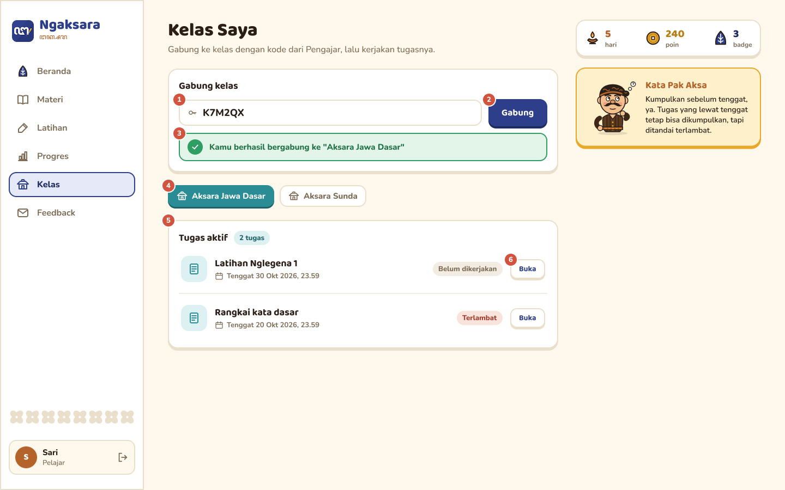
</p>
<p align="center"><i>Gambar 54. Rancangan Antarmuka I-12 - Kelas Saya & Daftar Tugas</i></p>

Tabel 6.12. Spesifikasi Objek Antarmuka I-12

| Id_Objek | Jenis | Konten | Keterangan |
| :--- | :--- | :--- | :--- |
| I-12.1 | Text box | Kode bergabung | Kode kelas dari Pengajar. |
| I-12.2 | Button | Gabung | Menjalankan kirimKodeBergabung(kode), lalu KelasController.validasiKodeBergabung() (Algo-081). |
| I-12.3 | Pesan | Hasil bergabung | Ditampilkan oleh tampilkanPesan(pesan): berhasil, sudah menjadi anggota (UC-05 alternatif 1), atau kode tidak valid (UC-05 alternatif 3). |
| I-12.4 | Tab | Kelas yang diikuti | Memilih kelas menjalankan bukaKelas(idKelas). |
| I-12.5 | Daftar | Tugas aktif, tenggat, status | Ditampilkan oleh tampilkanTugas(data) dari KelasController.ambilTugasAktif(). |
| I-12.6 | Button | Buka | Menjalankan bukaTugas(idKelas, idTugas), lalu membuka I-13. |

## 6.13 Rancangan Antarmuka I-13

**Antarmuka:** I-13  
**Nama Layar:** Pengerjaan Tugas  

<p align="center">
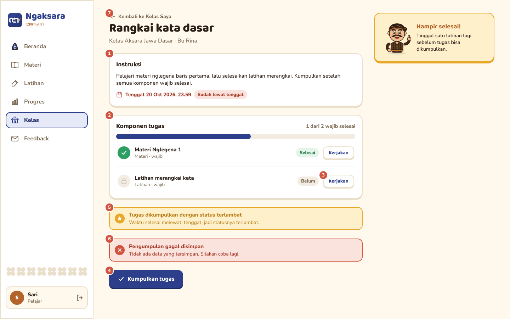
</p>
<p align="center"><i>Gambar 55. Rancangan Antarmuka I-13 - Pengerjaan Tugas</i></p>

Tabel 6.13. Spesifikasi Objek Antarmuka I-13

| Id_Objek | Jenis | Konten | Keterangan |
| :--- | :--- | :--- | :--- |
| I-13.1 | Panel | Instruksi, tenggat, penanda terlambat | Ditampilkan oleh tampilkanDetail(data). Penanda muncul bila tenggat sudah lewat (UC-05 alternatif 2). |
| I-13.2 | Daftar | Komponen tugas dan kemajuan | Status dari RiwayatLatihan.ambilBuktiPenyelesaian(). |
| I-13.3 | Button | Kerjakan | Menjalankan kerjakanTugas(idKelas, idTugas) lalu membuka I-05 atau I-06. |
| I-13.4 | Button | Kumpulkan tugas | Menjalankan periksaPenyelesaian(), lalu finalisasiTugas() dan KelasController.simpanPengumpulan() (Algo-082). Aktif bila semua komponen wajib selesai. |
| I-13.5 | Pesan | Status pengumpulan | Ditampilkan oleh tampilkanHasil(data): tepat waktu atau terlambat (Algo-064). |
| I-13.6 | Pesan kesalahan | Pengumpulan gagal | Muncul bila penyimpanan gagal. Semua perubahan dibatalkan (UC-05 eksepsi). |
| I-13.7 | Link | Kembali ke Kelas Saya | Kembali ke I-12. |

## 6.14 Rancangan Antarmuka I-14

**Antarmuka:** I-14  
**Nama Layar:** Kelola Kelas

<p align="center">
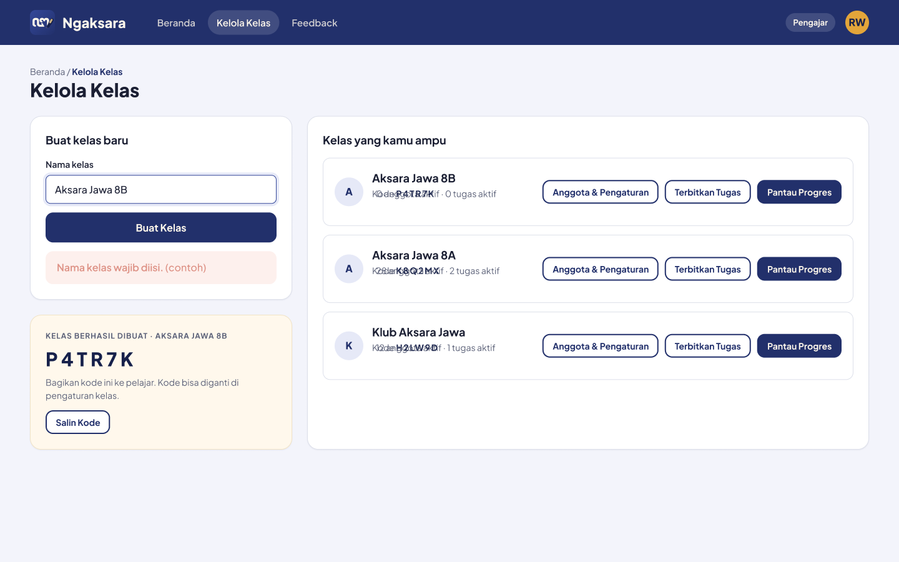
</p>
<p align="center">
<i>Gambar 6.14. Rancangan Antarmuka I-14 - Kelola Kelas</i>
</p>

Tabel 6.14. Spesifikasi Objek Antarmuka I-14

| Id_Objek | Jenis | Konten | Keterangan |
| :--- | :--- | :--- | :--- |
| I-14-01 | Label (judul halaman) | Breadcrumb "Beranda / Kelola Kelas" dan judul "Kelola Kelas" | Menunjukkan halaman untuk mengelola kelas yang diampu oleh Pengajar. |
| I-14-02 | Card (form pembuatan kelas) | Judul "Buat kelas baru", label "Nama kelas", dan kolom input nama kelas | Digunakan Pengajar untuk memasukkan nama kelas baru sebagai bagian dari `DataKelas`. |
| I-14-03 | Button (utama) | "Buat Kelas" | Memicu `buatKelas(data: DataKelas)` pada `HalamanKelolaKelas`. Permintaan diteruskan ke `KelasController.buatKelas(data)` untuk memverifikasi hak akses Pengajar dan menyimpan kelas melalui `KelasBelajar.simpan(data)`. |
| I-14-04 | Label (validasi) | "Nama kelas wajib diisi. (contoh)" | Menampilkan pesan validasi ketika nama kelas belum diisi. Kelas tidak dibuat sebelum data yang diperlukan valid. |
| I-14-05 | Card (hasil pembuatan kelas) | Judul "KELAS BERHASIL DIBUAT", nama kelas, dan kode bergabung, misalnya "P4TR7K" | Ditampilkan setelah pembuatan kelas berhasil. Kode bergabung dibangkitkan melalui `buatKodeBergabung()` dan dikembalikan bersama `HasilOperasi(idKelas, kodeBergabung)`. |
| I-14-06 | Button (aksi) | "Salin Kode" | Menyalin kode bergabung yang ditampilkan pada card hasil pembuatan kelas agar dapat dibagikan kepada Pelajar. |
| I-14-07 | Card (daftar kelas) | Judul "Kelas yang kamu ampu", nama kelas, kode bergabung, jumlah anggota, dan jumlah tugas aktif | Menampilkan daftar kelas yang dikelola Pengajar beserta ringkasan informasi setiap kelas. |
| I-14-08 | Button (navigasi) | "Anggota & Pengaturan" | Membuka antarmuka I-16 untuk mengelola anggota dan pengaturan papan peringkat pada kelas yang dipilih. |
| I-14-09 | Button (navigasi) | "Terbitkan Tugas" | Membuka antarmuka I-15 untuk menyusun dan menerbitkan tugas pada kelas yang dipilih. |
| I-14-10 | Button (navigasi) | "Pantau Progres" | Membuka halaman pemantauan progres belajar anggota pada kelas yang dipilih. |

## 6.15 Rancangan Antarmuka I-15

**Antarmuka:** I-15  
**Nama Layar:** Terbitkan Tugas

<p align="center">
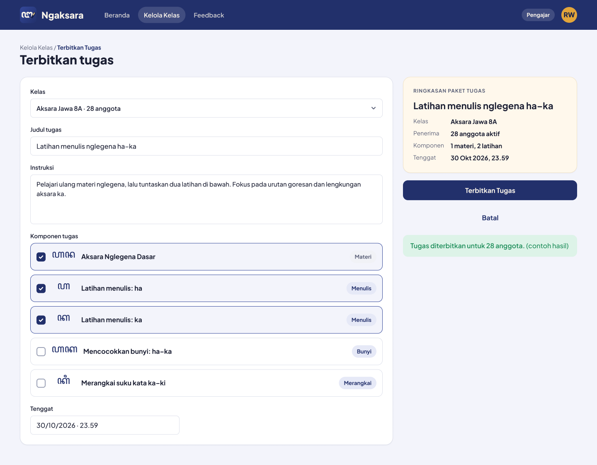
</p>
<p align="center">
<i>Gambar 6.15. Rancangan Antarmuka I-15 - Terbitkan Tugas</i>
</p>

Tabel 6.15. Spesifikasi Objek Antarmuka I-15

| Id_Objek | Jenis | Konten | Keterangan |
| :--- | :--- | :--- | :--- |
| I-15-01 | Label (judul halaman) | Breadcrumb "Kelola Kelas / Terbitkan Tugas" dan judul "Terbitkan tugas" | Menunjukkan halaman untuk menyusun dan menerbitkan tugas bagi anggota kelas. |
| I-15-02 | Dropdown (pemilihan kelas) | Label "Kelas" dan pilihan kelas, misalnya "Aksara Jawa 8A · 28 anggota" | Menentukan kelas penerima tugas dan nilai `idKelas` yang digunakan saat menyimpan atau menerbitkan tugas. |
| I-15-03 | Text Input | Label "Judul tugas"; contoh isi "Latihan menulis nglegena ha–ka" | Digunakan untuk memasukkan judul tugas sebagai bagian dari `DataTugas`. |
| I-15-04 | Textarea | Label "Instruksi" dan petunjuk pengerjaan tugas | Digunakan untuk memasukkan instruksi yang akan dibaca Pelajar saat mengerjakan tugas. Instruksi disimpan sebagai bagian dari `DataTugas`. |
| I-15-05 | Label (komponen tugas) | Judul "Komponen tugas" | Menandai daftar materi dan latihan yang dapat dipilih untuk dimasukkan ke dalam paket tugas. |
| I-15-06 | Checkbox (materi) | "Aksara Nglegena Dasar" dengan label kategori "Materi" | Menentukan apakah materi Aksara Nglegena Dasar disertakan dalam paket tugas. |
| I-15-07 | Checkbox (latihan menulis) | "Latihan menulis: ha" dengan label kategori "Menulis" | Menambahkan latihan menulis aksara ha ke dalam paket tugas apabila dipilih. |
| I-15-08 | Checkbox (latihan menulis) | "Latihan menulis: ka" dengan label kategori "Menulis" | Menambahkan latihan menulis aksara ka ke dalam paket tugas apabila dipilih. |
| I-15-09 | Checkbox (latihan bunyi) | "Mencocokkan bunyi: ha–ka" dengan label kategori "Bunyi" | Menambahkan latihan mencocokkan bunyi ha–ka ke dalam paket tugas apabila dipilih. |
| I-15-10 | Checkbox (latihan merangkai) | "Merangkai suku kata ka–ki" dengan label kategori "Merangkai" | Menambahkan latihan merangkai suku kata ka–ki ke dalam paket tugas apabila dipilih. |
| I-15-11 | Input (tenggat waktu) | Label "Tenggat"; contoh isi "30/10/2026 · 23.59" | Menentukan batas waktu pengerjaan tugas dan disimpan sebagai bagian dari `DataTugas`. |
| I-15-12 | Card (ringkasan paket tugas) | Judul "RINGKASAN PAKET TUGAS", judul tugas, kelas, jumlah anggota aktif, jumlah komponen, dan tenggat | Merangkum informasi tugas berdasarkan kelas yang dipilih, data formulir, komponen yang dicentang, dan tenggat waktu. |
| I-15-13 | Button (utama) | "Terbitkan Tugas" | Memicu `terbitkanTugas(idKelas, data)` pada `HalamanKelolaKelas`. `KelasController` memverifikasi hak akses Pengajar dan kepemilikan kelas, kemudian memanggil `TugasKelas.terbitkan()` agar tugas dapat diakses anggota kelas. |
| I-15-14 | Button (sekunder) | "Batal" | Membatalkan proses penyusunan tugas dan kembali tanpa menerbitkan tugas. |
| I-15-15 | Alert (sukses) | "Tugas diterbitkan untuk 28 anggota. (contoh hasil)" | Ditampilkan setelah penerbitan berhasil. Jumlah anggota pada notifikasi mengikuti jumlah penerima tugas pada kelas yang dipilih. |

## 6.16 Rancangan Antarmuka I-16

**Antarmuka:** I-16  
**Nama Layar:** Kelola Anggota dan Papan Peringkat

<p align="center">
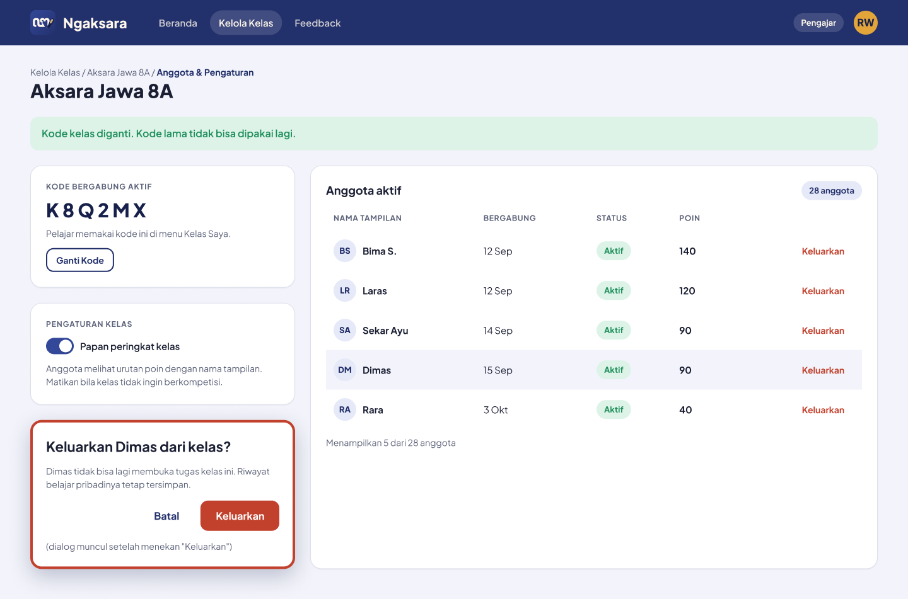
</p>
<p align="center">
<i>Gambar 6.16. Rancangan Antarmuka I-16 - Kelola Anggota dan Papan Peringkat</i>
</p>

Tabel 6.16. Spesifikasi Objek Antarmuka I-16

| Id_Objek | Jenis | Konten | Keterangan |
| :--- | :--- | :--- | :--- |
| I-16-01 | Label (judul halaman) | Breadcrumb "Kelola Kelas / Aksara Jawa 8A / Anggota & Pengaturan" dan judul "Aksara Jawa 8A" | Menunjukkan kelas yang sedang dikelola oleh Pengajar. |
| I-16-02 | Alert (sukses) | "Kode kelas diganti. Kode lama tidak bisa dipakai lagi." | Menampilkan konfirmasi setelah penggantian kode kelas berhasil. Kode lama dinonaktifkan dan kode bergabung baru menjadi kode aktif. |
| I-16-03 | Card (kode bergabung aktif) | Label "KODE BERGABUNG AKTIF", kode "K8Q2MX", dan keterangan "Pelajar memakai kode ini di menu Kelas Saya." | Menampilkan kode bergabung aktif yang digunakan Pelajar untuk bergabung ke kelas. |
| I-16-04 | Button (aksi) | "Ganti Kode" | Memicu `gantiKodeKelas(idKelas)` pada `HalamanKelolaKelas`. `KelasController` memverifikasi hak akses dan kepemilikan kelas sebelum meminta `KelasBelajar.gantiKodeBergabung(idPengajar)` menghasilkan kode baru. |
| I-16-05 | Card (pengaturan kelas) | Judul "PENGATURAN KELAS" | Mengelompokkan pengaturan papan peringkat kelas. |
| I-16-06 | Toggle | Label "Papan peringkat kelas" dengan status aktif atau nonaktif | Memicu `aturScoreboard(idKelas, aktif)`. Setelah hak akses dan kepemilikan kelas diverifikasi, `KelasBelajar.aturScoreboard(aktif)` memperbarui status papan peringkat. |
| I-16-07 | Label (deskripsi pengaturan) | "Anggota melihat urutan poin dengan nama tampilan. Matikan bila kelas tidak ingin berkompetisi." | Menjelaskan bahwa pengaturan ini menentukan apakah papan peringkat kelas diaktifkan atau dinonaktifkan. |
| I-16-08 | Card (daftar anggota) | Judul "Anggota aktif" dan jumlah anggota, misalnya "28 anggota" | Menampilkan daftar anggota yang berstatus aktif berdasarkan `KeanggotaanKelas.daftarAnggotaAktif(idKelas)`. |
| I-16-09 | Label (header tabel) | "NAMA TAMPILAN", "BERGABUNG", "STATUS", dan "POIN" | Menunjukkan kolom informasi anggota yang ditampilkan pada tabel. |
| I-16-10 | Row (data anggota) | Avatar atau inisial, nama tampilan, tanggal bergabung, status "Aktif", dan jumlah poin | Menampilkan data setiap anggota aktif. Profil diperoleh melalui `AkunPengguna.getProfil()`, sedangkan poin diperoleh melalui `MotivasiBelajar.ambilPoinKelas()`. |
| I-16-11 | Button (aksi anggota) | "Keluarkan" | Membuka dialog konfirmasi untuk anggota yang dipilih. Pengeluaran hanya diproses setelah Pengajar mengonfirmasi tindakan tersebut. |
| I-16-12 | Dialog konfirmasi | Judul "Keluarkan Dimas dari kelas?" dan keterangan bahwa Dimas tidak dapat membuka tugas kelas, tetapi riwayat belajar pribadinya tetap tersimpan | Meminta konfirmasi sebelum status keanggotaan Pelajar diubah menjadi nonaktif. Nama anggota menyesuaikan anggota yang dipilih. |
| I-16-13 | Button (sekunder pada dialog) | "Batal" | Menutup dialog tanpa mengubah status keanggotaan anggota. |
| I-16-14 | Button (utama pada dialog) | "Keluarkan" | Setelah dikonfirmasi, memicu `kelolaAnggota(idKelas)` pada `HalamanKelolaKelas`, yang meneruskan `KelasController.kelolaAnggota(idKelas, idPelajar, status="nonaktif")`. Setelah hak akses dan kepemilikan kelas diverifikasi, sistem memanggil `KeanggotaanKelas.ubahStatus("nonaktif")`. |
| I-16-15 | Label (jumlah anggota ditampilkan) | "Menampilkan 5 dari 28 anggota" | Menunjukkan jumlah anggota yang sedang ditampilkan dibandingkan dengan jumlah seluruh anggota aktif. Daftar diperbarui setelah pengeluaran anggota berhasil. |

## 6.17 Rancangan Antarmuka I-17
**Antarmuka:** I-17  
**Nama Layar:** Pantau Progres Anggota  
**Kelas View:** `HalamanKelolaKelas`  
**Use Case:** UC-08

<p align="center">

</p>
<p align="center"><i>Gambar 59. Rancangan Antarmuka I-17 - Pantau Progres Anggota</i></p>

Tabel 6.17. Spesifikasi Objek Antarmuka I-17

| Id_Objek | Jenis | Konten | Keterangan |
| :--- | :--- | :--- | :--- |
| I-17.1 | Kartu ringkasan | Jumlah anggota aktif, rata-rata penguasaan, tugas terkumpul | Dari ProgresController.agregasiProgres(anggotaAktif, periode) (Algo-102). |
| I-17.2 | Tabel | Progres tiap anggota aktif | Ditampilkan oleh tampilkanProgres(data). Anggota yang sudah keluar tidak ditampilkan. |
| I-17.3 | Button | Detail | Menjalankan pilihAnggota(idPelajar), lalu KelasController.ambilProgresAnggota() (KF13). |
| I-17.4 | Daftar | Aksara yang sering salah | Dari ProgresController.hitungPolaKesalahan(). |
| I-17.5 | Panel | Detail anggota terpilih | Riwayat latihan anggota terpilih. |
| I-17.6 | Text area + button | Umpan balik untuk anggota | Menjalankan kirimUmpanBalik(data), lalu KelasController.kirimUmpanBalik(idKelas, data). |
| I-17.7 | Pesan informasi | Belum ada riwayat | Muncul bila anggota belum berlatih (UC-08 alternatif 1). |
| I-17.8 | Pesan kesalahan | Bukan anggota aktif | Muncul bila Pengajar membuka progres pengguna yang bukan anggota aktif (UC-08 alternatif 2). |

## 6.18 Rancangan Antarmuka I-18

**Antarmuka:** I-18  
**Nama Layar:** Kelola Materi

<p align="center">

</p>
<p align="center">
<i>Gambar 6.18. Rancangan Antarmuka I-18 - Kelola Materi</i>
</p>

Tabel 6.18. Spesifikasi Objek Antarmuka I-18

| Id_Objek | Jenis | Konten | Keterangan |
| :--- | :--- | :--- | :--- |
| I-18-01 | Table (dalam Card) | Kolom "MATERI", "JENIS", "TINGKAT", "STATUS" (chip "Terbit" / "Draf"), "VERSI", "AKSI" | Diisi oleh `tampilkanDaftarMateri` dari hasil Algo-049 (Algo-040). Tim Materi melihat materi draf dan terbit. |
| I-18-02 | Button (utama, ikon plus) | "Tambah materi" | Membuka I-19 Unggah Materi. |
| I-18-03 | Button (sekunder, ikon pensil) | "Sunting" (satu per baris) | Membuka form sunting materi terpilih (`suntingMateri`, Algo-046, Algo-054). |
| I-18-04 | Button (aksi baris, terpotong pada desain) | Aksi arsip/hapus materi per baris | Menghapus materi secara lunak sehingga tidak tampil lagi bagi Pelajar (`hapusMateri`, Algo-055). Label tombol perlu dipastikan pada desain. |
| I-18-05 | Alert (sukses) | "Materi berhasil disimpan sebagai draf" | Notifikasi hasil operasi (`tampilkanStatus`, Algo-045, Algo-046). |

## 6.19 Rancangan Antarmuka I-19

**Antarmuka:** I-19  
**Nama Layar:** Unggah Materi

<p align="center">

</p>
<p align="center">
<i>Gambar 6.19. Rancangan Antarmuka I-19 - Unggah Materi</i>
</p>

Tabel 6.19. Spesifikasi Objek Antarmuka I-19

| Id_Objek | Jenis | Konten | Keterangan |
| :--- | :--- | :--- | :--- |
| I-19-01 | Text Input | Label "Nama materi"; contoh isi "Nglegena: ma ga ba tha nga" | Wajib diisi, maksimal 100 karakter (Algo-043). |
| I-19-02 | Segmented Button (dua kelompok) | Label "Jenis aksara": "Jawa" (terpilih), "Sunda"; label "Tingkat kesulitan": "1" (terpilih), "2", "3" | Menentukan jenis aksara dan tingkat kesulitan materi (Algo-043). |
| I-19-03 | Textarea | Label "Aturan penulisan dan contoh"; contoh isi "Tulis dari kiri ke kanan. Contoh: ꦩꦒ = "maga"." | Isi aturan dan contoh materi, disimpan sebagai konten (Algo-053, Algo-057). |
| I-19-04 | Dropzone + Button | "Seret berkas ke sini atau pilih berkas"; "Format: json, mp3, png, svg. Maksimal 10 MB."; tombol "Pilih berkas" | Menerima berkas materi dan memeriksa format serta ukurannya (Algo-045, Algo-052). |
| I-19-05 | Button (utama) | "Simpan sebagai draf" | Menjalankan `unggahFileMateri` (Algo-045, Algo-053). Materi baru tersimpan berstatus Draf, lalu kembali ke I-18. Tombol "Batal" di sebelahnya membuang isian dan kembali ke I-18. |
| I-19-06 | Alert (galat) | "Jenis berkas tidak didukung" dan "Pilih berkas lain. Materi tidak berubah." | Tampil bila format berkas tidak sesuai (Algo-045, Algo-052). Data materi tidak disimpan. |

## 6.20 Rancangan Antarmuka I-20
 
**Antarmuka:** I-20  
**Nama Layar:** Kirim Feedback  
**Kelas View:** `HalamanFeedback`  
**Use Case:** UC-09
 
<p align="center">

</p>
<p align="center">
<i>Gambar 6.20. Rancangan Antarmuka I-20 - Kirim Feedback</i>
</p>
Tabel 6.20. Spesifikasi Objek Antarmuka I-20
 
| Id_Objek | Jenis | Konten | Keterangan |
| :--- | :--- | :--- | :--- |
| I-20-01 | Segmented Button | Label "Kategori": "Performa", "Tampilan" (terpilih), "Fitur", "Materi" | Pertanyaan tertutup. Menentukan `kategoriFeedback` (KF18). Wajib dipilih (Algo-013). |
| I-20-02 | Text Area | Label "Pesan" | Pertanyaan terbuka, 10–1.000 karakter (Algo-013). |
| I-20-03 | Button (utama) | Ikon surat dan "Kirim" | Menjalankan `kirimFeedback` (Algo-008 → Algo-013 → Algo-014 → Algo-003). Nonaktif selama status `MENGIRIM`. |
| I-20-04 | Alert (sukses) | "Feedback terkirim. Matur nuwun!" | Tampil bila penyimpanan berhasil, lalu form dikosongkan (`tampilkanKonfirmasi`, KF20). |
| I-20-05 | Alert (galat) | "Feedback gagal terkirim" dan "Periksa koneksi lalu coba lagi. Isi pesanmu tidak hilang." | Tampil bila server gagal menyimpan atau koneksi terputus (UC-09 Skenario Alternatif 1, KNF05). Kategori dan pesan tetap terisi agar dapat dikirim ulang (Algo-008). |

## 6.21 Rancangan Antarmuka Keseluruhan

Tuliskan daftar gambar seluruh antarmuka. Berikan ID unik untuk setiap tampilan dan gunakan ID yang sama pada subbab perancangan antarmuka masing-masing.

Tabel 6.21. Rancangan Antarmuka Keseluruhan

| No   | Tampilan Antarmuka                                                                  |
| :--- | :---------------------------------------------------------------------------------- |
| I-01 |  |
| I-02 |  |
| I-03 |  |
| I-04 Daftar Materi |  |
| I-05 Detail Materi |  |
| I-06 Pilih Mode Latihan |  |
| I-07 Latihan Menulis |  |
| I-08 Latihan Mencocokkan Bunyi |  |
| I-09 Latihan Merangkai Aksara |  |
| I-10 Hasil Latihan |  |
| I-11 Progres Pelajar |  |
| I-12 Kelas Saya & Daftar Tugas | 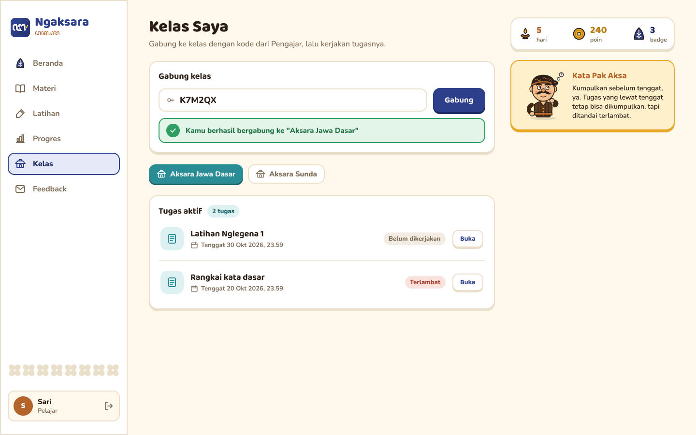 |
| I-13 Pengerjaan Tugas | 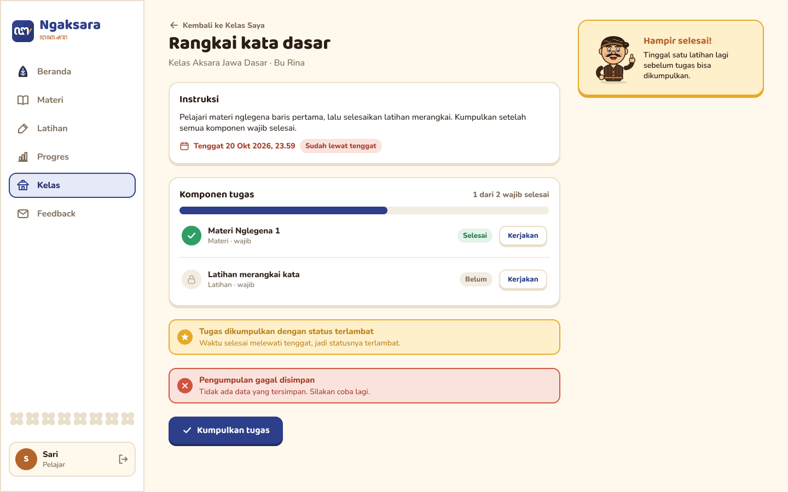 |
| I-14 Kelola Kelas|  |
| I-15 Terbitkan Tugas|  |
| I-16 Kelola Anggota dan Papan Peringkat|  |
|I-17 Pantau Progres Anggota | |
| I-18 Kelola Materi |  |
| I-19 Unggah Materi |  |
| I-20 |  |

<br>

---

# BAB 7: Matriks Kerunutan

Petakan kelas perancangan dengan use case yang terkait. Gunakan **BAB 6 Traceability pada dokumen SKPL** sebagai acuan keterkaitan kelas analisis dan use case, lalu sesuaikan dengan realisasi use case dan kelas perancangan pada BAB 3–BAB 5 DPPL.

Tabel 7.1. Matriks Kerunutan Kelas terhadap Use Case

| Kelas                      | Use Case Terkait                                                                                                                                                                                                                                                                                                                                  |
| :------------------------- | :------------------------------------------------------------------------------------------------------------------------------------------------------------------------------------------------------------------------------------------------------------------------------------------------------------------------------------------------ |
| C01 - AkunPengguna         | UC-01 - Melakukan Pendaftaran Akun<br>UC-02 - Mempelajari Materi<br>UC-03 - Mengerjakan Latihan Aksara<br>UC-04 - Meninjau Progres dan Motivasi<br>UC-05 - Mengikuti Pembelajaran Kelas<br>UC-06 - Memperbaharui Materi<br>UC-07 - Menyiapkan Pembelajaran Kelas<br>UC-08 - Memantau dan Menindaklanjuti Progres<br>UC-09 - Menyampaikan Feedback |
| C02 - MateriAksara         | UC-02 - Mempelajari Materi<br>UC-03 - Mengerjakan Latihan Aksara<br>UC-04 - Meninjau Progres dan Motivasi<br>UC-06 - Memperbaharui Materi                                                                                                                                                                                                         |
| C03 - RiwayatLatihan       | UC-02 - Mempelajari Materi<br>UC-03 - Mengerjakan Latihan Aksara<br>UC-04 - Meninjau Progres dan Motivasi<br>UC-05 - Mengikuti Pembelajaran Kelas<br>UC-08 - Memantau dan Menindaklanjuti Progres                                                                                                                                                 |
| C04 - DataFeedback         | UC-09 - Menyampaikan Feedback                                                                                                                                                                                                                                                                                                                     |
| C05 - HalamanPendaftaran   | UC-01 - Melakukan Pendaftaran Akun                                                                                                                                                                                                                                                                                                                |
| C06 - HalamanLogin         | UC-01 - Melakukan Pendaftaran Akun                                                                                                                                                                                                                                                                                                                |
| C07 - HalamanUtama         | UC-02 - Mempelajari Materi<br>UC-03 - Mengerjakan Latihan Aksara<br>UC-04 - Meninjau Progres dan Motivasi<br>UC-05 - Mengikuti Pembelajaran Kelas<br>UC-06 - Memperbaharui Materi<br>UC-07 - Menyiapkan Pembelajaran Kelas<br>UC-08 - Memantau dan Menindaklanjuti Progres<br>UC-09 - Menyampaikan Feedback                                       |
| C08 - HalamanLatihan       | UC-03 - Mengerjakan Latihan Aksara                                                                                                                                                                                                                                                                                                                |
| C09 - HalamanKelolaMateri  | UC-06 - Memperbaharui Materi                                                                                                                                                                                                                                                                                                                      |
| C10 - HalamanFeedback      | UC-09 - Menyampaikan Feedback                                                                                                                                                                                                                                                                                                                     |
| C11 - HalamanKelasPelajar  | UC-05 - Mengikuti Pembelajaran Kelas                                                                                                                                                                                                                                                                                                              |
| C12 - HalamanKelolaKelas   | UC-07 - Menyiapkan Pembelajaran Kelas<br>UC-08 - Memantau dan Menindaklanjuti Progres                                                                                                                                                                                                                                                             |
| C13 - HalamanMateri        | UC-02 - Mempelajari Materi                                                                                                                                                                                                                                                                                                                        |
| C14 - HalamanProgres       | UC-04 - Meninjau Progres dan Motivasi                                                                                                                                                                                                                                                                                                             |
| C15 - OtentikasiController | UC-01 - Melakukan Pendaftaran Akun                                                                                                                                                                                                                                                                                                                |
| C16 - LatihanController    | UC-03 - Mengerjakan Latihan Aksara                                                                                                                                                                                                                                                                                                                |
| C17 - MateriController     | UC-02 - Mempelajari Materi<br>UC-03 - Mengerjakan Latihan Aksara<br>UC-06 - Memperbaharui Materi                                                                                                                                                                                                                                                  |
| C18 - FeedbackController   | UC-09 - Menyampaikan Feedback                                                                                                                                                                                                                                                                                                                     |
| C19 - ProgresController    | UC-04 - Meninjau Progres dan Motivasi<br>UC-08 - Memantau dan Menindaklanjuti Progres                                                                                                                                                                                                                                                             |
| C20 - KelasController      | UC-05 - Mengikuti Pembelajaran Kelas<br>UC-07 - Menyiapkan Pembelajaran Kelas<br>UC-08 - Memantau dan Menindaklanjuti Progres                                                                                                                                                                                                                     |
| C21 - KontenMateri         | UC-02 - Mempelajari Materi<br>UC-03 - Mengerjakan Latihan Aksara<br>UC-06 - Memperbaharui Materi                                                                                                                                                                                                                                                  |
| C22 - MotivasiBelajar      | UC-03 - Mengerjakan Latihan Aksara<br>UC-04 - Meninjau Progres dan Motivasi<br>UC-07 - Menyiapkan Pembelajaran Kelas                                                                                                                                                                                                                              |
| C23 - KelasBelajar         | UC-05 - Mengikuti Pembelajaran Kelas<br>UC-07 - Menyiapkan Pembelajaran Kelas<br>UC-08 - Memantau dan Menindaklanjuti Progres                                                                                                                                                                                                                     |
| C24 - KeanggotaanKelas     | UC-05 - Mengikuti Pembelajaran Kelas<br>UC-07 - Menyiapkan Pembelajaran Kelas<br>UC-08 - Memantau dan Menindaklanjuti Progres                                                                                                                                                                                                                     |
| C25 - TugasKelas           | UC-05 - Mengikuti Pembelajaran Kelas<br>UC-07 - Menyiapkan Pembelajaran Kelas                                                                                                                                                                                                                                                                     |
| C26 - PenyelesaianTugas    | UC-05 - Mengikuti Pembelajaran Kelas                                                                                                                                                                                                                                                                                                              |