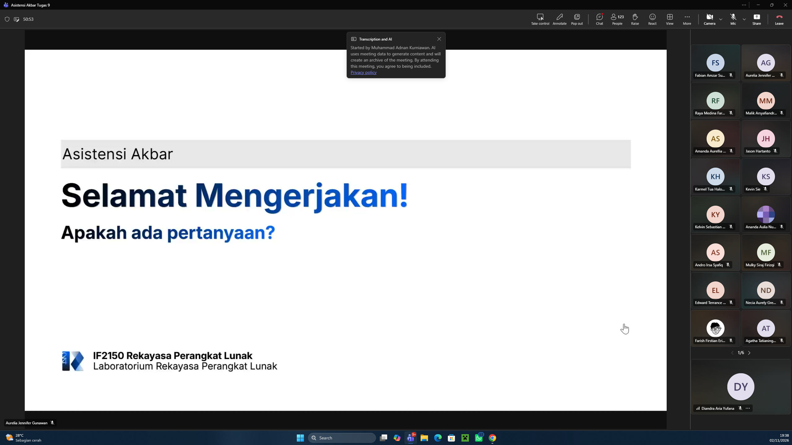

# Form Asistensi

## Tugas Besar IF2150 - Rekayasa Perangkat Lunak

| Informasi | Keterangan |
| --- | --- |
| **Hari** | Senin |
| **Tanggal** | 02/11/2026 |
| **Kelas** | K2 |
| **Nomor Kelompok** | 4  |
| **Nama Kelompok** | 0sks |
| **Nama Perangkat Lunak** | Ngaksara  |
| **Dokumen** | Implementasi  |

### Anggota Kelompok

| NIM      | Nama                           |
| -------- | ------------------------------ |
| 13525026 | Ryuza Nadif Aldebaran          |
| 13525029 | Muhammad Naufal Hilmi          |
| 13525077 | Muhammad Abduh                 |
| 13525107 | Nathaniel Marvelo              |
| 13525113 | Diandra Aria Yufana            |
| 13525143 | Natan Danuarta Ariel Wicaksana |

### Catatan

| Catatan |
| --- |
| 1. Mencatat setiap perbedaan rancangan dan implementasi beserta alasannya. Kalau tidak ada, tulis "tidak ada perubahan". |
| 2. Harus ada bukti branching, semantic commit, track task, PR dan review, serta pengujian. Profiling minimal untuk satu fitur berat yang terdiri dari temuan sebelum, perbaikan, dan hasil sesudah. |
| 3. Ada kendala, known issuees, dan catatan untuk asisten |
| 4. Setiap kelas DPPL harus bisa ditelusuri ke bentuk impelemntasi, lokasi file, dan cara perwujudannya. |

## Dokumentasi

<!--  -->

  

  <i>Gambar 1. Dokumentasi kegiatan asistensi.</i>

