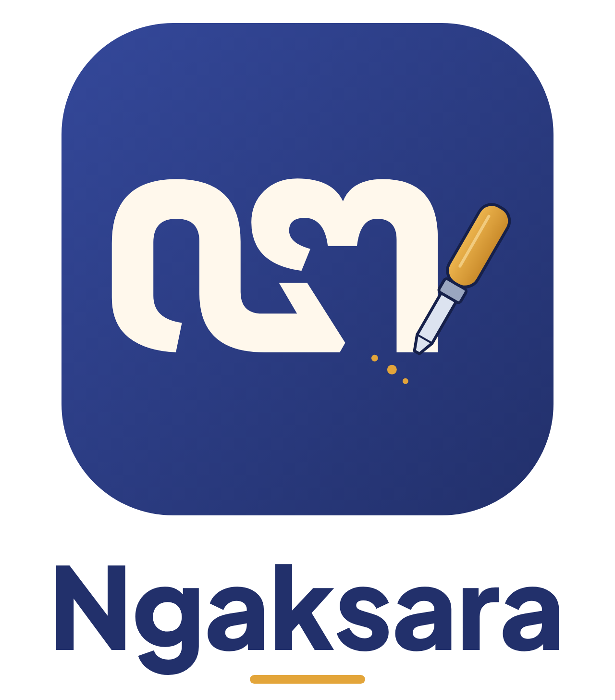

<h1>
IF2150 REKAYASA PERANGKAT LUNAK
 
TUGAS 9
 
IMPLEMENTASI PERANGKAT LUNAK
</h1>
 

## Ngaksara

### Untuk: Amanda Aurellia Salsabilla

Dipersiapkan oleh:
| Informasi | Keterangan |
| --- | --- |
| Kelas | K2 |
| Kelompok | 4 (0sks) |

| NIM      | Nama                           |
| -------- | ------------------------------ |
| 13525026 | Ryuza Nadif Aldebaran          |
| 13525029 | Muhammad Naufal Hilmi          |
| 13525077 | Muhammad Abduh                 |
| 13525107 | Nathaniel Marvelo              |
| 13525113 | Diandra Aria Yufana            |
| 13525143 | Natan Danuarta Ariel Wicaksana |

---

Repositori: <https://github.com/nighttbott/IF2150-RPL-K02-G04>. Kode aplikasi ada di [`src/`](../../src), dan petunjuk menjalankan ada di [`src/README.md`](../../src/README.md).

---

# BAGIAN B: Laporan Implementasi

## B.1 Perubahan dari DPPL

Tabel B.1. Perubahan dari DPPL

| No | Bagian DPPL | Rancangan Awal | Implementasi Akhir | Alasan |
| :--- | :--- | :--- | :--- | :--- |
| 1 | Kelas C20 KelasController | Satu controller untuk seluruh operasi kelas. | Dipecah menjadi `KelasPengajarController` (UC-07), `KelasPelajarController` (UC-05), dan `PemantauanKelasController` (UC-08). Logika pengumpulan (Algo-082/086) berada di `app/Services/PengumpulanTugas.php`. | Tiap bagian dikerjakan anggota berbeda (Marvel, Abduh, Natan), sehingga tidak saling menimpa berkas yang sama. Route juga dipisah per modul. |
| 2 | Kelas C12 HalamanKelolaKelas | Satu kelas View untuk I-14 sampai I-17. | Dipecah menjadi view `kelas-pengajar/index`, `anggota`, `tugas` (I-14, I-15, I-16) dan `pemantauan/daftar-kelas`, `pemantauan/index` (I-17). | Mengikuti pemecahan C20 di atas. |
| 3 | Kelas C16 LatihanController | Satu controller dengan operasi privat `hitungAkurasiGoresan`, `cocokkanBunyi`, `validasiRangkaian`, `periksaBadge`. | `LatihanController` (mode menulis) dan `LatihanNonKanvasController` (bunyi, merangkai, transliterasi). Operasi privat diwujudkan sebagai kelas yang bisa diuji tanpa HTTP: `AkurasiGoresan`, `PemeriksaBadge`, `PenilaiJawaban::bunyi/merangkai/transliterasi`, `PenyusunSoal`, `SelesaikanLatihan`. | Mode kanvas (Naufal) dan non-kanvas (Marvel) dikerjakan paralel. Pemisahan juga memudahkan unit test. |
| 4 | Algo-022 nilaiJawaban, KF23 | Algo-022 hanya membahas mode menulis, bunyi, dan merangkai. | Ditambah mode **transliterasi**: jawaban dan kunci dibandingkan setelah `trim` dan huruf kecil. | KF23 di SKPL meminta latihan transliterasi, tetapi belum ada algoritmanya di DPPL. |
| 5 | Algo-102 agregasiProgres | Riwayat dibaca per anggota (2 query per anggota). | Tiga query agregasi tetap (`WHERE id_pelajar IN (...) GROUP BY`), berapa pun jumlah anggotanya. | Menghindari masalah N+1. Hasilnya sama persis (dibuktikan perintah `ngaksara:profil-progres`), lihat B.2.1. |
| 6 | Basis data `riwayat_latihan` | Tidak ada rancangan indeks. | Ditambah indeks `idx_riwayat_agregasi (id_pelajar, tanggal_pengerjaan, id_materi)` dan `idx_riwayat_pelajar_materi (id_pelajar, id_materi, skor)`. | Hasil profiling B.2.1. |
| 7 | Basis data (seluruh tabel) | DPPL tidak memuat DDL lengkap, dan nilai enum bercampur huruf besar/kecil (`'AKTIF'`, `'TERBIT'`, `'aktif'`). | 12 tabel dibuat dari atribut Tabel 4.1 dan query Q-xxx. Semua nilai enum memakai **huruf kecil** dan dikunci dengan `CHECK` (MySQL), serta `app/Enums`. | Konsistensi data dan mencegah salah tulis. Daftar tabel ada di `src/README.md`. |
| 8 | Algo-055 hapusMateri, Q-055 | Penghapusan lunak (`deleted_at`). | Penghapusan = mengubah `status_publikasi` menjadi `arsip`; baris tidak dihapus. | Riwayat latihan yang merujuk materi tetap utuh, dan status lebih mudah ditampilkan di I-18. |
| 9 | UC-06, C17 MateriController | Tidak ada operasi transisi draf ke terbit. | Ditambah tombol **Terbitkan** (`POST /kelola/materi/{id}/terbitkan`) yang memakai `perbaruiMateri`. Pelajar hanya melihat materi berstatus `terbit`. | Tanpa transisi ini, materi baru dari Tim Materi tidak pernah sampai ke Pelajar. |
| 10 | Algo-052 validasiFormatFile | Unggahan berupa arsip zip berisi `konten.json`. | Unggahan satu berkas `json`, `mp3`, `png`, atau `svg` (maks. 10 MB), divalidasi di `SimpanMateriRequest` dan diperiksa ulang di `MateriController::validasiFormatFile`. | Lebih sederhana dan cukup untuk kebutuhan konten saat ini. |
| 11 | Algo-072/073 buatTugas, terbitkanTugas | Draf disimpan, lalu diterbitkan lewat aksi terpisah. | Layar I-15 hanya punya satu tombol **Terbitkan**: draf disimpan (`TugasKelas::simpan`) lalu langsung diterbitkan (`terbitkan`) dalam satu aksi. | Mengikuti desain Figma I-15. |
| 12 | Algo-075 kelolaAnggota | Status anggota yang dikeluarkan tidak dibedakan. | Pelajar yang dikeluarkan Pengajar berstatus `nonaktif`, sedangkan yang keluar sendiri berstatus `keluar`. Keduanya bisa bergabung lagi dengan kode (`updateOrCreate`). Riwayat tidak dihapus. | Pengajar dapat membedakan kedua kejadian. |
| 13 | C07 HalamanUtama (I-03) | Halaman utama untuk semua peran. | Beranda lengkap untuk Pelajar. Pengajar dan Tim Materi dialihkan ke menu pertamanya (Kelola Kelas / Kelola Materi). Menu sidebar per peran diatur di `config/navigation.php`. | Desain Figma hanya menyediakan Beranda Pelajar. |
| 14 | Menu "Latihan" (I-03-01) | Tidak ada halaman indeks latihan. | Route `GET /latihan` mengarahkan ke I-06 untuk materi rekomendasi teratas (Algo-101), atau ke daftar materi bila belum ada. | Menu Latihan di Figma tidak menunjuk materi tertentu. |
| 15 | Hak akses (Algo-002/004) | Pemeriksaan peran di tiap controller. | Middleware `peran:...` (`CekPeran`) dipasang per berkas route, ditambah pemeriksaan kepemilikan kelas (`KelasBelajar::periksaPemilik`) di controller. | Pertahanan berlapis dan mudah diaudit (`tests/Feature/RuteProtectedTest.php`). |
| 16 | SKPL UC-06, skenario | Ada teks tentang pembayaran. | Tidak diimplementasikan. | Dianggap salah ketik; Ngaksara tidak memiliki fitur pembayaran. |
| 17 | Algo-023 hitungAkurasiGoresan, Algo-021 langkah 1 sampai 5 | Templat = kontur huruf dari font; 64 titik; `akurasi = 100 × (1 − jarakRata / dMaks)` dengan jarak rata-rata dua arah. | Templat = **garis tengah huruf** (field `tengah` di `resources/aksara/template_aksara.json`, dibuat oleh `scripts/tambah_garis_tengah.py`); 200 titik; jarak dalam setengah ketebalan huruf dianggap nol (toleransi dari kontur); 25% titik terjauh dari goresan Pelajar diabaikan (coretan nyasar), tetapi setiap bagian templat tetap wajib tertulis. Parameter di `config/latihan.php`: `d_maks` 0,05, `buang_outlier` 0,25, `faktor_toleransi` 0,5, ambang 70. | Saat uji coba, menebalkan aksara yang terlihat benar sulit lulus. Pada simulasi garis tengah 38 aksara, rumus lama hanya meluluskan 5% tulisan yang tepat (skor median 62), karena goresan di tengah badan huruf selalu berjarak setengah ketebalan dari kontur dan 64 titik terlalu jarang. Dengan rumus baru, 98,5% tulisan benar lulus (termasuk yang bergetar, sedikit miring, atau ada coretan nyasar), sedangkan aksara setengah jadi tetap 0% lulus. |
| 18 | Tampilan (Bab 6) | Sesuai Figma. | Ditambah efek visual halus: kartu muncul bertahap, bilah progres terisi perlahan, skor naik bertahap dan taburan motif kawung saat latihan berhasil, toast badge baru, dan tanda centang saat tugas dikumpulkan (`resources/js/efek.js`). Semua efek nonaktif bila pengguna memilih *reduce motion*. Menu mobile memakai *offcanvas*. | Umpan balik yang lebih jelas tanpa mengubah alur. |

## B.2 Bukti Penerapan Best Practices

Tabel B.2. Bukti Best Practices

| Praktik | Bukti | Keterangan |
| :--- | :--- | :--- |
| Branching | [Daftar branch](https://github.com/nighttbott/IF2150-RPL-K02-G04/branches), [graf commit](https://github.com/nighttbott/IF2150-RPL-K02-G04/network) | Skema Gitflow sederhana: `feat/<fitur>` → PR → `develop` → `main`. Contoh: `feat/auth`, `feat/materi`, `feat/latihan-menulis`, `feat/kelola-kelas-pengajar`, `feat/kelas-pelajar`, `fondasi-database`, `progres-pemantauan`. |
| Semantic commit | [Riwayat commit `develop`](https://github.com/nighttbott/IF2150-RPL-K02-G04/commits/develop) | Format `<tipe>(<scope>): <deskripsi>`, contoh `feat(latihan): simpan, hasil, streak, poin, dan badge (Algo-026)`, `fix(auth): change persetujuan_tnc -> setuju_tnc`, `test(kelas): uji akses pengumpulan dan halaman Pelajar`. |
| Track tasks | [Issues](https://github.com/nighttbott/IF2150-RPL-K02-G04/issues?q=is%3Aissue) | 12 issue fitur per modul dengan penanggung jawab, misalnya #7 modul Materi (Diandra), #9 dan #11 kelas Pelajar (Abduh), #14 sampai #16 fondasi DB, progres, pemantauan (Natan), #26 sampai #32 latihan (Naufal). |
| Pull request dan review | [Daftar PR](https://github.com/nighttbott/IF2150-RPL-K02-G04/pulls?q=is%3Apr), contoh [#13](https://github.com/nighttbott/IF2150-RPL-K02-G04/pull/13), [#24](https://github.com/nighttbott/IF2150-RPL-K02-G04/pull/24), [#38](https://github.com/nighttbott/IF2150-RPL-K02-G04/pull/38) | 22 PR digabung ke `develop`. Contoh review: Abduh dan Ryuza menyetujui #13 (Natan); Natan menyetujui #23 dan #24 (Marvel), #25, #27, #33 (Naufal); Marvel menyetujui #21, #35, #37 (Ryuza); Diandra menyetujui #12 (Abduh) dan #17 (Natan); Abduh menyetujui #34 (Naufal); Marvel, Natan, dan Diandra menyetujui #38 (Ryuza). |
| Pengujian | [`src/tests/`](../../src/tests) | **378 test, 378 lolos** (`php artisan test`, SQLite di memori). Mencakup akses per peran, pendaftaran dan login, penilaian goresan dan non-kanvas, poin/streak/badge tanpa ganda, pembatalan transaksi, ketepatan pengumpulan (tepat di tenggat = tepat waktu), kepemilikan kelas, materi dan unggahan, progres dan pemantauan, serta layout per peran. |

### B.2.1 Profiling dan Optimasi

| Informasi | Keterangan |
| :--- | :--- |
| Fitur / proses yang diprofil | Agregasi progres kelas pada I-17 Pantau Progres Anggota (Algo-102 `agregasiProgres`) dan penguasaan per materi (Algo-100, Q-010 `hitungPenguasaan`). |
| Alat | Perintah `php artisan ngaksara:profil-progres --ulang=10 --periode=semua` (jumlah query lewat *query log* Laravel, waktu lewat `hrtime`, median dari 10 putaran), `EXPLAIN` MySQL 8.4 (Docker), dataset `ProfilingSeeder`: 1 kelas, **100 Pelajar aktif, 10.000 baris riwayat**. |
| Temuan (sebelum) | Versi DPPL (riwayat dibaca per anggota): **200 query, median 1.111,27 ms**. Versi agregasi `GROUP BY` tanpa indeks khusus: **3 query, median 42,39 ms** (periode 30 hari: 42,91 ms). `EXPLAIN` memakai indeks FK `riwayat_latihan_id_pelajar_foreign` (`type=index`, 10.122 baris, *filtered* 10,98%). Q-010 per Pelajar: `type=ref`, 97 baris, **`Using temporary`**, median 1,88 ms. |
| Perbaikan | (1) Algo-102 diganti dari pembacaan per anggota (N+1) menjadi 3 query agregasi. (2) Indeks `idx_riwayat_agregasi (id_pelajar, tanggal_pengerjaan, id_materi)`. (3) Indeks *covering* `idx_riwayat_pelajar_materi (id_pelajar, id_materi, skor)` untuk Q-010. Migrasi: `src/database/migrations/2026_11_13_000001_tambah_indeks_riwayat_latihan.php`. |
| Hasil (sesudah) | Agregasi: **3 query, median 27,25 ms** (periode 30 hari: 26,37 ms), sekitar **36% lebih cepat** dibanding tanpa indeks dan sekitar **40 kali lebih cepat** dibanding versi DPPL (200 query, 1.081,71 ms). `EXPLAIN` memakai `idx_riwayat_agregasi` dengan *filtered* 97,6%. Q-010: `EXPLAIN` berubah menjadi **`Using index`** (tanpa tabel sementara), median 1,78 ms. Penghematan Q-010 kecil karena tiap Pelajar hanya ±100 baris, tetapi indeks ini mencegah tabel sementara saat riwayat bertambah. Kedua versi Algo-102 menghasilkan angka yang **sama** (diperiksa otomatis oleh perintah profiling). |

Catatan: `EXPLAIN` agregasi tetap `type=index` karena kelas uji berisi seluruh 100 Pelajar, sehingga daftar `IN (...)` mencakup hampir seluruh tabel. Pada kelas yang lebih kecil, indeks gabungan menyaring baris lebih awal. Angka di atas diukur pada laptop pengembang (Windows 11, PHP 8.4, MySQL 8.4 di Docker), sehingga nilai absolutnya dapat berbeda di mesin lain.

## B.3 Kendala dan Catatan Penting

**Cara menjalankan untuk asisten**

1. Ikuti `src/README.md`: `docker compose up -d`, `composer install`, salin `.env.example` menjadi `.env`, `php artisan key:generate`, `php artisan migrate --seed`, `npm install`, `npm run build`, lalu `php artisan serve`.
2. Akun uji (kata sandi semua `Rahasia123!`):
   - Pelajar: `pelajar@ngaksara.test` (Sari)
   - Pengajar: `pengajar@ngaksara.test` (Bu Rina, kode kelas `K7M2QX`)
   - Tim Materi: `materi@ngaksara.test`
3. Halaman latihan menulis membutuhkan aset Vite. Bila muncul `Unable to locate file in Vite manifest`, jalankan `npm run build`.

**Kendala selama pengerjaan**

- **Integrasi antarbranch.** Beberapa bagian bekerja di branch masing-masing tetapi rusak setelah digabung ke `develop`:
  - prefix route `kelola/materi` hilang sehingga `/` milik Tim Materi menimpa Beranda;
  - halaman hasil mode non-kanvas tertimpa berkas bernama sama dari mode menulis;
  - tombol pilih mode, tombol "Kerjakan" komponen latihan pada tugas, dan penerbitan tugas memakai nama route/kunci data yang berbeda antarmodul;
  - nama menu sidebar tidak cocok dengan nama route.

  Semua sudah diperbaiki dan dicakup test regresi (`LayoutTest`, `PilihModeTest`, `LatihanNonKanvasTest`, `KelasPengajarTest`).
- **Template goresan aksara.** Template berasal dari font Noto Sans Javanese/Sundanese. Template untuk sandhangan belum ada, sehingga materi sandhangan hanya bisa dilatih dengan mode non-kanvas.

**Known issues**

| No | Masalah | Langkah reproduksi | Dampak |
| :--- | :--- | :--- | :--- |
| 1 | Audio mode bunyi berlaku untuk satu materi, belum per aksara. Bila audio belum diunggah, bacaan Latin ditampilkan sebagai petunjuk. | Pelajar → Latihan → Mencocokkan bunyi pada materi tanpa berkas mp3. | Soal bunyi menjadi lebih mudah karena petunjuk terlihat. |
| 2 | Berkas png/svg yang diunggah Tim Materi tersimpan, tetapi belum ditampilkan di detail materi. | Tim Materi → Unggah Materi dengan berkas png → buka materi sebagai Pelajar. | Gambar tambahan tidak terlihat; konten teks dan audio tetap tampil. |
| 3 | Umpan balik Pengajar di I-17 tersimpan di `data_feedback` atas nama Pelajar, tetapi belum ada layar bagi Pelajar untuk membacanya. | Pengajar → Pantau Progres → Detail anggota → Kirim umpan balik. | Pesan hanya bisa dilihat dari basis data. |
| 4 | Templat goresan sandhangan belum tersedia. | Pelajar → materi sandhangan → mode Menulis. | Muncul pesan bahwa materi belum memiliki soal untuk mode tersebut; mode lain tetap bisa dipakai. |
| 5 | Aksara yang bentuknya sangat mirip (misalnya Jawa *ka* dan *ha*, Sunda *sa* dan *ka*) masih bisa saling lulus pada mode menulis. Pada simulasi, 24% tulisan aksara lain mendapat skor ≥ 70, hampir semuanya pasangan yang mirip. | Soal *ha* → tulis bentuk *ka* di kanvas. | Kecil dalam praktik, karena outline aksara yang benar selalu tampil sebagai panduan. |
| 6 | Pada tahap integrasi akhir, kesesuaian visual dengan Figma diperiksa ulang hanya untuk sidebar, I-12, dan I-13; layar lain mengikuti hasil kerja tiap modul. | - | Mungkin ada selisih jarak atau warna kecil di layar lain. |

## B.4 Kontribusi Anggota

Tabel B.4. Kontribusi Anggota

| NIM | Nama | Modul / Fitur yang Dikerjakan | Persentase Kontribusi |
| :--- | :--- | :--- | :--- |
| 13525026 | Ryuza Nadif Aldebaran | Proyek Laravel, `docker-compose.yml`, `.env.example`, layout Blade dan sidebar per peran, pendaftaran dan login (UC-01), middleware peran, Beranda (I-03), Feedback (UC-09), model AkunPengguna (C01) | 18% |
| 13525029 | Muhammad Naufal Hilmi | Latihan menulis: kanvas (I-06, I-07), penilaian akurasi goresan (Algo-021/023), simpan hasil, streak, poin, badge (Algo-026), hasil latihan (I-10), latihan dari tugas kelas | 16% |
| 13525077 | Muhammad Abduh | Kelas Pelajar (UC-05): keanggotaan, gabung dengan kode, daftar dan detail tugas (I-12, I-13), pengumpulan atomik dan status ketepatan (Algo-082/064), test kelas | 15% |
| 13525107 | Nathaniel Marvelo | Kelola kelas Pengajar (UC-07, I-14 sampai I-16): kode bergabung, anggota, scoreboard, terbitkan tugas; mode latihan bunyi, merangkai, transliterasi (I-08, I-09) | 16% |
| 13525113 | Diandra Aria Yufana | Materi (UC-02, UC-06): daftar dan detail materi (I-04, I-05), kelola dan unggah materi (I-18, I-19), versi konten, templat aksara Jawa dan Sunda, seeder materi | 16% |
| 13525143 | Natan Danuarta Ariel Wicaksana | Seluruh migrasi dan seeder, RiwayatLatihan dan MotivasiBelajar (C03, C22), progres Pelajar (I-11), pemantauan (I-17), profiling B.2.1, integrasi akhir dan perbaikan bug lintas modul, review PR, laporan M9, logbook | 19% |

Persentase di atas adalah usulan berdasarkan cakupan modul, jumlah commit, dan baris kode di `src/` sejak 1 November 2026. Nilai akhir disepakati bersama oleh kelompok.

## B.5 Traceability Kelas Perancangan ke Implementasi

Semua lokasi relatif terhadap `src/`.

Tabel B.5. Traceability Kelas Perancangan ke Implementasi

| ID Kelas | Nama Kelas Perancangan | Bentuk Implementasi | Lokasi (File dan Nama) | Keterangan |
| :--- | :--- | :--- | :--- | :--- |
| C01 | AkunPengguna | Kelas Model + Tabel | `app/Models/AkunPengguna.php` - `AkunPengguna`; tabel `akun_pengguna` | Atribut menjadi kolom. `buatAkunBaru` (Algo-001), `verifikasiHakAkses` (Algo-002), `cariBerdasarkanEmail`, `cocokkanPassword`, `getProfil`, `getDetailAkun` menjadi method. |
| C02 | MateriAksara | Kelas Model + Tabel | `app/Models/MateriAksara.php` - `MateriAksara`; tabel `materi_aksara` | `ambilDaftarMateri` (Algo-040), `ambilMateriRekomendasi` (Algo-041), `ambilTargetLatihan`, `simpan`, `perbaruiData`. Status `draf`/`terbit`/`arsip` di `app/Enums/StatusPublikasi.php`. |
| C03 | RiwayatLatihan | Kelas Model + Tabel | `app/Models/RiwayatLatihan.php` - `RiwayatLatihan`; tabel `riwayat_latihan` | `simpanHasil` (Q-008), `catatAktivitas` (Q-016), `ambilRiwayat` (Q-011), `ambilBuktiPenyelesaian` (Q-015), `hitungPenguasaan` (Q-010), `hitungPolaKesalahan` (Q-013), `cekPernahSelesai` (Q-009), dan lainnya sebagai method statis. |
| C04 | DataFeedback | Kelas Model + Tabel | `app/Models/DataFeedback.php` - `DataFeedback`; tabel `data_feedback` | `simpan` (Algo-003), `perbaruiStatus` (Algo-004). |
| C05 | HalamanPendaftaran | Komponen View (Blade) + FormRequest | `resources/views/auth/daftar.blade.php`; `app/Http/Requests/DaftarRequest.php` | `tampilkanOpsiPeran`, `tampilkanTnC` menjadi bagian form; `kirimPendaftaran` = `POST /daftar`. |
| C06 | HalamanLogin | Komponen View (Blade) | `resources/views/auth/masuk.blade.php`; `resources/views/layouts/tamu.blade.php` | `kirimKredensial` = `POST /masuk`; `tampilkanStatusLogin` = pesan galat sesi. |
| C07 | HalamanUtama | Komponen View + Controller + Konfigurasi | `resources/views/beranda.blade.php`; `resources/views/layouts/app.blade.php`, `layouts/sidebar.blade.php`; `config/navigation.php`; `app/Http/Controllers/BerandaController.php` | `tampilkanMenu` = sidebar per peran; `pilihMenu` = tautan menu. Pengalihan per peran di `BerandaController::tampilkan`. |
| C08 | HalamanLatihan | Komponen View + JavaScript | `resources/views/latihan/pilih-mode`, `menulis`, `bunyi`, `merangkai`, `transliterasi`, `hasil`, `hasil-soal`; `resources/js/latihan/kanvas-menulis.js`; `resources/js/efek.js` | `rekamGoresan` (Algo-020) memakai Pointer Events di kanvas; `putarAudio`, `kirimJawaban`, `tampilkanHasil`, `ulangiLatihan` menjadi handler dan tombol. |
| C09 | HalamanKelolaMateri | Komponen View (Blade) | `resources/views/materi/kelola.blade.php`, `materi/form.blade.php` | `unggahFileMateri` (Algo-045), `suntingMateri` (Algo-046), `tampilkanStatus`, `tampilkanDaftarMateri`. |
| C10 | HalamanFeedback | Komponen View (Blade) | `resources/views/feedback/index.blade.php` | `tampilkanFormFeedback`, `kirimFeedback` (Algo-008), `tampilkanKonfirmasi`. |
| C11 | HalamanKelasPelajar | Komponen View (Blade) | `resources/views/kelas-pelajar/index.blade.php` (I-12), `kelas-pelajar/detail.blade.php` (I-13) | `kirimKodeBergabung`, `bukaKelas`, `bukaTugas`, `kerjakanTugas`, `periksaPenyelesaian`, `finalisasiTugas` menjadi form dan tombol. |
| C12 | HalamanKelolaKelas | Komponen View (Blade), dipecah | `resources/views/kelas-pengajar/index`, `anggota`, `tugas` (I-14 sampai I-16); `resources/views/pemantauan/daftar-kelas`, `pemantauan/index` (I-17) | Dipecah (lihat B.1 no. 2). `kirimUmpanBalik` ada di I-17. |
| C13 | HalamanMateri | Komponen View (Blade) | `resources/views/materi/index.blade.php` (I-04), `materi/show.blade.php` (I-05) | `pilihMateri`, `tampilkanIsiMateri` (Algo-047), `putarAudioPengucapan` (Algo-048). |
| C14 | HalamanProgres | Komponen View (Blade) | `resources/views/progres/index.blade.php`, `progres/label-status.blade.php` | `pilihPeriode`, `tampilkanRekomendasi`, `tampilkanScoreboard`, `tampilkanKeadaanKosong`, dan operasi tampilan lain menjadi bagian halaman. |
| C15 | OtentikasiController | Kelas Controller + FormRequest + Middleware | `app/Http/Controllers/OtentikasiController.php`; `app/Http/Requests/DaftarRequest.php`; `app/Http/Middleware/CekPeran.php`; `routes/auth.php` | `verifikasiFormatData` (Algo-009) diwujudkan sebagai aturan validasi `DaftarRequest`; `hashPassword` (Algo-010) bcrypt; `simpanAkun` (Algo-011) dalam transaksi; `validasiLogin` (Algo-012) dengan `RateLimiter` (atribut `batasPercobaanLogin`). |
| C16 | LatihanController | Kelas Controller (dipecah) + kelas domain | `app/Http/Controllers/LatihanController.php`, `LatihanNonKanvasController.php`; `app/Latihan/AkurasiGoresan.php`, `PemeriksaBadge.php`; `app/Services/Latihan/PenilaiJawaban.php`, `PenyusunSoal.php`, `SelesaikanLatihan.php`; `routes/latihan.php` | `siapkanSoal` (Algo-021), `nilaiJawaban` (Algo-022), `hitungAkurasiGoresan` (Algo-023) = `AkurasiGoresan` (garis tengah + toleransi ketebalan, lihat B.1 no. 17), `cocokkanBunyi` (Algo-024) dan `validasiRangkaian` (Algo-025) = `PenilaiJawaban`, `simpanHasil` (Algo-026), `periksaBadge` (Algo-027). Atribut `ambangAkurasi` di `config/latihan.php`. |
| C17 | MateriController | Kelas Controller + FormRequest + kelas pendukung | `app/Http/Controllers/MateriController.php`; `app/Http/Requests/SimpanMateriRequest.php`; `app/Support/Materi/*`; `routes/materi.php` | `ambilDaftarMateri` (Algo-049), `muatPaketMateri` (Algo-050), `ambilAudioPengucapan` (Algo-051), `validasiFormatFile` (Algo-052), `tambahMateri` (Algo-053), `perbaruiMateri` (Algo-054), `hapusMateri` (Algo-055). |
| C18 | FeedbackController | Kelas Controller | `app/Http/Controllers/FeedbackController.php`; `routes/feedback.php` | `validasiFeedback` (Algo-013), `simpanFeedback` (Algo-014), `kirimKonfirmasi`. |
| C19 | ProgresController | Kelas Controller + Perintah Artisan | `app/Http/Controllers/ProgresController.php`; `app/Console/Commands/ProfilProgresKelas.php`; `routes/progres.php` | `hitungProgres` (Algo-100), `siapkanRekomendasi` (Algo-101), `agregasiProgres` (Algo-102, versi 3 query), `ambilScoreboard`, `ambilRiwayat`, `hitungPolaKesalahan`, `ambilDetailHasil`, `ambilIndikatorMotivasi`. |
| C20 | KelasController | Kelas Controller (dipecah tiga) + Service | `app/Http/Controllers/KelasPengajarController.php`, `KelasPelajarController.php`, `PemantauanKelasController.php`; `app/Services/PengumpulanTugas.php`; `routes/kelas-pengajar.php`, `kelas-pelajar.php`, `progres.php` | Pengajar: `buatKelas` (Algo-071) sampai `ambilKelasPengajar` (Algo-078). Pelajar: `validasiKodeBergabung` (Algo-082), `gabungkanPelajar` (Algo-083), `ambilTugasAktif` (Algo-084), `bukaTugas` (Algo-085), `simpanPengumpulan` (Algo-086). Pemantauan: `ambilProgresAnggota` (Algo-081), `kirimUmpanBalik` (Algo-080). |
| C21 | KontenMateri | Kelas Model + Tabel | `app/Models/KontenMateri.php` - `KontenMateri`; tabel `konten_materi`, `konten_materi_arsip` | `ambilKonten` (Algo-056, `version_compare`), `simpanKonten` (Algo-057), `perbaruiKonten` (Algo-058), `arsipkanVersi` (Algo-059), `ambilAudio`. |
| C22 | MotivasiBelajar | Kelas Model + Tabel | `app/Models/MotivasiBelajar.php` - `MotivasiBelajar`; tabel `motivasi_belajar` | `perbaruiStreak` (Algo-028), `tambahPoin` (Algo-029, `lockForUpdate`), `berikanBadge` (Algo-030), `susunScoreboard` (Algo-031), `ambilMotivasi` (Algo-032), `ambilPoinKelas` (Algo-033). |
| C23 | KelasBelajar | Kelas Model + Tabel | `app/Models/KelasBelajar.php` - `KelasBelajar`; tabel `kelas_belajar` | `simpan` (Algo-087), `buatKodeBergabung` (Algo-088, `random_int`, tanpa O/0/I/1), `gantiKodeBergabung` (Algo-089), `periksaPemilik` (Algo-090), `aturScoreboard` (Algo-091), `daftarKelasPengajar` (Algo-092). |
| C24 | KeanggotaanKelas | Kelas Model + Tabel | `app/Models/KeanggotaanKelas.php` - `KeanggotaanKelas`; tabel `keanggotaan_kelas` | `simpanKeanggotaan` (Algo-109, termasuk mengaktifkan kembali), `periksaAkses` (Algo-110), `ubahStatus` (Algo-111), `daftarAnggotaAktif` (Algo-112). |
| C25 | TugasKelas | Kelas Model + Tabel | `app/Models/TugasKelas.php` - `TugasKelas`, `app/Models/KomponenTugas.php`; tabel `tugas_kelas`, `komponen_tugas` | `simpan` (Algo-113), `terbitkan` (Algo-114), `ambilTugasAktif` (Algo-117), `ambilDetail`. `verifikasiDanSimpan` (Algo-115) dan `periksaKomponenWajib` (Algo-116) diwujudkan di `PengumpulanTugas::progres` dan `simpanPengumpulan` (memeriksa semua komponen wajib sebelum menyimpan). |
| C26 | PenyelesaianTugas | Kelas Model + Service + Tabel | `app/Models/PenyelesaianTugas.php` - `PenyelesaianTugas`; `app/Services/PengumpulanTugas.php`; tabel `penyelesaian_tugas` | `simpanPengumpulan` (Algo-118) di `PengumpulanTugas`, dengan `simpanAtomik` (Algo-120) berupa `DB::transaction` dan penguncian baris; `PenyelesaianTugas::tentukanStatusKetepatan` (Algo-119): waktu komponen wajib terakhir ≤ tenggat = `tepat_waktu`; `PenyelesaianTugas::ambilStatus` (Algo-121). `UNIQUE (id_tugas, id_pelajar)`. |
